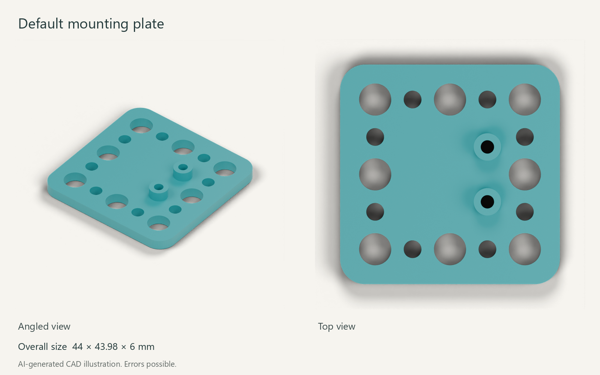

<!-- oomp-documentation:start -->
# OOMP electronic breakouts

## Summary

Breakout boards, pin layouts and mounting geometry.

Representative example: Electronic Breakout Input Remote Control Servo Tester 18 Mm Width 14 Mm Height Purple Pcb Aliexpress. Other variants differ.

## Details

[OOMP version 5 directory](https://github.com/oomlout/oomlout_oomp_version_5) · [Generator and maintenance guide](README_GENERATOR.md)

## Parts

Browse **105 records** in the [part folders](parts/).

## Assembly

Choose an exact record before using its files. Installation and compatibility depend on the selected component; refer to its technical notes.
<!-- oomp-documentation:end -->
