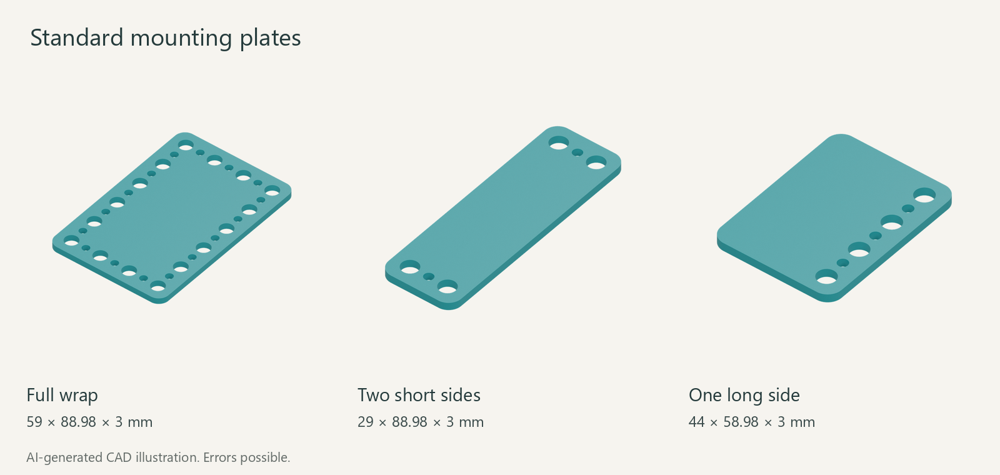

<!-- oobb-presentation:start -->
# Electronic breakout mounting plates

AI-generated images and instructions. Errors possible.

69 catalogue entries. Open a part for plate renders, STL downloads and linked parts.

[Worked example: Raspberry Pi Pico](parts/electronic_breakout_microcontroller_rp2040_pico_without_headers_21_mm_width_51_mm_height_40_pin_raspberry_pi_pico) · [Rebuild instructions](presentation/README.md)

## Input

| Board | PCB size (mm) | Variant | MD5 alpha |
| --- | --- | --- | --- |
| [Aliexpress remote control servo tester](parts/electronic_breakout_input_remote_control_servo_tester_18_mm_width_14_mm_height_purple_pcb_aliexpress) | 18 × 14 | — | [7cda2](parts/electronic_breakout_input_remote_control_servo_tester_18_mm_width_14_mm_height_purple_pcb_aliexpress/working.yaml) |

## Microcontroller

| Board | PCB size (mm) | Variant | MD5 alpha |
| --- | --- | --- | --- |
| [Adafruit ESP32 c3 fn4 QT Py ESP32 c3](parts/electronic_breakout_microcontroller_esp32_c3_fn4_qt_py_esp32_c3_17_8_mm_width_22_mm_height_14_pins_adafruit_5405) | 17.8 × 22 | — | [3p9b7](parts/electronic_breakout_microcontroller_esp32_c3_fn4_qt_py_esp32_c3_17_8_mm_width_22_mm_height_14_pins_adafruit_5405/working.yaml) |
| [Generic ESP32 c3 fn4 supermini 16 pin](parts/electronic_breakout_microcontroller_esp32_c3_fn4_supermini_16_pin_18_mm_width_22_5_mm_height_16_pins_generic_esp32_c3_supermini) | 18 × 22.5 | — | [5c7vp](parts/electronic_breakout_microcontroller_esp32_c3_fn4_supermini_16_pin_18_mm_width_22_5_mm_height_16_pins_generic_esp32_c3_supermini/working.yaml) |
| [M5Stack ESP32 c3 m5stamp c3u](parts/electronic_breakout_microcontroller_esp32_c3_m5stamp_c3u_20_mm_width_34_mm_height_m5stack_stamp_c3u) | 20 × 34 | — | [1yqii](parts/electronic_breakout_microcontroller_esp32_c3_m5stamp_c3u_20_mm_width_34_mm_height_m5stack_stamp_c3u/working.yaml) |
| [Espressif ESP32 c3 mini 1 devkitm 1 20 pin](parts/electronic_breakout_microcontroller_esp32_c3_mini_1_devkitm_1_20_pin_30_mm_width_50_9_mm_height_20_pins_espressif_esp32_c3_devkitm_1) | 30 × 50.9 | — | [1o184](parts/electronic_breakout_microcontroller_esp32_c3_mini_1_devkitm_1_20_pin_30_mm_width_50_9_mm_height_20_pins_espressif_esp32_c3_devkitm_1/working.yaml) |
| [Espressif ESP32 c3 wroom 02 devkitc 02 30 pin](parts/electronic_breakout_microcontroller_esp32_c3_wroom_02_devkitc_02_30_pin_38_9_mm_width_25_4_mm_height_30_pins_espressif_esp32_c3_devkitc_02) | 38.9 × 25.4 | — | [5amdk](parts/electronic_breakout_microcontroller_esp32_c3_wroom_02_devkitc_02_30_pin_38_9_mm_width_25_4_mm_height_30_pins_espressif_esp32_c3_devkitc_02/working.yaml) |
| [Seeed Studio ESP32 c3 XIAO ESP32c3](parts/electronic_breakout_microcontroller_esp32_c3_xiao_esp32c3_17_8_mm_width_21_mm_height_14_pins_seeed_studio_xiao_esp32c3) | 17.8 × 21 | — | [1ek9o](parts/electronic_breakout_microcontroller_esp32_c3_xiao_esp32c3_17_8_mm_width_21_mm_height_14_pins_seeed_studio_xiao_esp32c3/working.yaml) |
| [Wemos ESP32 c3fh4 lolin c3 mini](parts/electronic_breakout_microcontroller_esp32_c3fh4_lolin_c3_mini_25_4_mm_width_34_3_mm_height_wemos_lolin_c3_mini) | 25.4 × 34.3 | — | [4rcae](parts/electronic_breakout_microcontroller_esp32_c3fh4_lolin_c3_mini_25_4_mm_width_34_3_mm_height_wemos_lolin_c3_mini/working.yaml) |
| [Espressif ESP32 c6 mini 1 n4 devkitm 1 30 pin](parts/electronic_breakout_microcontroller_esp32_c6_mini_1_n4_devkitm_1_30_pin_25_4_mm_width_53_65_mm_height_30_pins_espressif_esp32_c6_devkitm_1_n4) | 25.4 × 53.65 | — | [72slk](parts/electronic_breakout_microcontroller_esp32_c6_mini_1_n4_devkitm_1_30_pin_25_4_mm_width_53_65_mm_height_30_pins_espressif_esp32_c6_devkitm_1_n4/working.yaml) |
| [Tenstar ESP32 c6 supermini 20 pin](parts/electronic_breakout_microcontroller_esp32_c6_supermini_20_pin_18_mm_width_23_5_mm_height_20_pins_tenstar_esp32_c6_supermini) | 18 × 23.5 | — | [9t9q6](parts/electronic_breakout_microcontroller_esp32_c6_supermini_20_pin_18_mm_width_23_5_mm_height_20_pins_tenstar_esp32_c6_supermini/working.yaml) |
| [Espressif ESP32 c6 wroom 1 n8 devkitc 1 30 pin](parts/electronic_breakout_microcontroller_esp32_c6_wroom_1_n8_devkitc_1_30_pin_25_4_mm_width_58_15_mm_height_30_pins_espressif_esp32_c6_devkitc_1_n8) | 25.4 × 58.15 | — | [2rpcc](parts/electronic_breakout_microcontroller_esp32_c6_wroom_1_n8_devkitc_1_30_pin_25_4_mm_width_58_15_mm_height_30_pins_espressif_esp32_c6_devkitc_1_n8/working.yaml) |
| [Seeed Studio ESP32 c6 XIAO ESP32c6](parts/electronic_breakout_microcontroller_esp32_c6_xiao_esp32c6_17_8_mm_width_21_mm_height_14_pins_seeed_studio_xiao_esp32c6) | 17.8 × 21 | — | [10lv0](parts/electronic_breakout_microcontroller_esp32_c6_xiao_esp32c6_17_8_mm_width_21_mm_height_14_pins_seeed_studio_xiao_esp32c6/working.yaml) |
| [Tenstar ESP32 h2 supermini 18 pin](parts/electronic_breakout_microcontroller_esp32_h2_supermini_18_pin_18_mm_width_23_5_mm_height_18_pins_tenstar_esp32_h2_supermini) | 18 × 23.5 | — | [6zl4y](parts/electronic_breakout_microcontroller_esp32_h2_supermini_18_pin_18_mm_width_23_5_mm_height_18_pins_tenstar_esp32_h2_supermini/working.yaml) |
| [Espressif ESP32 Pico d4 Pico kit 20 pin](parts/electronic_breakout_microcontroller_esp32_pico_d4_pico_kit_20_pin_20_3_mm_width_52_mm_height_20_pins_espressif_esp32_pico_kit_v4) | 20.3 × 52 | — | [6lx1k](parts/electronic_breakout_microcontroller_esp32_pico_d4_pico_kit_20_pin_20_3_mm_width_52_mm_height_20_pins_espressif_esp32_pico_kit_v4/working.yaml) |
| [Wemos ESP32 s2 lolin s2 mini](parts/electronic_breakout_microcontroller_esp32_s2_lolin_s2_mini_25_4_mm_width_34_3_mm_height_32_pins_wemos_lolin_s2_mini) | 25.4 × 34.3 | — | [55x8z](parts/electronic_breakout_microcontroller_esp32_s2_lolin_s2_mini_25_4_mm_width_34_3_mm_height_32_pins_wemos_lolin_s2_mini/working.yaml) |
| [Espressif ESP32 s2 wroom devkitc 1 44 pin](parts/electronic_breakout_microcontroller_esp32_s2_wroom_devkitc_1_44_pin_25_4_mm_width_62_74_mm_height_44_pins_espressif_esp32_s2_devkitc_1) | 25.4 × 62.74 | — | [nbfc](parts/electronic_breakout_microcontroller_esp32_s2_wroom_devkitc_1_44_pin_25_4_mm_width_62_74_mm_height_44_pins_espressif_esp32_s2_devkitc_1/working.yaml) |
| [Adafruit ESP32 s3 Feather ESP32 s3](parts/electronic_breakout_microcontroller_esp32_s3_feather_esp32_s3_22_7_mm_width_52_3_mm_height_28_pins_adafruit_5477) | 22.7 × 52.3 | — | [48ple](parts/electronic_breakout_microcontroller_esp32_s3_feather_esp32_s3_22_7_mm_width_52_3_mm_height_28_pins_adafruit_5477/working.yaml) |
| [Wemos ESP32 s3 lolin s3 mini](parts/electronic_breakout_microcontroller_esp32_s3_lolin_s3_mini_25_4_mm_width_34_3_mm_height_wemos_lolin_s3_mini) | 25.4 × 34.3 | — | [6hfn4](parts/electronic_breakout_microcontroller_esp32_s3_lolin_s3_mini_25_4_mm_width_34_3_mm_height_wemos_lolin_s3_mini/working.yaml) |
| [Adafruit ESP32 s3 QT Py ESP32 s3](parts/electronic_breakout_microcontroller_esp32_s3_qt_py_esp32_s3_17_8_mm_width_21_7_mm_height_14_pins_adafruit_qt_py_esp32_s3) | 17.8 × 21.7 | — | [7f5xa](parts/electronic_breakout_microcontroller_esp32_s3_qt_py_esp32_s3_17_8_mm_width_21_7_mm_height_14_pins_adafruit_qt_py_esp32_s3/working.yaml) |
| [Tenstar ESP32 s3 supermini 18 pin](parts/electronic_breakout_microcontroller_esp32_s3_supermini_18_pin_18_mm_width_23_5_mm_height_18_pins_tenstar_esp32_s3_supermini) | 18 × 23.5 | — | [4ov2z](parts/electronic_breakout_microcontroller_esp32_s3_supermini_18_pin_18_mm_width_23_5_mm_height_18_pins_tenstar_esp32_s3_supermini/working.yaml) |
| [Espressif ESP32 s3 wroom 1 n8r8 devkitc 1 44 pin](parts/electronic_breakout_microcontroller_esp32_s3_wroom_1_n8r8_devkitc_1_44_pin_25_4_mm_width_62_74_mm_height_44_pins_espressif_esp32_s3_devkitc_1_n8r8) | 25.4 × 62.74 | — | [51krw](parts/electronic_breakout_microcontroller_esp32_s3_wroom_1_n8r8_devkitc_1_44_pin_25_4_mm_width_62_74_mm_height_44_pins_espressif_esp32_s3_devkitc_1_n8r8/working.yaml) |
| [Seeed Studio ESP32 s3 XIAO ESP32s3](parts/electronic_breakout_microcontroller_esp32_s3_xiao_esp32s3_17_8_mm_width_21_mm_height_14_pins_seeed_studio_xiao_esp32s3) | 17.8 × 21 | — | [8s4tz](parts/electronic_breakout_microcontroller_esp32_s3_xiao_esp32s3_17_8_mm_width_21_mm_height_14_pins_seeed_studio_xiao_esp32s3/working.yaml) |
| [Ai Thinker ESP32 s ESP32 cam 16 pin](parts/electronic_breakout_microcontroller_esp32_s_esp32_cam_16_pin_27_mm_width_40_5_mm_height_16_pins_ai_thinker_esp32_cam) | 27 × 40.5 | — | [jeid](parts/electronic_breakout_microcontroller_esp32_s_esp32_cam_16_pin_27_mm_width_40_5_mm_height_16_pins_ai_thinker_esp32_cam/working.yaml) |
| [Generic ESP32 wroom 32 d1 r32](parts/electronic_breakout_microcontroller_esp32_wroom_32_d1_r32_53_34_mm_width_68_58_mm_height_generic_esp32_d1_r32) | 53.34 × 68.58 | — | [4iz4o](parts/electronic_breakout_microcontroller_esp32_wroom_32_d1_r32_53_34_mm_width_68_58_mm_height_generic_esp32_d1_r32/working.yaml) |
| [Doit ESP32 wroom 32 devkit v1 30 pin](parts/electronic_breakout_microcontroller_esp32_wroom_32_devkit_v1_30_pin_28_33_mm_width_51_45_mm_height_30_pins_doit_esp32_devkit_v1_30_pin) | 28.33 × 51.45 | — | [5rs3y](parts/electronic_breakout_microcontroller_esp32_wroom_32_devkit_v1_30_pin_28_33_mm_width_51_45_mm_height_30_pins_doit_esp32_devkit_v1_30_pin/working.yaml) |
| [Adafruit ESP32 wroom 32 huzzah32 Feather](parts/electronic_breakout_microcontroller_esp32_wroom_32_huzzah32_feather_22_7_mm_width_51_mm_height_28_pins_adafruit_3405) | 22.7 × 51 | — | [jiq8](parts/electronic_breakout_microcontroller_esp32_wroom_32_huzzah32_feather_22_7_mm_width_51_mm_height_28_pins_adafruit_3405/working.yaml) |
| [Wemos ESP32 wroom 32 lolin d32](parts/electronic_breakout_microcontroller_esp32_wroom_32_lolin_d32_25_4_mm_width_57_mm_height_20_pins_wemos_lolin_d32) | 25.4 × 57 | — | [4ih87](parts/electronic_breakout_microcontroller_esp32_wroom_32_lolin_d32_25_4_mm_width_57_mm_height_20_pins_wemos_lolin_d32/working.yaml) |
| [Generic ESP32 wroom 32 nodemcu 32s 38 pin](parts/electronic_breakout_microcontroller_esp32_wroom_32_nodemcu_32s_38_pin_26_mm_width_54_mm_height_38_pins_generic_nodemcu_32s) | 26 × 54 | — | [765t2](parts/electronic_breakout_microcontroller_esp32_wroom_32_nodemcu_32s_38_pin_26_mm_width_54_mm_height_38_pins_generic_nodemcu_32s/working.yaml) |
| [Espressif ESP32 wroom 32e devkitc v4 38 pin](parts/electronic_breakout_microcontroller_esp32_wroom_32e_devkitc_v4_38_pin_27_9_mm_width_54_4_mm_height_38_pins_espressif_esp32_devkitc_32e) | 27.9 × 54.4 | — | [8c8aj](parts/electronic_breakout_microcontroller_esp32_wroom_32e_devkitc_v4_38_pin_27_9_mm_width_54_4_mm_height_38_pins_espressif_esp32_devkitc_32e/working.yaml) |
| [Wemos ESP32 wrover lolin d32 pro](parts/electronic_breakout_microcontroller_esp32_wrover_lolin_d32_pro_25_4_mm_width_65_mm_height_32_pins_wemos_lolin_d32_pro) | 25.4 × 65 | — | [67pad](parts/electronic_breakout_microcontroller_esp32_wrover_lolin_d32_pro_25_4_mm_width_65_mm_height_32_pins_wemos_lolin_d32_pro/working.yaml) |
| [Adafruit RP2040 Feather](parts/electronic_breakout_microcontroller_rp2040_feather_22_86_mm_width_50_8_mm_height_28_pin_adafruit_4884) | 22.86 × 50.8 | — | [4nvq0](parts/electronic_breakout_microcontroller_rp2040_feather_22_86_mm_width_50_8_mm_height_28_pin_adafruit_4884/working.yaml) |
| [Adafruit RP2040 Feather](parts/electronic_breakout_microcontroller_rp2040_feather_without_headers_22_86_mm_width_50_8_mm_height_28_pin_adafruit_4884) | 22.86 × 50.8 | without headers | [79khh](parts/electronic_breakout_microcontroller_rp2040_feather_without_headers_22_86_mm_width_50_8_mm_height_28_pin_adafruit_4884/working.yaml) |
| [Raspberry Pi Pico](parts/electronic_breakout_microcontroller_rp2040_pico_21_mm_width_51_mm_height_40_pin_raspberry_pi_pico) | 21 × 51 | — | [3m55m](parts/electronic_breakout_microcontroller_rp2040_pico_21_mm_width_51_mm_height_40_pin_raspberry_pi_pico/working.yaml) |
| [Raspberry Pi Pico h](parts/electronic_breakout_microcontroller_rp2040_pico_21_mm_width_51_mm_height_40_pin_raspberry_pi_pico_h) | 21 × 51 | — | [lu52](parts/electronic_breakout_microcontroller_rp2040_pico_21_mm_width_51_mm_height_40_pin_raspberry_pi_pico_h/working.yaml) |
| [Raspberry Pi Pico w](parts/electronic_breakout_microcontroller_rp2040_pico_wifi_bluetooth_21_mm_width_51_mm_height_40_pin_raspberry_pi_pico_w) | 21 × 51 | wifi bluetooth | [66qhy](parts/electronic_breakout_microcontroller_rp2040_pico_wifi_bluetooth_21_mm_width_51_mm_height_40_pin_raspberry_pi_pico_w/working.yaml) |
| [Raspberry Pi Pico wh](parts/electronic_breakout_microcontroller_rp2040_pico_wifi_bluetooth_21_mm_width_51_mm_height_40_pin_raspberry_pi_pico_wh) | 21 × 51 | wifi bluetooth | [tjid](parts/electronic_breakout_microcontroller_rp2040_pico_wifi_bluetooth_21_mm_width_51_mm_height_40_pin_raspberry_pi_pico_wh/working.yaml) |
| [Raspberry Pi Pico wh](parts/electronic_breakout_microcontroller_rp2040_pico_wifi_bluetooth_with_headers_21_mm_width_51_mm_height_40_pin_raspberry_pi_pico_wh) | 21 × 51 | wifi bluetooth with headers | [4e3wb](parts/electronic_breakout_microcontroller_rp2040_pico_wifi_bluetooth_with_headers_21_mm_width_51_mm_height_40_pin_raspberry_pi_pico_wh/working.yaml) |
| [Raspberry Pi Pico w](parts/electronic_breakout_microcontroller_rp2040_pico_wifi_bluetooth_without_headers_21_mm_width_51_mm_height_40_pin_raspberry_pi_pico_w) | 21 × 51 | wifi bluetooth without headers | [7j2](parts/electronic_breakout_microcontroller_rp2040_pico_wifi_bluetooth_without_headers_21_mm_width_51_mm_height_40_pin_raspberry_pi_pico_w/working.yaml) |
| [Raspberry Pi Pico h](parts/electronic_breakout_microcontroller_rp2040_pico_with_headers_21_mm_width_51_mm_height_40_pin_raspberry_pi_pico_h) | 21 × 51 | with headers | [1n6p2](parts/electronic_breakout_microcontroller_rp2040_pico_with_headers_21_mm_width_51_mm_height_40_pin_raspberry_pi_pico_h/working.yaml) |
| [Raspberry Pi Pico](parts/electronic_breakout_microcontroller_rp2040_pico_without_headers_21_mm_width_51_mm_height_40_pin_raspberry_pi_pico) | 21 × 51 | without headers | [1owcj](parts/electronic_breakout_microcontroller_rp2040_pico_without_headers_21_mm_width_51_mm_height_40_pin_raspberry_pi_pico/working.yaml) |
| [Sparkfun Dev RP2040 pro micro](parts/electronic_breakout_microcontroller_rp2040_pro_micro_17_78_mm_width_33_02_mm_height_24_pin_sparkfun_dev_18288) | 17.78 × 33.02 | — | [93k7x](parts/electronic_breakout_microcontroller_rp2040_pro_micro_17_78_mm_width_33_02_mm_height_24_pin_sparkfun_dev_18288/working.yaml) |
| [Sparkfun Dev RP2040 pro micro](parts/electronic_breakout_microcontroller_rp2040_pro_micro_without_headers_17_78_mm_width_33_02_mm_height_24_pin_sparkfun_dev_18288) | 17.78 × 33.02 | without headers | [1rff7](parts/electronic_breakout_microcontroller_rp2040_pro_micro_without_headers_17_78_mm_width_33_02_mm_height_24_pin_sparkfun_dev_18288/working.yaml) |
| [Adafruit RP2040 QT Py](parts/electronic_breakout_microcontroller_rp2040_qt_py_18_mm_width_21_mm_height_14_pin_adafruit_4900) | 18 × 21 | — | [7odwk](parts/electronic_breakout_microcontroller_rp2040_qt_py_18_mm_width_21_mm_height_14_pin_adafruit_4900/working.yaml) |
| [Adafruit RP2040 QT Py](parts/electronic_breakout_microcontroller_rp2040_qt_py_without_headers_18_mm_width_21_mm_height_14_pin_adafruit_4900) | 18 × 21 | without headers | [7cild](parts/electronic_breakout_microcontroller_rp2040_qt_py_without_headers_18_mm_width_21_mm_height_14_pin_adafruit_4900/working.yaml) |
| [Seeed Studio RP2040 XIAO](parts/electronic_breakout_microcontroller_rp2040_xiao_17_8_mm_width_21_mm_height_14_pin_seeed_studio_102010428) | 17.8 × 21 | — | [704an](parts/electronic_breakout_microcontroller_rp2040_xiao_17_8_mm_width_21_mm_height_14_pin_seeed_studio_102010428/working.yaml) |
| [Seeed Studio RP2040 XIAO](parts/electronic_breakout_microcontroller_rp2040_xiao_without_headers_17_8_mm_width_21_mm_height_14_pin_seeed_studio_102010428) | 17.8 × 21 | without headers | [902ry](parts/electronic_breakout_microcontroller_rp2040_xiao_without_headers_17_8_mm_width_21_mm_height_14_pin_seeed_studio_102010428/working.yaml) |
| [Waveshare RP2040 zero](parts/electronic_breakout_microcontroller_rp2040_zero_18_mm_width_23_5_mm_height_20_pin_waveshare_rp2040_zero) | 18 × 23.5 | — | [7m9fv](parts/electronic_breakout_microcontroller_rp2040_zero_18_mm_width_23_5_mm_height_20_pin_waveshare_rp2040_zero/working.yaml) |
| [Waveshare RP2040 zero](parts/electronic_breakout_microcontroller_rp2040_zero_18_mm_width_23_5_mm_height_20_pin_waveshare_rp2040_zero_m) | 18 × 23.5 | — | [f8z1](parts/electronic_breakout_microcontroller_rp2040_zero_18_mm_width_23_5_mm_height_20_pin_waveshare_rp2040_zero_m/working.yaml) |
| [Waveshare RP2040 zero](parts/electronic_breakout_microcontroller_rp2040_zero_with_headers_18_mm_width_23_5_mm_height_20_pin_waveshare_rp2040_zero_m) | 18 × 23.5 | with headers | [2muru](parts/electronic_breakout_microcontroller_rp2040_zero_with_headers_18_mm_width_23_5_mm_height_20_pin_waveshare_rp2040_zero_m/working.yaml) |
| [Waveshare RP2040 zero](parts/electronic_breakout_microcontroller_rp2040_zero_without_headers_18_mm_width_23_5_mm_height_20_pin_waveshare_rp2040_zero) | 18 × 23.5 | without headers | [29aqh](parts/electronic_breakout_microcontroller_rp2040_zero_without_headers_18_mm_width_23_5_mm_height_20_pin_waveshare_rp2040_zero/working.yaml) |
| [Hstx Adafruit RP2350A Feather](parts/electronic_breakout_microcontroller_rp2350a_feather_22_86_mm_width_50_8_mm_height_28_pin_hstx_adafruit_6000) | 22.86 × 50.8 | — | [36hlh](parts/electronic_breakout_microcontroller_rp2350a_feather_22_86_mm_width_50_8_mm_height_28_pin_hstx_adafruit_6000/working.yaml) |
| [Hstx Adafruit RP2350A Feather](parts/electronic_breakout_microcontroller_rp2350a_feather_without_headers_22_86_mm_width_50_8_mm_height_28_pin_hstx_adafruit_6000) | 22.86 × 50.8 | without headers | [9yh42](parts/electronic_breakout_microcontroller_rp2350a_feather_without_headers_22_86_mm_width_50_8_mm_height_28_pin_hstx_adafruit_6000/working.yaml) |
| [Raspberry Pi Pico 2](parts/electronic_breakout_microcontroller_rp2350a_pico_21_mm_width_51_mm_height_40_pin_raspberry_pi_pico_2) | 21 × 51 | — | [5q8xy](parts/electronic_breakout_microcontroller_rp2350a_pico_21_mm_width_51_mm_height_40_pin_raspberry_pi_pico_2/working.yaml) |
| [Raspberry Pi Pico 2 with headers](parts/electronic_breakout_microcontroller_rp2350a_pico_21_mm_width_51_mm_height_40_pin_raspberry_pi_pico_2_with_headers) | 21 × 51 | — | [8r4es](parts/electronic_breakout_microcontroller_rp2350a_pico_21_mm_width_51_mm_height_40_pin_raspberry_pi_pico_2_with_headers/working.yaml) |
| [Raspberry Pi Pico 2 w](parts/electronic_breakout_microcontroller_rp2350a_pico_wifi_bluetooth_21_mm_width_51_mm_height_40_pin_raspberry_pi_pico_2_w) | 21 × 51 | wifi bluetooth | [37xk2](parts/electronic_breakout_microcontroller_rp2350a_pico_wifi_bluetooth_21_mm_width_51_mm_height_40_pin_raspberry_pi_pico_2_w/working.yaml) |
| [Raspberry Pi Pico 2 w with headers](parts/electronic_breakout_microcontroller_rp2350a_pico_wifi_bluetooth_21_mm_width_51_mm_height_40_pin_raspberry_pi_pico_2_w_with_headers) | 21 × 51 | wifi bluetooth | [jd9i](parts/electronic_breakout_microcontroller_rp2350a_pico_wifi_bluetooth_21_mm_width_51_mm_height_40_pin_raspberry_pi_pico_2_w_with_headers/working.yaml) |
| [Raspberry Pi Pico 2 w with headers](parts/electronic_breakout_microcontroller_rp2350a_pico_wifi_bluetooth_with_headers_21_mm_width_51_mm_height_40_pin_raspberry_pi_pico_2_w_with_headers) | 21 × 51 | wifi bluetooth with headers | [9d5c](parts/electronic_breakout_microcontroller_rp2350a_pico_wifi_bluetooth_with_headers_21_mm_width_51_mm_height_40_pin_raspberry_pi_pico_2_w_with_headers/working.yaml) |
| [Raspberry Pi Pico 2 w](parts/electronic_breakout_microcontroller_rp2350a_pico_wifi_bluetooth_without_headers_21_mm_width_51_mm_height_40_pin_raspberry_pi_pico_2_w) | 21 × 51 | wifi bluetooth without headers | [255xd](parts/electronic_breakout_microcontroller_rp2350a_pico_wifi_bluetooth_without_headers_21_mm_width_51_mm_height_40_pin_raspberry_pi_pico_2_w/working.yaml) |
| [Raspberry Pi Pico 2 with headers](parts/electronic_breakout_microcontroller_rp2350a_pico_with_headers_21_mm_width_51_mm_height_40_pin_raspberry_pi_pico_2_with_headers) | 21 × 51 | with headers | [7tepa](parts/electronic_breakout_microcontroller_rp2350a_pico_with_headers_21_mm_width_51_mm_height_40_pin_raspberry_pi_pico_2_with_headers/working.yaml) |
| [Raspberry Pi Pico 2](parts/electronic_breakout_microcontroller_rp2350a_pico_without_headers_21_mm_width_51_mm_height_40_pin_raspberry_pi_pico_2) | 21 × 51 | without headers | [7fuh9](parts/electronic_breakout_microcontroller_rp2350a_pico_without_headers_21_mm_width_51_mm_height_40_pin_raspberry_pi_pico_2/working.yaml) |
| [Seeed Studio RP2350A XIAO](parts/electronic_breakout_microcontroller_rp2350a_xiao_17_8_mm_width_21_mm_height_14_pin_seeed_studio_102010550) | 17.8 × 21 | — | [7ejs1](parts/electronic_breakout_microcontroller_rp2350a_xiao_17_8_mm_width_21_mm_height_14_pin_seeed_studio_102010550/working.yaml) |
| [Seeed Studio RP2350A XIAO](parts/electronic_breakout_microcontroller_rp2350a_xiao_without_headers_17_8_mm_width_21_mm_height_14_pin_seeed_studio_102010550) | 17.8 × 21 | without headers | [8zzk6](parts/electronic_breakout_microcontroller_rp2350a_xiao_without_headers_17_8_mm_width_21_mm_height_14_pin_seeed_studio_102010550/working.yaml) |
| [Waveshare RP2350A zero](parts/electronic_breakout_microcontroller_rp2350a_zero_18_mm_width_23_5_mm_height_20_pin_waveshare_rp2350_zero) | 18 × 23.5 | — | [9upy5](parts/electronic_breakout_microcontroller_rp2350a_zero_18_mm_width_23_5_mm_height_20_pin_waveshare_rp2350_zero/working.yaml) |
| [Waveshare RP2350A zero](parts/electronic_breakout_microcontroller_rp2350a_zero_with_headers_18_mm_width_23_5_mm_height_20_pin_waveshare_rp2350_zero_m) | 18 × 23.5 | with headers | [5br1p](parts/electronic_breakout_microcontroller_rp2350a_zero_with_headers_18_mm_width_23_5_mm_height_20_pin_waveshare_rp2350_zero_m/working.yaml) |
| [Waveshare RP2350A zero](parts/electronic_breakout_microcontroller_rp2350a_zero_without_headers_18_mm_width_23_5_mm_height_20_pin_waveshare_rp2350_zero) | 18 × 23.5 | without headers | [3pe9b](parts/electronic_breakout_microcontroller_rp2350a_zero_without_headers_18_mm_width_23_5_mm_height_20_pin_waveshare_rp2350_zero/working.yaml) |

## Output

| Board | PCB size (mm) | Variant | MD5 alpha |
| --- | --- | --- | --- |
| [Aliexpress relay](parts/electronic_breakout_output_relay_49_mm_width_38_mm_height_black_pcb_aliexpress) | 49 × 38 | — | [7zii9](parts/electronic_breakout_output_relay_49_mm_width_38_mm_height_black_pcb_aliexpress/working.yaml) |

## Power

| Board | PCB size (mm) | Variant | MD5 alpha |
| --- | --- | --- | --- |
| [Aliexpress dc to dc step down](parts/electronic_breakout_power_dc_to_dc_step_down_lm2596_48_mm_width_25_mm_height_blue_pcb_aliexpress) | 48 × 25 | lm2596 | [1c046](parts/electronic_breakout_power_dc_to_dc_step_down_lm2596_48_mm_width_25_mm_height_blue_pcb_aliexpress/working.yaml) |

## Sensor

| Board | PCB size (mm) | Variant | MD5 alpha |
| --- | --- | --- | --- |
| [SparkFun Qwiic BME280](parts/electronic_breakout_sensor_environmental_temperature_humidity_pressure_bme280_qwiic_sparkfun_sen_15440) | 25.4 × 25.4 | bme280 | [1l2i6](parts/electronic_breakout_sensor_environmental_temperature_humidity_pressure_bme280_qwiic_sparkfun_sen_15440/working.yaml) |
| [Adafruit ADXL345 STEMMA QT](parts/electronic_breakout_sensor_motion_accelerometer_adxl345_stemma_qt_adafruit_1231) | 25.4 × 17.78 | adxl345 | [1ut2v](parts/electronic_breakout_sensor_motion_accelerometer_adxl345_stemma_qt_adafruit_1231/working.yaml) |
<!-- oobb-presentation:end -->

## Mounting geometry research

[Luna board-by-board agent, standard holder API, and new-window launch prompt](MOUNTING_RESEARCH.md).
Research is archived per board, validated against the sources, and promoted into
the populate code before generating a holder.

<!-- mounting-pilots:start -->
## Mounting pilot review

[Review the ADXL345 and BME280 holders](research/mounting/REVIEW.md): renders, mounting patterns, printable STLs and source evidence.
<!-- mounting-pilots:end -->
