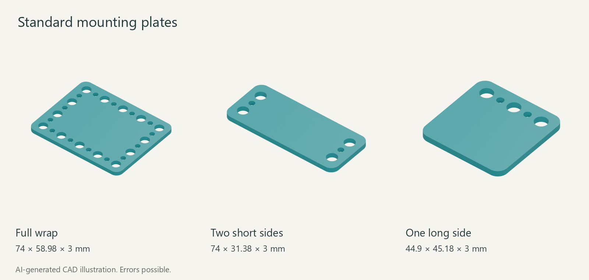
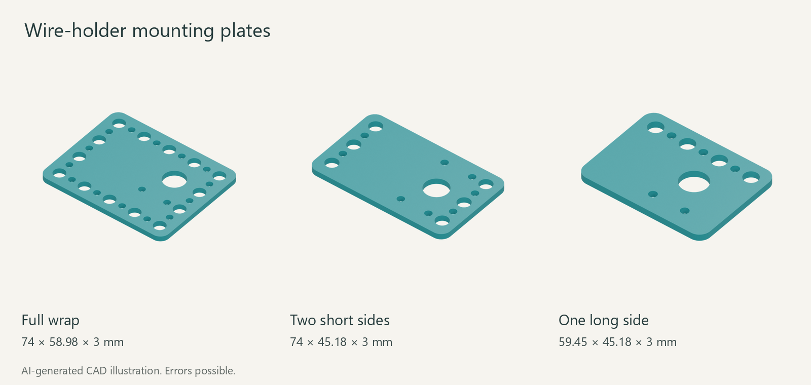

<!-- oomp-documentation:start -->
# Electronic Breakout Microcontroller Esp32 C3 Wroom 02 Devkitc 02 30 Pin 38 9 Mm Width 25 4 Mm Height 30 Pins Espressif Esp32 C3 Devkitc 02

## Summary

OOMP catalogue record for Electronic Breakout Microcontroller Esp32 C3 Wroom 02 Devkitc 02 30 Pin 38 9 Mm Width 25 4 Mm Height 30 Pins Espressif Esp32 C3 Devkitc 02. Use the metadata to identify this variant and the part folder to inspect its available assets.

## Details

**OOMP folder ID:** `electronic_breakout_microcontroller_esp32_c3_wroom_02_devkitc_02_30_pin_38_9_mm_width_25_4_mm_height_30_pins_espressif_esp32_c3_devkitc_02`

[Catalogue](../../README.md) · [Part metadata](working.yaml)

| Field | Value |
| --- | --- |
| id | electronic_breakout_microcontroller_esp32_c3_wroom_02_devkitc_02_30_pin_38_9_mm_width_25_4_mm_height_30_pins_espressif_esp32_c3_devkitc_02 |
| md5_6 | 87b4c8 |
| md5_6_alpha | 5amdk |
| oomp_key | oomp_electronic_breakout_microcontroller_esp32_c3_wroom_02_devkitc_02_30_pin_38_9_mm_width_25_4_mm_height_30_pins_espressif_esp32_c3_devkitc_02 |
| taxonomy_1 | electronic |
| taxonomy_2 | breakout |
| taxonomy_3 | microcontroller |
| taxonomy_4 | esp32_c3_wroom_02 |
| taxonomy_5 | devkitc_02_30_pin |
| taxonomy_6 | 38_9_mm_width_25_4_mm_height_30_pins |
| taxonomy_14 | espressif |
| taxonomy_15 | esp32_c3_devkitc_02 |

<details>
<summary>Full part metadata</summary>

```yaml
assembly:
  header_pitch_mm: 2.54
  headers: with_headers
bip_39_2_word_array:
- marble
- play
bip_39_2_word_no_space: marbleplay
bip_39_2_word_space: marble play
bip_39_2_word_underscore: marble_play
bip_39_3_word_array:
- marble
- play
- admit
bip_39_3_word_no_space: marbleplayadmit
bip_39_3_word_space: marble play admit
bip_39_3_word_underscore: marble_play_admit
bip_39_full_array:
- marble
- play
- admit
- proof
- balance
- unfair
- town
- now
- trumpet
- list
- impose
- excuse
bip_39_full_no_space: marbleplayadmitproofbalanceunfairtownnowtrumpetlistimposeexcuse
bip_39_full_space: marble play admit proof balance unfair town now trumpet list impose
  excuse
bip_39_full_underscore: marble_play_admit_proof_balance_unfair_town_now_trumpet_list_impose_excuse
breakout_description: 38_9_mm_width_25_4_mm_height_30_pins
breakout_pcb_height: 38.91
breakout_pcb_width: 25.4
chip:
  family: esp32_c3
  identity_scope: catalogue_chip_or_module_label
  oomp_id: null
  part_number: esp32_c3_wroom_02
  silicon_revision: null
chip_resources:
  clock_max_mhz: 160
  cpu_core_count: 1
  general_purpose_spi_controllers: 1
  hardware_i2c_controllers: 1
  hardware_uart_controllers: 2
  pio_state_machines: 0
  pwm_channels: 6
  scope: silicon resources; board routing and firmware may reduce availability
  source_id: chip_datasheet
connectors:
  J1:
    contact_count: 15
    pitch_mm: 2.54
    row_spacing_mm: 22.86
    source_id: board_guide
  J3:
    contact_count: 15
    pitch_mm: 2.54
    row_spacing_mm: 22.86
    source_id: board_guide
coordinate_system:
  origin: centre_of_pcb_outline
  units: mm
  view: top_with_usb_at_positive_y
  x_positive: right
  y_positive: towards_usb
data_gaps:
- Assembled component keepouts and USB insertion/cable envelopes have not been captured.
- C3 header absolute Y offset not dimensioned in the captured drawing; pad centres
  remain null.
- Chip package/module pad numbers are not fully transcribed; null chip_pin_number
  values must not be replaced with carrier-header numbers.
default_interfaces:
  i2c:
    api: Wire
    basis: framework_defaults
    framework: arduino-esp32
    notes:
    - Defaults apply when selecting this generic Arduino target; they do not establish
      a carrier-specific hardware convention.
    peripheral: null
    pin_keys:
      scl:
      - J1_12
      sda:
      - J1_11
    protocol: i2c
    scl_gpio: 9
    sda_gpio: 8
    signal_status:
      scl: mapped
      sda: mapped
    source_ids:
    - interface_variant
    - interface_board_selection
    - interface_runtime_i2c
    status: documented
    variant: esp32c3
    variant_scope: generic_target_selection
  spi:
    api: SPI
    basis: framework_defaults
    framework: arduino-esp32
    miso_gpio: 5
    mosi_gpio: 6
    notes:
    - Defaults apply when selecting this generic Arduino target; they do not establish
      a carrier-specific hardware convention.
    - ss is the framework chip-select alias/default, not an automatically asserted
      CS. Select and drive CS as required by the peripheral and library.
    peripheral: null
    pin_keys:
      miso:
      - J1_7
      mosi:
      - J1_8
      sck:
      - J1_6
      ss:
      - J1_9
    protocol: spi
    sck_gpio: 4
    signal_status:
      miso: mapped
      mosi: mapped
      sck: mapped
      ss: mapped
    source_ids:
    - interface_variant
    - interface_board_selection
    - interface_runtime_spi
    ss_gpio: 7
    status: documented
    variant: esp32c3
    variant_scope: generic_target_selection
  uart:
    api: null
    basis: framework_pin_aliases
    framework: arduino-esp32
    notes:
    - Defaults apply when selecting this generic Arduino target; they do not establish
      a carrier-specific hardware convention.
    - UART GPIOs are distinct from USB CDC/USB Serial. The meaning of Serial depends
      on the core and USB build settings.
    - TX/RX are board variant aliases. Pass the GPIOs explicitly to the selected HardwareSerial
      instance; no-argument pin selection can use SoC UART defaults instead.
    peripheral: null
    pin_keys:
      rx:
      - J3_9
      tx:
      - J3_10
    protocol: uart
    rx_gpio: 20
    signal_status:
      rx: mapped
      tx: mapped
    source_ids:
    - interface_variant
    - interface_board_selection
    - interface_runtime_uart
    status: documented
    tx_gpio: 21
    variant: esp32c3
    variant_scope: generic_target_selection
dimensions_mm:
  assembled_height: null
  height: 38.91
  module_antenna_overhang_positive_y: null
  pcb_thickness: null
  scope: carrier_pcb_excludes_module_antenna_and_usb_overhang
  source_id: mechanical
  status: manufacturer_drawing
  width: 25.4
directory: parts/electronic_breakout_microcontroller_esp32_c3_wroom_02_devkitc_02_30_pin_38_9_mm_width_25_4_mm_height_30_pins_espressif_esp32_c3_devkitc_02
electrical:
  gpio_5v_tolerant: false
  logic_voltage_v: 3.3
  source_id: chip_datasheet
  usb_connector: micro_usb_b
form_factor: devkitc_02_30_pin
gpio_summary:
  analog_candidates:
  - 0
  - 1
  - 2
  - 3
  - 4
  automatic_firmware_enable: false
  exposed:
  - 0
  - 1
  - 2
  - 3
  - 4
  - 5
  - 6
  - 7
  - 8
  - 9
  - 10
  - 18
  - 19
  - 20
  - 21
  general_io_candidates:
  - 0
  - 1
  - 2
  - 3
  - 4
  - 5
  - 6
  - 7
  - 8
  - 9
  - 10
  - 18
  - 19
  - 20
  - 21
id: electronic_breakout_microcontroller_esp32_c3_wroom_02_devkitc_02_30_pin_38_9_mm_width_25_4_mm_height_30_pins_espressif_esp32_c3_devkitc_02
id_no_class: electronic_breakout_microcontroller_esp32_c3_wroom_02_devkitc_02_30_pin_38_9_mm_width_25_4_mm_height_30_pins_espressif_esp32_c3_devkitc_02
id_no_size: electronic_breakout_microcontroller_esp32_c3_wroom_02_devkitc_02_30_pin_38_9_mm_width_25_4_mm_height_30_pins_espressif_esp32_c3_devkitc_02
id_no_type: electronic_breakout_microcontroller_esp32_c3_wroom_02_devkitc_02_30_pin_38_9_mm_width_25_4_mm_height_30_pins_espressif_esp32_c3_devkitc_02
interface_defaults_version: 1
item_kind: breakout
lab_support:
  automatic_firmware_enable: false
  gpio_matrix_routing: true
  requires_reviewed_board_profile: true
  status: catalogue_reference_only
link_github: https://github.com/oomlout/oomlout_oomp_version_1_messy/tree/main/parts/electronic_breakout_microcontroller_esp32_c3_wroom_02_devkitc_02_30_pin_38_9_mm_width_25_4_mm_height_30_pins_espressif_esp32_c3_devkitc_02
link_main: https://github.com/oomlout/oomlout_oomp_version_1_messy/tree/main/parts/electronic_breakout_microcontroller_esp32_c3_wroom_02_devkitc_02_30_pin_38_9_mm_width_25_4_mm_height_30_pins_espressif_esp32_c3_devkitc_02
link_redirect: https://github.com/oomlout/oomlout_oomp_version_1_messy/tree/main/parts/electronic_breakout_microcontroller_esp32_c3_wroom_02_devkitc_02_30_pin_38_9_mm_width_25_4_mm_height_30_pins_espressif_esp32_c3_devkitc_02
manufacturer: espressif
md5: 87b4c80ed6211bda3994b9e9904dc7a7
md5_10: 87b4c80ed6
md5_10_upper: 87B4C80ED6
md5_5: 87b4c
md5_5_upper: 87B4C
md5_6: 87b4c8
md5_6_alpha: 5amdk
md5_6_alpha_upper: 5AMDK
md5_6_upper: 87B4C8
memory:
  external_flash_bytes: 4194304
  psram_bytes: null
mounting_coordinate_system:
  origin: pcb_bounding_box_centre
  units: mm
  view: top
  x_positive: right
  y_positive: up
mounting_geometry_ready: false
mounting_hole_candidates: []
mounting_hole_details: []
mounting_hole_radius_name: m2
mounting_hole_radius_names: []
mounting_hole_status: no_holes
mounting_holes: []
mounting_lift: 3
mounting_research:
  board_revision: Espressif ESP32-C3-DevKitC-02 V1.1 carrier, identified by the official
    PCB layout and matching dimension drawing titled V1.1; official user guide lists
    no previous hardware versions.
  board_size:
  - 25.4
  - 38.91
  coordinate_system:
    origin: pcb_bounding_box_centre
    units: mm
    view: top
    x_positive: right
    y_positive: up
  derivation: 'The complete official dimension sheet labels the PCB bounding box 25.40
    mm wide and 38.91 mm high. The drawing is a top view with the Micro-USB connector
    at the lower end; map x right and y up, translating the lower-left outline bound
    (0,0) to the centred origin (12.70,19.455 mm): x_center = x_drawing - 12.70 mm
    and y_center = y_drawing - 19.455 mm. No rotation, reflection or axis swap is
    applied. Thus the USB connector is at negative Y. This resolves the seeded context
    note that incorrectly states USB at positive Y. The full dimension sheet and all
    six pages of the exact V1.1 PCB layout were reviewed. The thirty plated through-hole
    pads are the two 15-position headers. The large drilled/metallic features by the
    lower USB end are connector retaining anchors and contacts, not board mounting
    holes; remaining small drill/via and module features are likewise not mounting
    holes. The small circle appearing at the upper edge of the dimension sheet is
    not present as a hole in the full board layout view and is a drawing mark. No
    designated board mounting holes are shown in the complete carrier evidence.'
  fit_status: generic_holder_not_physical_fit_tested
  identity_evidence: Espressif’s official ESP32-C3-DevKitC-02 guide identifies the
    product and links its schematic, PCB layout and dimension drawing. The matching
    PCB layout and dimension file names identify V1.1; the six-page PCB layout title
    block identifies ESP32-C3-DevKitC-02 v1.1. The official guide says there are no
    previous versions available.
  mounting_holes: []
  record_sha256: 9c73f2b2f60634c74279fb99c1cfa283b3ddc5786e283fe6e7b2dd933f841d18
  research_file: source_file/electronic_breakout_microcontroller_esp32_c3_wroom_02_devkitc_02_30_pin_38_9_mm_width_25_4_mm_height_30_pins_espressif_esp32_c3_devkitc_02/mounting.yaml
  reviewed_by: gpt-6-luna
  sources:
  - bytes: 35753
    id: product
    kind: manufacturer_product
    local_file: mounting_evidence/esp32-c3-devkitc-02_user_guide.html
    locator: 'Espressif product guide: exact ESP32-C3-DevKitC-02 identity, on-board
      ESP32-C3-WROOM-02 variant and current revision/related-document listing; acquired
      2026-11-06'
    registered_at: '2026-11-06T17:28:54+00:00'
    sha256: e81a43501c4f15d1d42be17caebe297826df88d3a2c379c65154dfc748e27b83
    url: https://docs.espressif.com/projects/esp-dev-kits/en/latest/esp32c3/esp32-c3-devkitc-02/user_guide.html
  - bytes: 1006094
    id: pcb_layout
    kind: manufacturer_cad
    local_file: mounting_evidence/PCB_ESP32-C3-DevKitC-02_V1_1_20210121AA.pdf
    locator: Complete 6-page Espressif PCB layout V1.1; reviewed layers/pages 1-6,
      both board sides, all pad/drill candidates and connectors; no designated board
      mounting holes; acquired 2026-11-06
    registered_at: '2026-11-06T17:28:54+00:00'
    sha256: 680ce4c040a3a0f4fd23089311e0b5711cc46a25ea41ef69951c2de3e17b44e7
    url: https://dl.espressif.com/dl/schematics/PCB_ESP32-C3-DevKitC-02_V1_1_20210121AA.pdf
  - bytes: 194776
    id: mechanical
    kind: manufacturer_drawing
    local_file: reference/DXF_ESP32-C3-DevKitC-02_V1_1_20210121AA.pdf
    locator: 'Espressif dimensioned carrier drawing V1.1: exact outline 25.40 x 38.91
      mm; full sheet reviewed, no mounting-hole pattern or drill callout; existing
      archive SHA-256 verified against mounting_context.json'
    registered_at: '2026-11-06T17:28:55+00:00'
    sha256: 058072d75f90fa8668f7ada4548577078fca81b51850faeb1e6f6859bb9aaa8d
    url: https://dl.espressif.com/dl/schematics/DXF_ESP32-C3-DevKitC-02_V1_1_20210121AA.pdf
  - bytes: 345028
    id: schematic
    kind: manufacturer_schematic
    local_file: reference/SCH_ESP32-C3-DEVKITC-02_V1_1_20210126A.pdf
    locator: Espressif schematic V1.1; exact board identity and reference design;
      existing archive SHA-256 verified against mounting_context.json
    registered_at: '2026-11-06T17:28:55+00:00'
    sha256: e694ac254e6bf7ddd570ac7237ddb5ffa4e874e953619185ee7ba9a0c9f8af6c
    url: https://dl.espressif.com/dl/schematics/SCH_ESP32-C3-DEVKITC-02_V1_1_20210126A.pdf
  status: no_holes
name: Electronic Breakout Microcontroller Esp32 C3 Wroom 02 Devkitc 02 30 Pin 38 9
  Mm Width 25 4 Mm Height 30 Pins Espressif Esp32 C3 Devkitc 02
name_no_class: Electronic Breakout Microcontroller Esp32 C3 Wroom 02 Devkitc 02 30
  Pin 38 9 Mm Width 25 4 Mm Height 30 Pins Espressif Esp32 C3 Devkitc 02
name_no_size: Electronic Breakout Microcontroller Esp32 C3 Wroom 02 Devkitc 02 30
  Pin 38 9 Mm Width 25 4 Mm Height 30 Pins Espressif Esp32 C3 Devkitc 02
name_no_type: Electronic Breakout Microcontroller Esp32 C3 Wroom 02 Devkitc 02 30
  Pin 38 9 Mm Width 25 4 Mm Height 30 Pins Espressif Esp32 C3 Devkitc 02
name_proper: Electronic Breakout Microcontroller Esp32 C3 Wroom 02 Devkitc 02 30 Pin
  38 9 Mm Width 25 4 Mm Height 30 Pins Espressif Esp32 C3 Devkitc 02
name_readable: Espressif ESP32-C3 DevKitC-02
name_space: electronic breakout microcontroller esp32 c3 wroom 02 devkitc 02 30 pin
  38 9 mm width 25 4 mm height 30 pins espressif esp32 c3 devkitc 02
name_upper: ELECTRONIC BREAKOUT MICROCONTROLLER ESP32 C3 WROOM 02 DEVKITC 02 30 PIN
  38 9 MM WIDTH 25 4 MM HEIGHT 30 PINS ESPRESSIF ESP32 C3 DEVKITC 02
notes:
- Physical header contacts include supply, ground and reserved contacts; contact count
  is not GPIO count.
onboard_gpio_connections:
- function: addressable_rgb_led
  gpio: 8
  source_id: board_guide
oobb_details: []
oomlout_ai_roboclick_1:
  actions:
  - command: text_jinja_template
    convert_to_pdf: false
    convert_to_png: false
    dict_data:
      assembly:
        header_pitch_mm: 2.54
        headers: with_headers
      breakout_description: 38_9_mm_width_25_4_mm_height_30_pins
      breakout_pcb_height: 38.91
      breakout_pcb_width: 25.4
      chip:
        family: esp32_c3
        identity_scope: catalogue_chip_or_module_label
        oomp_id: null
        part_number: esp32_c3_wroom_02
        silicon_revision: null
      chip_resources:
        clock_max_mhz: 160
        cpu_core_count: 1
        general_purpose_spi_controllers: 1
        hardware_i2c_controllers: 1
        hardware_uart_controllers: 2
        pio_state_machines: 0
        pwm_channels: 6
        scope: silicon resources; board routing and firmware may reduce availability
        source_id: chip_datasheet
      connectors:
        J1:
          contact_count: 15
          pitch_mm: 2.54
          row_spacing_mm: 22.86
          source_id: board_guide
        J3:
          contact_count: 15
          pitch_mm: 2.54
          row_spacing_mm: 22.86
          source_id: board_guide
      coordinate_system:
        origin: centre_of_pcb_outline
        units: mm
        view: top_with_usb_at_positive_y
        x_positive: right
        y_positive: towards_usb
      data_gaps:
      - Assembled component keepouts and USB insertion/cable envelopes have not been
        captured.
      - C3 header absolute Y offset not dimensioned in the captured drawing; pad centres
        remain null.
      - Chip package/module pad numbers are not fully transcribed; null chip_pin_number
        values must not be replaced with carrier-header numbers.
      default_interfaces:
        i2c:
          api: Wire
          basis: framework_defaults
          framework: arduino-esp32
          notes:
          - Defaults apply when selecting this generic Arduino target; they do not
            establish a carrier-specific hardware convention.
          peripheral: null
          pin_keys:
            scl:
            - J1_12
            sda:
            - J1_11
          protocol: i2c
          scl_gpio: 9
          sda_gpio: 8
          signal_status:
            scl: mapped
            sda: mapped
          source_ids:
          - interface_variant
          - interface_board_selection
          - interface_runtime_i2c
          status: documented
          variant: esp32c3
          variant_scope: generic_target_selection
        spi:
          api: SPI
          basis: framework_defaults
          framework: arduino-esp32
          miso_gpio: 5
          mosi_gpio: 6
          notes:
          - Defaults apply when selecting this generic Arduino target; they do not
            establish a carrier-specific hardware convention.
          - ss is the framework chip-select alias/default, not an automatically asserted
            CS. Select and drive CS as required by the peripheral and library.
          peripheral: null
          pin_keys:
            miso:
            - J1_7
            mosi:
            - J1_8
            sck:
            - J1_6
            ss:
            - J1_9
          protocol: spi
          sck_gpio: 4
          signal_status:
            miso: mapped
            mosi: mapped
            sck: mapped
            ss: mapped
          source_ids:
          - interface_variant
          - interface_board_selection
          - interface_runtime_spi
          ss_gpio: 7
          status: documented
          variant: esp32c3
          variant_scope: generic_target_selection
        uart:
          api: null
          basis: framework_pin_aliases
          framework: arduino-esp32
          notes:
          - Defaults apply when selecting this generic Arduino target; they do not
            establish a carrier-specific hardware convention.
          - UART GPIOs are distinct from USB CDC/USB Serial. The meaning of Serial
            depends on the core and USB build settings.
          - TX/RX are board variant aliases. Pass the GPIOs explicitly to the selected
            HardwareSerial instance; no-argument pin selection can use SoC UART defaults
            instead.
          peripheral: null
          pin_keys:
            rx:
            - J3_9
            tx:
            - J3_10
          protocol: uart
          rx_gpio: 20
          signal_status:
            rx: mapped
            tx: mapped
          source_ids:
          - interface_variant
          - interface_board_selection
          - interface_runtime_uart
          status: documented
          tx_gpio: 21
          variant: esp32c3
          variant_scope: generic_target_selection
      dimensions_mm:
        assembled_height: null
        height: 38.91
        module_antenna_overhang_positive_y: null
        pcb_thickness: null
        scope: carrier_pcb_excludes_module_antenna_and_usb_overhang
        source_id: mechanical
        status: manufacturer_drawing
        width: 25.4
      directory: parts\electronic_breakout_microcontroller_esp32_c3_wroom_02_devkitc_02_30_pin_38_9_mm_width_25_4_mm_height_30_pins_espressif_esp32_c3_devkitc_02
      electrical:
        gpio_5v_tolerant: false
        logic_voltage_v: 3.3
        source_id: chip_datasheet
        usb_connector: micro_usb_b
      form_factor: devkitc_02_30_pin
      gpio_summary:
        analog_candidates:
        - 0
        - 1
        - 2
        - 3
        - 4
        automatic_firmware_enable: false
        exposed:
        - 0
        - 1
        - 2
        - 3
        - 4
        - 5
        - 6
        - 7
        - 8
        - 9
        - 10
        - 18
        - 19
        - 20
        - 21
        general_io_candidates:
        - 0
        - 1
        - 2
        - 3
        - 4
        - 5
        - 6
        - 7
        - 8
        - 9
        - 10
        - 18
        - 19
        - 20
        - 21
      interface_defaults_version: 1
      item_kind: breakout
      lab_support:
        automatic_firmware_enable: false
        gpio_matrix_routing: true
        requires_reviewed_board_profile: true
        status: catalogue_reference_only
      manufacturer: espressif
      memory:
        external_flash_bytes: 4194304
        psram_bytes: null
      mounting_coordinate_system:
        origin: pcb_bounding_box_centre
        units: mm
        view: top
        x_positive: right
        y_positive: up
      mounting_geometry_ready: false
      mounting_hole_candidates: []
      mounting_hole_details: []
      mounting_hole_radius_name: m2
      mounting_hole_radius_names: []
      mounting_hole_status: no_holes
      mounting_holes: []
      mounting_lift: 3
      mounting_research:
        board_revision: Espressif ESP32-C3-DevKitC-02 V1.1 carrier, identified by
          the official PCB layout and matching dimension drawing titled V1.1; official
          user guide lists no previous hardware versions.
        board_size:
        - 25.4
        - 38.91
        coordinate_system:
          origin: pcb_bounding_box_centre
          units: mm
          view: top
          x_positive: right
          y_positive: up
        derivation: 'The complete official dimension sheet labels the PCB bounding
          box 25.40 mm wide and 38.91 mm high. The drawing is a top view with the
          Micro-USB connector at the lower end; map x right and y up, translating
          the lower-left outline bound (0,0) to the centred origin (12.70,19.455 mm):
          x_center = x_drawing - 12.70 mm and y_center = y_drawing - 19.455 mm. No
          rotation, reflection or axis swap is applied. Thus the USB connector is
          at negative Y. This resolves the seeded context note that incorrectly states
          USB at positive Y. The full dimension sheet and all six pages of the exact
          V1.1 PCB layout were reviewed. The thirty plated through-hole pads are the
          two 15-position headers. The large drilled/metallic features by the lower
          USB end are connector retaining anchors and contacts, not board mounting
          holes; remaining small drill/via and module features are likewise not mounting
          holes. The small circle appearing at the upper edge of the dimension sheet
          is not present as a hole in the full board layout view and is a drawing
          mark. No designated board mounting holes are shown in the complete carrier
          evidence.'
        fit_status: generic_holder_not_physical_fit_tested
        identity_evidence: Espressif’s official ESP32-C3-DevKitC-02 guide identifies
          the product and links its schematic, PCB layout and dimension drawing. The
          matching PCB layout and dimension file names identify V1.1; the six-page
          PCB layout title block identifies ESP32-C3-DevKitC-02 v1.1. The official
          guide says there are no previous versions available.
        mounting_holes: []
        record_sha256: 9c73f2b2f60634c74279fb99c1cfa283b3ddc5786e283fe6e7b2dd933f841d18
        research_file: source_file/electronic_breakout_microcontroller_esp32_c3_wroom_02_devkitc_02_30_pin_38_9_mm_width_25_4_mm_height_30_pins_espressif_esp32_c3_devkitc_02/mounting.yaml
        reviewed_by: gpt-6-luna
        sources:
        - bytes: 35753
          id: product
          kind: manufacturer_product
          local_file: mounting_evidence/esp32-c3-devkitc-02_user_guide.html
          locator: 'Espressif product guide: exact ESP32-C3-DevKitC-02 identity, on-board
            ESP32-C3-WROOM-02 variant and current revision/related-document listing;
            acquired 2026-11-06'
          registered_at: '2026-11-06T17:28:54+00:00'
          sha256: e81a43501c4f15d1d42be17caebe297826df88d3a2c379c65154dfc748e27b83
          url: https://docs.espressif.com/projects/esp-dev-kits/en/latest/esp32c3/esp32-c3-devkitc-02/user_guide.html
        - bytes: 1006094
          id: pcb_layout
          kind: manufacturer_cad
          local_file: mounting_evidence/PCB_ESP32-C3-DevKitC-02_V1_1_20210121AA.pdf
          locator: Complete 6-page Espressif PCB layout V1.1; reviewed layers/pages
            1-6, both board sides, all pad/drill candidates and connectors; no designated
            board mounting holes; acquired 2026-11-06
          registered_at: '2026-11-06T17:28:54+00:00'
          sha256: 680ce4c040a3a0f4fd23089311e0b5711cc46a25ea41ef69951c2de3e17b44e7
          url: https://dl.espressif.com/dl/schematics/PCB_ESP32-C3-DevKitC-02_V1_1_20210121AA.pdf
        - bytes: 194776
          id: mechanical
          kind: manufacturer_drawing
          local_file: reference/DXF_ESP32-C3-DevKitC-02_V1_1_20210121AA.pdf
          locator: 'Espressif dimensioned carrier drawing V1.1: exact outline 25.40
            x 38.91 mm; full sheet reviewed, no mounting-hole pattern or drill callout;
            existing archive SHA-256 verified against mounting_context.json'
          registered_at: '2026-11-06T17:28:55+00:00'
          sha256: 058072d75f90fa8668f7ada4548577078fca81b51850faeb1e6f6859bb9aaa8d
          url: https://dl.espressif.com/dl/schematics/DXF_ESP32-C3-DevKitC-02_V1_1_20210121AA.pdf
        - bytes: 345028
          id: schematic
          kind: manufacturer_schematic
          local_file: reference/SCH_ESP32-C3-DEVKITC-02_V1_1_20210126A.pdf
          locator: Espressif schematic V1.1; exact board identity and reference design;
            existing archive SHA-256 verified against mounting_context.json
          registered_at: '2026-11-06T17:28:55+00:00'
          sha256: e694ac254e6bf7ddd570ac7237ddb5ffa4e874e953619185ee7ba9a0c9f8af6c
          url: https://dl.espressif.com/dl/schematics/SCH_ESP32-C3-DEVKITC-02_V1_1_20210126A.pdf
        status: no_holes
      name: electronic_breakout_microcontroller_esp32_c3_wroom_02_devkitc_02_30_pin_38_9_mm_width_25_4_mm_height_30_pins_espressif_esp32_c3_devkitc_02
      name_proper: Electronic Breakout Microcontroller Esp32 C3 Wroom 02 Devkitc 02
        30 Pin 38 9 Mm Width 25 4 Mm Height 30 Pins Espressif Esp32 C3 Devkitc 02
      name_readable: Espressif ESP32-C3 DevKitC-02
      name_space: electronic breakout microcontroller esp32 c3 wroom 02 devkitc 02
        30 pin 38 9 mm width 25 4 mm height 30 pins espressif esp32 c3 devkitc 02
      name_upper: ELECTRONIC BREAKOUT MICROCONTROLLER ESP32 C3 WROOM 02 DEVKITC 02
        30 PIN 38 9 MM WIDTH 25 4 MM HEIGHT 30 PINS ESPRESSIF ESP32 C3 DEVKITC 02
      notes:
      - Physical header contacts include supply, ground and reserved contacts; contact
        count is not GPIO count.
      onboard_gpio_connections:
      - function: addressable_rgb_led
        gpio: 8
        source_id: board_guide
      oobb_details: []
      part_number: esp32_c3_devkitc_02
      pinout_scope: Expansion connectors and explicitly listed test pads; USB socket
        contacts excluded.
      pinout_status: documented_contact_inventory
      pins:
        J1_1:
          adc_channel: null
          adc_unit: null
          aliases: []
          available_for_general_io: false
          capabilities: []
          chip_pin_number: null
          connector: J1
          default_interface_roles: []
          direction: not_applicable
          functions:
          - Ground
          - G
          gpio: null
          manufacturer_pin_type: G
          name: G
          number: '1'
          restrictions: []
          signal_types: []
          source_id: board_guide
          surface: unspecified
          type: ground
          x_mm: null
          y_mm: null
        J1_10:
          adc_channel: null
          adc_unit: null
          aliases: []
          available_for_general_io: false
          capabilities: []
          chip_pin_number: null
          connector: J1
          default_interface_roles: []
          direction: not_applicable
          functions:
          - Ground
          - G
          gpio: null
          manufacturer_pin_type: G
          name: G
          number: '10'
          restrictions: []
          signal_types: []
          source_id: board_guide
          surface: unspecified
          type: ground
          x_mm: null
          y_mm: null
        J1_11:
          adc_channel: null
          adc_unit: null
          aliases: []
          available_for_general_io: true
          capabilities:
          - gpio
          - digital_input
          - digital_output
          - pwm
          capability_source_id: chip_datasheet
          chip_pin_number: null
          connector: J1
          default_interface_roles:
          - interface: i2c
            signal: sda
          direction: bidirectional
          functions:
          - GPIO8
          - RGB LED
          gpio: 8
          input_only: false
          lab_analog_eligible: false
          logic_voltage_v: 3.3
          manufacturer_pin_type: I/O/T
          name: '8'
          number: '11'
          restrictions:
          - Boot strapping pin; verify external levels at reset.
          - 'Shared onboard net: addressable_rgb_led'
          routable_peripherals:
          - uart
          - spi
          - i2c
          - i2s
          - rmt
          - pwm
          signal_types:
          - digital
          source_id: board_guide
          surface: unspecified
          type: gpio
          x_mm: null
          y_mm: null
        J1_12:
          adc_channel: null
          adc_unit: null
          aliases: []
          available_for_general_io: true
          capabilities:
          - gpio
          - digital_input
          - digital_output
          - pwm
          capability_source_id: chip_datasheet
          chip_pin_number: null
          connector: J1
          default_interface_roles:
          - interface: i2c
            signal: scl
          direction: bidirectional
          functions:
          - GPIO9
          gpio: 9
          input_only: false
          lab_analog_eligible: false
          logic_voltage_v: 3.3
          manufacturer_pin_type: I/O/T
          name: '9'
          number: '12'
          restrictions:
          - Boot strapping pin; verify external levels at reset.
          routable_peripherals:
          - uart
          - spi
          - i2c
          - i2s
          - rmt
          - pwm
          signal_types:
          - digital
          source_id: board_guide
          surface: unspecified
          type: gpio
          x_mm: null
          y_mm: null
        J1_13:
          adc_channel: null
          adc_unit: null
          aliases: []
          available_for_general_io: false
          capabilities: []
          chip_pin_number: null
          connector: J1
          default_interface_roles: []
          direction: not_applicable
          functions:
          - 5 V power supply
          - 5V
          gpio: null
          manufacturer_pin_type: P
          name: 5V
          number: '13'
          restrictions: []
          signal_types: []
          source_id: board_guide
          surface: unspecified
          type: power
          x_mm: null
          y_mm: null
        J1_14:
          adc_channel: null
          adc_unit: null
          aliases: []
          available_for_general_io: false
          capabilities: []
          chip_pin_number: null
          connector: J1
          default_interface_roles: []
          direction: not_applicable
          functions:
          - 5 V power supply
          - 5V
          gpio: null
          manufacturer_pin_type: P
          name: 5V
          number: '14'
          restrictions: []
          signal_types: []
          source_id: board_guide
          surface: unspecified
          type: power
          x_mm: null
          y_mm: null
        J1_15:
          adc_channel: null
          adc_unit: null
          aliases: []
          available_for_general_io: false
          capabilities: []
          chip_pin_number: null
          connector: J1
          default_interface_roles: []
          direction: not_applicable
          functions:
          - Ground
          - G
          gpio: null
          manufacturer_pin_type: G
          name: G
          number: '15'
          restrictions: []
          signal_types: []
          source_id: board_guide
          surface: unspecified
          type: ground
          x_mm: null
          y_mm: null
        J1_2:
          adc_channel: null
          adc_unit: null
          aliases: []
          available_for_general_io: false
          capabilities: []
          chip_pin_number: null
          connector: J1
          default_interface_roles: []
          direction: not_applicable
          functions:
          - 3.3 V power supply
          - 3V3
          gpio: null
          manufacturer_pin_type: P
          name: 3V3
          number: '2'
          restrictions: []
          signal_types: []
          source_id: board_guide
          surface: unspecified
          type: power
          x_mm: null
          y_mm: null
        J1_3:
          adc_channel: null
          adc_unit: null
          aliases: []
          available_for_general_io: false
          capabilities: []
          chip_pin_number: null
          connector: J1
          default_interface_roles: []
          direction: not_applicable
          functions:
          - 3.3 V power supply
          - 3V3
          gpio: null
          manufacturer_pin_type: P
          name: 3V3
          number: '3'
          restrictions: []
          signal_types: []
          source_id: board_guide
          surface: unspecified
          type: power
          x_mm: null
          y_mm: null
        J1_4:
          adc_channel: null
          adc_unit: null
          aliases: []
          available_for_general_io: false
          capabilities: []
          chip_pin_number: null
          connector: J1
          default_interface_roles: []
          direction: not_applicable
          functions:
          - CHIP_PU
          - RST
          gpio: null
          manufacturer_pin_type: I
          name: RST
          number: '4'
          restrictions: []
          signal_types: []
          source_id: board_guide
          surface: unspecified
          type: control
          x_mm: null
          y_mm: null
        J1_5:
          adc_channel: null
          adc_unit: null
          aliases: []
          available_for_general_io: false
          capabilities: []
          chip_pin_number: null
          connector: J1
          default_interface_roles: []
          direction: not_applicable
          functions:
          - Ground
          - G
          gpio: null
          manufacturer_pin_type: G
          name: G
          number: '5'
          restrictions: []
          signal_types: []
          source_id: board_guide
          surface: unspecified
          type: ground
          x_mm: null
          y_mm: null
        J1_6:
          adc_channel: 4
          adc_unit: 1
          aliases: []
          available_for_general_io: true
          capabilities:
          - gpio
          - digital_input
          - digital_output
          - pwm
          - analog_input
          capability_source_id: chip_datasheet
          chip_pin_number: null
          connector: J1
          default_interface_roles:
          - interface: spi
            signal: sck
          direction: bidirectional
          functions:
          - GPIO4
          - ADC1_CH4
          - FSPIHD
          - MTMS
          gpio: 4
          input_only: false
          lab_analog_eligible: true
          logic_voltage_v: 3.3
          manufacturer_pin_type: I/O/T
          name: '4'
          number: '6'
          restrictions: []
          routable_peripherals:
          - uart
          - spi
          - i2c
          - i2s
          - rmt
          - pwm
          signal_types:
          - digital
          - analog
          source_id: board_guide
          surface: unspecified
          type: gpio
          x_mm: null
          y_mm: null
        J1_7:
          adc_channel: 0
          adc_unit: 2
          aliases: []
          available_for_general_io: true
          capabilities:
          - gpio
          - digital_input
          - digital_output
          - pwm
          - analog_input
          capability_source_id: chip_datasheet
          chip_pin_number: null
          connector: J1
          default_interface_roles:
          - interface: spi
            signal: miso
          direction: bidirectional
          functions:
          - GPIO5
          - ADC2_CH0
          - FSPIWP
          - MTDI
          gpio: 5
          input_only: false
          lab_analog_eligible: false
          logic_voltage_v: 3.3
          manufacturer_pin_type: I/O/T
          name: '5'
          number: '7'
          restrictions:
          - ADC2 is not supported by ESP-IDF oneshot/continuous drivers on C3; exclude
            from lab analog controls.
          routable_peripherals:
          - uart
          - spi
          - i2c
          - i2s
          - rmt
          - pwm
          signal_types:
          - digital
          - analog
          source_id: board_guide
          surface: unspecified
          type: gpio
          x_mm: null
          y_mm: null
        J1_8:
          adc_channel: null
          adc_unit: null
          aliases: []
          available_for_general_io: true
          capabilities:
          - gpio
          - digital_input
          - digital_output
          - pwm
          capability_source_id: chip_datasheet
          chip_pin_number: null
          connector: J1
          default_interface_roles:
          - interface: spi
            signal: mosi
          direction: bidirectional
          functions:
          - GPIO6
          - FSPICLK
          - MTCK
          gpio: 6
          input_only: false
          lab_analog_eligible: false
          logic_voltage_v: 3.3
          manufacturer_pin_type: I/O/T
          name: '6'
          number: '8'
          restrictions: []
          routable_peripherals:
          - uart
          - spi
          - i2c
          - i2s
          - rmt
          - pwm
          signal_types:
          - digital
          source_id: board_guide
          surface: unspecified
          type: gpio
          x_mm: null
          y_mm: null
        J1_9:
          adc_channel: null
          adc_unit: null
          aliases: []
          available_for_general_io: true
          capabilities:
          - gpio
          - digital_input
          - digital_output
          - pwm
          capability_source_id: chip_datasheet
          chip_pin_number: null
          connector: J1
          default_interface_roles:
          - interface: spi
            signal: ss
          direction: bidirectional
          functions:
          - GPIO7
          - FSPID
          - MTDO
          gpio: 7
          input_only: false
          lab_analog_eligible: false
          logic_voltage_v: 3.3
          manufacturer_pin_type: I/O/T
          name: '7'
          number: '9'
          restrictions: []
          routable_peripherals:
          - uart
          - spi
          - i2c
          - i2s
          - rmt
          - pwm
          signal_types:
          - digital
          source_id: board_guide
          surface: unspecified
          type: gpio
          x_mm: null
          y_mm: null
        J3_1:
          adc_channel: null
          adc_unit: null
          aliases: []
          available_for_general_io: false
          capabilities: []
          chip_pin_number: null
          connector: J3
          default_interface_roles: []
          direction: not_applicable
          functions:
          - Ground
          - G
          gpio: null
          manufacturer_pin_type: G
          name: G
          number: '1'
          restrictions: []
          signal_types: []
          source_id: board_guide
          surface: unspecified
          type: ground
          x_mm: null
          y_mm: null
        J3_10:
          adc_channel: null
          adc_unit: null
          aliases: []
          available_for_general_io: true
          capabilities:
          - gpio
          - digital_input
          - digital_output
          - pwm
          capability_source_id: chip_datasheet
          chip_pin_number: null
          connector: J3
          default_interface_roles:
          - interface: uart
            signal: tx
          direction: bidirectional
          functions:
          - GPIO21
          - U0TXD
          gpio: 21
          input_only: false
          lab_analog_eligible: false
          logic_voltage_v: 3.3
          manufacturer_pin_type: I/O/T
          name: TX
          number: '10'
          restrictions: []
          routable_peripherals:
          - uart
          - spi
          - i2c
          - i2s
          - rmt
          - pwm
          signal_types:
          - digital
          source_id: board_guide
          surface: unspecified
          type: gpio
          x_mm: null
          y_mm: null
        J3_11:
          adc_channel: null
          adc_unit: null
          aliases: []
          available_for_general_io: false
          capabilities: []
          chip_pin_number: null
          connector: J3
          default_interface_roles: []
          direction: not_applicable
          functions:
          - Ground
          - G
          gpio: null
          manufacturer_pin_type: G
          name: G
          number: '11'
          restrictions: []
          signal_types: []
          source_id: board_guide
          surface: unspecified
          type: ground
          x_mm: null
          y_mm: null
        J3_12:
          adc_channel: null
          adc_unit: null
          aliases: []
          available_for_general_io: true
          capabilities:
          - gpio
          - digital_input
          - digital_output
          - pwm
          capability_source_id: chip_datasheet
          chip_pin_number: null
          connector: J3
          default_interface_roles: []
          direction: bidirectional
          functions:
          - GPIO18
          - USB_D-
          gpio: 18
          input_only: false
          lab_analog_eligible: false
          logic_voltage_v: 3.3
          manufacturer_pin_type: I/O/T
          name: '18'
          number: '12'
          restrictions:
          - 'USB D-/D+ function: GPIO use can disconnect native USB; check board routing.'
          routable_peripherals:
          - uart
          - spi
          - i2c
          - i2s
          - rmt
          - pwm
          signal_types:
          - digital
          source_id: board_guide
          surface: unspecified
          type: gpio
          x_mm: null
          y_mm: null
        J3_13:
          adc_channel: null
          adc_unit: null
          aliases: []
          available_for_general_io: true
          capabilities:
          - gpio
          - digital_input
          - digital_output
          - pwm
          capability_source_id: chip_datasheet
          chip_pin_number: null
          connector: J3
          default_interface_roles: []
          direction: bidirectional
          functions:
          - GPIO19
          - USB_D+
          gpio: 19
          input_only: false
          lab_analog_eligible: false
          logic_voltage_v: 3.3
          manufacturer_pin_type: I/O/T
          name: '19'
          number: '13'
          restrictions:
          - 'USB D-/D+ function: GPIO use can disconnect native USB; check board routing.'
          routable_peripherals:
          - uart
          - spi
          - i2c
          - i2s
          - rmt
          - pwm
          signal_types:
          - digital
          source_id: board_guide
          surface: unspecified
          type: gpio
          x_mm: null
          y_mm: null
        J3_14:
          adc_channel: null
          adc_unit: null
          aliases: []
          available_for_general_io: false
          capabilities: []
          chip_pin_number: null
          connector: J3
          default_interface_roles: []
          direction: not_applicable
          functions:
          - Ground
          - G
          gpio: null
          manufacturer_pin_type: G
          name: G
          number: '14'
          restrictions: []
          signal_types: []
          source_id: board_guide
          surface: unspecified
          type: ground
          x_mm: null
          y_mm: null
        J3_15:
          adc_channel: null
          adc_unit: null
          aliases: []
          available_for_general_io: false
          capabilities: []
          chip_pin_number: null
          connector: J3
          default_interface_roles: []
          direction: not_applicable
          functions:
          - Ground
          - G
          gpio: null
          manufacturer_pin_type: G
          name: G
          number: '15'
          restrictions: []
          signal_types: []
          source_id: board_guide
          surface: unspecified
          type: ground
          x_mm: null
          y_mm: null
        J3_2:
          adc_channel: 0
          adc_unit: 1
          aliases: []
          available_for_general_io: true
          capabilities:
          - gpio
          - digital_input
          - digital_output
          - pwm
          - analog_input
          capability_source_id: chip_datasheet
          chip_pin_number: null
          connector: J3
          default_interface_roles: []
          direction: bidirectional
          functions:
          - GPIO0
          - ADC1_CH0
          - XTAL_32K_P
          gpio: 0
          input_only: false
          lab_analog_eligible: true
          logic_voltage_v: 3.3
          manufacturer_pin_type: I/O/T
          name: '0'
          number: '2'
          restrictions: []
          routable_peripherals:
          - uart
          - spi
          - i2c
          - i2s
          - rmt
          - pwm
          signal_types:
          - digital
          - analog
          source_id: board_guide
          surface: unspecified
          type: gpio
          x_mm: null
          y_mm: null
        J3_3:
          adc_channel: 1
          adc_unit: 1
          aliases: []
          available_for_general_io: true
          capabilities:
          - gpio
          - digital_input
          - digital_output
          - pwm
          - analog_input
          capability_source_id: chip_datasheet
          chip_pin_number: null
          connector: J3
          default_interface_roles: []
          direction: bidirectional
          functions:
          - GPIO1
          - ADC1_CH1
          - XTAL_32K_N
          gpio: 1
          input_only: false
          lab_analog_eligible: true
          logic_voltage_v: 3.3
          manufacturer_pin_type: I/O/T
          name: '1'
          number: '3'
          restrictions: []
          routable_peripherals:
          - uart
          - spi
          - i2c
          - i2s
          - rmt
          - pwm
          signal_types:
          - digital
          - analog
          source_id: board_guide
          surface: unspecified
          type: gpio
          x_mm: null
          y_mm: null
        J3_4:
          adc_channel: 2
          adc_unit: 1
          aliases: []
          available_for_general_io: true
          capabilities:
          - gpio
          - digital_input
          - digital_output
          - pwm
          - analog_input
          capability_source_id: chip_datasheet
          chip_pin_number: null
          connector: J3
          default_interface_roles: []
          direction: bidirectional
          functions:
          - GPIO2
          - ADC1_CH2
          - FSPIQ
          gpio: 2
          input_only: false
          lab_analog_eligible: true
          logic_voltage_v: 3.3
          manufacturer_pin_type: I/O/T
          name: '2'
          number: '4'
          restrictions:
          - Boot strapping pin; verify external levels at reset.
          routable_peripherals:
          - uart
          - spi
          - i2c
          - i2s
          - rmt
          - pwm
          signal_types:
          - digital
          - analog
          source_id: board_guide
          surface: unspecified
          type: gpio
          x_mm: null
          y_mm: null
        J3_5:
          adc_channel: 3
          adc_unit: 1
          aliases: []
          available_for_general_io: true
          capabilities:
          - gpio
          - digital_input
          - digital_output
          - pwm
          - analog_input
          capability_source_id: chip_datasheet
          chip_pin_number: null
          connector: J3
          default_interface_roles: []
          direction: bidirectional
          functions:
          - GPIO3
          - ADC1_CH3
          gpio: 3
          input_only: false
          lab_analog_eligible: true
          logic_voltage_v: 3.3
          manufacturer_pin_type: I/O/T
          name: '3'
          number: '5'
          restrictions: []
          routable_peripherals:
          - uart
          - spi
          - i2c
          - i2s
          - rmt
          - pwm
          signal_types:
          - digital
          - analog
          source_id: board_guide
          surface: unspecified
          type: gpio
          x_mm: null
          y_mm: null
        J3_6:
          adc_channel: null
          adc_unit: null
          aliases: []
          available_for_general_io: false
          capabilities: []
          chip_pin_number: null
          connector: J3
          default_interface_roles: []
          direction: not_applicable
          functions:
          - Ground
          - G
          gpio: null
          manufacturer_pin_type: G
          name: G
          number: '6'
          restrictions: []
          signal_types: []
          source_id: board_guide
          surface: unspecified
          type: ground
          x_mm: null
          y_mm: null
        J3_7:
          adc_channel: null
          adc_unit: null
          aliases: []
          available_for_general_io: true
          capabilities:
          - gpio
          - digital_input
          - digital_output
          - pwm
          capability_source_id: chip_datasheet
          chip_pin_number: null
          connector: J3
          default_interface_roles: []
          direction: bidirectional
          functions:
          - GPIO10
          - FSPICS0
          gpio: 10
          input_only: false
          lab_analog_eligible: false
          logic_voltage_v: 3.3
          manufacturer_pin_type: I/O/T
          name: '10'
          number: '7'
          restrictions: []
          routable_peripherals:
          - uart
          - spi
          - i2c
          - i2s
          - rmt
          - pwm
          signal_types:
          - digital
          source_id: board_guide
          surface: unspecified
          type: gpio
          x_mm: null
          y_mm: null
        J3_8:
          adc_channel: null
          adc_unit: null
          aliases: []
          available_for_general_io: false
          capabilities: []
          chip_pin_number: null
          connector: J3
          default_interface_roles: []
          direction: not_applicable
          functions:
          - Ground
          - G
          gpio: null
          manufacturer_pin_type: G
          name: G
          number: '8'
          restrictions: []
          signal_types: []
          source_id: board_guide
          surface: unspecified
          type: ground
          x_mm: null
          y_mm: null
        J3_9:
          adc_channel: null
          adc_unit: null
          aliases: []
          available_for_general_io: true
          capabilities:
          - gpio
          - digital_input
          - digital_output
          - pwm
          capability_source_id: chip_datasheet
          chip_pin_number: null
          connector: J3
          default_interface_roles:
          - interface: uart
            signal: rx
          direction: bidirectional
          functions:
          - GPIO20
          - U0RXD
          gpio: 20
          input_only: false
          lab_analog_eligible: false
          logic_voltage_v: 3.3
          manufacturer_pin_type: I/O/T
          name: RX
          number: '9'
          restrictions: []
          routable_peripherals:
          - uart
          - spi
          - i2c
          - i2s
          - rmt
          - pwm
          signal_types:
          - digital
          source_id: board_guide
          surface: unspecified
          type: gpio
          x_mm: null
          y_mm: null
      schema_version: 1
      sources:
      - accessed: '2026-10-22'
        id: original_catalogue
        local_file: null
        scope: Nominal dimensions and identity; not manufacturer verification
        title: Original populate entries in this repository
        url: null
      - accessed: '2026-10-22'
        id: chip_datasheet
        scope: GPIO capabilities, electrical limits and strapping; not carrier geometry
        title: chip_datasheet
        url: https://www.espressif.com/sites/default/files/documentation/esp32-c3_datasheet_en.pdf
      - accessed: '2026-10-22'
        id: board_guide
        scope: Board identity, connector pinout and documented functions
        title: esp32-c3-devkitc-02 manufacturer guide
        url: https://docs.espressif.com/projects/esp-dev-kits/en/latest/esp32c3/esp32-c3-devkitc-02/user_guide.html
      - accessed: '2026-10-22'
        id: mechanical
        local_file: reference/DXF_ESP32-C3-DevKitC-02_V1_1_20210121AA.pdf
        scope: Manufacturer mechanical for the stated revision
        sha256: 058072d75f90fa8668f7ada4548577078fca81b51850faeb1e6f6859bb9aaa8d
        title: ESP32-C3-DevKitC-02 Dimensions
        url: https://dl.espressif.com/dl/schematics/DXF_ESP32-C3-DevKitC-02_V1_1_20210121AA.pdf
      - accessed: '2026-10-22'
        id: schematic
        local_file: reference/SCH_ESP32-C3-DEVKITC-02_V1_1_20210126A.pdf
        scope: Manufacturer schematic for the stated revision
        sha256: e694ac254e6bf7ddd570ac7237ddb5ffa4e874e953619185ee7ba9a0c9f8af6c
        title: ESP32-C3-DevKitC-02 Schematic
        url: https://dl.espressif.com/dl/schematics/SCH_ESP32-C3-DEVKITC-02_V1_1_20210126A.pdf
      - id: interface_variant
        local_file: reference/interface_defaults/esp32_esp32c3.h
        retrieved_date: '2026-10-23'
        revision: 6b41cf6f6f272538ee91746f26c5068e2ca692e4
        scope: Arduino variant pin assignments; not a physical header drawing
        sha256: ac8fa453d3cac0582430c53156f09241fdd4ce516e11d03f7c39bf1bab018785
        url: https://raw.githubusercontent.com/espressif/arduino-esp32/6b41cf6f6f272538ee91746f26c5068e2ca692e4/variants/esp32c3/pins_arduino.h
      - content_scope: excerpt_of_board_names_and_variant_selections
        id: interface_board_selection
        local_file: reference/interface_defaults/esp32_boards.txt
        retrieved_date: '2026-10-23'
        revision: 6b41cf6f6f272538ee91746f26c5068e2ca692e4
        scope: Framework board names and variant selection; generic selections remain
          explicitly scoped
        sha256: ee8dff33096a208589dd864d01acbabd8853ba5dfb5588cb9a22f96791584f23
        source_document_sha256: 11b90d1f4795ec365418635749b685a2f3d8320d0e163d886aa2099e81277b07
        url: https://raw.githubusercontent.com/espressif/arduino-esp32/6b41cf6f6f272538ee91746f26c5068e2ca692e4/boards.txt
      - id: interface_runtime_uart
        local_file: reference/interface_defaults/esp32_HardwareSerial.cpp
        retrieved_date: '2026-10-23'
        revision: 6b41cf6f6f272538ee91746f26c5068e2ca692e4
        scope: Framework API construction/default behavior; USB Serial is separate
          from UART pin aliases
        sha256: a555861fb4f28a2a4c1d903a8152d714902fee2510c9eaf3ad5311dbcd779035
        url: https://raw.githubusercontent.com/espressif/arduino-esp32/6b41cf6f6f272538ee91746f26c5068e2ca692e4/cores/esp32/HardwareSerial.cpp
      - id: interface_runtime_i2c
        local_file: reference/interface_defaults/esp32_Wire.cpp
        retrieved_date: '2026-10-23'
        revision: 6b41cf6f6f272538ee91746f26c5068e2ca692e4
        scope: Framework API construction/default behavior; USB Serial is separate
          from UART pin aliases
        sha256: 0454e5becf7acaa6f7cb466397682d762461f678cbb88644f31f313e653b71bc
        url: https://raw.githubusercontent.com/espressif/arduino-esp32/6b41cf6f6f272538ee91746f26c5068e2ca692e4/libraries/Wire/src/Wire.cpp
      - id: interface_runtime_spi
        local_file: reference/interface_defaults/esp32_SPI.cpp
        retrieved_date: '2026-10-23'
        revision: 6b41cf6f6f272538ee91746f26c5068e2ca692e4
        scope: Framework API construction/default behavior; USB Serial is separate
          from UART pin aliases
        sha256: 4caea80d21fa230a528322d9eb900880a0acd9c91cb355bc5cec514ea02ecaed
        url: https://raw.githubusercontent.com/espressif/arduino-esp32/6b41cf6f6f272538ee91746f26c5068e2ca692e4/libraries/SPI/src/SPI.cpp
      - bytes: 35753
        id: mounting_product
        kind: manufacturer_product
        local_file: mounting_evidence/esp32-c3-devkitc-02_user_guide.html
        locator: 'Espressif product guide: exact ESP32-C3-DevKitC-02 identity, on-board
          ESP32-C3-WROOM-02 variant and current revision/related-document listing;
          acquired 2026-11-06'
        registered_at: '2026-11-06T17:28:54+00:00'
        sha256: e81a43501c4f15d1d42be17caebe297826df88d3a2c379c65154dfc748e27b83
        url: https://docs.espressif.com/projects/esp-dev-kits/en/latest/esp32c3/esp32-c3-devkitc-02/user_guide.html
      - bytes: 1006094
        id: mounting_pcb_layout
        kind: manufacturer_cad
        local_file: mounting_evidence/PCB_ESP32-C3-DevKitC-02_V1_1_20210121AA.pdf
        locator: Complete 6-page Espressif PCB layout V1.1; reviewed layers/pages
          1-6, both board sides, all pad/drill candidates and connectors; no designated
          board mounting holes; acquired 2026-11-06
        registered_at: '2026-11-06T17:28:54+00:00'
        sha256: 680ce4c040a3a0f4fd23089311e0b5711cc46a25ea41ef69951c2de3e17b44e7
        url: https://dl.espressif.com/dl/schematics/PCB_ESP32-C3-DevKitC-02_V1_1_20210121AA.pdf
      - bytes: 194776
        id: mounting_mechanical
        kind: manufacturer_drawing
        local_file: reference/DXF_ESP32-C3-DevKitC-02_V1_1_20210121AA.pdf
        locator: 'Espressif dimensioned carrier drawing V1.1: exact outline 25.40
          x 38.91 mm; full sheet reviewed, no mounting-hole pattern or drill callout;
          existing archive SHA-256 verified against mounting_context.json'
        registered_at: '2026-11-06T17:28:55+00:00'
        sha256: 058072d75f90fa8668f7ada4548577078fca81b51850faeb1e6f6859bb9aaa8d
        url: https://dl.espressif.com/dl/schematics/DXF_ESP32-C3-DevKitC-02_V1_1_20210121AA.pdf
      - bytes: 345028
        id: mounting_schematic
        kind: manufacturer_schematic
        local_file: reference/SCH_ESP32-C3-DEVKITC-02_V1_1_20210126A.pdf
        locator: Espressif schematic V1.1; exact board identity and reference design;
          existing archive SHA-256 verified against mounting_context.json
        registered_at: '2026-11-06T17:28:55+00:00'
        sha256: e694ac254e6bf7ddd570ac7237ddb5ffa4e874e953619185ee7ba9a0c9f8af6c
        url: https://dl.espressif.com/dl/schematics/SCH_ESP32-C3-DEVKITC-02_V1_1_20210126A.pdf
      svg_details:
        height: 38.91
        stylesheet: microcontroller
        svg_name: microcontroller
        width: 25.4
      taxonomy_1: electronic
      taxonomy_10: ''
      taxonomy_11: ''
      taxonomy_12: ''
      taxonomy_13: ''
      taxonomy_14: espressif
      taxonomy_15: esp32_c3_devkitc_02
      taxonomy_2: breakout
      taxonomy_3: microcontroller
      taxonomy_4: esp32_c3_wroom_02
      taxonomy_5: devkitc_02_30_pin
      taxonomy_6: 38_9_mm_width_25_4_mm_height_30_pins
      taxonomy_7: ''
      taxonomy_8: ''
      taxonomy_9: ''
      type_1: microcontroller
      type_2: esp32_c3_wroom_02
      type_3: devkitc_02_30_pin
      url_chat: ''
    dict_data_files: {}
    dict_data_files_exists: {}
    file_output: label_oomp.svg
    file_template: C:\gh\oomp_electronic_breakout_version_5\source_file\template_jinja\template_jinja_label_oomlout_76_2_mm_50_8_mm\working.svg.j2
    search_and_replace: []
  file_test: label_oomp.pdf
  retries_until_complete: 0
oomp_key: oomp_electronic_breakout_microcontroller_esp32_c3_wroom_02_devkitc_02_30_pin_38_9_mm_width_25_4_mm_height_30_pins_espressif_esp32_c3_devkitc_02
part_number: esp32_c3_devkitc_02
pinout_scope: Expansion connectors and explicitly listed test pads; USB socket contacts
  excluded.
pinout_status: documented_contact_inventory
pins:
  J1_1:
    adc_channel: null
    adc_unit: null
    aliases: []
    available_for_general_io: false
    capabilities: []
    chip_pin_number: null
    connector: J1
    default_interface_roles: []
    direction: not_applicable
    functions:
    - Ground
    - G
    gpio: null
    manufacturer_pin_type: G
    name: G
    number: '1'
    restrictions: []
    signal_types: []
    source_id: board_guide
    surface: unspecified
    type: ground
    x_mm: null
    y_mm: null
  J1_10:
    adc_channel: null
    adc_unit: null
    aliases: []
    available_for_general_io: false
    capabilities: []
    chip_pin_number: null
    connector: J1
    default_interface_roles: []
    direction: not_applicable
    functions:
    - Ground
    - G
    gpio: null
    manufacturer_pin_type: G
    name: G
    number: '10'
    restrictions: []
    signal_types: []
    source_id: board_guide
    surface: unspecified
    type: ground
    x_mm: null
    y_mm: null
  J1_11:
    adc_channel: null
    adc_unit: null
    aliases: []
    available_for_general_io: true
    capabilities:
    - gpio
    - digital_input
    - digital_output
    - pwm
    capability_source_id: chip_datasheet
    chip_pin_number: null
    connector: J1
    default_interface_roles:
    - interface: i2c
      signal: sda
    direction: bidirectional
    functions:
    - GPIO8
    - RGB LED
    gpio: 8
    input_only: false
    lab_analog_eligible: false
    logic_voltage_v: 3.3
    manufacturer_pin_type: I/O/T
    name: '8'
    number: '11'
    restrictions:
    - Boot strapping pin; verify external levels at reset.
    - 'Shared onboard net: addressable_rgb_led'
    routable_peripherals:
    - uart
    - spi
    - i2c
    - i2s
    - rmt
    - pwm
    signal_types:
    - digital
    source_id: board_guide
    surface: unspecified
    type: gpio
    x_mm: null
    y_mm: null
  J1_12:
    adc_channel: null
    adc_unit: null
    aliases: []
    available_for_general_io: true
    capabilities:
    - gpio
    - digital_input
    - digital_output
    - pwm
    capability_source_id: chip_datasheet
    chip_pin_number: null
    connector: J1
    default_interface_roles:
    - interface: i2c
      signal: scl
    direction: bidirectional
    functions:
    - GPIO9
    gpio: 9
    input_only: false
    lab_analog_eligible: false
    logic_voltage_v: 3.3
    manufacturer_pin_type: I/O/T
    name: '9'
    number: '12'
    restrictions:
    - Boot strapping pin; verify external levels at reset.
    routable_peripherals:
    - uart
    - spi
    - i2c
    - i2s
    - rmt
    - pwm
    signal_types:
    - digital
    source_id: board_guide
    surface: unspecified
    type: gpio
    x_mm: null
    y_mm: null
  J1_13:
    adc_channel: null
    adc_unit: null
    aliases: []
    available_for_general_io: false
    capabilities: []
    chip_pin_number: null
    connector: J1
    default_interface_roles: []
    direction: not_applicable
    functions:
    - 5 V power supply
    - 5V
    gpio: null
    manufacturer_pin_type: P
    name: 5V
    number: '13'
    restrictions: []
    signal_types: []
    source_id: board_guide
    surface: unspecified
    type: power
    x_mm: null
    y_mm: null
  J1_14:
    adc_channel: null
    adc_unit: null
    aliases: []
    available_for_general_io: false
    capabilities: []
    chip_pin_number: null
    connector: J1
    default_interface_roles: []
    direction: not_applicable
    functions:
    - 5 V power supply
    - 5V
    gpio: null
    manufacturer_pin_type: P
    name: 5V
    number: '14'
    restrictions: []
    signal_types: []
    source_id: board_guide
    surface: unspecified
    type: power
    x_mm: null
    y_mm: null
  J1_15:
    adc_channel: null
    adc_unit: null
    aliases: []
    available_for_general_io: false
    capabilities: []
    chip_pin_number: null
    connector: J1
    default_interface_roles: []
    direction: not_applicable
    functions:
    - Ground
    - G
    gpio: null
    manufacturer_pin_type: G
    name: G
    number: '15'
    restrictions: []
    signal_types: []
    source_id: board_guide
    surface: unspecified
    type: ground
    x_mm: null
    y_mm: null
  J1_2:
    adc_channel: null
    adc_unit: null
    aliases: []
    available_for_general_io: false
    capabilities: []
    chip_pin_number: null
    connector: J1
    default_interface_roles: []
    direction: not_applicable
    functions:
    - 3.3 V power supply
    - 3V3
    gpio: null
    manufacturer_pin_type: P
    name: 3V3
    number: '2'
    restrictions: []
    signal_types: []
    source_id: board_guide
    surface: unspecified
    type: power
    x_mm: null
    y_mm: null
  J1_3:
    adc_channel: null
    adc_unit: null
    aliases: []
    available_for_general_io: false
    capabilities: []
    chip_pin_number: null
    connector: J1
    default_interface_roles: []
    direction: not_applicable
    functions:
    - 3.3 V power supply
    - 3V3
    gpio: null
    manufacturer_pin_type: P
    name: 3V3
    number: '3'
    restrictions: []
    signal_types: []
    source_id: board_guide
    surface: unspecified
    type: power
    x_mm: null
    y_mm: null
  J1_4:
    adc_channel: null
    adc_unit: null
    aliases: []
    available_for_general_io: false
    capabilities: []
    chip_pin_number: null
    connector: J1
    default_interface_roles: []
    direction: not_applicable
    functions:
    - CHIP_PU
    - RST
    gpio: null
    manufacturer_pin_type: I
    name: RST
    number: '4'
    restrictions: []
    signal_types: []
    source_id: board_guide
    surface: unspecified
    type: control
    x_mm: null
    y_mm: null
  J1_5:
    adc_channel: null
    adc_unit: null
    aliases: []
    available_for_general_io: false
    capabilities: []
    chip_pin_number: null
    connector: J1
    default_interface_roles: []
    direction: not_applicable
    functions:
    - Ground
    - G
    gpio: null
    manufacturer_pin_type: G
    name: G
    number: '5'
    restrictions: []
    signal_types: []
    source_id: board_guide
    surface: unspecified
    type: ground
    x_mm: null
    y_mm: null
  J1_6:
    adc_channel: 4
    adc_unit: 1
    aliases: []
    available_for_general_io: true
    capabilities:
    - gpio
    - digital_input
    - digital_output
    - pwm
    - analog_input
    capability_source_id: chip_datasheet
    chip_pin_number: null
    connector: J1
    default_interface_roles:
    - interface: spi
      signal: sck
    direction: bidirectional
    functions:
    - GPIO4
    - ADC1_CH4
    - FSPIHD
    - MTMS
    gpio: 4
    input_only: false
    lab_analog_eligible: true
    logic_voltage_v: 3.3
    manufacturer_pin_type: I/O/T
    name: '4'
    number: '6'
    restrictions: []
    routable_peripherals:
    - uart
    - spi
    - i2c
    - i2s
    - rmt
    - pwm
    signal_types:
    - digital
    - analog
    source_id: board_guide
    surface: unspecified
    type: gpio
    x_mm: null
    y_mm: null
  J1_7:
    adc_channel: 0
    adc_unit: 2
    aliases: []
    available_for_general_io: true
    capabilities:
    - gpio
    - digital_input
    - digital_output
    - pwm
    - analog_input
    capability_source_id: chip_datasheet
    chip_pin_number: null
    connector: J1
    default_interface_roles:
    - interface: spi
      signal: miso
    direction: bidirectional
    functions:
    - GPIO5
    - ADC2_CH0
    - FSPIWP
    - MTDI
    gpio: 5
    input_only: false
    lab_analog_eligible: false
    logic_voltage_v: 3.3
    manufacturer_pin_type: I/O/T
    name: '5'
    number: '7'
    restrictions:
    - ADC2 is not supported by ESP-IDF oneshot/continuous drivers on C3; exclude from
      lab analog controls.
    routable_peripherals:
    - uart
    - spi
    - i2c
    - i2s
    - rmt
    - pwm
    signal_types:
    - digital
    - analog
    source_id: board_guide
    surface: unspecified
    type: gpio
    x_mm: null
    y_mm: null
  J1_8:
    adc_channel: null
    adc_unit: null
    aliases: []
    available_for_general_io: true
    capabilities:
    - gpio
    - digital_input
    - digital_output
    - pwm
    capability_source_id: chip_datasheet
    chip_pin_number: null
    connector: J1
    default_interface_roles:
    - interface: spi
      signal: mosi
    direction: bidirectional
    functions:
    - GPIO6
    - FSPICLK
    - MTCK
    gpio: 6
    input_only: false
    lab_analog_eligible: false
    logic_voltage_v: 3.3
    manufacturer_pin_type: I/O/T
    name: '6'
    number: '8'
    restrictions: []
    routable_peripherals:
    - uart
    - spi
    - i2c
    - i2s
    - rmt
    - pwm
    signal_types:
    - digital
    source_id: board_guide
    surface: unspecified
    type: gpio
    x_mm: null
    y_mm: null
  J1_9:
    adc_channel: null
    adc_unit: null
    aliases: []
    available_for_general_io: true
    capabilities:
    - gpio
    - digital_input
    - digital_output
    - pwm
    capability_source_id: chip_datasheet
    chip_pin_number: null
    connector: J1
    default_interface_roles:
    - interface: spi
      signal: ss
    direction: bidirectional
    functions:
    - GPIO7
    - FSPID
    - MTDO
    gpio: 7
    input_only: false
    lab_analog_eligible: false
    logic_voltage_v: 3.3
    manufacturer_pin_type: I/O/T
    name: '7'
    number: '9'
    restrictions: []
    routable_peripherals:
    - uart
    - spi
    - i2c
    - i2s
    - rmt
    - pwm
    signal_types:
    - digital
    source_id: board_guide
    surface: unspecified
    type: gpio
    x_mm: null
    y_mm: null
  J3_1:
    adc_channel: null
    adc_unit: null
    aliases: []
    available_for_general_io: false
    capabilities: []
    chip_pin_number: null
    connector: J3
    default_interface_roles: []
    direction: not_applicable
    functions:
    - Ground
    - G
    gpio: null
    manufacturer_pin_type: G
    name: G
    number: '1'
    restrictions: []
    signal_types: []
    source_id: board_guide
    surface: unspecified
    type: ground
    x_mm: null
    y_mm: null
  J3_10:
    adc_channel: null
    adc_unit: null
    aliases: []
    available_for_general_io: true
    capabilities:
    - gpio
    - digital_input
    - digital_output
    - pwm
    capability_source_id: chip_datasheet
    chip_pin_number: null
    connector: J3
    default_interface_roles:
    - interface: uart
      signal: tx
    direction: bidirectional
    functions:
    - GPIO21
    - U0TXD
    gpio: 21
    input_only: false
    lab_analog_eligible: false
    logic_voltage_v: 3.3
    manufacturer_pin_type: I/O/T
    name: TX
    number: '10'
    restrictions: []
    routable_peripherals:
    - uart
    - spi
    - i2c
    - i2s
    - rmt
    - pwm
    signal_types:
    - digital
    source_id: board_guide
    surface: unspecified
    type: gpio
    x_mm: null
    y_mm: null
  J3_11:
    adc_channel: null
    adc_unit: null
    aliases: []
    available_for_general_io: false
    capabilities: []
    chip_pin_number: null
    connector: J3
    default_interface_roles: []
    direction: not_applicable
    functions:
    - Ground
    - G
    gpio: null
    manufacturer_pin_type: G
    name: G
    number: '11'
    restrictions: []
    signal_types: []
    source_id: board_guide
    surface: unspecified
    type: ground
    x_mm: null
    y_mm: null
  J3_12:
    adc_channel: null
    adc_unit: null
    aliases: []
    available_for_general_io: true
    capabilities:
    - gpio
    - digital_input
    - digital_output
    - pwm
    capability_source_id: chip_datasheet
    chip_pin_number: null
    connector: J3
    default_interface_roles: []
    direction: bidirectional
    functions:
    - GPIO18
    - USB_D-
    gpio: 18
    input_only: false
    lab_analog_eligible: false
    logic_voltage_v: 3.3
    manufacturer_pin_type: I/O/T
    name: '18'
    number: '12'
    restrictions:
    - 'USB D-/D+ function: GPIO use can disconnect native USB; check board routing.'
    routable_peripherals:
    - uart
    - spi
    - i2c
    - i2s
    - rmt
    - pwm
    signal_types:
    - digital
    source_id: board_guide
    surface: unspecified
    type: gpio
    x_mm: null
    y_mm: null
  J3_13:
    adc_channel: null
    adc_unit: null
    aliases: []
    available_for_general_io: true
    capabilities:
    - gpio
    - digital_input
    - digital_output
    - pwm
    capability_source_id: chip_datasheet
    chip_pin_number: null
    connector: J3
    default_interface_roles: []
    direction: bidirectional
    functions:
    - GPIO19
    - USB_D+
    gpio: 19
    input_only: false
    lab_analog_eligible: false
    logic_voltage_v: 3.3
    manufacturer_pin_type: I/O/T
    name: '19'
    number: '13'
    restrictions:
    - 'USB D-/D+ function: GPIO use can disconnect native USB; check board routing.'
    routable_peripherals:
    - uart
    - spi
    - i2c
    - i2s
    - rmt
    - pwm
    signal_types:
    - digital
    source_id: board_guide
    surface: unspecified
    type: gpio
    x_mm: null
    y_mm: null
  J3_14:
    adc_channel: null
    adc_unit: null
    aliases: []
    available_for_general_io: false
    capabilities: []
    chip_pin_number: null
    connector: J3
    default_interface_roles: []
    direction: not_applicable
    functions:
    - Ground
    - G
    gpio: null
    manufacturer_pin_type: G
    name: G
    number: '14'
    restrictions: []
    signal_types: []
    source_id: board_guide
    surface: unspecified
    type: ground
    x_mm: null
    y_mm: null
  J3_15:
    adc_channel: null
    adc_unit: null
    aliases: []
    available_for_general_io: false
    capabilities: []
    chip_pin_number: null
    connector: J3
    default_interface_roles: []
    direction: not_applicable
    functions:
    - Ground
    - G
    gpio: null
    manufacturer_pin_type: G
    name: G
    number: '15'
    restrictions: []
    signal_types: []
    source_id: board_guide
    surface: unspecified
    type: ground
    x_mm: null
    y_mm: null
  J3_2:
    adc_channel: 0
    adc_unit: 1
    aliases: []
    available_for_general_io: true
    capabilities:
    - gpio
    - digital_input
    - digital_output
    - pwm
    - analog_input
    capability_source_id: chip_datasheet
    chip_pin_number: null
    connector: J3
    default_interface_roles: []
    direction: bidirectional
    functions:
    - GPIO0
    - ADC1_CH0
    - XTAL_32K_P
    gpio: 0
    input_only: false
    lab_analog_eligible: true
    logic_voltage_v: 3.3
    manufacturer_pin_type: I/O/T
    name: '0'
    number: '2'
    restrictions: []
    routable_peripherals:
    - uart
    - spi
    - i2c
    - i2s
    - rmt
    - pwm
    signal_types:
    - digital
    - analog
    source_id: board_guide
    surface: unspecified
    type: gpio
    x_mm: null
    y_mm: null
  J3_3:
    adc_channel: 1
    adc_unit: 1
    aliases: []
    available_for_general_io: true
    capabilities:
    - gpio
    - digital_input
    - digital_output
    - pwm
    - analog_input
    capability_source_id: chip_datasheet
    chip_pin_number: null
    connector: J3
    default_interface_roles: []
    direction: bidirectional
    functions:
    - GPIO1
    - ADC1_CH1
    - XTAL_32K_N
    gpio: 1
    input_only: false
    lab_analog_eligible: true
    logic_voltage_v: 3.3
    manufacturer_pin_type: I/O/T
    name: '1'
    number: '3'
    restrictions: []
    routable_peripherals:
    - uart
    - spi
    - i2c
    - i2s
    - rmt
    - pwm
    signal_types:
    - digital
    - analog
    source_id: board_guide
    surface: unspecified
    type: gpio
    x_mm: null
    y_mm: null
  J3_4:
    adc_channel: 2
    adc_unit: 1
    aliases: []
    available_for_general_io: true
    capabilities:
    - gpio
    - digital_input
    - digital_output
    - pwm
    - analog_input
    capability_source_id: chip_datasheet
    chip_pin_number: null
    connector: J3
    default_interface_roles: []
    direction: bidirectional
    functions:
    - GPIO2
    - ADC1_CH2
    - FSPIQ
    gpio: 2
    input_only: false
    lab_analog_eligible: true
    logic_voltage_v: 3.3
    manufacturer_pin_type: I/O/T
    name: '2'
    number: '4'
    restrictions:
    - Boot strapping pin; verify external levels at reset.
    routable_peripherals:
    - uart
    - spi
    - i2c
    - i2s
    - rmt
    - pwm
    signal_types:
    - digital
    - analog
    source_id: board_guide
    surface: unspecified
    type: gpio
    x_mm: null
    y_mm: null
  J3_5:
    adc_channel: 3
    adc_unit: 1
    aliases: []
    available_for_general_io: true
    capabilities:
    - gpio
    - digital_input
    - digital_output
    - pwm
    - analog_input
    capability_source_id: chip_datasheet
    chip_pin_number: null
    connector: J3
    default_interface_roles: []
    direction: bidirectional
    functions:
    - GPIO3
    - ADC1_CH3
    gpio: 3
    input_only: false
    lab_analog_eligible: true
    logic_voltage_v: 3.3
    manufacturer_pin_type: I/O/T
    name: '3'
    number: '5'
    restrictions: []
    routable_peripherals:
    - uart
    - spi
    - i2c
    - i2s
    - rmt
    - pwm
    signal_types:
    - digital
    - analog
    source_id: board_guide
    surface: unspecified
    type: gpio
    x_mm: null
    y_mm: null
  J3_6:
    adc_channel: null
    adc_unit: null
    aliases: []
    available_for_general_io: false
    capabilities: []
    chip_pin_number: null
    connector: J3
    default_interface_roles: []
    direction: not_applicable
    functions:
    - Ground
    - G
    gpio: null
    manufacturer_pin_type: G
    name: G
    number: '6'
    restrictions: []
    signal_types: []
    source_id: board_guide
    surface: unspecified
    type: ground
    x_mm: null
    y_mm: null
  J3_7:
    adc_channel: null
    adc_unit: null
    aliases: []
    available_for_general_io: true
    capabilities:
    - gpio
    - digital_input
    - digital_output
    - pwm
    capability_source_id: chip_datasheet
    chip_pin_number: null
    connector: J3
    default_interface_roles: []
    direction: bidirectional
    functions:
    - GPIO10
    - FSPICS0
    gpio: 10
    input_only: false
    lab_analog_eligible: false
    logic_voltage_v: 3.3
    manufacturer_pin_type: I/O/T
    name: '10'
    number: '7'
    restrictions: []
    routable_peripherals:
    - uart
    - spi
    - i2c
    - i2s
    - rmt
    - pwm
    signal_types:
    - digital
    source_id: board_guide
    surface: unspecified
    type: gpio
    x_mm: null
    y_mm: null
  J3_8:
    adc_channel: null
    adc_unit: null
    aliases: []
    available_for_general_io: false
    capabilities: []
    chip_pin_number: null
    connector: J3
    default_interface_roles: []
    direction: not_applicable
    functions:
    - Ground
    - G
    gpio: null
    manufacturer_pin_type: G
    name: G
    number: '8'
    restrictions: []
    signal_types: []
    source_id: board_guide
    surface: unspecified
    type: ground
    x_mm: null
    y_mm: null
  J3_9:
    adc_channel: null
    adc_unit: null
    aliases: []
    available_for_general_io: true
    capabilities:
    - gpio
    - digital_input
    - digital_output
    - pwm
    capability_source_id: chip_datasheet
    chip_pin_number: null
    connector: J3
    default_interface_roles:
    - interface: uart
      signal: rx
    direction: bidirectional
    functions:
    - GPIO20
    - U0RXD
    gpio: 20
    input_only: false
    lab_analog_eligible: false
    logic_voltage_v: 3.3
    manufacturer_pin_type: I/O/T
    name: RX
    number: '9'
    restrictions: []
    routable_peripherals:
    - uart
    - spi
    - i2c
    - i2s
    - rmt
    - pwm
    signal_types:
    - digital
    source_id: board_guide
    surface: unspecified
    type: gpio
    x_mm: null
    y_mm: null
schema_version: 1
sources:
- accessed: '2026-10-22'
  id: original_catalogue
  local_file: null
  scope: Nominal dimensions and identity; not manufacturer verification
  title: Original populate entries in this repository
  url: null
- accessed: '2026-10-22'
  id: chip_datasheet
  scope: GPIO capabilities, electrical limits and strapping; not carrier geometry
  title: chip_datasheet
  url: https://www.espressif.com/sites/default/files/documentation/esp32-c3_datasheet_en.pdf
- accessed: '2026-10-22'
  id: board_guide
  scope: Board identity, connector pinout and documented functions
  title: esp32-c3-devkitc-02 manufacturer guide
  url: https://docs.espressif.com/projects/esp-dev-kits/en/latest/esp32c3/esp32-c3-devkitc-02/user_guide.html
- accessed: '2026-10-22'
  id: mechanical
  local_file: reference/DXF_ESP32-C3-DevKitC-02_V1_1_20210121AA.pdf
  scope: Manufacturer mechanical for the stated revision
  sha256: 058072d75f90fa8668f7ada4548577078fca81b51850faeb1e6f6859bb9aaa8d
  title: ESP32-C3-DevKitC-02 Dimensions
  url: https://dl.espressif.com/dl/schematics/DXF_ESP32-C3-DevKitC-02_V1_1_20210121AA.pdf
- accessed: '2026-10-22'
  id: schematic
  local_file: reference/SCH_ESP32-C3-DEVKITC-02_V1_1_20210126A.pdf
  scope: Manufacturer schematic for the stated revision
  sha256: e694ac254e6bf7ddd570ac7237ddb5ffa4e874e953619185ee7ba9a0c9f8af6c
  title: ESP32-C3-DevKitC-02 Schematic
  url: https://dl.espressif.com/dl/schematics/SCH_ESP32-C3-DEVKITC-02_V1_1_20210126A.pdf
- id: interface_variant
  local_file: reference/interface_defaults/esp32_esp32c3.h
  retrieved_date: '2026-10-23'
  revision: 6b41cf6f6f272538ee91746f26c5068e2ca692e4
  scope: Arduino variant pin assignments; not a physical header drawing
  sha256: ac8fa453d3cac0582430c53156f09241fdd4ce516e11d03f7c39bf1bab018785
  url: https://raw.githubusercontent.com/espressif/arduino-esp32/6b41cf6f6f272538ee91746f26c5068e2ca692e4/variants/esp32c3/pins_arduino.h
- content_scope: excerpt_of_board_names_and_variant_selections
  id: interface_board_selection
  local_file: reference/interface_defaults/esp32_boards.txt
  retrieved_date: '2026-10-23'
  revision: 6b41cf6f6f272538ee91746f26c5068e2ca692e4
  scope: Framework board names and variant selection; generic selections remain explicitly
    scoped
  sha256: ee8dff33096a208589dd864d01acbabd8853ba5dfb5588cb9a22f96791584f23
  source_document_sha256: 11b90d1f4795ec365418635749b685a2f3d8320d0e163d886aa2099e81277b07
  url: https://raw.githubusercontent.com/espressif/arduino-esp32/6b41cf6f6f272538ee91746f26c5068e2ca692e4/boards.txt
- id: interface_runtime_uart
  local_file: reference/interface_defaults/esp32_HardwareSerial.cpp
  retrieved_date: '2026-10-23'
  revision: 6b41cf6f6f272538ee91746f26c5068e2ca692e4
  scope: Framework API construction/default behavior; USB Serial is separate from
    UART pin aliases
  sha256: a555861fb4f28a2a4c1d903a8152d714902fee2510c9eaf3ad5311dbcd779035
  url: https://raw.githubusercontent.com/espressif/arduino-esp32/6b41cf6f6f272538ee91746f26c5068e2ca692e4/cores/esp32/HardwareSerial.cpp
- id: interface_runtime_i2c
  local_file: reference/interface_defaults/esp32_Wire.cpp
  retrieved_date: '2026-10-23'
  revision: 6b41cf6f6f272538ee91746f26c5068e2ca692e4
  scope: Framework API construction/default behavior; USB Serial is separate from
    UART pin aliases
  sha256: 0454e5becf7acaa6f7cb466397682d762461f678cbb88644f31f313e653b71bc
  url: https://raw.githubusercontent.com/espressif/arduino-esp32/6b41cf6f6f272538ee91746f26c5068e2ca692e4/libraries/Wire/src/Wire.cpp
- id: interface_runtime_spi
  local_file: reference/interface_defaults/esp32_SPI.cpp
  retrieved_date: '2026-10-23'
  revision: 6b41cf6f6f272538ee91746f26c5068e2ca692e4
  scope: Framework API construction/default behavior; USB Serial is separate from
    UART pin aliases
  sha256: 4caea80d21fa230a528322d9eb900880a0acd9c91cb355bc5cec514ea02ecaed
  url: https://raw.githubusercontent.com/espressif/arduino-esp32/6b41cf6f6f272538ee91746f26c5068e2ca692e4/libraries/SPI/src/SPI.cpp
- bytes: 35753
  id: mounting_product
  kind: manufacturer_product
  local_file: mounting_evidence/esp32-c3-devkitc-02_user_guide.html
  locator: 'Espressif product guide: exact ESP32-C3-DevKitC-02 identity, on-board
    ESP32-C3-WROOM-02 variant and current revision/related-document listing; acquired
    2026-11-06'
  registered_at: '2026-11-06T17:28:54+00:00'
  sha256: e81a43501c4f15d1d42be17caebe297826df88d3a2c379c65154dfc748e27b83
  url: https://docs.espressif.com/projects/esp-dev-kits/en/latest/esp32c3/esp32-c3-devkitc-02/user_guide.html
- bytes: 1006094
  id: mounting_pcb_layout
  kind: manufacturer_cad
  local_file: mounting_evidence/PCB_ESP32-C3-DevKitC-02_V1_1_20210121AA.pdf
  locator: Complete 6-page Espressif PCB layout V1.1; reviewed layers/pages 1-6, both
    board sides, all pad/drill candidates and connectors; no designated board mounting
    holes; acquired 2026-11-06
  registered_at: '2026-11-06T17:28:54+00:00'
  sha256: 680ce4c040a3a0f4fd23089311e0b5711cc46a25ea41ef69951c2de3e17b44e7
  url: https://dl.espressif.com/dl/schematics/PCB_ESP32-C3-DevKitC-02_V1_1_20210121AA.pdf
- bytes: 194776
  id: mounting_mechanical
  kind: manufacturer_drawing
  local_file: reference/DXF_ESP32-C3-DevKitC-02_V1_1_20210121AA.pdf
  locator: 'Espressif dimensioned carrier drawing V1.1: exact outline 25.40 x 38.91
    mm; full sheet reviewed, no mounting-hole pattern or drill callout; existing archive
    SHA-256 verified against mounting_context.json'
  registered_at: '2026-11-06T17:28:55+00:00'
  sha256: 058072d75f90fa8668f7ada4548577078fca81b51850faeb1e6f6859bb9aaa8d
  url: https://dl.espressif.com/dl/schematics/DXF_ESP32-C3-DevKitC-02_V1_1_20210121AA.pdf
- bytes: 345028
  id: mounting_schematic
  kind: manufacturer_schematic
  local_file: reference/SCH_ESP32-C3-DEVKITC-02_V1_1_20210126A.pdf
  locator: Espressif schematic V1.1; exact board identity and reference design; existing
    archive SHA-256 verified against mounting_context.json
  registered_at: '2026-11-06T17:28:55+00:00'
  sha256: e694ac254e6bf7ddd570ac7237ddb5ffa4e874e953619185ee7ba9a0c9f8af6c
  url: https://dl.espressif.com/dl/schematics/SCH_ESP32-C3-DEVKITC-02_V1_1_20210126A.pdf
svg_details:
  height: 38.91
  stylesheet: microcontroller
  svg_name: microcontroller
  width: 25.4
taxonomy_1: electronic
taxonomy_10: ''
taxonomy_11: ''
taxonomy_12: ''
taxonomy_13: ''
taxonomy_14: espressif
taxonomy_14_capital: Espressif
taxonomy_14_first_letter: e
taxonomy_14_first_letter_upper: E
taxonomy_14_length_1: e
taxonomy_14_length_2: es
taxonomy_14_length_3: esp
taxonomy_14_length_4: espr
taxonomy_14_length_5: espre
taxonomy_14_upper: ESPRESSIF
taxonomy_14_upper_length_1: E
taxonomy_14_upper_length_2: ES
taxonomy_14_upper_length_3: ESP
taxonomy_14_upper_length_4: ESPR
taxonomy_14_upper_length_5: ESPRE
taxonomy_15: esp32_c3_devkitc_02
taxonomy_15_capital: Esp32 C3 Devkitc 02
taxonomy_15_first_letter: e
taxonomy_15_first_letter_upper: E
taxonomy_15_length_1: e
taxonomy_15_length_2: es
taxonomy_15_length_3: esp
taxonomy_15_length_4: esp3
taxonomy_15_length_5: esp32
taxonomy_15_upper: ESP32_C3_DEVKITC_02
taxonomy_15_upper_length_1: E
taxonomy_15_upper_length_2: ES
taxonomy_15_upper_length_3: ESP
taxonomy_15_upper_length_4: ESP3
taxonomy_15_upper_length_5: ESP32
taxonomy_1_capital: Electronic
taxonomy_1_first_letter: e
taxonomy_1_first_letter_upper: E
taxonomy_1_length_1: e
taxonomy_1_length_2: el
taxonomy_1_length_3: ele
taxonomy_1_length_4: elec
taxonomy_1_length_5: elect
taxonomy_1_upper: ELECTRONIC
taxonomy_1_upper_length_1: E
taxonomy_1_upper_length_2: EL
taxonomy_1_upper_length_3: ELE
taxonomy_1_upper_length_4: ELEC
taxonomy_1_upper_length_5: ELECT
taxonomy_2: breakout
taxonomy_2_capital: Breakout
taxonomy_2_first_letter: b
taxonomy_2_first_letter_upper: B
taxonomy_2_length_1: b
taxonomy_2_length_2: br
taxonomy_2_length_3: bre
taxonomy_2_length_4: brea
taxonomy_2_length_5: break
taxonomy_2_upper: BREAKOUT
taxonomy_2_upper_length_1: B
taxonomy_2_upper_length_2: BR
taxonomy_2_upper_length_3: BRE
taxonomy_2_upper_length_4: BREA
taxonomy_2_upper_length_5: BREAK
taxonomy_3: microcontroller
taxonomy_3_capital: Microcontroller
taxonomy_3_first_letter: m
taxonomy_3_first_letter_upper: M
taxonomy_3_length_1: m
taxonomy_3_length_2: mi
taxonomy_3_length_3: mic
taxonomy_3_length_4: micr
taxonomy_3_length_5: micro
taxonomy_3_upper: MICROCONTROLLER
taxonomy_3_upper_length_1: M
taxonomy_3_upper_length_2: MI
taxonomy_3_upper_length_3: MIC
taxonomy_3_upper_length_4: MICR
taxonomy_3_upper_length_5: MICRO
taxonomy_4: esp32_c3_wroom_02
taxonomy_4_capital: Esp32 C3 Wroom 02
taxonomy_4_first_letter: e
taxonomy_4_first_letter_upper: E
taxonomy_4_length_1: e
taxonomy_4_length_2: es
taxonomy_4_length_3: esp
taxonomy_4_length_4: esp3
taxonomy_4_length_5: esp32
taxonomy_4_upper: ESP32_C3_WROOM_02
taxonomy_4_upper_length_1: E
taxonomy_4_upper_length_2: ES
taxonomy_4_upper_length_3: ESP
taxonomy_4_upper_length_4: ESP3
taxonomy_4_upper_length_5: ESP32
taxonomy_5: devkitc_02_30_pin
taxonomy_5_capital: Devkitc 02.30 Pin
taxonomy_5_first_letter: d
taxonomy_5_first_letter_upper: D
taxonomy_5_length_1: d
taxonomy_5_length_2: de
taxonomy_5_length_3: dev
taxonomy_5_length_4: devk
taxonomy_5_length_5: devki
taxonomy_5_upper: DEVKITC_02_30_PIN
taxonomy_5_upper_length_1: D
taxonomy_5_upper_length_2: DE
taxonomy_5_upper_length_3: DEV
taxonomy_5_upper_length_4: DEVK
taxonomy_5_upper_length_5: DEVKI
taxonomy_6: 38_9_mm_width_25_4_mm_height_30_pins
taxonomy_6_capital: 38.9 mm Width 25.4 mm Height 30 Pins
taxonomy_6_first_letter: '3'
taxonomy_6_first_letter_upper: '3'
taxonomy_6_length_1: '3'
taxonomy_6_length_2: '38'
taxonomy_6_length_3: '38_'
taxonomy_6_length_4: '38_9'
taxonomy_6_length_5: '38_9_'
taxonomy_6_upper: 38_9_MM_WIDTH_25_4_MM_HEIGHT_30_PINS
taxonomy_6_upper_length_1: '3'
taxonomy_6_upper_length_2: '38'
taxonomy_6_upper_length_3: '38_'
taxonomy_6_upper_length_4: '38_9'
taxonomy_6_upper_length_5: '38_9_'
taxonomy_7: ''
taxonomy_8: ''
taxonomy_9: ''
type_1: microcontroller
type_2: esp32_c3_wroom_02
type_3: devkitc_02_30_pin
url_chat: ''
```

</details>

## Parts

[Open the canonical part folder](./) for the files available for this variant. Alternative model formats describe the same record; they are not extra components.

## Assembly

No assembly procedure is inferred from this catalogue record. Use any retained technical notes and the original manufacturer documentation for installation details.
<!-- oomp-documentation:end -->

<details>
<summary>Existing technical notes</summary>

<!-- oobb-presentation:start -->
# Espressif ESP32 c3 wroom 02 devkitc 02 30 pin

AI-generated images and instructions. Errors possible.



Mounting plates for the listed board. Board not shown.

M6: Ø6.5 mm holes, Ø13 mm head/nut clearance, 15 mm pitch.

## Parts

One board and one plate. Choose a plate variant.

| Part | Type | Specification | Qty | MD5 alpha |
| --- | --- | --- | ---: | --- |
| [Standard — Full wrap](3dpr.stl) | Printed | 74 × 58.98 × 3 mm | 1 | — |
| [Standard — Two short sides](3dpr_short_sides.stl) | Printed | 74 × 31.38 × 3 mm | 1 | — |
| [Standard — One long side](3dpr_long_side.stl) | Printed | 44.9 × 45.18 × 3 mm | 1 | — |
| [Wire-holder — Full wrap](working_oobb.stl) | Printed | 74 × 58.98 × 3 mm | 1 | — |
| [Wire-holder — Two short sides](working_oobb_short_sides.stl) | Printed | 74 × 45.18 × 3 mm | 1 | — |
| [Wire-holder — One long side](working_oobb_long_side.stl) | Printed | 59.45 × 45.18 × 3 mm | 1 | — |
| [Espressif ESP32 c3 wroom 02 devkitc 02 30 pin](working.yaml) | Hardware | 38.9 × 25.4 mm | 1 | [5amdk](working.yaml) |

## Wire-holder plates



## Installation

Select a plate and download its STL. Board fixing hardware is not specified in this record.

## Files

[Catalogue record](working.yaml) · [Render sources](presentation/manifest.json)
<!-- oobb-presentation:end -->

</details>
