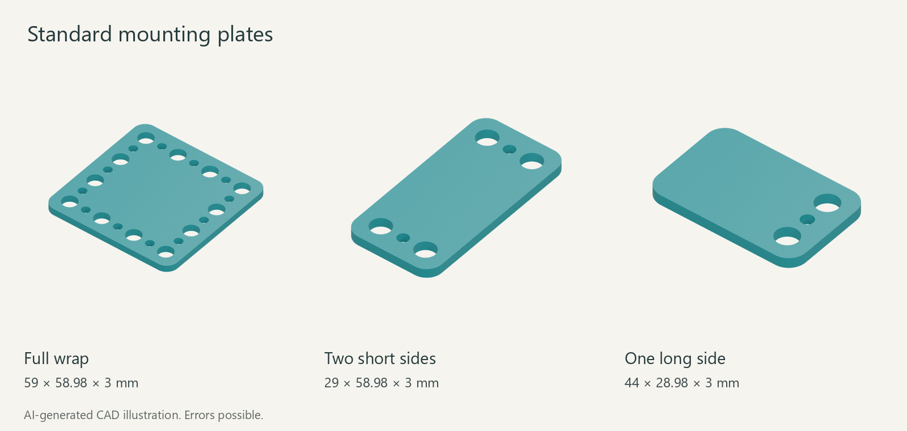
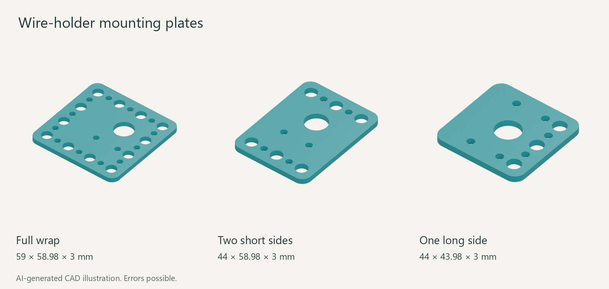

<!-- oomp-documentation:start -->
# Electronic Breakout Microcontroller Esp32 C3 Xiao Esp32C3 17 8 Mm Width 21 Mm Height 14 Pins Seeed Studio Xiao Esp32C3

## Summary

OOMP catalogue record for Electronic Breakout Microcontroller Esp32 C3 Xiao Esp32C3 17 8 Mm Width 21 Mm Height 14 Pins Seeed Studio Xiao Esp32C3. Use the metadata to identify this variant and the part folder to inspect its available assets.

## Details

**OOMP folder ID:** `electronic_breakout_microcontroller_esp32_c3_xiao_esp32c3_17_8_mm_width_21_mm_height_14_pins_seeed_studio_xiao_esp32c3`

[Catalogue](../../README.md) · [Part metadata](working.yaml)

| Field | Value |
| --- | --- |
| id | electronic_breakout_microcontroller_esp32_c3_xiao_esp32c3_17_8_mm_width_21_mm_height_14_pins_seeed_studio_xiao_esp32c3 |
| md5_6 | 23ff1c |
| md5_6_alpha | 1ek9o |
| oomp_key | oomp_electronic_breakout_microcontroller_esp32_c3_xiao_esp32c3_17_8_mm_width_21_mm_height_14_pins_seeed_studio_xiao_esp32c3 |
| taxonomy_1 | electronic |
| taxonomy_2 | breakout |
| taxonomy_3 | microcontroller |
| taxonomy_4 | esp32_c3 |
| taxonomy_5 | xiao_esp32c3 |
| taxonomy_6 | 17_8_mm_width_21_mm_height_14_pins |
| taxonomy_14 | seeed_studio |
| taxonomy_15 | xiao_esp32c3 |

<details>
<summary>Full part metadata</summary>

```yaml
assembly:
  header_pitch_mm: 2.54
  headers: without_headers
bip_39_2_word_array:
- catalog
- wedding
bip_39_2_word_no_space: catalogwedding
bip_39_2_word_space: catalog wedding
bip_39_2_word_underscore: catalog_wedding
bip_39_3_word_array:
- catalog
- wedding
- build
bip_39_3_word_no_space: catalogweddingbuild
bip_39_3_word_space: catalog wedding build
bip_39_3_word_underscore: catalog_wedding_build
bip_39_full_array:
- catalog
- wedding
- build
- sun
- cave
- pepper
- parent
- opera
- enemy
- sugar
- over
- power
bip_39_full_no_space: catalogweddingbuildsuncavepepperparentoperaenemysugaroverpower
bip_39_full_space: catalog wedding build sun cave pepper parent opera enemy sugar
  over power
bip_39_full_underscore: catalog_wedding_build_sun_cave_pepper_parent_opera_enemy_sugar_over_power
breakout_description: 17_8_mm_width_21_mm_height_14_pins
breakout_pcb_height: 21.0
breakout_pcb_width: 17.8
chip:
  family: esp32_c3
  identity_scope: catalogue_chip_or_module_label
  oomp_id: null
  part_number: esp32_c3
  silicon_revision: null
chip_resources:
  clock_max_mhz: 160
  cpu_core_count: 1
  general_purpose_spi_controllers: 1
  hardware_i2c_controllers: 1
  hardware_uart_controllers: 2
  pio_state_machines: 0
  pwm_channels: 6
  scope: silicon resources; board routing and firmware may reduce availability
  source_id: chip_datasheet
connectors:
  expansion:
    contact_count: 14
    pitch_mm: 2.54
    source_id: board_guide
coordinate_system:
  origin: centre_of_pcb_outline
  units: mm
  view: top_with_usb_at_positive_y
  x_positive: right
  y_positive: towards_usb
data_gaps:
- Assembled component keepouts and USB insertion/cable envelopes have not been captured.
- Only source-confirmed pad centres are positioned; no shared-XIAO outline pin-position
  inference is applied.
- Chip package/module pad numbers are not fully transcribed; null chip_pin_number
  values must not be replaced with carrier-header numbers.
default_interfaces:
  i2c:
    api: Wire
    basis: framework_defaults
    framework: arduino-esp32
    notes: []
    peripheral: null
    pin_keys:
      scl:
      - J2_6
      - J2_18
      - TP5_T
      sda:
      - J2_5
      - J2_17
      - TP4_T
    protocol: i2c
    scl_gpio: 7
    sda_gpio: 6
    signal_status:
      scl: mapped
      sda: mapped
    source_ids:
    - interface_variant
    - interface_board_selection
    - interface_runtime_i2c
    status: documented
    variant: XIAO_ESP32C3
    variant_scope: board_variant
  spi:
    api: SPI
    basis: framework_defaults
    framework: arduino-esp32
    miso_gpio: 9
    mosi_gpio: 10
    notes:
    - ss is the framework chip-select alias/default, not an automatically asserted
      CS. Select and drive CS as required by the peripheral and library.
    peripheral: null
    pin_keys:
      miso:
      - J1_3
      - J1_15
      mosi:
      - J1_4
      - J1_16
      sck:
      - J1_2
      - J1_14
      ss:
      - J1_1
      - J1_13
    protocol: spi
    sck_gpio: 8
    signal_status:
      miso: mapped
      mosi: mapped
      sck: mapped
      ss: mapped
    source_ids:
    - interface_variant
    - interface_board_selection
    - interface_runtime_spi
    ss_gpio: 20
    status: documented
    variant: XIAO_ESP32C3
    variant_scope: board_variant
  uart:
    api: null
    basis: framework_pin_aliases
    framework: arduino-esp32
    notes:
    - UART GPIOs are distinct from USB CDC/USB Serial. The meaning of Serial depends
      on the core and USB build settings.
    - TX/RX are board variant aliases. Pass the GPIOs explicitly to the selected HardwareSerial
      instance; no-argument pin selection can use SoC UART defaults instead.
    peripheral: null
    pin_keys:
      rx:
      - J1_1
      - J1_13
      tx:
      - J2_7
      - J2_19
    protocol: uart
    rx_gpio: 20
    signal_status:
      rx: mapped
      tx: mapped
    source_ids:
    - interface_variant
    - interface_board_selection
    - interface_runtime_uart
    status: documented
    tx_gpio: 21
    variant: XIAO_ESP32C3
    variant_scope: board_variant
dimensions_mm:
  assembled_height: null
  height: 20.955
  pcb_thickness: null
  scope: pcb_outline_excludes_usb_overhang
  source_id: cad
  status: manufacturer_cad
  width: 17.78
directory: parts/electronic_breakout_microcontroller_esp32_c3_xiao_esp32c3_17_8_mm_width_21_mm_height_14_pins_seeed_studio_xiao_esp32c3
electrical:
  gpio_5v_tolerant: false
  logic_voltage_v: 3.3
  source_id: chip_datasheet
  usb_connector: usb_c
form_factor: xiao_esp32c3
gpio_summary:
  analog_candidates:
  - 2
  - 3
  - 4
  automatic_firmware_enable: false
  exposed:
  - 2
  - 3
  - 4
  - 5
  - 6
  - 7
  - 8
  - 9
  - 10
  - 20
  - 21
  general_io_candidates:
  - 2
  - 3
  - 4
  - 5
  - 6
  - 7
  - 8
  - 9
  - 10
  - 20
  - 21
id: electronic_breakout_microcontroller_esp32_c3_xiao_esp32c3_17_8_mm_width_21_mm_height_14_pins_seeed_studio_xiao_esp32c3
id_no_class: electronic_breakout_microcontroller_esp32_c3_xiao_esp32c3_17_8_mm_width_21_mm_height_14_pins_seeed_studio_xiao_esp32c3
id_no_size: electronic_breakout_microcontroller_esp32_c3_xiao_esp32c3_17_8_mm_width_21_mm_height_14_pins_seeed_studio_xiao_esp32c3
id_no_type: electronic_breakout_microcontroller_esp32_c3_xiao_esp32c3_17_8_mm_width_21_mm_height_14_pins_seeed_studio_xiao_esp32c3
interface_defaults_version: 1
item_kind: breakout
lab_support:
  automatic_firmware_enable: false
  gpio_matrix_routing: true
  requires_reviewed_board_profile: true
  status: catalogue_reference_only
link_github: https://github.com/oomlout/oomlout_oomp_version_1_messy/tree/main/parts/electronic_breakout_microcontroller_esp32_c3_xiao_esp32c3_17_8_mm_width_21_mm_height_14_pins_seeed_studio_xiao_esp32c3
link_main: https://github.com/oomlout/oomlout_oomp_version_1_messy/tree/main/parts/electronic_breakout_microcontroller_esp32_c3_xiao_esp32c3_17_8_mm_width_21_mm_height_14_pins_seeed_studio_xiao_esp32c3
link_redirect: https://github.com/oomlout/oomlout_oomp_version_1_messy/tree/main/parts/electronic_breakout_microcontroller_esp32_c3_xiao_esp32c3_17_8_mm_width_21_mm_height_14_pins_seeed_studio_xiao_esp32c3
manufacturer: seeed_studio
md5: 23ff1c776ca24d45e80cda49fb1a77d4
md5_10: 23ff1c776c
md5_10_upper: 23FF1C776C
md5_5: 23ff1
md5_5_upper: 23FF1
md5_6: 23ff1c
md5_6_alpha: 1ek9o
md5_6_alpha_upper: 1EK9O
md5_6_upper: 23FF1C
memory:
  external_flash_bytes: 4194304
  psram_bytes: null
mounting_coordinate_system:
  origin: pcb_bounding_box_centre
  units: mm
  view: top
  x_positive: right
  y_positive: up
mounting_geometry_ready: false
mounting_hole_candidates: []
mounting_hole_details: []
mounting_hole_radius_name: m2
mounting_hole_radius_names: []
mounting_hole_status: no_holes
mounting_holes: []
mounting_lift: 3
mounting_research:
  board_revision: XIAO ESP32-C3 carrier PCB Rev v1.3; manufacturer KiCad archive XIAO_ESP32C3_v1.3_KiCad_260116.zip,
    board member XIAO ESP32C3_v1.3.kicad_pcb (schematic title block Rev v1.3).
  board_size:
  - 17.8
  - 21.0
  coordinate_system:
    origin: pcb_bounding_box_centre
    units: mm
    view: top
    x_positive: right
    y_positive: up
  derivation: 'Drawing page 6 labels the XIAO ESP32C3 board outline 17.8 mm wide by
    21.0 mm tall, dimensions in mm; these nominal manufacturer dimensions define the
    output bounding box. The archived v1.3 KiCad board outline independently measures
    20.955 mm along native X and 17.78 mm along native Y (x max-min and y max-min
    from the complete Edge.Cuts contour). KiCad native X is rotated into canonical
    top view by 90 degrees CCW: (x_c,y_c)=(-(y-y_cad_center), x-x_cad_center); this
    maps the USB-C connector at positive native X to positive canonical Y (towards
    top), swaps the extents, and keeps canonical X right/Y up. The manufacturer drawing
    rounds these extents to 17.8 x 21.0 mm. Reviewed every through-drill candidate
    in the full CAD: J1/J2 are electrical castellated/header pads, USB0 drills are
    connector shield anchors, and BOOT0/RST0 drills are button-footprint actuation/retention
    features; none are board mounting holes. No other drilled pads or board mounting-hole
    features are present. Thus the mounting pattern is explicitly empty.'
  fit_status: generic_holder_not_physical_fit_tested
  identity_evidence: The Seeed Studio product guide names Seeed Studio XIAO ESP32C3
    and links its PCB design files. The page 6 manufacturer package/PCB drawing identifies
    XIAO ESP32C3, Seeed SKU 113991054. The official versioned KiCad archive contains
    XIAO ESP32C3_v1.3.kicad_pcb; its bytes match the archived reference/board.kicad_pcb
    SHA-256. The associated manufacturer schematic title block and revision history
    identify the carrier as Rev v1.3.
  mounting_holes: []
  record_sha256: 60c0651c623c107866bd44e8d9d0cddc8386cd0891d050a1857028c6694b3655
  research_file: source_file/electronic_breakout_microcontroller_esp32_c3_xiao_esp32c3_17_8_mm_width_21_mm_height_14_pins_seeed_studio_xiao_esp32c3/mounting.yaml
  reviewed_by: gpt-6-luna
  sources:
  - bytes: 124883
    id: product
    kind: manufacturer_product
    local_file: mounting_evidence/XIAO_ESP32C3_Getting_Started.html
    locator: Getting Started identity/specifications and Hardware Design Resources;
      confirms XIAO ESP32C3 product, 21 x 17.8 mm, and links the versioned KiCad project
      and dimension resources
    registered_at: '2026-11-06T17:37:16+00:00'
    sha256: 019b8559ad164be7790c4cb07c1938dc3224dca6b3e72f593d202dd6f44b999a
    url: https://wiki.seeedstudio.com/XIAO_ESP32C3_Getting_Started/
  - bytes: 629257
    id: drawing
    kind: manufacturer_drawing
    local_file: mounting_evidence/Seeed-Studio-XIAO-Series-Package-and-PCB-Design.pdf
    locator: 'Page 6: Seeed Studio XIAO ESP32C3, Seeed SKU 113991054, recommended
      PCB land pattern; dimensions in mm, board outline 17.8 x 21.0'
    registered_at: '2026-11-06T17:37:17+00:00'
    sha256: 25e9dc961719df965c81c3424111b70d127c8e8255147fad16634c8e8cdd4267
    url: https://www.seeedstudio.com/blog/wp-content/uploads/2022/08/Seeed-Studio-XIAO-Series-Package-and-PCB-Design.pdf
  - bytes: 697553
    id: cad
    kind: manufacturer_cad
    local_file: reference/board.kicad_pcb
    locator: Archive member XIAO ESP32C3_v1.3.kicad_pcb from XIAO_ESP32C3_v1.3_KiCad_260116.zip;
      verified byte-identical to the previously archived local board.kicad_pcb; complete
      Edge.Cuts and all pad/drill definitions reviewed for mounting features
    registered_at: '2026-11-06T17:37:18+00:00'
    sha256: a761393935ff261a58fee3e3d7ecfb65152eaba8620de64ff7758fb0c043d1db
    url: https://files.seeedstudio.com/wiki/XIAO_WiFi/Resources/XIAO_ESP32C3_v1.3_KiCad_260116.zip
  - bytes: 424362
    id: schematic
    kind: manufacturer_schematic
    local_file: reference/XIAO_ESP32C3_v1.3_SCH_260116.pdf
    locator: Title block and revision history identify XIAO ESP32-C3, Rev v1.3; corroborates
      carrier board revision
    registered_at: '2026-11-06T17:37:18+00:00'
    sha256: 60d7d447d0d37b0c3ff6c50d372a45d50f750070b8b9d68ca7b906df43365081
    url: https://files.seeedstudio.com/wiki/XIAO_WiFi/Resources/XIAO_ESP32C3_v1.3_SCH_260116.pdf
  status: no_holes
name: Electronic Breakout Microcontroller Esp32 C3 Xiao Esp32C3 17 8 Mm Width 21 Mm
  Height 14 Pins Seeed Studio Xiao Esp32C3
name_no_class: Electronic Breakout Microcontroller Esp32 C3 Xiao Esp32C3 17 8 Mm Width
  21 Mm Height 14 Pins Seeed Studio Xiao Esp32C3
name_no_size: Electronic Breakout Microcontroller Esp32 C3 Xiao Esp32C3 17 8 Mm Width
  21 Mm Height 14 Pins Seeed Studio Xiao Esp32C3
name_no_type: Electronic Breakout Microcontroller Esp32 C3 Xiao Esp32C3 17 8 Mm Width
  21 Mm Height 14 Pins Seeed Studio Xiao Esp32C3
name_proper: Electronic Breakout Microcontroller Esp32 C3 Xiao Esp32C3 17 8 Mm Width
  21 Mm Height 14 Pins Seeed Studio Xiao Esp32C3
name_readable: Seeed Studio XIAO ESP32-C3
name_space: electronic breakout microcontroller esp32 c3 xiao esp32c3 17 8 mm width
  21 mm height 14 pins seeed studio xiao esp32c3
name_upper: ELECTRONIC BREAKOUT MICROCONTROLLER ESP32 C3 XIAO ESP32C3 17 8 MM WIDTH
  21 MM HEIGHT 14 PINS SEEED STUDIO XIAO ESP32C3
notes: []
onboard_gpio_connections: []
oobb_details: []
oomlout_ai_roboclick_1:
  actions:
  - command: text_jinja_template
    convert_to_pdf: false
    convert_to_png: false
    dict_data:
      assembly:
        header_pitch_mm: 2.54
        headers: without_headers
      breakout_description: 17_8_mm_width_21_mm_height_14_pins
      breakout_pcb_height: 21.0
      breakout_pcb_width: 17.8
      chip:
        family: esp32_c3
        identity_scope: catalogue_chip_or_module_label
        oomp_id: null
        part_number: esp32_c3
        silicon_revision: null
      chip_resources:
        clock_max_mhz: 160
        cpu_core_count: 1
        general_purpose_spi_controllers: 1
        hardware_i2c_controllers: 1
        hardware_uart_controllers: 2
        pio_state_machines: 0
        pwm_channels: 6
        scope: silicon resources; board routing and firmware may reduce availability
        source_id: chip_datasheet
      connectors:
        expansion:
          contact_count: 14
          pitch_mm: 2.54
          source_id: board_guide
      coordinate_system:
        origin: centre_of_pcb_outline
        units: mm
        view: top_with_usb_at_positive_y
        x_positive: right
        y_positive: towards_usb
      data_gaps:
      - Assembled component keepouts and USB insertion/cable envelopes have not been
        captured.
      - Only source-confirmed pad centres are positioned; no shared-XIAO outline pin-position
        inference is applied.
      - Chip package/module pad numbers are not fully transcribed; null chip_pin_number
        values must not be replaced with carrier-header numbers.
      default_interfaces:
        i2c:
          api: Wire
          basis: framework_defaults
          framework: arduino-esp32
          notes: []
          peripheral: null
          pin_keys:
            scl:
            - J2_6
            - J2_18
            - TP5_T
            sda:
            - J2_5
            - J2_17
            - TP4_T
          protocol: i2c
          scl_gpio: 7
          sda_gpio: 6
          signal_status:
            scl: mapped
            sda: mapped
          source_ids:
          - interface_variant
          - interface_board_selection
          - interface_runtime_i2c
          status: documented
          variant: XIAO_ESP32C3
          variant_scope: board_variant
        spi:
          api: SPI
          basis: framework_defaults
          framework: arduino-esp32
          miso_gpio: 9
          mosi_gpio: 10
          notes:
          - ss is the framework chip-select alias/default, not an automatically asserted
            CS. Select and drive CS as required by the peripheral and library.
          peripheral: null
          pin_keys:
            miso:
            - J1_3
            - J1_15
            mosi:
            - J1_4
            - J1_16
            sck:
            - J1_2
            - J1_14
            ss:
            - J1_1
            - J1_13
          protocol: spi
          sck_gpio: 8
          signal_status:
            miso: mapped
            mosi: mapped
            sck: mapped
            ss: mapped
          source_ids:
          - interface_variant
          - interface_board_selection
          - interface_runtime_spi
          ss_gpio: 20
          status: documented
          variant: XIAO_ESP32C3
          variant_scope: board_variant
        uart:
          api: null
          basis: framework_pin_aliases
          framework: arduino-esp32
          notes:
          - UART GPIOs are distinct from USB CDC/USB Serial. The meaning of Serial
            depends on the core and USB build settings.
          - TX/RX are board variant aliases. Pass the GPIOs explicitly to the selected
            HardwareSerial instance; no-argument pin selection can use SoC UART defaults
            instead.
          peripheral: null
          pin_keys:
            rx:
            - J1_1
            - J1_13
            tx:
            - J2_7
            - J2_19
          protocol: uart
          rx_gpio: 20
          signal_status:
            rx: mapped
            tx: mapped
          source_ids:
          - interface_variant
          - interface_board_selection
          - interface_runtime_uart
          status: documented
          tx_gpio: 21
          variant: XIAO_ESP32C3
          variant_scope: board_variant
      dimensions_mm:
        assembled_height: null
        height: 20.955
        pcb_thickness: null
        scope: pcb_outline_excludes_usb_overhang
        source_id: cad
        status: manufacturer_cad
        width: 17.78
      directory: parts\electronic_breakout_microcontroller_esp32_c3_xiao_esp32c3_17_8_mm_width_21_mm_height_14_pins_seeed_studio_xiao_esp32c3
      electrical:
        gpio_5v_tolerant: false
        logic_voltage_v: 3.3
        source_id: chip_datasheet
        usb_connector: usb_c
      form_factor: xiao_esp32c3
      gpio_summary:
        analog_candidates:
        - 2
        - 3
        - 4
        automatic_firmware_enable: false
        exposed:
        - 2
        - 3
        - 4
        - 5
        - 6
        - 7
        - 8
        - 9
        - 10
        - 20
        - 21
        general_io_candidates:
        - 2
        - 3
        - 4
        - 5
        - 6
        - 7
        - 8
        - 9
        - 10
        - 20
        - 21
      interface_defaults_version: 1
      item_kind: breakout
      lab_support:
        automatic_firmware_enable: false
        gpio_matrix_routing: true
        requires_reviewed_board_profile: true
        status: catalogue_reference_only
      manufacturer: seeed_studio
      memory:
        external_flash_bytes: 4194304
        psram_bytes: null
      mounting_coordinate_system:
        origin: pcb_bounding_box_centre
        units: mm
        view: top
        x_positive: right
        y_positive: up
      mounting_geometry_ready: false
      mounting_hole_candidates: []
      mounting_hole_details: []
      mounting_hole_radius_name: m2
      mounting_hole_radius_names: []
      mounting_hole_status: no_holes
      mounting_holes: []
      mounting_lift: 3
      mounting_research:
        board_revision: XIAO ESP32-C3 carrier PCB Rev v1.3; manufacturer KiCad archive
          XIAO_ESP32C3_v1.3_KiCad_260116.zip, board member XIAO ESP32C3_v1.3.kicad_pcb
          (schematic title block Rev v1.3).
        board_size:
        - 17.8
        - 21.0
        coordinate_system:
          origin: pcb_bounding_box_centre
          units: mm
          view: top
          x_positive: right
          y_positive: up
        derivation: 'Drawing page 6 labels the XIAO ESP32C3 board outline 17.8 mm
          wide by 21.0 mm tall, dimensions in mm; these nominal manufacturer dimensions
          define the output bounding box. The archived v1.3 KiCad board outline independently
          measures 20.955 mm along native X and 17.78 mm along native Y (x max-min
          and y max-min from the complete Edge.Cuts contour). KiCad native X is rotated
          into canonical top view by 90 degrees CCW: (x_c,y_c)=(-(y-y_cad_center),
          x-x_cad_center); this maps the USB-C connector at positive native X to positive
          canonical Y (towards top), swaps the extents, and keeps canonical X right/Y
          up. The manufacturer drawing rounds these extents to 17.8 x 21.0 mm. Reviewed
          every through-drill candidate in the full CAD: J1/J2 are electrical castellated/header
          pads, USB0 drills are connector shield anchors, and BOOT0/RST0 drills are
          button-footprint actuation/retention features; none are board mounting holes.
          No other drilled pads or board mounting-hole features are present. Thus
          the mounting pattern is explicitly empty.'
        fit_status: generic_holder_not_physical_fit_tested
        identity_evidence: The Seeed Studio product guide names Seeed Studio XIAO
          ESP32C3 and links its PCB design files. The page 6 manufacturer package/PCB
          drawing identifies XIAO ESP32C3, Seeed SKU 113991054. The official versioned
          KiCad archive contains XIAO ESP32C3_v1.3.kicad_pcb; its bytes match the
          archived reference/board.kicad_pcb SHA-256. The associated manufacturer
          schematic title block and revision history identify the carrier as Rev v1.3.
        mounting_holes: []
        record_sha256: 60c0651c623c107866bd44e8d9d0cddc8386cd0891d050a1857028c6694b3655
        research_file: source_file/electronic_breakout_microcontroller_esp32_c3_xiao_esp32c3_17_8_mm_width_21_mm_height_14_pins_seeed_studio_xiao_esp32c3/mounting.yaml
        reviewed_by: gpt-6-luna
        sources:
        - bytes: 124883
          id: product
          kind: manufacturer_product
          local_file: mounting_evidence/XIAO_ESP32C3_Getting_Started.html
          locator: Getting Started identity/specifications and Hardware Design Resources;
            confirms XIAO ESP32C3 product, 21 x 17.8 mm, and links the versioned KiCad
            project and dimension resources
          registered_at: '2026-11-06T17:37:16+00:00'
          sha256: 019b8559ad164be7790c4cb07c1938dc3224dca6b3e72f593d202dd6f44b999a
          url: https://wiki.seeedstudio.com/XIAO_ESP32C3_Getting_Started/
        - bytes: 629257
          id: drawing
          kind: manufacturer_drawing
          local_file: mounting_evidence/Seeed-Studio-XIAO-Series-Package-and-PCB-Design.pdf
          locator: 'Page 6: Seeed Studio XIAO ESP32C3, Seeed SKU 113991054, recommended
            PCB land pattern; dimensions in mm, board outline 17.8 x 21.0'
          registered_at: '2026-11-06T17:37:17+00:00'
          sha256: 25e9dc961719df965c81c3424111b70d127c8e8255147fad16634c8e8cdd4267
          url: https://www.seeedstudio.com/blog/wp-content/uploads/2022/08/Seeed-Studio-XIAO-Series-Package-and-PCB-Design.pdf
        - bytes: 697553
          id: cad
          kind: manufacturer_cad
          local_file: reference/board.kicad_pcb
          locator: Archive member XIAO ESP32C3_v1.3.kicad_pcb from XIAO_ESP32C3_v1.3_KiCad_260116.zip;
            verified byte-identical to the previously archived local board.kicad_pcb;
            complete Edge.Cuts and all pad/drill definitions reviewed for mounting
            features
          registered_at: '2026-11-06T17:37:18+00:00'
          sha256: a761393935ff261a58fee3e3d7ecfb65152eaba8620de64ff7758fb0c043d1db
          url: https://files.seeedstudio.com/wiki/XIAO_WiFi/Resources/XIAO_ESP32C3_v1.3_KiCad_260116.zip
        - bytes: 424362
          id: schematic
          kind: manufacturer_schematic
          local_file: reference/XIAO_ESP32C3_v1.3_SCH_260116.pdf
          locator: Title block and revision history identify XIAO ESP32-C3, Rev v1.3;
            corroborates carrier board revision
          registered_at: '2026-11-06T17:37:18+00:00'
          sha256: 60d7d447d0d37b0c3ff6c50d372a45d50f750070b8b9d68ca7b906df43365081
          url: https://files.seeedstudio.com/wiki/XIAO_WiFi/Resources/XIAO_ESP32C3_v1.3_SCH_260116.pdf
        status: no_holes
      name: electronic_breakout_microcontroller_esp32_c3_xiao_esp32c3_17_8_mm_width_21_mm_height_14_pins_seeed_studio_xiao_esp32c3
      name_proper: Electronic Breakout Microcontroller Esp32 C3 Xiao Esp32C3 17 8
        Mm Width 21 Mm Height 14 Pins Seeed Studio Xiao Esp32C3
      name_readable: Seeed Studio XIAO ESP32-C3
      name_space: electronic breakout microcontroller esp32 c3 xiao esp32c3 17 8 mm
        width 21 mm height 14 pins seeed studio xiao esp32c3
      name_upper: ELECTRONIC BREAKOUT MICROCONTROLLER ESP32 C3 XIAO ESP32C3 17 8 MM
        WIDTH 21 MM HEIGHT 14 PINS SEEED STUDIO XIAO ESP32C3
      notes: []
      onboard_gpio_connections: []
      oobb_details: []
      part_number: xiao_esp32c3
      pinout_scope: Expansion connectors and explicitly listed test pads; USB socket
        contacts excluded.
      pinout_status: documented_contact_inventory
      pins:
        J1_1:
          adc_channel: null
          adc_unit: null
          aliases:
          - D7
          available_for_general_io: true
          capabilities:
          - gpio
          - digital_input
          - digital_output
          - pwm
          capability_source_id: chip_datasheet
          chip_pin_number: null
          connector: J1
          default_interface_roles:
          - interface: uart
            signal: rx
          - interface: spi
            signal: ss
          direction: bidirectional
          drill_mm: 0.85
          functions:
          - RX_D7
          - RX
          - U0RXD
          gpio: 20
          input_only: false
          lab_analog_eligible: false
          logic_voltage_v: 3.3
          name: D7
          net_name: RX_D7
          number: '1'
          pad_kind: through_hole
          restrictions: []
          routable_peripherals:
          - uart
          - spi
          - i2c
          - i2s
          - rmt
          - pwm
          signal_types:
          - digital
          source_id: cad
          surface: top
          type: gpio
          x_mm: 7.62
          y_mm: -7.6835
        J1_13:
          adc_channel: null
          adc_unit: null
          aliases:
          - D7
          available_for_general_io: true
          capabilities:
          - gpio
          - digital_input
          - digital_output
          - pwm
          capability_source_id: chip_datasheet
          chip_pin_number: null
          connector: J1
          default_interface_roles:
          - interface: uart
            signal: rx
          - interface: spi
            signal: ss
          direction: bidirectional
          drill_mm: 0.7
          functions:
          - RX_D7
          - RX
          - U0RXD
          gpio: 20
          input_only: false
          lab_analog_eligible: false
          logic_voltage_v: 3.3
          name: D7
          net_name: RX_D7
          number: '13'
          pad_kind: through_hole
          restrictions: []
          routable_peripherals:
          - uart
          - spi
          - i2c
          - i2s
          - rmt
          - pwm
          signal_types:
          - digital
          source_id: cad
          surface: top
          type: gpio
          x_mm: 8.89
          y_mm: -7.6835
        J1_14:
          adc_channel: null
          adc_unit: null
          aliases:
          - D8
          available_for_general_io: true
          capabilities:
          - gpio
          - digital_input
          - digital_output
          - pwm
          capability_source_id: chip_datasheet
          chip_pin_number: null
          connector: J1
          default_interface_roles:
          - interface: spi
            signal: sck
          direction: bidirectional
          drill_mm: 0.7
          functions:
          - D8
          - SCK
          gpio: 8
          input_only: false
          lab_analog_eligible: false
          logic_voltage_v: 3.3
          name: D8
          net_name: D8
          number: '14'
          pad_kind: through_hole
          restrictions:
          - Boot strapping pin; verify external levels at reset.
          routable_peripherals:
          - uart
          - spi
          - i2c
          - i2s
          - rmt
          - pwm
          signal_types:
          - digital
          source_id: cad
          surface: top
          type: gpio
          x_mm: 8.89
          y_mm: -5.1435
        J1_15:
          adc_channel: null
          adc_unit: null
          aliases:
          - D9
          available_for_general_io: true
          capabilities:
          - gpio
          - digital_input
          - digital_output
          - pwm
          capability_source_id: chip_datasheet
          chip_pin_number: null
          connector: J1
          default_interface_roles:
          - interface: spi
            signal: miso
          direction: bidirectional
          drill_mm: 0.7
          functions:
          - D9
          - MISO
          gpio: 9
          input_only: false
          lab_analog_eligible: false
          logic_voltage_v: 3.3
          name: D9
          net_name: D9
          number: '15'
          pad_kind: through_hole
          restrictions:
          - Boot strapping pin; verify external levels at reset.
          routable_peripherals:
          - uart
          - spi
          - i2c
          - i2s
          - rmt
          - pwm
          signal_types:
          - digital
          source_id: cad
          surface: top
          type: gpio
          x_mm: 8.89
          y_mm: -2.6035
        J1_16:
          adc_channel: null
          adc_unit: null
          aliases:
          - D10
          available_for_general_io: true
          capabilities:
          - gpio
          - digital_input
          - digital_output
          - pwm
          capability_source_id: chip_datasheet
          chip_pin_number: null
          connector: J1
          default_interface_roles:
          - interface: spi
            signal: mosi
          direction: bidirectional
          drill_mm: 0.7
          functions:
          - D10
          - MOSI
          - FSPICS0
          gpio: 10
          input_only: false
          lab_analog_eligible: false
          logic_voltage_v: 3.3
          name: D10
          net_name: D10
          number: '16'
          pad_kind: through_hole
          restrictions: []
          routable_peripherals:
          - uart
          - spi
          - i2c
          - i2s
          - rmt
          - pwm
          signal_types:
          - digital
          source_id: cad
          surface: top
          type: gpio
          x_mm: 8.89
          y_mm: -0.0635
        J1_17:
          adc_channel: null
          adc_unit: null
          aliases: []
          available_for_general_io: false
          capabilities: []
          chip_pin_number: null
          connector: J1
          default_interface_roles: []
          direction: not_applicable
          drill_mm: 0.7
          functions:
          - VCC_3V3
          - VCC_3V3
          gpio: null
          name: VCC_3V3
          number: '17'
          pad_kind: through_hole
          restrictions: []
          signal_types: []
          source_id: cad
          surface: top
          type: power
          x_mm: 8.89
          y_mm: 2.4765
        J1_18:
          adc_channel: null
          adc_unit: null
          aliases: []
          available_for_general_io: false
          capabilities: []
          chip_pin_number: null
          connector: J1
          default_interface_roles: []
          direction: not_applicable
          drill_mm: 0.7
          functions:
          - GND
          - GND
          gpio: null
          name: GND
          number: '18'
          pad_kind: through_hole
          restrictions: []
          signal_types: []
          source_id: cad
          surface: top
          type: ground
          x_mm: 8.89
          y_mm: 5.0165
        J1_19:
          adc_channel: null
          adc_unit: null
          aliases: []
          available_for_general_io: false
          capabilities: []
          chip_pin_number: null
          connector: J1
          default_interface_roles: []
          direction: not_applicable
          drill_mm: 0.7
          functions:
          - VUSB
          - VUSB
          gpio: null
          name: VUSB
          number: '19'
          pad_kind: through_hole
          restrictions: []
          signal_types: []
          source_id: cad
          surface: top
          type: power
          x_mm: 8.89
          y_mm: 7.5565
        J1_2:
          adc_channel: null
          adc_unit: null
          aliases:
          - D8
          available_for_general_io: true
          capabilities:
          - gpio
          - digital_input
          - digital_output
          - pwm
          capability_source_id: chip_datasheet
          chip_pin_number: null
          connector: J1
          default_interface_roles:
          - interface: spi
            signal: sck
          direction: bidirectional
          drill_mm: 0.85
          functions:
          - D8
          - SCK
          gpio: 8
          input_only: false
          lab_analog_eligible: false
          logic_voltage_v: 3.3
          name: D8
          net_name: D8
          number: '2'
          pad_kind: through_hole
          restrictions:
          - Boot strapping pin; verify external levels at reset.
          routable_peripherals:
          - uart
          - spi
          - i2c
          - i2s
          - rmt
          - pwm
          signal_types:
          - digital
          source_id: cad
          surface: top
          type: gpio
          x_mm: 7.62
          y_mm: -5.1435
        J1_3:
          adc_channel: null
          adc_unit: null
          aliases:
          - D9
          available_for_general_io: true
          capabilities:
          - gpio
          - digital_input
          - digital_output
          - pwm
          capability_source_id: chip_datasheet
          chip_pin_number: null
          connector: J1
          default_interface_roles:
          - interface: spi
            signal: miso
          direction: bidirectional
          drill_mm: 0.85
          functions:
          - D9
          - MISO
          gpio: 9
          input_only: false
          lab_analog_eligible: false
          logic_voltage_v: 3.3
          name: D9
          net_name: D9
          number: '3'
          pad_kind: through_hole
          restrictions:
          - Boot strapping pin; verify external levels at reset.
          routable_peripherals:
          - uart
          - spi
          - i2c
          - i2s
          - rmt
          - pwm
          signal_types:
          - digital
          source_id: cad
          surface: top
          type: gpio
          x_mm: 7.62
          y_mm: -2.6035
        J1_4:
          adc_channel: null
          adc_unit: null
          aliases:
          - D10
          available_for_general_io: true
          capabilities:
          - gpio
          - digital_input
          - digital_output
          - pwm
          capability_source_id: chip_datasheet
          chip_pin_number: null
          connector: J1
          default_interface_roles:
          - interface: spi
            signal: mosi
          direction: bidirectional
          drill_mm: 0.85
          functions:
          - D10
          - MOSI
          - FSPICS0
          gpio: 10
          input_only: false
          lab_analog_eligible: false
          logic_voltage_v: 3.3
          name: D10
          net_name: D10
          number: '4'
          pad_kind: through_hole
          restrictions: []
          routable_peripherals:
          - uart
          - spi
          - i2c
          - i2s
          - rmt
          - pwm
          signal_types:
          - digital
          source_id: cad
          surface: top
          type: gpio
          x_mm: 7.62
          y_mm: -0.0635
        J1_5:
          adc_channel: null
          adc_unit: null
          aliases: []
          available_for_general_io: false
          capabilities: []
          chip_pin_number: null
          connector: J1
          default_interface_roles: []
          direction: not_applicable
          drill_mm: 0.85
          functions:
          - VCC_3V3
          - VCC_3V3
          gpio: null
          name: VCC_3V3
          number: '5'
          pad_kind: through_hole
          restrictions: []
          signal_types: []
          source_id: cad
          surface: top
          type: power
          x_mm: 7.62
          y_mm: 2.4765
        J1_6:
          adc_channel: null
          adc_unit: null
          aliases: []
          available_for_general_io: false
          capabilities: []
          chip_pin_number: null
          connector: J1
          default_interface_roles: []
          direction: not_applicable
          drill_mm: 0.85
          functions:
          - GND
          - GND
          gpio: null
          name: GND
          number: '6'
          pad_kind: through_hole
          restrictions: []
          signal_types: []
          source_id: cad
          surface: top
          type: ground
          x_mm: 7.62
          y_mm: 5.0165
        J1_7:
          adc_channel: null
          adc_unit: null
          aliases: []
          available_for_general_io: false
          capabilities: []
          chip_pin_number: null
          connector: J1
          default_interface_roles: []
          direction: not_applicable
          drill_mm: 0.85
          functions:
          - VUSB
          - VUSB
          gpio: null
          name: VUSB
          number: '7'
          pad_kind: through_hole
          restrictions: []
          signal_types: []
          source_id: cad
          surface: top
          type: power
          x_mm: 7.62
          y_mm: 7.5565
        J2_1:
          adc_channel: 2
          adc_unit: 1
          aliases:
          - D0
          available_for_general_io: true
          capabilities:
          - gpio
          - digital_input
          - digital_output
          - pwm
          - analog_input
          capability_source_id: chip_datasheet
          chip_pin_number: null
          connector: J2
          default_interface_roles: []
          direction: bidirectional
          drill_mm: 0.85
          functions:
          - D0
          - Analog
          - ADC1_CH2
          gpio: 2
          input_only: false
          lab_analog_eligible: true
          logic_voltage_v: 3.3
          name: D0
          net_name: D0
          number: '1'
          pad_kind: through_hole
          restrictions:
          - Boot strapping pin; verify external levels at reset.
          routable_peripherals:
          - uart
          - spi
          - i2c
          - i2s
          - rmt
          - pwm
          signal_types:
          - digital
          - analog
          source_id: cad
          surface: top
          type: gpio
          x_mm: -7.62
          y_mm: 7.5565
        J2_13:
          adc_channel: 2
          adc_unit: 1
          aliases:
          - D0
          available_for_general_io: true
          capabilities:
          - gpio
          - digital_input
          - digital_output
          - pwm
          - analog_input
          capability_source_id: chip_datasheet
          chip_pin_number: null
          connector: J2
          default_interface_roles: []
          direction: bidirectional
          drill_mm: 0.7
          functions:
          - D0
          - Analog
          - ADC1_CH2
          gpio: 2
          input_only: false
          lab_analog_eligible: true
          logic_voltage_v: 3.3
          name: D0
          net_name: D0
          number: '13'
          pad_kind: through_hole
          restrictions:
          - Boot strapping pin; verify external levels at reset.
          routable_peripherals:
          - uart
          - spi
          - i2c
          - i2s
          - rmt
          - pwm
          signal_types:
          - digital
          - analog
          source_id: cad
          surface: top
          type: gpio
          x_mm: -8.89
          y_mm: 7.5565
        J2_14:
          adc_channel: 3
          adc_unit: 1
          aliases:
          - D1
          available_for_general_io: true
          capabilities:
          - gpio
          - digital_input
          - digital_output
          - pwm
          - analog_input
          capability_source_id: chip_datasheet
          chip_pin_number: null
          connector: J2
          default_interface_roles: []
          direction: bidirectional
          drill_mm: 0.7
          functions:
          - D1
          - Analog
          - ADC1_CH3
          gpio: 3
          input_only: false
          lab_analog_eligible: true
          logic_voltage_v: 3.3
          name: D1
          net_name: D1
          number: '14'
          pad_kind: through_hole
          restrictions: []
          routable_peripherals:
          - uart
          - spi
          - i2c
          - i2s
          - rmt
          - pwm
          signal_types:
          - digital
          - analog
          source_id: cad
          surface: top
          type: gpio
          x_mm: -8.89
          y_mm: 5.0165
        J2_15:
          adc_channel: 4
          adc_unit: 1
          aliases:
          - D2
          available_for_general_io: true
          capabilities:
          - gpio
          - digital_input
          - digital_output
          - pwm
          - analog_input
          capability_source_id: chip_datasheet
          chip_pin_number: null
          connector: J2
          default_interface_roles: []
          direction: bidirectional
          drill_mm: 0.7
          functions:
          - D2
          - Analog
          - ADC1_CH4
          - FSPIHD
          - MTMS
          gpio: 4
          input_only: false
          lab_analog_eligible: true
          logic_voltage_v: 3.3
          name: D2
          net_name: D2
          number: '15'
          pad_kind: through_hole
          restrictions: []
          routable_peripherals:
          - uart
          - spi
          - i2c
          - i2s
          - rmt
          - pwm
          signal_types:
          - digital
          - analog
          source_id: cad
          surface: top
          type: gpio
          x_mm: -8.89
          y_mm: 2.4765
        J2_16:
          adc_channel: 0
          adc_unit: 2
          aliases:
          - D3
          available_for_general_io: true
          capabilities:
          - gpio
          - digital_input
          - digital_output
          - pwm
          - analog_input
          capability_source_id: chip_datasheet
          chip_pin_number: null
          connector: J2
          default_interface_roles: []
          direction: bidirectional
          drill_mm: 0.7
          functions:
          - D3
          - Analog
          - ADC2_CH0
          - FSPIWP
          - MTDI
          gpio: 5
          input_only: false
          lab_analog_eligible: false
          logic_voltage_v: 3.3
          name: D3
          net_name: D3
          number: '16'
          pad_kind: through_hole
          restrictions:
          - ADC2 is not supported by ESP-IDF oneshot/continuous drivers on C3; exclude
            from lab analog controls.
          routable_peripherals:
          - uart
          - spi
          - i2c
          - i2s
          - rmt
          - pwm
          signal_types:
          - digital
          - analog
          source_id: cad
          surface: top
          type: gpio
          x_mm: -8.89
          y_mm: -0.0635
        J2_17:
          adc_channel: null
          adc_unit: null
          aliases:
          - D4
          available_for_general_io: true
          capabilities:
          - gpio
          - digital_input
          - digital_output
          - pwm
          capability_source_id: chip_datasheet
          chip_pin_number: null
          connector: J2
          default_interface_roles:
          - interface: i2c
            signal: sda
          direction: bidirectional
          drill_mm: 0.7
          functions:
          - D4
          - SDA
          - FSPICLK
          - MTCK
          gpio: 6
          input_only: false
          lab_analog_eligible: false
          logic_voltage_v: 3.3
          name: D4
          net_name: D4
          number: '17'
          pad_kind: through_hole
          restrictions: []
          routable_peripherals:
          - uart
          - spi
          - i2c
          - i2s
          - rmt
          - pwm
          signal_types:
          - digital
          source_id: cad
          surface: top
          type: gpio
          x_mm: -8.89
          y_mm: -2.6035
        J2_18:
          adc_channel: null
          adc_unit: null
          aliases:
          - D5
          available_for_general_io: true
          capabilities:
          - gpio
          - digital_input
          - digital_output
          - pwm
          capability_source_id: chip_datasheet
          chip_pin_number: null
          connector: J2
          default_interface_roles:
          - interface: i2c
            signal: scl
          direction: bidirectional
          drill_mm: 0.7
          functions:
          - D5
          - SCL
          - FSPID
          - MTDO
          gpio: 7
          input_only: false
          lab_analog_eligible: false
          logic_voltage_v: 3.3
          name: D5
          net_name: D5
          number: '18'
          pad_kind: through_hole
          restrictions: []
          routable_peripherals:
          - uart
          - spi
          - i2c
          - i2s
          - rmt
          - pwm
          signal_types:
          - digital
          source_id: cad
          surface: top
          type: gpio
          x_mm: -8.89
          y_mm: -5.1435
        J2_19:
          adc_channel: null
          adc_unit: null
          aliases:
          - D6
          available_for_general_io: true
          capabilities:
          - gpio
          - digital_input
          - digital_output
          - pwm
          capability_source_id: chip_datasheet
          chip_pin_number: null
          connector: J2
          default_interface_roles:
          - interface: uart
            signal: tx
          direction: bidirectional
          drill_mm: 0.7
          functions:
          - TX_D6
          - TX
          - U0TXD
          gpio: 21
          input_only: false
          lab_analog_eligible: false
          logic_voltage_v: 3.3
          name: D6
          net_name: TX_D6
          number: '19'
          pad_kind: through_hole
          restrictions: []
          routable_peripherals:
          - uart
          - spi
          - i2c
          - i2s
          - rmt
          - pwm
          signal_types:
          - digital
          source_id: cad
          surface: top
          type: gpio
          x_mm: -8.89
          y_mm: -7.6835
        J2_2:
          adc_channel: 3
          adc_unit: 1
          aliases:
          - D1
          available_for_general_io: true
          capabilities:
          - gpio
          - digital_input
          - digital_output
          - pwm
          - analog_input
          capability_source_id: chip_datasheet
          chip_pin_number: null
          connector: J2
          default_interface_roles: []
          direction: bidirectional
          drill_mm: 0.85
          functions:
          - D1
          - Analog
          - ADC1_CH3
          gpio: 3
          input_only: false
          lab_analog_eligible: true
          logic_voltage_v: 3.3
          name: D1
          net_name: D1
          number: '2'
          pad_kind: through_hole
          restrictions: []
          routable_peripherals:
          - uart
          - spi
          - i2c
          - i2s
          - rmt
          - pwm
          signal_types:
          - digital
          - analog
          source_id: cad
          surface: top
          type: gpio
          x_mm: -7.62
          y_mm: 5.0165
        J2_3:
          adc_channel: 4
          adc_unit: 1
          aliases:
          - D2
          available_for_general_io: true
          capabilities:
          - gpio
          - digital_input
          - digital_output
          - pwm
          - analog_input
          capability_source_id: chip_datasheet
          chip_pin_number: null
          connector: J2
          default_interface_roles: []
          direction: bidirectional
          drill_mm: 0.85
          functions:
          - D2
          - Analog
          - ADC1_CH4
          - FSPIHD
          - MTMS
          gpio: 4
          input_only: false
          lab_analog_eligible: true
          logic_voltage_v: 3.3
          name: D2
          net_name: D2
          number: '3'
          pad_kind: through_hole
          restrictions: []
          routable_peripherals:
          - uart
          - spi
          - i2c
          - i2s
          - rmt
          - pwm
          signal_types:
          - digital
          - analog
          source_id: cad
          surface: top
          type: gpio
          x_mm: -7.62
          y_mm: 2.4765
        J2_4:
          adc_channel: 0
          adc_unit: 2
          aliases:
          - D3
          available_for_general_io: true
          capabilities:
          - gpio
          - digital_input
          - digital_output
          - pwm
          - analog_input
          capability_source_id: chip_datasheet
          chip_pin_number: null
          connector: J2
          default_interface_roles: []
          direction: bidirectional
          drill_mm: 0.85
          functions:
          - D3
          - Analog
          - ADC2_CH0
          - FSPIWP
          - MTDI
          gpio: 5
          input_only: false
          lab_analog_eligible: false
          logic_voltage_v: 3.3
          name: D3
          net_name: D3
          number: '4'
          pad_kind: through_hole
          restrictions:
          - ADC2 is not supported by ESP-IDF oneshot/continuous drivers on C3; exclude
            from lab analog controls.
          routable_peripherals:
          - uart
          - spi
          - i2c
          - i2s
          - rmt
          - pwm
          signal_types:
          - digital
          - analog
          source_id: cad
          surface: top
          type: gpio
          x_mm: -7.62
          y_mm: -0.0635
        J2_5:
          adc_channel: null
          adc_unit: null
          aliases:
          - D4
          available_for_general_io: true
          capabilities:
          - gpio
          - digital_input
          - digital_output
          - pwm
          capability_source_id: chip_datasheet
          chip_pin_number: null
          connector: J2
          default_interface_roles:
          - interface: i2c
            signal: sda
          direction: bidirectional
          drill_mm: 0.85
          functions:
          - D4
          - SDA
          - FSPICLK
          - MTCK
          gpio: 6
          input_only: false
          lab_analog_eligible: false
          logic_voltage_v: 3.3
          name: D4
          net_name: D4
          number: '5'
          pad_kind: through_hole
          restrictions: []
          routable_peripherals:
          - uart
          - spi
          - i2c
          - i2s
          - rmt
          - pwm
          signal_types:
          - digital
          source_id: cad
          surface: top
          type: gpio
          x_mm: -7.62
          y_mm: -2.6035
        J2_6:
          adc_channel: null
          adc_unit: null
          aliases:
          - D5
          available_for_general_io: true
          capabilities:
          - gpio
          - digital_input
          - digital_output
          - pwm
          capability_source_id: chip_datasheet
          chip_pin_number: null
          connector: J2
          default_interface_roles:
          - interface: i2c
            signal: scl
          direction: bidirectional
          drill_mm: 0.85
          functions:
          - D5
          - SCL
          - FSPID
          - MTDO
          gpio: 7
          input_only: false
          lab_analog_eligible: false
          logic_voltage_v: 3.3
          name: D5
          net_name: D5
          number: '6'
          pad_kind: through_hole
          restrictions: []
          routable_peripherals:
          - uart
          - spi
          - i2c
          - i2s
          - rmt
          - pwm
          signal_types:
          - digital
          source_id: cad
          surface: top
          type: gpio
          x_mm: -7.62
          y_mm: -5.1435
        J2_7:
          adc_channel: null
          adc_unit: null
          aliases:
          - D6
          available_for_general_io: true
          capabilities:
          - gpio
          - digital_input
          - digital_output
          - pwm
          capability_source_id: chip_datasheet
          chip_pin_number: null
          connector: J2
          default_interface_roles:
          - interface: uart
            signal: tx
          direction: bidirectional
          drill_mm: 0.85
          functions:
          - TX_D6
          - TX
          - U0TXD
          gpio: 21
          input_only: false
          lab_analog_eligible: false
          logic_voltage_v: 3.3
          name: D6
          net_name: TX_D6
          number: '7'
          pad_kind: through_hole
          restrictions: []
          routable_peripherals:
          - uart
          - spi
          - i2c
          - i2s
          - rmt
          - pwm
          signal_types:
          - digital
          source_id: cad
          surface: top
          type: gpio
          x_mm: -7.62
          y_mm: -7.6835
        TP1_T:
          adc_channel: null
          adc_unit: null
          aliases: []
          available_for_general_io: false
          capabilities: []
          chip_pin_number: null
          connector: TP1
          default_interface_roles: []
          direction: not_applicable
          drill_mm: null
          functions:
          - GND
          - GND
          gpio: null
          name: GND
          number: T
          pad_kind: surface_pad
          restrictions: []
          signal_types: []
          source_id: cad
          surface: bottom
          type: ground
          x_mm: 1.27
          y_mm: 6.0325
        TP2_T:
          adc_channel: 4
          adc_unit: 1
          aliases:
          - D2
          available_for_general_io: true
          capabilities:
          - gpio
          - digital_input
          - digital_output
          - pwm
          - analog_input
          capability_source_id: chip_datasheet
          chip_pin_number: null
          connector: TP2
          default_interface_roles: []
          direction: bidirectional
          drill_mm: null
          functions:
          - D2
          - Analog
          - ADC1_CH4
          - FSPIHD
          - MTMS
          gpio: 4
          input_only: false
          lab_analog_eligible: true
          logic_voltage_v: 3.3
          name: D2
          net_name: D2
          number: T
          pad_kind: surface_pad
          restrictions: []
          routable_peripherals:
          - uart
          - spi
          - i2c
          - i2s
          - rmt
          - pwm
          signal_types:
          - digital
          - analog
          source_id: cad
          surface: bottom
          type: gpio
          x_mm: -1.27
          y_mm: 3.4925
        TP3_T:
          adc_channel: 0
          adc_unit: 2
          aliases:
          - D3
          available_for_general_io: true
          capabilities:
          - gpio
          - digital_input
          - digital_output
          - pwm
          - analog_input
          capability_source_id: chip_datasheet
          chip_pin_number: null
          connector: TP3
          default_interface_roles: []
          direction: bidirectional
          drill_mm: null
          functions:
          - D3
          - Analog
          - ADC2_CH0
          - FSPIWP
          - MTDI
          gpio: 5
          input_only: false
          lab_analog_eligible: false
          logic_voltage_v: 3.3
          name: D3
          net_name: D3
          number: T
          pad_kind: surface_pad
          restrictions:
          - ADC2 is not supported by ESP-IDF oneshot/continuous drivers on C3; exclude
            from lab analog controls.
          routable_peripherals:
          - uart
          - spi
          - i2c
          - i2s
          - rmt
          - pwm
          signal_types:
          - digital
          - analog
          source_id: cad
          surface: bottom
          type: gpio
          x_mm: -1.27
          y_mm: 8.5725
        TP4_T:
          adc_channel: null
          adc_unit: null
          aliases:
          - D4
          available_for_general_io: true
          capabilities:
          - gpio
          - digital_input
          - digital_output
          - pwm
          capability_source_id: chip_datasheet
          chip_pin_number: null
          connector: TP4
          default_interface_roles:
          - interface: i2c
            signal: sda
          direction: bidirectional
          drill_mm: null
          functions:
          - D4
          - SDA
          - FSPICLK
          - MTCK
          gpio: 6
          input_only: false
          lab_analog_eligible: false
          logic_voltage_v: 3.3
          name: D4
          net_name: D4
          number: T
          pad_kind: surface_pad
          restrictions: []
          routable_peripherals:
          - uart
          - spi
          - i2c
          - i2s
          - rmt
          - pwm
          signal_types:
          - digital
          source_id: cad
          surface: bottom
          type: gpio
          x_mm: 1.27
          y_mm: 3.4925
        TP5_T:
          adc_channel: null
          adc_unit: null
          aliases:
          - D5
          available_for_general_io: true
          capabilities:
          - gpio
          - digital_input
          - digital_output
          - pwm
          capability_source_id: chip_datasheet
          chip_pin_number: null
          connector: TP5
          default_interface_roles:
          - interface: i2c
            signal: scl
          direction: bidirectional
          drill_mm: null
          functions:
          - D5
          - SCL
          - FSPID
          - MTDO
          gpio: 7
          input_only: false
          lab_analog_eligible: false
          logic_voltage_v: 3.3
          name: D5
          net_name: D5
          number: T
          pad_kind: surface_pad
          restrictions: []
          routable_peripherals:
          - uart
          - spi
          - i2c
          - i2s
          - rmt
          - pwm
          signal_types:
          - digital
          source_id: cad
          surface: bottom
          type: gpio
          x_mm: 1.27
          y_mm: 8.5725
        TP6_T:
          adc_channel: null
          adc_unit: null
          aliases: []
          available_for_general_io: false
          capabilities: []
          chip_pin_number: null
          connector: TP6
          default_interface_roles: []
          direction: not_applicable
          drill_mm: null
          functions:
          - EN
          - EN
          gpio: null
          name: EN
          number: T
          pad_kind: surface_pad
          restrictions: []
          signal_types: []
          source_id: cad
          surface: bottom
          type: control
          x_mm: -1.27
          y_mm: 6.0325
      schema_version: 1
      sources:
      - accessed: '2026-10-22'
        id: original_catalogue
        local_file: null
        scope: Nominal dimensions and identity; not manufacturer verification
        title: Original populate entries in this repository
        url: null
      - accessed: '2026-10-22'
        id: chip_datasheet
        scope: GPIO capabilities, electrical limits and strapping; not carrier geometry
        title: chip_datasheet
        url: https://www.espressif.com/sites/default/files/documentation/esp32-c3_datasheet_en.pdf
      - accessed: '2026-10-22'
        id: board_guide
        scope: Board identity, connector pinout and documented functions
        title: xiao_c3 manufacturer guide
        url: https://wiki.seeedstudio.com/XIAO_ESP32C3_Getting_Started/
      - accessed: '2026-10-22'
        id: schematic
        local_file: reference/XIAO_ESP32C3_v1.3_SCH_260116.pdf
        scope: Manufacturer schematic for the stated revision
        sha256: 60d7d447d0d37b0c3ff6c50d372a45d50f750070b8b9d68ca7b906df43365081
        title: XIAO ESP32-C3 Schematic
        url: https://files.seeedstudio.com/wiki/XIAO_WiFi/Resources/XIAO_ESP32C3_v1.3_SCH_260116.pdf
      - accessed: '2026-10-22'
        id: cad
        local_file: reference/board.kicad_pcb
        scope: Board KiCad extracted from manufacturer archive
        sha256: a761393935ff261a58fee3e3d7ecfb65152eaba8620de64ff7758fb0c043d1db
        title: cad
        url: https://files.seeedstudio.com/wiki/XIAO_WiFi/Resources/XIAO_ESP32C3_v1.3_KiCad_260116.zip
      - id: interface_variant
        local_file: reference/interface_defaults/esp32_XIAO_ESP32C3.h
        retrieved_date: '2026-10-23'
        revision: 6b41cf6f6f272538ee91746f26c5068e2ca692e4
        scope: Arduino variant pin assignments; not a physical header drawing
        sha256: 64c09f4fff90609416924a2d8ba54bbc6fb2ec0dca3988dbd00d1b9bb62f9b98
        url: https://raw.githubusercontent.com/espressif/arduino-esp32/6b41cf6f6f272538ee91746f26c5068e2ca692e4/variants/XIAO_ESP32C3/pins_arduino.h
      - content_scope: excerpt_of_board_names_and_variant_selections
        id: interface_board_selection
        local_file: reference/interface_defaults/esp32_boards.txt
        retrieved_date: '2026-10-23'
        revision: 6b41cf6f6f272538ee91746f26c5068e2ca692e4
        scope: Framework board names and variant selection; generic selections remain
          explicitly scoped
        sha256: 39de205b372b65a4639012a5e4eca5bf2fbb689ac089e703bb67746668ed94e1
        source_document_sha256: 11b90d1f4795ec365418635749b685a2f3d8320d0e163d886aa2099e81277b07
        url: https://raw.githubusercontent.com/espressif/arduino-esp32/6b41cf6f6f272538ee91746f26c5068e2ca692e4/boards.txt
      - id: interface_runtime_uart
        local_file: reference/interface_defaults/esp32_HardwareSerial.cpp
        retrieved_date: '2026-10-23'
        revision: 6b41cf6f6f272538ee91746f26c5068e2ca692e4
        scope: Framework API construction/default behavior; USB Serial is separate
          from UART pin aliases
        sha256: a555861fb4f28a2a4c1d903a8152d714902fee2510c9eaf3ad5311dbcd779035
        url: https://raw.githubusercontent.com/espressif/arduino-esp32/6b41cf6f6f272538ee91746f26c5068e2ca692e4/cores/esp32/HardwareSerial.cpp
      - id: interface_runtime_i2c
        local_file: reference/interface_defaults/esp32_Wire.cpp
        retrieved_date: '2026-10-23'
        revision: 6b41cf6f6f272538ee91746f26c5068e2ca692e4
        scope: Framework API construction/default behavior; USB Serial is separate
          from UART pin aliases
        sha256: 0454e5becf7acaa6f7cb466397682d762461f678cbb88644f31f313e653b71bc
        url: https://raw.githubusercontent.com/espressif/arduino-esp32/6b41cf6f6f272538ee91746f26c5068e2ca692e4/libraries/Wire/src/Wire.cpp
      - id: interface_runtime_spi
        local_file: reference/interface_defaults/esp32_SPI.cpp
        retrieved_date: '2026-10-23'
        revision: 6b41cf6f6f272538ee91746f26c5068e2ca692e4
        scope: Framework API construction/default behavior; USB Serial is separate
          from UART pin aliases
        sha256: 4caea80d21fa230a528322d9eb900880a0acd9c91cb355bc5cec514ea02ecaed
        url: https://raw.githubusercontent.com/espressif/arduino-esp32/6b41cf6f6f272538ee91746f26c5068e2ca692e4/libraries/SPI/src/SPI.cpp
      - bytes: 124883
        id: mounting_product
        kind: manufacturer_product
        local_file: mounting_evidence/XIAO_ESP32C3_Getting_Started.html
        locator: Getting Started identity/specifications and Hardware Design Resources;
          confirms XIAO ESP32C3 product, 21 x 17.8 mm, and links the versioned KiCad
          project and dimension resources
        registered_at: '2026-11-06T17:37:16+00:00'
        sha256: 019b8559ad164be7790c4cb07c1938dc3224dca6b3e72f593d202dd6f44b999a
        url: https://wiki.seeedstudio.com/XIAO_ESP32C3_Getting_Started/
      - bytes: 629257
        id: mounting_drawing
        kind: manufacturer_drawing
        local_file: mounting_evidence/Seeed-Studio-XIAO-Series-Package-and-PCB-Design.pdf
        locator: 'Page 6: Seeed Studio XIAO ESP32C3, Seeed SKU 113991054, recommended
          PCB land pattern; dimensions in mm, board outline 17.8 x 21.0'
        registered_at: '2026-11-06T17:37:17+00:00'
        sha256: 25e9dc961719df965c81c3424111b70d127c8e8255147fad16634c8e8cdd4267
        url: https://www.seeedstudio.com/blog/wp-content/uploads/2022/08/Seeed-Studio-XIAO-Series-Package-and-PCB-Design.pdf
      - bytes: 697553
        id: mounting_cad
        kind: manufacturer_cad
        local_file: reference/board.kicad_pcb
        locator: Archive member XIAO ESP32C3_v1.3.kicad_pcb from XIAO_ESP32C3_v1.3_KiCad_260116.zip;
          verified byte-identical to the previously archived local board.kicad_pcb;
          complete Edge.Cuts and all pad/drill definitions reviewed for mounting features
        registered_at: '2026-11-06T17:37:18+00:00'
        sha256: a761393935ff261a58fee3e3d7ecfb65152eaba8620de64ff7758fb0c043d1db
        url: https://files.seeedstudio.com/wiki/XIAO_WiFi/Resources/XIAO_ESP32C3_v1.3_KiCad_260116.zip
      - bytes: 424362
        id: mounting_schematic
        kind: manufacturer_schematic
        local_file: reference/XIAO_ESP32C3_v1.3_SCH_260116.pdf
        locator: Title block and revision history identify XIAO ESP32-C3, Rev v1.3;
          corroborates carrier board revision
        registered_at: '2026-11-06T17:37:18+00:00'
        sha256: 60d7d447d0d37b0c3ff6c50d372a45d50f750070b8b9d68ca7b906df43365081
        url: https://files.seeedstudio.com/wiki/XIAO_WiFi/Resources/XIAO_ESP32C3_v1.3_SCH_260116.pdf
      svg_details:
        height: 20.955
        stylesheet: microcontroller
        svg_name: microcontroller
        width: 17.78
      taxonomy_1: electronic
      taxonomy_10: ''
      taxonomy_11: ''
      taxonomy_12: ''
      taxonomy_13: ''
      taxonomy_14: seeed_studio
      taxonomy_15: xiao_esp32c3
      taxonomy_2: breakout
      taxonomy_3: microcontroller
      taxonomy_4: esp32_c3
      taxonomy_5: xiao_esp32c3
      taxonomy_6: 17_8_mm_width_21_mm_height_14_pins
      taxonomy_7: ''
      taxonomy_8: ''
      taxonomy_9: ''
      type_1: microcontroller
      type_2: esp32_c3
      type_3: xiao_esp32c3
      url_chat: ''
    dict_data_files: {}
    dict_data_files_exists: {}
    file_output: label_oomp.svg
    file_template: C:\gh\oomp_electronic_breakout_version_5\source_file\template_jinja\template_jinja_label_oomlout_76_2_mm_50_8_mm\working.svg.j2
    search_and_replace: []
  file_test: label_oomp.pdf
  retries_until_complete: 0
oomp_key: oomp_electronic_breakout_microcontroller_esp32_c3_xiao_esp32c3_17_8_mm_width_21_mm_height_14_pins_seeed_studio_xiao_esp32c3
part_number: xiao_esp32c3
pinout_scope: Expansion connectors and explicitly listed test pads; USB socket contacts
  excluded.
pinout_status: documented_contact_inventory
pins:
  J1_1:
    adc_channel: null
    adc_unit: null
    aliases:
    - D7
    available_for_general_io: true
    capabilities:
    - gpio
    - digital_input
    - digital_output
    - pwm
    capability_source_id: chip_datasheet
    chip_pin_number: null
    connector: J1
    default_interface_roles:
    - interface: uart
      signal: rx
    - interface: spi
      signal: ss
    direction: bidirectional
    drill_mm: 0.85
    functions:
    - RX_D7
    - RX
    - U0RXD
    gpio: 20
    input_only: false
    lab_analog_eligible: false
    logic_voltage_v: 3.3
    name: D7
    net_name: RX_D7
    number: '1'
    pad_kind: through_hole
    restrictions: []
    routable_peripherals:
    - uart
    - spi
    - i2c
    - i2s
    - rmt
    - pwm
    signal_types:
    - digital
    source_id: cad
    surface: top
    type: gpio
    x_mm: 7.62
    y_mm: -7.6835
  J1_13:
    adc_channel: null
    adc_unit: null
    aliases:
    - D7
    available_for_general_io: true
    capabilities:
    - gpio
    - digital_input
    - digital_output
    - pwm
    capability_source_id: chip_datasheet
    chip_pin_number: null
    connector: J1
    default_interface_roles:
    - interface: uart
      signal: rx
    - interface: spi
      signal: ss
    direction: bidirectional
    drill_mm: 0.7
    functions:
    - RX_D7
    - RX
    - U0RXD
    gpio: 20
    input_only: false
    lab_analog_eligible: false
    logic_voltage_v: 3.3
    name: D7
    net_name: RX_D7
    number: '13'
    pad_kind: through_hole
    restrictions: []
    routable_peripherals:
    - uart
    - spi
    - i2c
    - i2s
    - rmt
    - pwm
    signal_types:
    - digital
    source_id: cad
    surface: top
    type: gpio
    x_mm: 8.89
    y_mm: -7.6835
  J1_14:
    adc_channel: null
    adc_unit: null
    aliases:
    - D8
    available_for_general_io: true
    capabilities:
    - gpio
    - digital_input
    - digital_output
    - pwm
    capability_source_id: chip_datasheet
    chip_pin_number: null
    connector: J1
    default_interface_roles:
    - interface: spi
      signal: sck
    direction: bidirectional
    drill_mm: 0.7
    functions:
    - D8
    - SCK
    gpio: 8
    input_only: false
    lab_analog_eligible: false
    logic_voltage_v: 3.3
    name: D8
    net_name: D8
    number: '14'
    pad_kind: through_hole
    restrictions:
    - Boot strapping pin; verify external levels at reset.
    routable_peripherals:
    - uart
    - spi
    - i2c
    - i2s
    - rmt
    - pwm
    signal_types:
    - digital
    source_id: cad
    surface: top
    type: gpio
    x_mm: 8.89
    y_mm: -5.1435
  J1_15:
    adc_channel: null
    adc_unit: null
    aliases:
    - D9
    available_for_general_io: true
    capabilities:
    - gpio
    - digital_input
    - digital_output
    - pwm
    capability_source_id: chip_datasheet
    chip_pin_number: null
    connector: J1
    default_interface_roles:
    - interface: spi
      signal: miso
    direction: bidirectional
    drill_mm: 0.7
    functions:
    - D9
    - MISO
    gpio: 9
    input_only: false
    lab_analog_eligible: false
    logic_voltage_v: 3.3
    name: D9
    net_name: D9
    number: '15'
    pad_kind: through_hole
    restrictions:
    - Boot strapping pin; verify external levels at reset.
    routable_peripherals:
    - uart
    - spi
    - i2c
    - i2s
    - rmt
    - pwm
    signal_types:
    - digital
    source_id: cad
    surface: top
    type: gpio
    x_mm: 8.89
    y_mm: -2.6035
  J1_16:
    adc_channel: null
    adc_unit: null
    aliases:
    - D10
    available_for_general_io: true
    capabilities:
    - gpio
    - digital_input
    - digital_output
    - pwm
    capability_source_id: chip_datasheet
    chip_pin_number: null
    connector: J1
    default_interface_roles:
    - interface: spi
      signal: mosi
    direction: bidirectional
    drill_mm: 0.7
    functions:
    - D10
    - MOSI
    - FSPICS0
    gpio: 10
    input_only: false
    lab_analog_eligible: false
    logic_voltage_v: 3.3
    name: D10
    net_name: D10
    number: '16'
    pad_kind: through_hole
    restrictions: []
    routable_peripherals:
    - uart
    - spi
    - i2c
    - i2s
    - rmt
    - pwm
    signal_types:
    - digital
    source_id: cad
    surface: top
    type: gpio
    x_mm: 8.89
    y_mm: -0.0635
  J1_17:
    adc_channel: null
    adc_unit: null
    aliases: []
    available_for_general_io: false
    capabilities: []
    chip_pin_number: null
    connector: J1
    default_interface_roles: []
    direction: not_applicable
    drill_mm: 0.7
    functions:
    - VCC_3V3
    - VCC_3V3
    gpio: null
    name: VCC_3V3
    number: '17'
    pad_kind: through_hole
    restrictions: []
    signal_types: []
    source_id: cad
    surface: top
    type: power
    x_mm: 8.89
    y_mm: 2.4765
  J1_18:
    adc_channel: null
    adc_unit: null
    aliases: []
    available_for_general_io: false
    capabilities: []
    chip_pin_number: null
    connector: J1
    default_interface_roles: []
    direction: not_applicable
    drill_mm: 0.7
    functions:
    - GND
    - GND
    gpio: null
    name: GND
    number: '18'
    pad_kind: through_hole
    restrictions: []
    signal_types: []
    source_id: cad
    surface: top
    type: ground
    x_mm: 8.89
    y_mm: 5.0165
  J1_19:
    adc_channel: null
    adc_unit: null
    aliases: []
    available_for_general_io: false
    capabilities: []
    chip_pin_number: null
    connector: J1
    default_interface_roles: []
    direction: not_applicable
    drill_mm: 0.7
    functions:
    - VUSB
    - VUSB
    gpio: null
    name: VUSB
    number: '19'
    pad_kind: through_hole
    restrictions: []
    signal_types: []
    source_id: cad
    surface: top
    type: power
    x_mm: 8.89
    y_mm: 7.5565
  J1_2:
    adc_channel: null
    adc_unit: null
    aliases:
    - D8
    available_for_general_io: true
    capabilities:
    - gpio
    - digital_input
    - digital_output
    - pwm
    capability_source_id: chip_datasheet
    chip_pin_number: null
    connector: J1
    default_interface_roles:
    - interface: spi
      signal: sck
    direction: bidirectional
    drill_mm: 0.85
    functions:
    - D8
    - SCK
    gpio: 8
    input_only: false
    lab_analog_eligible: false
    logic_voltage_v: 3.3
    name: D8
    net_name: D8
    number: '2'
    pad_kind: through_hole
    restrictions:
    - Boot strapping pin; verify external levels at reset.
    routable_peripherals:
    - uart
    - spi
    - i2c
    - i2s
    - rmt
    - pwm
    signal_types:
    - digital
    source_id: cad
    surface: top
    type: gpio
    x_mm: 7.62
    y_mm: -5.1435
  J1_3:
    adc_channel: null
    adc_unit: null
    aliases:
    - D9
    available_for_general_io: true
    capabilities:
    - gpio
    - digital_input
    - digital_output
    - pwm
    capability_source_id: chip_datasheet
    chip_pin_number: null
    connector: J1
    default_interface_roles:
    - interface: spi
      signal: miso
    direction: bidirectional
    drill_mm: 0.85
    functions:
    - D9
    - MISO
    gpio: 9
    input_only: false
    lab_analog_eligible: false
    logic_voltage_v: 3.3
    name: D9
    net_name: D9
    number: '3'
    pad_kind: through_hole
    restrictions:
    - Boot strapping pin; verify external levels at reset.
    routable_peripherals:
    - uart
    - spi
    - i2c
    - i2s
    - rmt
    - pwm
    signal_types:
    - digital
    source_id: cad
    surface: top
    type: gpio
    x_mm: 7.62
    y_mm: -2.6035
  J1_4:
    adc_channel: null
    adc_unit: null
    aliases:
    - D10
    available_for_general_io: true
    capabilities:
    - gpio
    - digital_input
    - digital_output
    - pwm
    capability_source_id: chip_datasheet
    chip_pin_number: null
    connector: J1
    default_interface_roles:
    - interface: spi
      signal: mosi
    direction: bidirectional
    drill_mm: 0.85
    functions:
    - D10
    - MOSI
    - FSPICS0
    gpio: 10
    input_only: false
    lab_analog_eligible: false
    logic_voltage_v: 3.3
    name: D10
    net_name: D10
    number: '4'
    pad_kind: through_hole
    restrictions: []
    routable_peripherals:
    - uart
    - spi
    - i2c
    - i2s
    - rmt
    - pwm
    signal_types:
    - digital
    source_id: cad
    surface: top
    type: gpio
    x_mm: 7.62
    y_mm: -0.0635
  J1_5:
    adc_channel: null
    adc_unit: null
    aliases: []
    available_for_general_io: false
    capabilities: []
    chip_pin_number: null
    connector: J1
    default_interface_roles: []
    direction: not_applicable
    drill_mm: 0.85
    functions:
    - VCC_3V3
    - VCC_3V3
    gpio: null
    name: VCC_3V3
    number: '5'
    pad_kind: through_hole
    restrictions: []
    signal_types: []
    source_id: cad
    surface: top
    type: power
    x_mm: 7.62
    y_mm: 2.4765
  J1_6:
    adc_channel: null
    adc_unit: null
    aliases: []
    available_for_general_io: false
    capabilities: []
    chip_pin_number: null
    connector: J1
    default_interface_roles: []
    direction: not_applicable
    drill_mm: 0.85
    functions:
    - GND
    - GND
    gpio: null
    name: GND
    number: '6'
    pad_kind: through_hole
    restrictions: []
    signal_types: []
    source_id: cad
    surface: top
    type: ground
    x_mm: 7.62
    y_mm: 5.0165
  J1_7:
    adc_channel: null
    adc_unit: null
    aliases: []
    available_for_general_io: false
    capabilities: []
    chip_pin_number: null
    connector: J1
    default_interface_roles: []
    direction: not_applicable
    drill_mm: 0.85
    functions:
    - VUSB
    - VUSB
    gpio: null
    name: VUSB
    number: '7'
    pad_kind: through_hole
    restrictions: []
    signal_types: []
    source_id: cad
    surface: top
    type: power
    x_mm: 7.62
    y_mm: 7.5565
  J2_1:
    adc_channel: 2
    adc_unit: 1
    aliases:
    - D0
    available_for_general_io: true
    capabilities:
    - gpio
    - digital_input
    - digital_output
    - pwm
    - analog_input
    capability_source_id: chip_datasheet
    chip_pin_number: null
    connector: J2
    default_interface_roles: []
    direction: bidirectional
    drill_mm: 0.85
    functions:
    - D0
    - Analog
    - ADC1_CH2
    gpio: 2
    input_only: false
    lab_analog_eligible: true
    logic_voltage_v: 3.3
    name: D0
    net_name: D0
    number: '1'
    pad_kind: through_hole
    restrictions:
    - Boot strapping pin; verify external levels at reset.
    routable_peripherals:
    - uart
    - spi
    - i2c
    - i2s
    - rmt
    - pwm
    signal_types:
    - digital
    - analog
    source_id: cad
    surface: top
    type: gpio
    x_mm: -7.62
    y_mm: 7.5565
  J2_13:
    adc_channel: 2
    adc_unit: 1
    aliases:
    - D0
    available_for_general_io: true
    capabilities:
    - gpio
    - digital_input
    - digital_output
    - pwm
    - analog_input
    capability_source_id: chip_datasheet
    chip_pin_number: null
    connector: J2
    default_interface_roles: []
    direction: bidirectional
    drill_mm: 0.7
    functions:
    - D0
    - Analog
    - ADC1_CH2
    gpio: 2
    input_only: false
    lab_analog_eligible: true
    logic_voltage_v: 3.3
    name: D0
    net_name: D0
    number: '13'
    pad_kind: through_hole
    restrictions:
    - Boot strapping pin; verify external levels at reset.
    routable_peripherals:
    - uart
    - spi
    - i2c
    - i2s
    - rmt
    - pwm
    signal_types:
    - digital
    - analog
    source_id: cad
    surface: top
    type: gpio
    x_mm: -8.89
    y_mm: 7.5565
  J2_14:
    adc_channel: 3
    adc_unit: 1
    aliases:
    - D1
    available_for_general_io: true
    capabilities:
    - gpio
    - digital_input
    - digital_output
    - pwm
    - analog_input
    capability_source_id: chip_datasheet
    chip_pin_number: null
    connector: J2
    default_interface_roles: []
    direction: bidirectional
    drill_mm: 0.7
    functions:
    - D1
    - Analog
    - ADC1_CH3
    gpio: 3
    input_only: false
    lab_analog_eligible: true
    logic_voltage_v: 3.3
    name: D1
    net_name: D1
    number: '14'
    pad_kind: through_hole
    restrictions: []
    routable_peripherals:
    - uart
    - spi
    - i2c
    - i2s
    - rmt
    - pwm
    signal_types:
    - digital
    - analog
    source_id: cad
    surface: top
    type: gpio
    x_mm: -8.89
    y_mm: 5.0165
  J2_15:
    adc_channel: 4
    adc_unit: 1
    aliases:
    - D2
    available_for_general_io: true
    capabilities:
    - gpio
    - digital_input
    - digital_output
    - pwm
    - analog_input
    capability_source_id: chip_datasheet
    chip_pin_number: null
    connector: J2
    default_interface_roles: []
    direction: bidirectional
    drill_mm: 0.7
    functions:
    - D2
    - Analog
    - ADC1_CH4
    - FSPIHD
    - MTMS
    gpio: 4
    input_only: false
    lab_analog_eligible: true
    logic_voltage_v: 3.3
    name: D2
    net_name: D2
    number: '15'
    pad_kind: through_hole
    restrictions: []
    routable_peripherals:
    - uart
    - spi
    - i2c
    - i2s
    - rmt
    - pwm
    signal_types:
    - digital
    - analog
    source_id: cad
    surface: top
    type: gpio
    x_mm: -8.89
    y_mm: 2.4765
  J2_16:
    adc_channel: 0
    adc_unit: 2
    aliases:
    - D3
    available_for_general_io: true
    capabilities:
    - gpio
    - digital_input
    - digital_output
    - pwm
    - analog_input
    capability_source_id: chip_datasheet
    chip_pin_number: null
    connector: J2
    default_interface_roles: []
    direction: bidirectional
    drill_mm: 0.7
    functions:
    - D3
    - Analog
    - ADC2_CH0
    - FSPIWP
    - MTDI
    gpio: 5
    input_only: false
    lab_analog_eligible: false
    logic_voltage_v: 3.3
    name: D3
    net_name: D3
    number: '16'
    pad_kind: through_hole
    restrictions:
    - ADC2 is not supported by ESP-IDF oneshot/continuous drivers on C3; exclude from
      lab analog controls.
    routable_peripherals:
    - uart
    - spi
    - i2c
    - i2s
    - rmt
    - pwm
    signal_types:
    - digital
    - analog
    source_id: cad
    surface: top
    type: gpio
    x_mm: -8.89
    y_mm: -0.0635
  J2_17:
    adc_channel: null
    adc_unit: null
    aliases:
    - D4
    available_for_general_io: true
    capabilities:
    - gpio
    - digital_input
    - digital_output
    - pwm
    capability_source_id: chip_datasheet
    chip_pin_number: null
    connector: J2
    default_interface_roles:
    - interface: i2c
      signal: sda
    direction: bidirectional
    drill_mm: 0.7
    functions:
    - D4
    - SDA
    - FSPICLK
    - MTCK
    gpio: 6
    input_only: false
    lab_analog_eligible: false
    logic_voltage_v: 3.3
    name: D4
    net_name: D4
    number: '17'
    pad_kind: through_hole
    restrictions: []
    routable_peripherals:
    - uart
    - spi
    - i2c
    - i2s
    - rmt
    - pwm
    signal_types:
    - digital
    source_id: cad
    surface: top
    type: gpio
    x_mm: -8.89
    y_mm: -2.6035
  J2_18:
    adc_channel: null
    adc_unit: null
    aliases:
    - D5
    available_for_general_io: true
    capabilities:
    - gpio
    - digital_input
    - digital_output
    - pwm
    capability_source_id: chip_datasheet
    chip_pin_number: null
    connector: J2
    default_interface_roles:
    - interface: i2c
      signal: scl
    direction: bidirectional
    drill_mm: 0.7
    functions:
    - D5
    - SCL
    - FSPID
    - MTDO
    gpio: 7
    input_only: false
    lab_analog_eligible: false
    logic_voltage_v: 3.3
    name: D5
    net_name: D5
    number: '18'
    pad_kind: through_hole
    restrictions: []
    routable_peripherals:
    - uart
    - spi
    - i2c
    - i2s
    - rmt
    - pwm
    signal_types:
    - digital
    source_id: cad
    surface: top
    type: gpio
    x_mm: -8.89
    y_mm: -5.1435
  J2_19:
    adc_channel: null
    adc_unit: null
    aliases:
    - D6
    available_for_general_io: true
    capabilities:
    - gpio
    - digital_input
    - digital_output
    - pwm
    capability_source_id: chip_datasheet
    chip_pin_number: null
    connector: J2
    default_interface_roles:
    - interface: uart
      signal: tx
    direction: bidirectional
    drill_mm: 0.7
    functions:
    - TX_D6
    - TX
    - U0TXD
    gpio: 21
    input_only: false
    lab_analog_eligible: false
    logic_voltage_v: 3.3
    name: D6
    net_name: TX_D6
    number: '19'
    pad_kind: through_hole
    restrictions: []
    routable_peripherals:
    - uart
    - spi
    - i2c
    - i2s
    - rmt
    - pwm
    signal_types:
    - digital
    source_id: cad
    surface: top
    type: gpio
    x_mm: -8.89
    y_mm: -7.6835
  J2_2:
    adc_channel: 3
    adc_unit: 1
    aliases:
    - D1
    available_for_general_io: true
    capabilities:
    - gpio
    - digital_input
    - digital_output
    - pwm
    - analog_input
    capability_source_id: chip_datasheet
    chip_pin_number: null
    connector: J2
    default_interface_roles: []
    direction: bidirectional
    drill_mm: 0.85
    functions:
    - D1
    - Analog
    - ADC1_CH3
    gpio: 3
    input_only: false
    lab_analog_eligible: true
    logic_voltage_v: 3.3
    name: D1
    net_name: D1
    number: '2'
    pad_kind: through_hole
    restrictions: []
    routable_peripherals:
    - uart
    - spi
    - i2c
    - i2s
    - rmt
    - pwm
    signal_types:
    - digital
    - analog
    source_id: cad
    surface: top
    type: gpio
    x_mm: -7.62
    y_mm: 5.0165
  J2_3:
    adc_channel: 4
    adc_unit: 1
    aliases:
    - D2
    available_for_general_io: true
    capabilities:
    - gpio
    - digital_input
    - digital_output
    - pwm
    - analog_input
    capability_source_id: chip_datasheet
    chip_pin_number: null
    connector: J2
    default_interface_roles: []
    direction: bidirectional
    drill_mm: 0.85
    functions:
    - D2
    - Analog
    - ADC1_CH4
    - FSPIHD
    - MTMS
    gpio: 4
    input_only: false
    lab_analog_eligible: true
    logic_voltage_v: 3.3
    name: D2
    net_name: D2
    number: '3'
    pad_kind: through_hole
    restrictions: []
    routable_peripherals:
    - uart
    - spi
    - i2c
    - i2s
    - rmt
    - pwm
    signal_types:
    - digital
    - analog
    source_id: cad
    surface: top
    type: gpio
    x_mm: -7.62
    y_mm: 2.4765
  J2_4:
    adc_channel: 0
    adc_unit: 2
    aliases:
    - D3
    available_for_general_io: true
    capabilities:
    - gpio
    - digital_input
    - digital_output
    - pwm
    - analog_input
    capability_source_id: chip_datasheet
    chip_pin_number: null
    connector: J2
    default_interface_roles: []
    direction: bidirectional
    drill_mm: 0.85
    functions:
    - D3
    - Analog
    - ADC2_CH0
    - FSPIWP
    - MTDI
    gpio: 5
    input_only: false
    lab_analog_eligible: false
    logic_voltage_v: 3.3
    name: D3
    net_name: D3
    number: '4'
    pad_kind: through_hole
    restrictions:
    - ADC2 is not supported by ESP-IDF oneshot/continuous drivers on C3; exclude from
      lab analog controls.
    routable_peripherals:
    - uart
    - spi
    - i2c
    - i2s
    - rmt
    - pwm
    signal_types:
    - digital
    - analog
    source_id: cad
    surface: top
    type: gpio
    x_mm: -7.62
    y_mm: -0.0635
  J2_5:
    adc_channel: null
    adc_unit: null
    aliases:
    - D4
    available_for_general_io: true
    capabilities:
    - gpio
    - digital_input
    - digital_output
    - pwm
    capability_source_id: chip_datasheet
    chip_pin_number: null
    connector: J2
    default_interface_roles:
    - interface: i2c
      signal: sda
    direction: bidirectional
    drill_mm: 0.85
    functions:
    - D4
    - SDA
    - FSPICLK
    - MTCK
    gpio: 6
    input_only: false
    lab_analog_eligible: false
    logic_voltage_v: 3.3
    name: D4
    net_name: D4
    number: '5'
    pad_kind: through_hole
    restrictions: []
    routable_peripherals:
    - uart
    - spi
    - i2c
    - i2s
    - rmt
    - pwm
    signal_types:
    - digital
    source_id: cad
    surface: top
    type: gpio
    x_mm: -7.62
    y_mm: -2.6035
  J2_6:
    adc_channel: null
    adc_unit: null
    aliases:
    - D5
    available_for_general_io: true
    capabilities:
    - gpio
    - digital_input
    - digital_output
    - pwm
    capability_source_id: chip_datasheet
    chip_pin_number: null
    connector: J2
    default_interface_roles:
    - interface: i2c
      signal: scl
    direction: bidirectional
    drill_mm: 0.85
    functions:
    - D5
    - SCL
    - FSPID
    - MTDO
    gpio: 7
    input_only: false
    lab_analog_eligible: false
    logic_voltage_v: 3.3
    name: D5
    net_name: D5
    number: '6'
    pad_kind: through_hole
    restrictions: []
    routable_peripherals:
    - uart
    - spi
    - i2c
    - i2s
    - rmt
    - pwm
    signal_types:
    - digital
    source_id: cad
    surface: top
    type: gpio
    x_mm: -7.62
    y_mm: -5.1435
  J2_7:
    adc_channel: null
    adc_unit: null
    aliases:
    - D6
    available_for_general_io: true
    capabilities:
    - gpio
    - digital_input
    - digital_output
    - pwm
    capability_source_id: chip_datasheet
    chip_pin_number: null
    connector: J2
    default_interface_roles:
    - interface: uart
      signal: tx
    direction: bidirectional
    drill_mm: 0.85
    functions:
    - TX_D6
    - TX
    - U0TXD
    gpio: 21
    input_only: false
    lab_analog_eligible: false
    logic_voltage_v: 3.3
    name: D6
    net_name: TX_D6
    number: '7'
    pad_kind: through_hole
    restrictions: []
    routable_peripherals:
    - uart
    - spi
    - i2c
    - i2s
    - rmt
    - pwm
    signal_types:
    - digital
    source_id: cad
    surface: top
    type: gpio
    x_mm: -7.62
    y_mm: -7.6835
  TP1_T:
    adc_channel: null
    adc_unit: null
    aliases: []
    available_for_general_io: false
    capabilities: []
    chip_pin_number: null
    connector: TP1
    default_interface_roles: []
    direction: not_applicable
    drill_mm: null
    functions:
    - GND
    - GND
    gpio: null
    name: GND
    number: T
    pad_kind: surface_pad
    restrictions: []
    signal_types: []
    source_id: cad
    surface: bottom
    type: ground
    x_mm: 1.27
    y_mm: 6.0325
  TP2_T:
    adc_channel: 4
    adc_unit: 1
    aliases:
    - D2
    available_for_general_io: true
    capabilities:
    - gpio
    - digital_input
    - digital_output
    - pwm
    - analog_input
    capability_source_id: chip_datasheet
    chip_pin_number: null
    connector: TP2
    default_interface_roles: []
    direction: bidirectional
    drill_mm: null
    functions:
    - D2
    - Analog
    - ADC1_CH4
    - FSPIHD
    - MTMS
    gpio: 4
    input_only: false
    lab_analog_eligible: true
    logic_voltage_v: 3.3
    name: D2
    net_name: D2
    number: T
    pad_kind: surface_pad
    restrictions: []
    routable_peripherals:
    - uart
    - spi
    - i2c
    - i2s
    - rmt
    - pwm
    signal_types:
    - digital
    - analog
    source_id: cad
    surface: bottom
    type: gpio
    x_mm: -1.27
    y_mm: 3.4925
  TP3_T:
    adc_channel: 0
    adc_unit: 2
    aliases:
    - D3
    available_for_general_io: true
    capabilities:
    - gpio
    - digital_input
    - digital_output
    - pwm
    - analog_input
    capability_source_id: chip_datasheet
    chip_pin_number: null
    connector: TP3
    default_interface_roles: []
    direction: bidirectional
    drill_mm: null
    functions:
    - D3
    - Analog
    - ADC2_CH0
    - FSPIWP
    - MTDI
    gpio: 5
    input_only: false
    lab_analog_eligible: false
    logic_voltage_v: 3.3
    name: D3
    net_name: D3
    number: T
    pad_kind: surface_pad
    restrictions:
    - ADC2 is not supported by ESP-IDF oneshot/continuous drivers on C3; exclude from
      lab analog controls.
    routable_peripherals:
    - uart
    - spi
    - i2c
    - i2s
    - rmt
    - pwm
    signal_types:
    - digital
    - analog
    source_id: cad
    surface: bottom
    type: gpio
    x_mm: -1.27
    y_mm: 8.5725
  TP4_T:
    adc_channel: null
    adc_unit: null
    aliases:
    - D4
    available_for_general_io: true
    capabilities:
    - gpio
    - digital_input
    - digital_output
    - pwm
    capability_source_id: chip_datasheet
    chip_pin_number: null
    connector: TP4
    default_interface_roles:
    - interface: i2c
      signal: sda
    direction: bidirectional
    drill_mm: null
    functions:
    - D4
    - SDA
    - FSPICLK
    - MTCK
    gpio: 6
    input_only: false
    lab_analog_eligible: false
    logic_voltage_v: 3.3
    name: D4
    net_name: D4
    number: T
    pad_kind: surface_pad
    restrictions: []
    routable_peripherals:
    - uart
    - spi
    - i2c
    - i2s
    - rmt
    - pwm
    signal_types:
    - digital
    source_id: cad
    surface: bottom
    type: gpio
    x_mm: 1.27
    y_mm: 3.4925
  TP5_T:
    adc_channel: null
    adc_unit: null
    aliases:
    - D5
    available_for_general_io: true
    capabilities:
    - gpio
    - digital_input
    - digital_output
    - pwm
    capability_source_id: chip_datasheet
    chip_pin_number: null
    connector: TP5
    default_interface_roles:
    - interface: i2c
      signal: scl
    direction: bidirectional
    drill_mm: null
    functions:
    - D5
    - SCL
    - FSPID
    - MTDO
    gpio: 7
    input_only: false
    lab_analog_eligible: false
    logic_voltage_v: 3.3
    name: D5
    net_name: D5
    number: T
    pad_kind: surface_pad
    restrictions: []
    routable_peripherals:
    - uart
    - spi
    - i2c
    - i2s
    - rmt
    - pwm
    signal_types:
    - digital
    source_id: cad
    surface: bottom
    type: gpio
    x_mm: 1.27
    y_mm: 8.5725
  TP6_T:
    adc_channel: null
    adc_unit: null
    aliases: []
    available_for_general_io: false
    capabilities: []
    chip_pin_number: null
    connector: TP6
    default_interface_roles: []
    direction: not_applicable
    drill_mm: null
    functions:
    - EN
    - EN
    gpio: null
    name: EN
    number: T
    pad_kind: surface_pad
    restrictions: []
    signal_types: []
    source_id: cad
    surface: bottom
    type: control
    x_mm: -1.27
    y_mm: 6.0325
schema_version: 1
sources:
- accessed: '2026-10-22'
  id: original_catalogue
  local_file: null
  scope: Nominal dimensions and identity; not manufacturer verification
  title: Original populate entries in this repository
  url: null
- accessed: '2026-10-22'
  id: chip_datasheet
  scope: GPIO capabilities, electrical limits and strapping; not carrier geometry
  title: chip_datasheet
  url: https://www.espressif.com/sites/default/files/documentation/esp32-c3_datasheet_en.pdf
- accessed: '2026-10-22'
  id: board_guide
  scope: Board identity, connector pinout and documented functions
  title: xiao_c3 manufacturer guide
  url: https://wiki.seeedstudio.com/XIAO_ESP32C3_Getting_Started/
- accessed: '2026-10-22'
  id: schematic
  local_file: reference/XIAO_ESP32C3_v1.3_SCH_260116.pdf
  scope: Manufacturer schematic for the stated revision
  sha256: 60d7d447d0d37b0c3ff6c50d372a45d50f750070b8b9d68ca7b906df43365081
  title: XIAO ESP32-C3 Schematic
  url: https://files.seeedstudio.com/wiki/XIAO_WiFi/Resources/XIAO_ESP32C3_v1.3_SCH_260116.pdf
- accessed: '2026-10-22'
  id: cad
  local_file: reference/board.kicad_pcb
  scope: Board KiCad extracted from manufacturer archive
  sha256: a761393935ff261a58fee3e3d7ecfb65152eaba8620de64ff7758fb0c043d1db
  title: cad
  url: https://files.seeedstudio.com/wiki/XIAO_WiFi/Resources/XIAO_ESP32C3_v1.3_KiCad_260116.zip
- id: interface_variant
  local_file: reference/interface_defaults/esp32_XIAO_ESP32C3.h
  retrieved_date: '2026-10-23'
  revision: 6b41cf6f6f272538ee91746f26c5068e2ca692e4
  scope: Arduino variant pin assignments; not a physical header drawing
  sha256: 64c09f4fff90609416924a2d8ba54bbc6fb2ec0dca3988dbd00d1b9bb62f9b98
  url: https://raw.githubusercontent.com/espressif/arduino-esp32/6b41cf6f6f272538ee91746f26c5068e2ca692e4/variants/XIAO_ESP32C3/pins_arduino.h
- content_scope: excerpt_of_board_names_and_variant_selections
  id: interface_board_selection
  local_file: reference/interface_defaults/esp32_boards.txt
  retrieved_date: '2026-10-23'
  revision: 6b41cf6f6f272538ee91746f26c5068e2ca692e4
  scope: Framework board names and variant selection; generic selections remain explicitly
    scoped
  sha256: 39de205b372b65a4639012a5e4eca5bf2fbb689ac089e703bb67746668ed94e1
  source_document_sha256: 11b90d1f4795ec365418635749b685a2f3d8320d0e163d886aa2099e81277b07
  url: https://raw.githubusercontent.com/espressif/arduino-esp32/6b41cf6f6f272538ee91746f26c5068e2ca692e4/boards.txt
- id: interface_runtime_uart
  local_file: reference/interface_defaults/esp32_HardwareSerial.cpp
  retrieved_date: '2026-10-23'
  revision: 6b41cf6f6f272538ee91746f26c5068e2ca692e4
  scope: Framework API construction/default behavior; USB Serial is separate from
    UART pin aliases
  sha256: a555861fb4f28a2a4c1d903a8152d714902fee2510c9eaf3ad5311dbcd779035
  url: https://raw.githubusercontent.com/espressif/arduino-esp32/6b41cf6f6f272538ee91746f26c5068e2ca692e4/cores/esp32/HardwareSerial.cpp
- id: interface_runtime_i2c
  local_file: reference/interface_defaults/esp32_Wire.cpp
  retrieved_date: '2026-10-23'
  revision: 6b41cf6f6f272538ee91746f26c5068e2ca692e4
  scope: Framework API construction/default behavior; USB Serial is separate from
    UART pin aliases
  sha256: 0454e5becf7acaa6f7cb466397682d762461f678cbb88644f31f313e653b71bc
  url: https://raw.githubusercontent.com/espressif/arduino-esp32/6b41cf6f6f272538ee91746f26c5068e2ca692e4/libraries/Wire/src/Wire.cpp
- id: interface_runtime_spi
  local_file: reference/interface_defaults/esp32_SPI.cpp
  retrieved_date: '2026-10-23'
  revision: 6b41cf6f6f272538ee91746f26c5068e2ca692e4
  scope: Framework API construction/default behavior; USB Serial is separate from
    UART pin aliases
  sha256: 4caea80d21fa230a528322d9eb900880a0acd9c91cb355bc5cec514ea02ecaed
  url: https://raw.githubusercontent.com/espressif/arduino-esp32/6b41cf6f6f272538ee91746f26c5068e2ca692e4/libraries/SPI/src/SPI.cpp
- bytes: 124883
  id: mounting_product
  kind: manufacturer_product
  local_file: mounting_evidence/XIAO_ESP32C3_Getting_Started.html
  locator: Getting Started identity/specifications and Hardware Design Resources;
    confirms XIAO ESP32C3 product, 21 x 17.8 mm, and links the versioned KiCad project
    and dimension resources
  registered_at: '2026-11-06T17:37:16+00:00'
  sha256: 019b8559ad164be7790c4cb07c1938dc3224dca6b3e72f593d202dd6f44b999a
  url: https://wiki.seeedstudio.com/XIAO_ESP32C3_Getting_Started/
- bytes: 629257
  id: mounting_drawing
  kind: manufacturer_drawing
  local_file: mounting_evidence/Seeed-Studio-XIAO-Series-Package-and-PCB-Design.pdf
  locator: 'Page 6: Seeed Studio XIAO ESP32C3, Seeed SKU 113991054, recommended PCB
    land pattern; dimensions in mm, board outline 17.8 x 21.0'
  registered_at: '2026-11-06T17:37:17+00:00'
  sha256: 25e9dc961719df965c81c3424111b70d127c8e8255147fad16634c8e8cdd4267
  url: https://www.seeedstudio.com/blog/wp-content/uploads/2022/08/Seeed-Studio-XIAO-Series-Package-and-PCB-Design.pdf
- bytes: 697553
  id: mounting_cad
  kind: manufacturer_cad
  local_file: reference/board.kicad_pcb
  locator: Archive member XIAO ESP32C3_v1.3.kicad_pcb from XIAO_ESP32C3_v1.3_KiCad_260116.zip;
    verified byte-identical to the previously archived local board.kicad_pcb; complete
    Edge.Cuts and all pad/drill definitions reviewed for mounting features
  registered_at: '2026-11-06T17:37:18+00:00'
  sha256: a761393935ff261a58fee3e3d7ecfb65152eaba8620de64ff7758fb0c043d1db
  url: https://files.seeedstudio.com/wiki/XIAO_WiFi/Resources/XIAO_ESP32C3_v1.3_KiCad_260116.zip
- bytes: 424362
  id: mounting_schematic
  kind: manufacturer_schematic
  local_file: reference/XIAO_ESP32C3_v1.3_SCH_260116.pdf
  locator: Title block and revision history identify XIAO ESP32-C3, Rev v1.3; corroborates
    carrier board revision
  registered_at: '2026-11-06T17:37:18+00:00'
  sha256: 60d7d447d0d37b0c3ff6c50d372a45d50f750070b8b9d68ca7b906df43365081
  url: https://files.seeedstudio.com/wiki/XIAO_WiFi/Resources/XIAO_ESP32C3_v1.3_SCH_260116.pdf
svg_details:
  height: 20.955
  stylesheet: microcontroller
  svg_name: microcontroller
  width: 17.78
taxonomy_1: electronic
taxonomy_10: ''
taxonomy_11: ''
taxonomy_12: ''
taxonomy_13: ''
taxonomy_14: seeed_studio
taxonomy_14_capital: Seeed Studio
taxonomy_14_first_letter: s
taxonomy_14_first_letter_upper: S
taxonomy_14_length_1: s
taxonomy_14_length_2: se
taxonomy_14_length_3: see
taxonomy_14_length_4: seee
taxonomy_14_length_5: seeed
taxonomy_14_upper: SEEED_STUDIO
taxonomy_14_upper_length_1: S
taxonomy_14_upper_length_2: SE
taxonomy_14_upper_length_3: SEE
taxonomy_14_upper_length_4: SEEE
taxonomy_14_upper_length_5: SEEED
taxonomy_15: xiao_esp32c3
taxonomy_15_capital: Xiao Esp32C3
taxonomy_15_first_letter: x
taxonomy_15_first_letter_upper: X
taxonomy_15_length_1: x
taxonomy_15_length_2: xi
taxonomy_15_length_3: xia
taxonomy_15_length_4: xiao
taxonomy_15_length_5: xiao_
taxonomy_15_upper: XIAO_ESP32C3
taxonomy_15_upper_length_1: X
taxonomy_15_upper_length_2: XI
taxonomy_15_upper_length_3: XIA
taxonomy_15_upper_length_4: XIAO
taxonomy_15_upper_length_5: XIAO_
taxonomy_1_capital: Electronic
taxonomy_1_first_letter: e
taxonomy_1_first_letter_upper: E
taxonomy_1_length_1: e
taxonomy_1_length_2: el
taxonomy_1_length_3: ele
taxonomy_1_length_4: elec
taxonomy_1_length_5: elect
taxonomy_1_upper: ELECTRONIC
taxonomy_1_upper_length_1: E
taxonomy_1_upper_length_2: EL
taxonomy_1_upper_length_3: ELE
taxonomy_1_upper_length_4: ELEC
taxonomy_1_upper_length_5: ELECT
taxonomy_2: breakout
taxonomy_2_capital: Breakout
taxonomy_2_first_letter: b
taxonomy_2_first_letter_upper: B
taxonomy_2_length_1: b
taxonomy_2_length_2: br
taxonomy_2_length_3: bre
taxonomy_2_length_4: brea
taxonomy_2_length_5: break
taxonomy_2_upper: BREAKOUT
taxonomy_2_upper_length_1: B
taxonomy_2_upper_length_2: BR
taxonomy_2_upper_length_3: BRE
taxonomy_2_upper_length_4: BREA
taxonomy_2_upper_length_5: BREAK
taxonomy_3: microcontroller
taxonomy_3_capital: Microcontroller
taxonomy_3_first_letter: m
taxonomy_3_first_letter_upper: M
taxonomy_3_length_1: m
taxonomy_3_length_2: mi
taxonomy_3_length_3: mic
taxonomy_3_length_4: micr
taxonomy_3_length_5: micro
taxonomy_3_upper: MICROCONTROLLER
taxonomy_3_upper_length_1: M
taxonomy_3_upper_length_2: MI
taxonomy_3_upper_length_3: MIC
taxonomy_3_upper_length_4: MICR
taxonomy_3_upper_length_5: MICRO
taxonomy_4: esp32_c3
taxonomy_4_capital: Esp32 C3
taxonomy_4_first_letter: e
taxonomy_4_first_letter_upper: E
taxonomy_4_length_1: e
taxonomy_4_length_2: es
taxonomy_4_length_3: esp
taxonomy_4_length_4: esp3
taxonomy_4_length_5: esp32
taxonomy_4_upper: ESP32_C3
taxonomy_4_upper_length_1: E
taxonomy_4_upper_length_2: ES
taxonomy_4_upper_length_3: ESP
taxonomy_4_upper_length_4: ESP3
taxonomy_4_upper_length_5: ESP32
taxonomy_5: xiao_esp32c3
taxonomy_5_capital: Xiao Esp32C3
taxonomy_5_first_letter: x
taxonomy_5_first_letter_upper: X
taxonomy_5_length_1: x
taxonomy_5_length_2: xi
taxonomy_5_length_3: xia
taxonomy_5_length_4: xiao
taxonomy_5_length_5: xiao_
taxonomy_5_upper: XIAO_ESP32C3
taxonomy_5_upper_length_1: X
taxonomy_5_upper_length_2: XI
taxonomy_5_upper_length_3: XIA
taxonomy_5_upper_length_4: XIAO
taxonomy_5_upper_length_5: XIAO_
taxonomy_6: 17_8_mm_width_21_mm_height_14_pins
taxonomy_6_capital: 17.8 mm Width 21 mm Height 14 Pins
taxonomy_6_first_letter: '1'
taxonomy_6_first_letter_upper: '1'
taxonomy_6_length_1: '1'
taxonomy_6_length_2: '17'
taxonomy_6_length_3: '17_'
taxonomy_6_length_4: '17_8'
taxonomy_6_length_5: '17_8_'
taxonomy_6_upper: 17_8_MM_WIDTH_21_MM_HEIGHT_14_PINS
taxonomy_6_upper_length_1: '1'
taxonomy_6_upper_length_2: '17'
taxonomy_6_upper_length_3: '17_'
taxonomy_6_upper_length_4: '17_8'
taxonomy_6_upper_length_5: '17_8_'
taxonomy_7: ''
taxonomy_8: ''
taxonomy_9: ''
type_1: microcontroller
type_2: esp32_c3
type_3: xiao_esp32c3
url_chat: ''
```

</details>

## Parts

[Open the canonical part folder](./) for the files available for this variant. Alternative model formats describe the same record; they are not extra components.

## Assembly

No assembly procedure is inferred from this catalogue record. Use any retained technical notes and the original manufacturer documentation for installation details.
<!-- oomp-documentation:end -->

<details>
<summary>Existing technical notes</summary>

<!-- oobb-presentation:start -->
# Seeed Studio ESP32 c3 XIAO ESP32c3

AI-generated images and instructions. Errors possible.



Mounting plates for the listed board. Board not shown.

M6: Ø6.5 mm holes, Ø13 mm head/nut clearance, 15 mm pitch.

## Parts

One board and one plate. Choose a plate variant.

| Part | Type | Specification | Qty | MD5 alpha |
| --- | --- | --- | ---: | --- |
| [Standard — Full wrap](3dpr.stl) | Printed | 59 × 58.98 × 3 mm | 1 | — |
| [Standard — Two short sides](3dpr_short_sides.stl) | Printed | 29 × 58.98 × 3 mm | 1 | — |
| [Standard — One long side](3dpr_long_side.stl) | Printed | 44 × 28.98 × 3 mm | 1 | — |
| [Wire-holder — Full wrap](working_oobb.stl) | Printed | 59 × 58.98 × 3 mm | 1 | — |
| [Wire-holder — Two short sides](working_oobb_short_sides.stl) | Printed | 44 × 58.98 × 3 mm | 1 | — |
| [Wire-holder — One long side](working_oobb_long_side.stl) | Printed | 44 × 43.98 × 3 mm | 1 | — |
| [Seeed Studio ESP32 c3 XIAO ESP32c3](working.yaml) | Hardware | 17.8 × 21 mm | 1 | [1ek9o](working.yaml) |

## Wire-holder plates



## Installation

Select a plate and download its STL. Board fixing hardware is not specified in this record.

## Files

[Catalogue record](working.yaml) · [Render sources](presentation/manifest.json)
<!-- oobb-presentation:end -->

</details>
