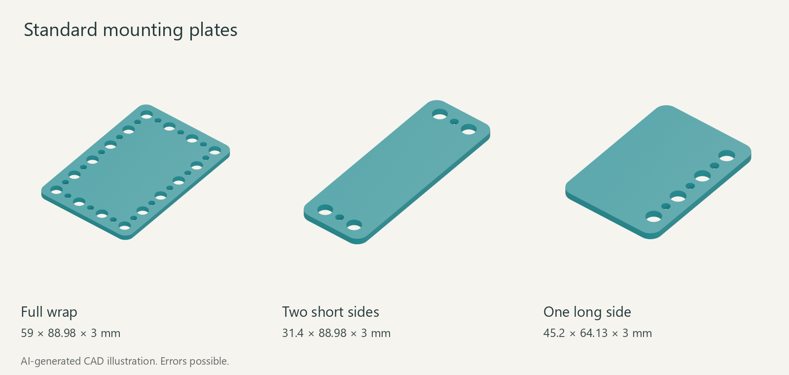
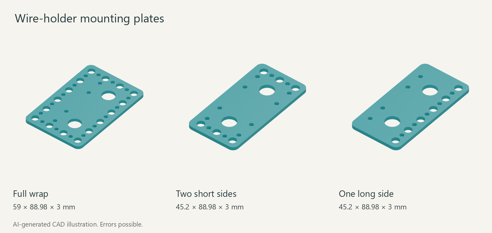

<!-- oomp-documentation:start -->
# Electronic Breakout Microcontroller Esp32 C6 Wroom 1 N8 Devkitc 1 30 Pin 25 4 Mm Width 58 15 Mm Height 30 Pins Espressif Esp32 C6 Devkitc 1 N8

## Summary

OOMP catalogue record for Electronic Breakout Microcontroller Esp32 C6 Wroom 1 N8 Devkitc 1 30 Pin 25 4 Mm Width 58 15 Mm Height 30 Pins Espressif Esp32 C6 Devkitc 1 N8. Use the metadata to identify this variant and the part folder to inspect its available assets.

## Details

**OOMP folder ID:** `electronic_breakout_microcontroller_esp32_c6_wroom_1_n8_devkitc_1_30_pin_25_4_mm_width_58_15_mm_height_30_pins_espressif_esp32_c6_devkitc_1_n8`

[Catalogue](../../README.md) · [Part metadata](working.yaml)

| Field | Value |
| --- | --- |
| id | electronic_breakout_microcontroller_esp32_c6_wroom_1_n8_devkitc_1_30_pin_25_4_mm_width_58_15_mm_height_30_pins_espressif_esp32_c6_devkitc_1_n8 |
| md5_6 | 46fb0c |
| md5_6_alpha | 2rpcc |
| oomp_key | oomp_electronic_breakout_microcontroller_esp32_c6_wroom_1_n8_devkitc_1_30_pin_25_4_mm_width_58_15_mm_height_30_pins_espressif_esp32_c6_devkitc_1_n8 |
| taxonomy_1 | electronic |
| taxonomy_2 | breakout |
| taxonomy_3 | microcontroller |
| taxonomy_4 | esp32_c6_wroom_1_n8 |
| taxonomy_5 | devkitc_1_30_pin |
| taxonomy_6 | 25_4_mm_width_58_15_mm_height_30_pins |
| taxonomy_14 | espressif |
| taxonomy_15 | esp32_c6_devkitc_1_n8 |

<details>
<summary>Full part metadata</summary>

```yaml
assembly:
  header_pitch_mm: 2.54
  headers: with_headers
bip_39_2_word_array:
- eight
- such
bip_39_2_word_no_space: eightsuch
bip_39_2_word_space: eight such
bip_39_2_word_underscore: eight_such
bip_39_3_word_array:
- eight
- such
- barely
bip_39_3_word_no_space: eightsuchbarely
bip_39_3_word_space: eight such barely
bip_39_3_word_underscore: eight_such_barely
bip_39_full_array:
- eight
- such
- barely
- lock
- opera
- clever
- limit
- shaft
- pen
- myth
- peace
- august
bip_39_full_no_space: eightsuchbarelylockoperacleverlimitshaftpenmythpeaceaugust
bip_39_full_space: eight such barely lock opera clever limit shaft pen myth peace
  august
bip_39_full_underscore: eight_such_barely_lock_opera_clever_limit_shaft_pen_myth_peace_august
breakout_description: 25_4_mm_width_58_15_mm_height_30_pins
breakout_pcb_height: 51.8
breakout_pcb_width: 25.4
chip:
  family: esp32_c6
  identity_scope: catalogue_chip_or_module_label
  oomp_id: null
  part_number: esp32_c6_wroom_1_n8
  silicon_revision: null
chip_resources:
  clock_max_mhz: 160
  cpu_core_count: 1
  general_purpose_spi_controllers: 1
  hardware_i2c_controllers: 1
  hardware_uart_controllers: 2
  pio_state_machines: 0
  pwm_channels: 6
  scope: silicon resources; board routing and firmware may reduce availability
  source_id: chip_datasheet
connectors:
  J1:
    contact_count: 16
    pitch_mm: 2.54
    row_spacing_mm: 22.86
    source_id: board_guide
  J3:
    contact_count: 16
    pitch_mm: 2.54
    row_spacing_mm: 22.86
    source_id: board_guide
coordinate_system:
  origin: centre_of_pcb_outline
  units: mm
  view: top_with_usb_at_positive_y
  x_positive: right
  y_positive: towards_usb
data_gaps:
- Assembled component keepouts and USB insertion/cable envelopes have not been captured.
- Chip package/module pad numbers are not fully transcribed; null chip_pin_number
  values must not be replaced with carrier-header numbers.
default_interfaces:
  i2c:
    api: Wire
    basis: framework_defaults
    framework: arduino-esp32
    notes:
    - Defaults apply when selecting this generic Arduino target; they do not establish
      a carrier-specific hardware convention.
    peripheral: null
    pin_keys:
      scl:
      - J3_6
      sda:
      - J3_5
    protocol: i2c
    scl_gpio: 22
    sda_gpio: 23
    signal_status:
      scl: mapped
      sda: mapped
    source_ids:
    - interface_variant
    - interface_board_selection
    - interface_runtime_i2c
    status: documented
    variant: esp32c6
    variant_scope: generic_target_selection
  spi:
    api: SPI
    basis: framework_defaults
    framework: arduino-esp32
    miso_gpio: 20
    mosi_gpio: 19
    notes:
    - Defaults apply when selecting this generic Arduino target; they do not establish
      a carrier-specific hardware convention.
    - ss is the framework chip-select alias/default, not an automatically asserted
      CS. Select and drive CS as required by the peripheral and library.
    peripheral: null
    pin_keys:
      miso:
      - J3_8
      mosi:
      - J3_9
      sck:
      - J3_7
      ss:
      - J3_10
    protocol: spi
    sck_gpio: 21
    signal_status:
      miso: mapped
      mosi: mapped
      sck: mapped
      ss: mapped
    source_ids:
    - interface_variant
    - interface_board_selection
    - interface_runtime_spi
    ss_gpio: 18
    status: documented
    variant: esp32c6
    variant_scope: generic_target_selection
  uart:
    api: null
    basis: framework_pin_aliases
    framework: arduino-esp32
    notes:
    - Defaults apply when selecting this generic Arduino target; they do not establish
      a carrier-specific hardware convention.
    - UART GPIOs are distinct from USB CDC/USB Serial. The meaning of Serial depends
      on the core and USB build settings.
    - TX/RX are board variant aliases. Pass the GPIOs explicitly to the selected HardwareSerial
      instance; no-argument pin selection can use SoC UART defaults instead.
    peripheral: null
    pin_keys:
      rx:
      - J3_3
      tx:
      - J3_2
    protocol: uart
    rx_gpio: 17
    signal_status:
      rx: mapped
      tx: mapped
    source_ids:
    - interface_variant
    - interface_board_selection
    - interface_runtime_uart
    status: documented
    tx_gpio: 16
    variant: esp32c6
    variant_scope: generic_target_selection
dimensions_mm:
  assembled_height: null
  height: 51.8
  module_antenna_overhang_positive_y: 6.35
  pcb_thickness: null
  scope: carrier_pcb_excludes_module_antenna_and_usb_overhang
  source_id: mechanical
  status: manufacturer_drawing
  width: 25.4
directory: parts/electronic_breakout_microcontroller_esp32_c6_wroom_1_n8_devkitc_1_30_pin_25_4_mm_width_58_15_mm_height_30_pins_espressif_esp32_c6_devkitc_1_n8
electrical:
  gpio_5v_tolerant: false
  logic_voltage_v: 3.3
  source_id: chip_datasheet
  usb_connector: dual_usb_c
form_factor: devkitc_1_30_pin
gpio_summary:
  analog_candidates:
  - 0
  - 1
  - 2
  - 3
  - 4
  - 5
  - 6
  automatic_firmware_enable: false
  exposed:
  - 0
  - 1
  - 2
  - 3
  - 4
  - 5
  - 6
  - 7
  - 8
  - 9
  - 10
  - 11
  - 12
  - 13
  - 15
  - 16
  - 17
  - 18
  - 19
  - 20
  - 21
  - 22
  - 23
  general_io_candidates:
  - 0
  - 1
  - 2
  - 3
  - 4
  - 5
  - 6
  - 7
  - 8
  - 9
  - 10
  - 11
  - 12
  - 13
  - 15
  - 16
  - 17
  - 18
  - 19
  - 20
  - 21
  - 22
  - 23
id: electronic_breakout_microcontroller_esp32_c6_wroom_1_n8_devkitc_1_30_pin_25_4_mm_width_58_15_mm_height_30_pins_espressif_esp32_c6_devkitc_1_n8
id_no_class: electronic_breakout_microcontroller_esp32_c6_wroom_1_n8_devkitc_1_30_pin_25_4_mm_width_58_15_mm_height_30_pins_espressif_esp32_c6_devkitc_1_n8
id_no_size: electronic_breakout_microcontroller_esp32_c6_wroom_1_n8_devkitc_1_30_pin_25_4_mm_width_58_15_mm_height_30_pins_espressif_esp32_c6_devkitc_1_n8
id_no_type: electronic_breakout_microcontroller_esp32_c6_wroom_1_n8_devkitc_1_30_pin_25_4_mm_width_58_15_mm_height_30_pins_espressif_esp32_c6_devkitc_1_n8
interface_defaults_version: 1
item_kind: breakout
lab_support:
  automatic_firmware_enable: false
  gpio_matrix_routing: true
  requires_reviewed_board_profile: true
  status: catalogue_reference_only
link_github: https://github.com/oomlout/oomlout_oomp_version_1_messy/tree/main/parts/electronic_breakout_microcontroller_esp32_c6_wroom_1_n8_devkitc_1_30_pin_25_4_mm_width_58_15_mm_height_30_pins_espressif_esp32_c6_devkitc_1_n8
link_main: https://github.com/oomlout/oomlout_oomp_version_1_messy/tree/main/parts/electronic_breakout_microcontroller_esp32_c6_wroom_1_n8_devkitc_1_30_pin_25_4_mm_width_58_15_mm_height_30_pins_espressif_esp32_c6_devkitc_1_n8
link_redirect: https://github.com/oomlout/oomlout_oomp_version_1_messy/tree/main/parts/electronic_breakout_microcontroller_esp32_c6_wroom_1_n8_devkitc_1_30_pin_25_4_mm_width_58_15_mm_height_30_pins_espressif_esp32_c6_devkitc_1_n8
manufacturer: espressif
md5: 46fb0c4a41b9b455207e27a272528707
md5_10: 46fb0c4a41
md5_10_upper: 46FB0C4A41
md5_5: 46fb0
md5_5_upper: 46FB0
md5_6: 46fb0c
md5_6_alpha: 2rpcc
md5_6_alpha_upper: 2RPCC
md5_6_upper: 46FB0C
memory:
  external_flash_bytes: 8388608
  psram_bytes: null
mounting_coordinate_system:
  origin: pcb_bounding_box_centre
  units: mm
  view: top
  x_positive: right
  y_positive: up
mounting_geometry_ready: false
mounting_hole_candidates: []
mounting_hole_details: []
mounting_hole_radius_name: m2
mounting_hole_radius_names: []
mounting_hole_status: no_holes
mounting_holes: []
mounting_lift: 3
mounting_research:
  board_revision: Espressif ESP32-C6-DevKitC-1-N8 carrier, PCB layout and dimensions
    drawing Rev 1.2. The official guide documents later electrical schematic revisions
    by production batch; the reviewed Rev 1.2 mechanical outline/layout identifies
    the N8 carrier geometry.
  board_size:
  - 25.4
  - 51.8
  coordinate_system:
    origin: pcb_bounding_box_centre
    units: mm
    view: top
    x_positive: right
    y_positive: up
  derivation: The complete official top-view dimensions sheet labels the carrier PCB
    outline 25.40 mm wide and 51.80 mm high. Taking the lower-left PCB outline bound
    as (0, 0), the centred top-view frame is x = X - 12.70 mm and y = Y - 25.90 mm;
    +X points right, +Y points toward the antenna end, and the USB connectors are
    at negative Y. No rotation, reflection or axis swap is applied. The complete dimensions
    sheet and all five pages of the exact Rev 1.2 PCB layout were reviewed. The 32
    side-pad drills are header contacts; the two J5 drills are current-measurement
    jumper pads; the large oblong drills along the USB end are USB connector retaining/through-hole
    features; the many small drills are vias or component pads. None is a board mounting
    hole. No designated mounting-hole pattern or drill callout appears in the complete
    carrier evidence. The seeded mounting_context.json says USB is at positive Y;
    the official dimension drawing and complete PCB layout place USB at the lower
    end, so the canonical +Y-up top-view frame puts USB at negative Y.
  fit_status: generic_holder_not_physical_fit_tested
  identity_evidence: Espressif’s official ESP32-C6-DevKitC-1 v1.2 guide identifies
    the N8 variant as using ESP32-C6-WROOM-1 with 8 MB SPI flash and links the v1.2
    PCB layout, dimensions drawing and DXF. The official PCB layout title block reads
    ESP32-C6-DevKitC-1, Rev 1.2, dated 2023-01-11; the matching dimensions PDF and
    DXF filenames also identify v1.2.
  mounting_holes: []
  record_sha256: cbca8b317c2ba2dc4da3c4057980412ead96de332b68ddae2fc54226f609ad2f
  research_file: source_file/electronic_breakout_microcontroller_esp32_c6_wroom_1_n8_devkitc_1_30_pin_25_4_mm_width_58_15_mm_height_30_pins_espressif_esp32_c6_devkitc_1_n8/mounting.yaml
  reviewed_by: gpt-6-luna
  sources:
  - bytes: 41772
    id: product
    kind: manufacturer_product
    local_file: mounting_evidence/product.html
    locator: 'Official Espressif guide: ESP32-C6-DevKitC-1 v1.2 exact product identity;
      ordering table identifies ESP32-C6-DevKitC-1-N8 with WROOM-1 and 8 MB; links
      PCB layout and dimensions source; acquired 2026-11-06'
    registered_at: '2026-11-06T18:24:09+00:00'
    sha256: ff650e3d8830e610e170d7bfb4c6abcf44b2bbb12101e86176b5c4c43b923c0c
    url: https://docs.espressif.com/projects/esp-dev-kits/en/latest/esp32c6/esp32-c6-devkitc-1/user_guide.html
  - bytes: 1451081
    id: pcb_layout
    kind: manufacturer_cad
    local_file: mounting_evidence/pcb-layout-v1.2.pdf
    locator: Complete 5-page official PCB layout, title block ESP32-C6-DevKitC-1 Rev
      1.2 dated 2023-01-11; reviewed all layers/pages, both board sides, header/J5
      drills, USB connector anchors and all visible drill candidates; no board mounting
      holes; acquired 2026-11-06
    registered_at: '2026-11-06T18:24:09+00:00'
    sha256: de37074086fb6d80111fc27bb63c2732015ee59d12074a9952d9c7c84f956266
    url: https://dl.espressif.com/dl/schematics/esp32-c6-devkitc-1-pcb-layout_v1.2.pdf
  - bytes: 3983012
    id: dimensions_dxf
    kind: manufacturer_cad
    local_file: mounting_evidence/dimensions-source-v1.2.dxf
    locator: Official Espressif v1.2 source drawing linked from product guide; exact
      dimension/outline source file; acquired 2026-11-06
    registered_at: '2026-11-06T18:24:10+00:00'
    sha256: 8bfd7e5ed84bf3e4a1fc56498595cb1d5ffdc48c7cd8e8ff5544588fd14e9a63
    url: https://dl.espressif.com/dl/schematics/esp32-c6-devkitc-1-dimensions_v1.2.dxf
  - bytes: 1085902
    id: mechanical
    kind: manufacturer_drawing
    local_file: reference/esp32-c6-devkitc-1-dimensions_v1.2.pdf
    locator: Official one-page v1.2 dimension drawing linked from Espressif guide;
      full sheet reviewed, 25.40 x 51.80 mm PCB outline, no board mounting pattern;
      archived SHA-256 verified against mounting_context.json; acquired 2026-11-06
    registered_at: '2026-11-06T18:24:10+00:00'
    sha256: 44f8b92af56b5cdac607f356a244d6297ed054713dbd4d69c5a48848b1d75cac
    url: https://dl.espressif.com/dl/schematics/esp32-c6-devkitc-1-dimensions_v1.2.pdf
  - bytes: 515944
    id: schematic
    kind: manufacturer_schematic
    local_file: reference/esp32-c6-devkitc-1-schematics_v1.2.pdf
    locator: Official Espressif schematic v1.2, cross-checks header/J5/USB connector
      designators and board revision identity; archived SHA-256 verified against mounting_context.json;
      acquired 2026-11-06
    registered_at: '2026-11-06T18:24:11+00:00'
    sha256: 4718c322c698db80bafe09c66cfe08e3c9ed3a09d5aaafa5748a15794d24902d
    url: https://dl.espressif.com/dl/schematics/esp32-c6-devkitc-1-schematics_v1.2.pdf
  status: no_holes
name: Electronic Breakout Microcontroller Esp32 C6 Wroom 1 N8 Devkitc 1 30 Pin 25
  4 Mm Width 58 15 Mm Height 30 Pins Espressif Esp32 C6 Devkitc 1 N8
name_no_class: Electronic Breakout Microcontroller Esp32 C6 Wroom 1 N8 Devkitc 1 30
  Pin 25 4 Mm Width 58 15 Mm Height 30 Pins Espressif Esp32 C6 Devkitc 1 N8
name_no_size: Electronic Breakout Microcontroller Esp32 C6 Wroom 1 N8 Devkitc 1 30
  Pin 25 4 Mm Width 58 15 Mm Height 30 Pins Espressif Esp32 C6 Devkitc 1 N8
name_no_type: Electronic Breakout Microcontroller Esp32 C6 Wroom 1 N8 Devkitc 1 30
  Pin 25 4 Mm Width 58 15 Mm Height 30 Pins Espressif Esp32 C6 Devkitc 1 N8
name_proper: Electronic Breakout Microcontroller Esp32 C6 Wroom 1 N8 Devkitc 1 30
  Pin 25 4 Mm Width 58 15 Mm Height 30 Pins Espressif Esp32 C6 Devkitc 1 N8
name_readable: Espressif ESP32-C6 DevKitC-1 N8 (32 contacts)
name_space: electronic breakout microcontroller esp32 c6 wroom 1 n8 devkitc 1 30 pin
  25 4 mm width 58 15 mm height 30 pins espressif esp32 c6 devkitc 1 n8
name_upper: ELECTRONIC BREAKOUT MICROCONTROLLER ESP32 C6 WROOM 1 N8 DEVKITC 1 30 PIN
  25 4 MM WIDTH 58 15 MM HEIGHT 30 PINS ESPRESSIF ESP32 C6 DEVKITC 1 N8
notes:
- Physical header contacts include supply, ground and reserved contacts; contact count
  is not GPIO count.
onboard_gpio_connections:
- function: addressable_rgb_led
  gpio: 8
  source_id: board_guide
oobb_details: []
oomlout_ai_roboclick_1:
  actions:
  - command: text_jinja_template
    convert_to_pdf: false
    convert_to_png: false
    dict_data:
      assembly:
        header_pitch_mm: 2.54
        headers: with_headers
      breakout_description: 25_4_mm_width_58_15_mm_height_30_pins
      breakout_pcb_height: 51.8
      breakout_pcb_width: 25.4
      chip:
        family: esp32_c6
        identity_scope: catalogue_chip_or_module_label
        oomp_id: null
        part_number: esp32_c6_wroom_1_n8
        silicon_revision: null
      chip_resources:
        clock_max_mhz: 160
        cpu_core_count: 1
        general_purpose_spi_controllers: 1
        hardware_i2c_controllers: 1
        hardware_uart_controllers: 2
        pio_state_machines: 0
        pwm_channels: 6
        scope: silicon resources; board routing and firmware may reduce availability
        source_id: chip_datasheet
      connectors:
        J1:
          contact_count: 16
          pitch_mm: 2.54
          row_spacing_mm: 22.86
          source_id: board_guide
        J3:
          contact_count: 16
          pitch_mm: 2.54
          row_spacing_mm: 22.86
          source_id: board_guide
      coordinate_system:
        origin: centre_of_pcb_outline
        units: mm
        view: top_with_usb_at_positive_y
        x_positive: right
        y_positive: towards_usb
      data_gaps:
      - Assembled component keepouts and USB insertion/cable envelopes have not been
        captured.
      - Chip package/module pad numbers are not fully transcribed; null chip_pin_number
        values must not be replaced with carrier-header numbers.
      default_interfaces:
        i2c:
          api: Wire
          basis: framework_defaults
          framework: arduino-esp32
          notes:
          - Defaults apply when selecting this generic Arduino target; they do not
            establish a carrier-specific hardware convention.
          peripheral: null
          pin_keys:
            scl:
            - J3_6
            sda:
            - J3_5
          protocol: i2c
          scl_gpio: 22
          sda_gpio: 23
          signal_status:
            scl: mapped
            sda: mapped
          source_ids:
          - interface_variant
          - interface_board_selection
          - interface_runtime_i2c
          status: documented
          variant: esp32c6
          variant_scope: generic_target_selection
        spi:
          api: SPI
          basis: framework_defaults
          framework: arduino-esp32
          miso_gpio: 20
          mosi_gpio: 19
          notes:
          - Defaults apply when selecting this generic Arduino target; they do not
            establish a carrier-specific hardware convention.
          - ss is the framework chip-select alias/default, not an automatically asserted
            CS. Select and drive CS as required by the peripheral and library.
          peripheral: null
          pin_keys:
            miso:
            - J3_8
            mosi:
            - J3_9
            sck:
            - J3_7
            ss:
            - J3_10
          protocol: spi
          sck_gpio: 21
          signal_status:
            miso: mapped
            mosi: mapped
            sck: mapped
            ss: mapped
          source_ids:
          - interface_variant
          - interface_board_selection
          - interface_runtime_spi
          ss_gpio: 18
          status: documented
          variant: esp32c6
          variant_scope: generic_target_selection
        uart:
          api: null
          basis: framework_pin_aliases
          framework: arduino-esp32
          notes:
          - Defaults apply when selecting this generic Arduino target; they do not
            establish a carrier-specific hardware convention.
          - UART GPIOs are distinct from USB CDC/USB Serial. The meaning of Serial
            depends on the core and USB build settings.
          - TX/RX are board variant aliases. Pass the GPIOs explicitly to the selected
            HardwareSerial instance; no-argument pin selection can use SoC UART defaults
            instead.
          peripheral: null
          pin_keys:
            rx:
            - J3_3
            tx:
            - J3_2
          protocol: uart
          rx_gpio: 17
          signal_status:
            rx: mapped
            tx: mapped
          source_ids:
          - interface_variant
          - interface_board_selection
          - interface_runtime_uart
          status: documented
          tx_gpio: 16
          variant: esp32c6
          variant_scope: generic_target_selection
      dimensions_mm:
        assembled_height: null
        height: 51.8
        module_antenna_overhang_positive_y: 6.35
        pcb_thickness: null
        scope: carrier_pcb_excludes_module_antenna_and_usb_overhang
        source_id: mechanical
        status: manufacturer_drawing
        width: 25.4
      directory: parts\electronic_breakout_microcontroller_esp32_c6_wroom_1_n8_devkitc_1_30_pin_25_4_mm_width_58_15_mm_height_30_pins_espressif_esp32_c6_devkitc_1_n8
      electrical:
        gpio_5v_tolerant: false
        logic_voltage_v: 3.3
        source_id: chip_datasheet
        usb_connector: dual_usb_c
      form_factor: devkitc_1_30_pin
      gpio_summary:
        analog_candidates:
        - 0
        - 1
        - 2
        - 3
        - 4
        - 5
        - 6
        automatic_firmware_enable: false
        exposed:
        - 0
        - 1
        - 2
        - 3
        - 4
        - 5
        - 6
        - 7
        - 8
        - 9
        - 10
        - 11
        - 12
        - 13
        - 15
        - 16
        - 17
        - 18
        - 19
        - 20
        - 21
        - 22
        - 23
        general_io_candidates:
        - 0
        - 1
        - 2
        - 3
        - 4
        - 5
        - 6
        - 7
        - 8
        - 9
        - 10
        - 11
        - 12
        - 13
        - 15
        - 16
        - 17
        - 18
        - 19
        - 20
        - 21
        - 22
        - 23
      interface_defaults_version: 1
      item_kind: breakout
      lab_support:
        automatic_firmware_enable: false
        gpio_matrix_routing: true
        requires_reviewed_board_profile: true
        status: catalogue_reference_only
      manufacturer: espressif
      memory:
        external_flash_bytes: 8388608
        psram_bytes: null
      mounting_coordinate_system:
        origin: pcb_bounding_box_centre
        units: mm
        view: top
        x_positive: right
        y_positive: up
      mounting_geometry_ready: false
      mounting_hole_candidates: []
      mounting_hole_details: []
      mounting_hole_radius_name: m2
      mounting_hole_radius_names: []
      mounting_hole_status: no_holes
      mounting_holes: []
      mounting_lift: 3
      mounting_research:
        board_revision: Espressif ESP32-C6-DevKitC-1-N8 carrier, PCB layout and dimensions
          drawing Rev 1.2. The official guide documents later electrical schematic
          revisions by production batch; the reviewed Rev 1.2 mechanical outline/layout
          identifies the N8 carrier geometry.
        board_size:
        - 25.4
        - 51.8
        coordinate_system:
          origin: pcb_bounding_box_centre
          units: mm
          view: top
          x_positive: right
          y_positive: up
        derivation: The complete official top-view dimensions sheet labels the carrier
          PCB outline 25.40 mm wide and 51.80 mm high. Taking the lower-left PCB outline
          bound as (0, 0), the centred top-view frame is x = X - 12.70 mm and y =
          Y - 25.90 mm; +X points right, +Y points toward the antenna end, and the
          USB connectors are at negative Y. No rotation, reflection or axis swap is
          applied. The complete dimensions sheet and all five pages of the exact Rev
          1.2 PCB layout were reviewed. The 32 side-pad drills are header contacts;
          the two J5 drills are current-measurement jumper pads; the large oblong
          drills along the USB end are USB connector retaining/through-hole features;
          the many small drills are vias or component pads. None is a board mounting
          hole. No designated mounting-hole pattern or drill callout appears in the
          complete carrier evidence. The seeded mounting_context.json says USB is
          at positive Y; the official dimension drawing and complete PCB layout place
          USB at the lower end, so the canonical +Y-up top-view frame puts USB at
          negative Y.
        fit_status: generic_holder_not_physical_fit_tested
        identity_evidence: Espressif’s official ESP32-C6-DevKitC-1 v1.2 guide identifies
          the N8 variant as using ESP32-C6-WROOM-1 with 8 MB SPI flash and links the
          v1.2 PCB layout, dimensions drawing and DXF. The official PCB layout title
          block reads ESP32-C6-DevKitC-1, Rev 1.2, dated 2023-01-11; the matching
          dimensions PDF and DXF filenames also identify v1.2.
        mounting_holes: []
        record_sha256: cbca8b317c2ba2dc4da3c4057980412ead96de332b68ddae2fc54226f609ad2f
        research_file: source_file/electronic_breakout_microcontroller_esp32_c6_wroom_1_n8_devkitc_1_30_pin_25_4_mm_width_58_15_mm_height_30_pins_espressif_esp32_c6_devkitc_1_n8/mounting.yaml
        reviewed_by: gpt-6-luna
        sources:
        - bytes: 41772
          id: product
          kind: manufacturer_product
          local_file: mounting_evidence/product.html
          locator: 'Official Espressif guide: ESP32-C6-DevKitC-1 v1.2 exact product
            identity; ordering table identifies ESP32-C6-DevKitC-1-N8 with WROOM-1
            and 8 MB; links PCB layout and dimensions source; acquired 2026-11-06'
          registered_at: '2026-11-06T18:24:09+00:00'
          sha256: ff650e3d8830e610e170d7bfb4c6abcf44b2bbb12101e86176b5c4c43b923c0c
          url: https://docs.espressif.com/projects/esp-dev-kits/en/latest/esp32c6/esp32-c6-devkitc-1/user_guide.html
        - bytes: 1451081
          id: pcb_layout
          kind: manufacturer_cad
          local_file: mounting_evidence/pcb-layout-v1.2.pdf
          locator: Complete 5-page official PCB layout, title block ESP32-C6-DevKitC-1
            Rev 1.2 dated 2023-01-11; reviewed all layers/pages, both board sides,
            header/J5 drills, USB connector anchors and all visible drill candidates;
            no board mounting holes; acquired 2026-11-06
          registered_at: '2026-11-06T18:24:09+00:00'
          sha256: de37074086fb6d80111fc27bb63c2732015ee59d12074a9952d9c7c84f956266
          url: https://dl.espressif.com/dl/schematics/esp32-c6-devkitc-1-pcb-layout_v1.2.pdf
        - bytes: 3983012
          id: dimensions_dxf
          kind: manufacturer_cad
          local_file: mounting_evidence/dimensions-source-v1.2.dxf
          locator: Official Espressif v1.2 source drawing linked from product guide;
            exact dimension/outline source file; acquired 2026-11-06
          registered_at: '2026-11-06T18:24:10+00:00'
          sha256: 8bfd7e5ed84bf3e4a1fc56498595cb1d5ffdc48c7cd8e8ff5544588fd14e9a63
          url: https://dl.espressif.com/dl/schematics/esp32-c6-devkitc-1-dimensions_v1.2.dxf
        - bytes: 1085902
          id: mechanical
          kind: manufacturer_drawing
          local_file: reference/esp32-c6-devkitc-1-dimensions_v1.2.pdf
          locator: Official one-page v1.2 dimension drawing linked from Espressif
            guide; full sheet reviewed, 25.40 x 51.80 mm PCB outline, no board mounting
            pattern; archived SHA-256 verified against mounting_context.json; acquired
            2026-11-06
          registered_at: '2026-11-06T18:24:10+00:00'
          sha256: 44f8b92af56b5cdac607f356a244d6297ed054713dbd4d69c5a48848b1d75cac
          url: https://dl.espressif.com/dl/schematics/esp32-c6-devkitc-1-dimensions_v1.2.pdf
        - bytes: 515944
          id: schematic
          kind: manufacturer_schematic
          local_file: reference/esp32-c6-devkitc-1-schematics_v1.2.pdf
          locator: Official Espressif schematic v1.2, cross-checks header/J5/USB connector
            designators and board revision identity; archived SHA-256 verified against
            mounting_context.json; acquired 2026-11-06
          registered_at: '2026-11-06T18:24:11+00:00'
          sha256: 4718c322c698db80bafe09c66cfe08e3c9ed3a09d5aaafa5748a15794d24902d
          url: https://dl.espressif.com/dl/schematics/esp32-c6-devkitc-1-schematics_v1.2.pdf
        status: no_holes
      name: electronic_breakout_microcontroller_esp32_c6_wroom_1_n8_devkitc_1_30_pin_25_4_mm_width_58_15_mm_height_30_pins_espressif_esp32_c6_devkitc_1_n8
      name_proper: Electronic Breakout Microcontroller Esp32 C6 Wroom 1 N8 Devkitc
        1 30 Pin 25 4 Mm Width 58 15 Mm Height 30 Pins Espressif Esp32 C6 Devkitc
        1 N8
      name_readable: Espressif ESP32-C6 DevKitC-1 N8 (32 contacts)
      name_space: electronic breakout microcontroller esp32 c6 wroom 1 n8 devkitc
        1 30 pin 25 4 mm width 58 15 mm height 30 pins espressif esp32 c6 devkitc
        1 n8
      name_upper: ELECTRONIC BREAKOUT MICROCONTROLLER ESP32 C6 WROOM 1 N8 DEVKITC
        1 30 PIN 25 4 MM WIDTH 58 15 MM HEIGHT 30 PINS ESPRESSIF ESP32 C6 DEVKITC
        1 N8
      notes:
      - Physical header contacts include supply, ground and reserved contacts; contact
        count is not GPIO count.
      onboard_gpio_connections:
      - function: addressable_rgb_led
        gpio: 8
        source_id: board_guide
      oobb_details: []
      part_number: esp32_c6_devkitc_1_n8
      pinout_scope: Expansion connectors and explicitly listed test pads; USB socket
        contacts excluded.
      pinout_status: documented_contact_inventory
      pins:
        J1_1:
          adc_channel: null
          adc_unit: null
          aliases: []
          available_for_general_io: false
          capabilities: []
          chip_pin_number: null
          connector: J1
          default_interface_roles: []
          direction: not_applicable
          functions:
          - 3.3 V power supply
          - 3V3
          gpio: null
          manufacturer_pin_type: P
          name: 3V3
          number: '1'
          position_source_id: mechanical
          restrictions: []
          signal_types: []
          source_id: board_guide
          surface: unspecified
          type: power
          x_mm: 11.43
          y_mm: -24.63
        J1_10:
          adc_channel: null
          adc_unit: null
          aliases: []
          available_for_general_io: true
          capabilities:
          - gpio
          - digital_input
          - digital_output
          - pwm
          capability_source_id: chip_datasheet
          chip_pin_number: null
          connector: J1
          default_interface_roles: []
          direction: bidirectional
          functions:
          - GPIO10
          gpio: 10
          input_only: false
          lab_analog_eligible: false
          logic_voltage_v: 3.3
          manufacturer_pin_type: I/O/T
          name: '10'
          number: '10'
          position_source_id: mechanical
          restrictions: []
          routable_peripherals:
          - uart
          - spi
          - i2c
          - i2s
          - rmt
          - pwm
          signal_types:
          - digital
          source_id: board_guide
          surface: unspecified
          type: gpio
          x_mm: 11.43
          y_mm: -1.77
        J1_11:
          adc_channel: null
          adc_unit: null
          aliases: []
          available_for_general_io: true
          capabilities:
          - gpio
          - digital_input
          - digital_output
          - pwm
          capability_source_id: chip_datasheet
          chip_pin_number: null
          connector: J1
          default_interface_roles: []
          direction: bidirectional
          functions:
          - GPIO11
          gpio: 11
          input_only: false
          lab_analog_eligible: false
          logic_voltage_v: 3.3
          manufacturer_pin_type: I/O/T
          name: '11'
          number: '11'
          position_source_id: mechanical
          restrictions: []
          routable_peripherals:
          - uart
          - spi
          - i2c
          - i2s
          - rmt
          - pwm
          signal_types:
          - digital
          source_id: board_guide
          surface: unspecified
          type: gpio
          x_mm: 11.43
          y_mm: 0.77
        J1_12:
          adc_channel: 2
          adc_unit: 1
          aliases: []
          available_for_general_io: true
          capabilities:
          - gpio
          - digital_input
          - digital_output
          - pwm
          - analog_input
          capability_source_id: chip_datasheet
          chip_pin_number: null
          connector: J1
          default_interface_roles: []
          direction: bidirectional
          functions:
          - GPIO2
          - LP_GPIO2
          - LP_UART_RTSN
          - ADC1_CH2
          - FSPIQ
          gpio: 2
          input_only: false
          lab_analog_eligible: true
          logic_voltage_v: 3.3
          manufacturer_pin_type: I/O/T
          name: '2'
          number: '12'
          position_source_id: mechanical
          restrictions: []
          routable_peripherals:
          - uart
          - spi
          - i2c
          - i2s
          - rmt
          - pwm
          signal_types:
          - digital
          - analog
          source_id: board_guide
          surface: unspecified
          type: gpio
          x_mm: 11.43
          y_mm: 3.31
        J1_13:
          adc_channel: 3
          adc_unit: 1
          aliases: []
          available_for_general_io: true
          capabilities:
          - gpio
          - digital_input
          - digital_output
          - pwm
          - analog_input
          capability_source_id: chip_datasheet
          chip_pin_number: null
          connector: J1
          default_interface_roles: []
          direction: bidirectional
          functions:
          - GPIO3
          - LP_GPIO3
          - LP_UART_CTSN
          - ADC1_CH3
          gpio: 3
          input_only: false
          lab_analog_eligible: true
          logic_voltage_v: 3.3
          manufacturer_pin_type: I/O/T
          name: '3'
          number: '13'
          position_source_id: mechanical
          restrictions: []
          routable_peripherals:
          - uart
          - spi
          - i2c
          - i2s
          - rmt
          - pwm
          signal_types:
          - digital
          - analog
          source_id: board_guide
          surface: unspecified
          type: gpio
          x_mm: 11.43
          y_mm: 5.85
        J1_14:
          adc_channel: null
          adc_unit: null
          aliases: []
          available_for_general_io: false
          capabilities: []
          chip_pin_number: null
          connector: J1
          default_interface_roles: []
          direction: not_applicable
          functions:
          - 5 V power supply
          - 5V
          gpio: null
          manufacturer_pin_type: P
          name: 5V
          number: '14'
          position_source_id: mechanical
          restrictions: []
          signal_types: []
          source_id: board_guide
          surface: unspecified
          type: power
          x_mm: 11.43
          y_mm: 8.39
        J1_15:
          adc_channel: null
          adc_unit: null
          aliases: []
          available_for_general_io: false
          capabilities: []
          chip_pin_number: null
          connector: J1
          default_interface_roles: []
          direction: not_applicable
          functions:
          - Ground
          - G
          gpio: null
          manufacturer_pin_type: G
          name: G
          number: '15'
          position_source_id: mechanical
          restrictions: []
          signal_types: []
          source_id: board_guide
          surface: unspecified
          type: ground
          x_mm: 11.43
          y_mm: 10.93
        J1_16:
          adc_channel: null
          adc_unit: null
          aliases: []
          available_for_general_io: false
          capabilities: []
          chip_pin_number: null
          connector: J1
          default_interface_roles: []
          direction: not_applicable
          functions:
          - No connection
          - NC
          gpio: null
          manufacturer_pin_type: –
          name: NC
          number: '16'
          position_source_id: mechanical
          restrictions: []
          signal_types: []
          source_id: board_guide
          surface: unspecified
          type: not_connected
          x_mm: 11.43
          y_mm: 13.47
        J1_2:
          adc_channel: null
          adc_unit: null
          aliases: []
          available_for_general_io: false
          capabilities: []
          chip_pin_number: null
          connector: J1
          default_interface_roles: []
          direction: not_applicable
          functions:
          - 'High: enables the chip; Low: disables the chip.'
          - RST
          gpio: null
          manufacturer_pin_type: I
          name: RST
          number: '2'
          position_source_id: mechanical
          restrictions: []
          signal_types: []
          source_id: board_guide
          surface: unspecified
          type: control
          x_mm: 11.43
          y_mm: -22.09
        J1_3:
          adc_channel: 4
          adc_unit: 1
          aliases: []
          available_for_general_io: true
          capabilities:
          - gpio
          - digital_input
          - digital_output
          - pwm
          - analog_input
          capability_source_id: chip_datasheet
          chip_pin_number: null
          connector: J1
          default_interface_roles: []
          direction: bidirectional
          functions:
          - MTMS
          - GPIO4
          - LP_GPIO4
          - LP_UART_RXD
          - ADC1_CH4
          - FSPIHD
          gpio: 4
          input_only: false
          lab_analog_eligible: true
          logic_voltage_v: 3.3
          manufacturer_pin_type: I/O/T
          name: '4'
          number: '3'
          position_source_id: mechanical
          restrictions:
          - Boot strapping pin; external levels affect startup.
          routable_peripherals:
          - uart
          - spi
          - i2c
          - i2s
          - rmt
          - pwm
          signal_types:
          - digital
          - analog
          source_id: board_guide
          surface: unspecified
          type: gpio
          x_mm: 11.43
          y_mm: -19.55
        J1_4:
          adc_channel: 5
          adc_unit: 1
          aliases: []
          available_for_general_io: true
          capabilities:
          - gpio
          - digital_input
          - digital_output
          - pwm
          - analog_input
          capability_source_id: chip_datasheet
          chip_pin_number: null
          connector: J1
          default_interface_roles: []
          direction: bidirectional
          functions:
          - MTDI
          - GPIO5
          - LP_GPIO5
          - LP_UART_TXD
          - ADC1_CH5
          - FSPIWP
          gpio: 5
          input_only: false
          lab_analog_eligible: true
          logic_voltage_v: 3.3
          manufacturer_pin_type: I/O/T
          name: '5'
          number: '4'
          position_source_id: mechanical
          restrictions:
          - Boot strapping pin; external levels affect startup.
          routable_peripherals:
          - uart
          - spi
          - i2c
          - i2s
          - rmt
          - pwm
          signal_types:
          - digital
          - analog
          source_id: board_guide
          surface: unspecified
          type: gpio
          x_mm: 11.43
          y_mm: -17.01
        J1_5:
          adc_channel: 6
          adc_unit: 1
          aliases: []
          available_for_general_io: true
          capabilities:
          - gpio
          - digital_input
          - digital_output
          - pwm
          - analog_input
          capability_source_id: chip_datasheet
          chip_pin_number: null
          connector: J1
          default_interface_roles: []
          direction: bidirectional
          functions:
          - MTCK
          - GPIO6
          - LP_GPIO6
          - LP_I2C_SDA
          - ADC1_CH6
          - FSPICLK
          gpio: 6
          input_only: false
          lab_analog_eligible: true
          logic_voltage_v: 3.3
          manufacturer_pin_type: I/O/T
          name: '6'
          number: '5'
          position_source_id: mechanical
          restrictions: []
          routable_peripherals:
          - uart
          - spi
          - i2c
          - i2s
          - rmt
          - pwm
          signal_types:
          - digital
          - analog
          source_id: board_guide
          surface: unspecified
          type: gpio
          x_mm: 11.43
          y_mm: -14.47
        J1_6:
          adc_channel: null
          adc_unit: null
          aliases: []
          available_for_general_io: true
          capabilities:
          - gpio
          - digital_input
          - digital_output
          - pwm
          capability_source_id: chip_datasheet
          chip_pin_number: null
          connector: J1
          default_interface_roles: []
          direction: bidirectional
          functions:
          - MTDO
          - GPIO7
          - LP_GPIO7
          - LP_I2C_SCL
          - FSPID
          gpio: 7
          input_only: false
          lab_analog_eligible: false
          logic_voltage_v: 3.3
          manufacturer_pin_type: I/O/T
          name: '7'
          number: '6'
          position_source_id: mechanical
          restrictions: []
          routable_peripherals:
          - uart
          - spi
          - i2c
          - i2s
          - rmt
          - pwm
          signal_types:
          - digital
          source_id: board_guide
          surface: unspecified
          type: gpio
          x_mm: 11.43
          y_mm: -11.93
        J1_7:
          adc_channel: 0
          adc_unit: 1
          aliases: []
          available_for_general_io: true
          capabilities:
          - gpio
          - digital_input
          - digital_output
          - pwm
          - analog_input
          capability_source_id: chip_datasheet
          chip_pin_number: null
          connector: J1
          default_interface_roles: []
          direction: bidirectional
          functions:
          - GPIO0
          - XTAL_32K_P
          - LP_GPIO0
          - LP_UART_DTRN
          - ADC1_CH0
          gpio: 0
          input_only: false
          lab_analog_eligible: true
          logic_voltage_v: 3.3
          manufacturer_pin_type: I/O/T
          name: '0'
          number: '7'
          position_source_id: mechanical
          restrictions: []
          routable_peripherals:
          - uart
          - spi
          - i2c
          - i2s
          - rmt
          - pwm
          signal_types:
          - digital
          - analog
          source_id: board_guide
          surface: unspecified
          type: gpio
          x_mm: 11.43
          y_mm: -9.39
        J1_8:
          adc_channel: 1
          adc_unit: 1
          aliases: []
          available_for_general_io: true
          capabilities:
          - gpio
          - digital_input
          - digital_output
          - pwm
          - analog_input
          capability_source_id: chip_datasheet
          chip_pin_number: null
          connector: J1
          default_interface_roles: []
          direction: bidirectional
          functions:
          - GPIO1
          - XTAL_32K_N
          - LP_GPIO1
          - LP_UART_DSRN
          - ADC1_CH1
          gpio: 1
          input_only: false
          lab_analog_eligible: true
          logic_voltage_v: 3.3
          manufacturer_pin_type: I/O/T
          name: '1'
          number: '8'
          position_source_id: mechanical
          restrictions: []
          routable_peripherals:
          - uart
          - spi
          - i2c
          - i2s
          - rmt
          - pwm
          signal_types:
          - digital
          - analog
          source_id: board_guide
          surface: unspecified
          type: gpio
          x_mm: 11.43
          y_mm: -6.85
        J1_9:
          adc_channel: null
          adc_unit: null
          aliases: []
          available_for_general_io: true
          capabilities:
          - gpio
          - digital_input
          - digital_output
          - pwm
          capability_source_id: chip_datasheet
          chip_pin_number: null
          connector: J1
          default_interface_roles: []
          direction: bidirectional
          functions:
          - GPIO8
          gpio: 8
          input_only: false
          lab_analog_eligible: false
          logic_voltage_v: 3.3
          manufacturer_pin_type: I/O/T
          name: '8'
          number: '9'
          position_source_id: mechanical
          restrictions:
          - Boot strapping pin; external levels affect startup.
          - 'Shared onboard net: addressable_rgb_led'
          routable_peripherals:
          - uart
          - spi
          - i2c
          - i2s
          - rmt
          - pwm
          signal_types:
          - digital
          source_id: board_guide
          surface: unspecified
          type: gpio
          x_mm: 11.43
          y_mm: -4.31
        J3_1:
          adc_channel: null
          adc_unit: null
          aliases: []
          available_for_general_io: false
          capabilities: []
          chip_pin_number: null
          connector: J3
          default_interface_roles: []
          direction: not_applicable
          functions:
          - Ground
          - G
          gpio: null
          manufacturer_pin_type: G
          name: G
          number: '1'
          position_source_id: mechanical
          restrictions: []
          signal_types: []
          source_id: board_guide
          surface: unspecified
          type: ground
          x_mm: -11.43
          y_mm: -24.63
        J3_10:
          adc_channel: null
          adc_unit: null
          aliases: []
          available_for_general_io: true
          capabilities:
          - gpio
          - digital_input
          - digital_output
          - pwm
          capability_source_id: chip_datasheet
          chip_pin_number: null
          connector: J3
          default_interface_roles:
          - interface: spi
            signal: ss
          direction: bidirectional
          functions:
          - GPIO18
          - SDIO_CMD
          - FSPICS2
          gpio: 18
          input_only: false
          lab_analog_eligible: false
          logic_voltage_v: 3.3
          manufacturer_pin_type: I/O/T
          name: '18'
          number: '10'
          position_source_id: mechanical
          restrictions: []
          routable_peripherals:
          - uart
          - spi
          - i2c
          - i2s
          - rmt
          - pwm
          signal_types:
          - digital
          source_id: board_guide
          surface: unspecified
          type: gpio
          x_mm: -11.43
          y_mm: -1.77
        J3_11:
          adc_channel: null
          adc_unit: null
          aliases: []
          available_for_general_io: true
          capabilities:
          - gpio
          - digital_input
          - digital_output
          - pwm
          capability_source_id: chip_datasheet
          chip_pin_number: null
          connector: J3
          default_interface_roles: []
          direction: bidirectional
          functions:
          - GPIO9
          gpio: 9
          input_only: false
          lab_analog_eligible: false
          logic_voltage_v: 3.3
          manufacturer_pin_type: I/O/T
          name: '9'
          number: '11'
          position_source_id: mechanical
          restrictions:
          - Boot strapping pin; external levels affect startup.
          routable_peripherals:
          - uart
          - spi
          - i2c
          - i2s
          - rmt
          - pwm
          signal_types:
          - digital
          source_id: board_guide
          surface: unspecified
          type: gpio
          x_mm: -11.43
          y_mm: 0.77
        J3_12:
          adc_channel: null
          adc_unit: null
          aliases: []
          available_for_general_io: false
          capabilities: []
          chip_pin_number: null
          connector: J3
          default_interface_roles: []
          direction: not_applicable
          functions:
          - Ground
          - G
          gpio: null
          manufacturer_pin_type: G
          name: G
          number: '12'
          position_source_id: mechanical
          restrictions: []
          signal_types: []
          source_id: board_guide
          surface: unspecified
          type: ground
          x_mm: -11.43
          y_mm: 3.31
        J3_13:
          adc_channel: null
          adc_unit: null
          aliases: []
          available_for_general_io: true
          capabilities:
          - gpio
          - digital_input
          - digital_output
          - pwm
          capability_source_id: chip_datasheet
          chip_pin_number: null
          connector: J3
          default_interface_roles: []
          direction: bidirectional
          functions:
          - GPIO13
          - USB_D+
          gpio: 13
          input_only: false
          lab_analog_eligible: false
          logic_voltage_v: 3.3
          manufacturer_pin_type: I/O/T
          name: '13'
          number: '13'
          position_source_id: mechanical
          restrictions:
          - 'USB D-/D+ function: GPIO use can disconnect native USB; check board routing.'
          routable_peripherals:
          - uart
          - spi
          - i2c
          - i2s
          - rmt
          - pwm
          signal_types:
          - digital
          source_id: board_guide
          surface: unspecified
          type: gpio
          x_mm: -11.43
          y_mm: 5.85
        J3_14:
          adc_channel: null
          adc_unit: null
          aliases: []
          available_for_general_io: true
          capabilities:
          - gpio
          - digital_input
          - digital_output
          - pwm
          capability_source_id: chip_datasheet
          chip_pin_number: null
          connector: J3
          default_interface_roles: []
          direction: bidirectional
          functions:
          - GPIO12
          - USB_D-
          gpio: 12
          input_only: false
          lab_analog_eligible: false
          logic_voltage_v: 3.3
          manufacturer_pin_type: I/O/T
          name: '12'
          number: '14'
          position_source_id: mechanical
          restrictions:
          - 'USB D-/D+ function: GPIO use can disconnect native USB; check board routing.'
          routable_peripherals:
          - uart
          - spi
          - i2c
          - i2s
          - rmt
          - pwm
          signal_types:
          - digital
          source_id: board_guide
          surface: unspecified
          type: gpio
          x_mm: -11.43
          y_mm: 8.39
        J3_15:
          adc_channel: null
          adc_unit: null
          aliases: []
          available_for_general_io: false
          capabilities: []
          chip_pin_number: null
          connector: J3
          default_interface_roles: []
          direction: not_applicable
          functions:
          - Ground
          - G
          gpio: null
          manufacturer_pin_type: G
          name: G
          number: '15'
          position_source_id: mechanical
          restrictions: []
          signal_types: []
          source_id: board_guide
          surface: unspecified
          type: ground
          x_mm: -11.43
          y_mm: 10.93
        J3_16:
          adc_channel: null
          adc_unit: null
          aliases: []
          available_for_general_io: false
          capabilities: []
          chip_pin_number: null
          connector: J3
          default_interface_roles: []
          direction: not_applicable
          functions:
          - No connection
          - NC
          gpio: null
          manufacturer_pin_type: –
          name: NC
          number: '16'
          position_source_id: mechanical
          restrictions: []
          signal_types: []
          source_id: board_guide
          surface: unspecified
          type: not_connected
          x_mm: -11.43
          y_mm: 13.47
        J3_2:
          adc_channel: null
          adc_unit: null
          aliases: []
          available_for_general_io: true
          capabilities:
          - gpio
          - digital_input
          - digital_output
          - pwm
          capability_source_id: chip_datasheet
          chip_pin_number: null
          connector: J3
          default_interface_roles:
          - interface: uart
            signal: tx
          direction: bidirectional
          functions:
          - U0TXD
          - GPIO16
          - FSPICS0
          gpio: 16
          input_only: false
          lab_analog_eligible: false
          logic_voltage_v: 3.3
          manufacturer_pin_type: I/O/T
          name: TX
          number: '2'
          position_source_id: mechanical
          restrictions: []
          routable_peripherals:
          - uart
          - spi
          - i2c
          - i2s
          - rmt
          - pwm
          signal_types:
          - digital
          source_id: board_guide
          surface: unspecified
          type: gpio
          x_mm: -11.43
          y_mm: -22.09
        J3_3:
          adc_channel: null
          adc_unit: null
          aliases: []
          available_for_general_io: true
          capabilities:
          - gpio
          - digital_input
          - digital_output
          - pwm
          capability_source_id: chip_datasheet
          chip_pin_number: null
          connector: J3
          default_interface_roles:
          - interface: uart
            signal: rx
          direction: bidirectional
          functions:
          - U0RXD
          - GPIO17
          - FSPICS1
          gpio: 17
          input_only: false
          lab_analog_eligible: false
          logic_voltage_v: 3.3
          manufacturer_pin_type: I/O/T
          name: RX
          number: '3'
          position_source_id: mechanical
          restrictions: []
          routable_peripherals:
          - uart
          - spi
          - i2c
          - i2s
          - rmt
          - pwm
          signal_types:
          - digital
          source_id: board_guide
          surface: unspecified
          type: gpio
          x_mm: -11.43
          y_mm: -19.55
        J3_4:
          adc_channel: null
          adc_unit: null
          aliases: []
          available_for_general_io: true
          capabilities:
          - gpio
          - digital_input
          - digital_output
          - pwm
          capability_source_id: chip_datasheet
          chip_pin_number: null
          connector: J3
          default_interface_roles: []
          direction: bidirectional
          functions:
          - GPIO15
          gpio: 15
          input_only: false
          lab_analog_eligible: false
          logic_voltage_v: 3.3
          manufacturer_pin_type: I/O/T
          name: '15'
          number: '4'
          position_source_id: mechanical
          restrictions:
          - Boot strapping pin; external levels affect startup.
          routable_peripherals:
          - uart
          - spi
          - i2c
          - i2s
          - rmt
          - pwm
          signal_types:
          - digital
          source_id: board_guide
          surface: unspecified
          type: gpio
          x_mm: -11.43
          y_mm: -17.01
        J3_5:
          adc_channel: null
          adc_unit: null
          aliases: []
          available_for_general_io: true
          capabilities:
          - gpio
          - digital_input
          - digital_output
          - pwm
          capability_source_id: chip_datasheet
          chip_pin_number: null
          connector: J3
          default_interface_roles:
          - interface: i2c
            signal: sda
          direction: bidirectional
          functions:
          - GPIO23
          - SDIO_DATA3
          gpio: 23
          input_only: false
          lab_analog_eligible: false
          logic_voltage_v: 3.3
          manufacturer_pin_type: I/O/T
          name: '23'
          number: '5'
          position_source_id: mechanical
          restrictions: []
          routable_peripherals:
          - uart
          - spi
          - i2c
          - i2s
          - rmt
          - pwm
          signal_types:
          - digital
          source_id: board_guide
          surface: unspecified
          type: gpio
          x_mm: -11.43
          y_mm: -14.47
        J3_6:
          adc_channel: null
          adc_unit: null
          aliases: []
          available_for_general_io: true
          capabilities:
          - gpio
          - digital_input
          - digital_output
          - pwm
          capability_source_id: chip_datasheet
          chip_pin_number: null
          connector: J3
          default_interface_roles:
          - interface: i2c
            signal: scl
          direction: bidirectional
          functions:
          - GPIO22
          - SDIO_DATA2
          gpio: 22
          input_only: false
          lab_analog_eligible: false
          logic_voltage_v: 3.3
          manufacturer_pin_type: I/O/T
          name: '22'
          number: '6'
          position_source_id: mechanical
          restrictions: []
          routable_peripherals:
          - uart
          - spi
          - i2c
          - i2s
          - rmt
          - pwm
          signal_types:
          - digital
          source_id: board_guide
          surface: unspecified
          type: gpio
          x_mm: -11.43
          y_mm: -11.93
        J3_7:
          adc_channel: null
          adc_unit: null
          aliases: []
          available_for_general_io: true
          capabilities:
          - gpio
          - digital_input
          - digital_output
          - pwm
          capability_source_id: chip_datasheet
          chip_pin_number: null
          connector: J3
          default_interface_roles:
          - interface: spi
            signal: sck
          direction: bidirectional
          functions:
          - GPIO21
          - SDIO_DATA1
          - FSPICS5
          gpio: 21
          input_only: false
          lab_analog_eligible: false
          logic_voltage_v: 3.3
          manufacturer_pin_type: I/O/T
          name: '21'
          number: '7'
          position_source_id: mechanical
          restrictions: []
          routable_peripherals:
          - uart
          - spi
          - i2c
          - i2s
          - rmt
          - pwm
          signal_types:
          - digital
          source_id: board_guide
          surface: unspecified
          type: gpio
          x_mm: -11.43
          y_mm: -9.39
        J3_8:
          adc_channel: null
          adc_unit: null
          aliases: []
          available_for_general_io: true
          capabilities:
          - gpio
          - digital_input
          - digital_output
          - pwm
          capability_source_id: chip_datasheet
          chip_pin_number: null
          connector: J3
          default_interface_roles:
          - interface: spi
            signal: miso
          direction: bidirectional
          functions:
          - GPIO20
          - SDIO_DATA0
          - FSPICS4
          gpio: 20
          input_only: false
          lab_analog_eligible: false
          logic_voltage_v: 3.3
          manufacturer_pin_type: I/O/T
          name: '20'
          number: '8'
          position_source_id: mechanical
          restrictions: []
          routable_peripherals:
          - uart
          - spi
          - i2c
          - i2s
          - rmt
          - pwm
          signal_types:
          - digital
          source_id: board_guide
          surface: unspecified
          type: gpio
          x_mm: -11.43
          y_mm: -6.85
        J3_9:
          adc_channel: null
          adc_unit: null
          aliases: []
          available_for_general_io: true
          capabilities:
          - gpio
          - digital_input
          - digital_output
          - pwm
          capability_source_id: chip_datasheet
          chip_pin_number: null
          connector: J3
          default_interface_roles:
          - interface: spi
            signal: mosi
          direction: bidirectional
          functions:
          - GPIO19
          - SDIO_CLK
          - FSPICS3
          gpio: 19
          input_only: false
          lab_analog_eligible: false
          logic_voltage_v: 3.3
          manufacturer_pin_type: I/O/T
          name: '19'
          number: '9'
          position_source_id: mechanical
          restrictions: []
          routable_peripherals:
          - uart
          - spi
          - i2c
          - i2s
          - rmt
          - pwm
          signal_types:
          - digital
          source_id: board_guide
          surface: unspecified
          type: gpio
          x_mm: -11.43
          y_mm: -4.31
      schema_version: 1
      sources:
      - accessed: '2026-10-22'
        id: original_catalogue
        local_file: null
        scope: Nominal dimensions and identity; not manufacturer verification
        title: Original populate entries in this repository
        url: null
      - accessed: '2026-10-22'
        id: chip_datasheet
        scope: GPIO capabilities, electrical limits and strapping; not carrier geometry
        title: chip_datasheet
        url: https://www.espressif.com/sites/default/files/documentation/esp32-c6_datasheet_en.pdf
      - accessed: '2026-10-22'
        id: board_guide
        scope: Board identity, connector pinout and documented functions
        title: esp32-c6-devkitc-1 manufacturer guide
        url: https://docs.espressif.com/projects/esp-dev-kits/en/latest/esp32c6/esp32-c6-devkitc-1/user_guide.html
      - accessed: '2026-10-22'
        id: mechanical
        local_file: reference/esp32-c6-devkitc-1-dimensions_v1.2.pdf
        scope: Manufacturer mechanical for the stated revision
        sha256: 44f8b92af56b5cdac607f356a244d6297ed054713dbd4d69c5a48848b1d75cac
        title: ESP32-C6-DevKitC-1 Dimensions
        url: https://dl.espressif.com/dl/schematics/esp32-c6-devkitc-1-dimensions_v1.2.pdf
      - accessed: '2026-10-22'
        id: schematic
        local_file: reference/esp32-c6-devkitc-1-schematics_v1.2.pdf
        scope: Manufacturer schematic for the stated revision
        sha256: 4718c322c698db80bafe09c66cfe08e3c9ed3a09d5aaafa5748a15794d24902d
        title: ESP32-C6-DevKitC-1 Schematic v1.2
        url: https://dl.espressif.com/dl/schematics/esp32-c6-devkitc-1-schematics_v1.2.pdf
      - id: interface_variant
        local_file: reference/interface_defaults/esp32_esp32c6.h
        retrieved_date: '2026-10-23'
        revision: 6b41cf6f6f272538ee91746f26c5068e2ca692e4
        scope: Arduino variant pin assignments; not a physical header drawing
        sha256: 3347d2cce29f7f55fe7fe5ab773e9ae97e9b888811c2c531cbe5f692a979b3fd
        url: https://raw.githubusercontent.com/espressif/arduino-esp32/6b41cf6f6f272538ee91746f26c5068e2ca692e4/variants/esp32c6/pins_arduino.h
      - content_scope: excerpt_of_board_names_and_variant_selections
        id: interface_board_selection
        local_file: reference/interface_defaults/esp32_boards.txt
        retrieved_date: '2026-10-23'
        revision: 6b41cf6f6f272538ee91746f26c5068e2ca692e4
        scope: Framework board names and variant selection; generic selections remain
          explicitly scoped
        sha256: ec1e046d6b2d5d8b1d6b25072f60dc463d91873790ec5841fa3b24b95e527d27
        source_document_sha256: 11b90d1f4795ec365418635749b685a2f3d8320d0e163d886aa2099e81277b07
        url: https://raw.githubusercontent.com/espressif/arduino-esp32/6b41cf6f6f272538ee91746f26c5068e2ca692e4/boards.txt
      - id: interface_runtime_uart
        local_file: reference/interface_defaults/esp32_HardwareSerial.cpp
        retrieved_date: '2026-10-23'
        revision: 6b41cf6f6f272538ee91746f26c5068e2ca692e4
        scope: Framework API construction/default behavior; USB Serial is separate
          from UART pin aliases
        sha256: a555861fb4f28a2a4c1d903a8152d714902fee2510c9eaf3ad5311dbcd779035
        url: https://raw.githubusercontent.com/espressif/arduino-esp32/6b41cf6f6f272538ee91746f26c5068e2ca692e4/cores/esp32/HardwareSerial.cpp
      - id: interface_runtime_i2c
        local_file: reference/interface_defaults/esp32_Wire.cpp
        retrieved_date: '2026-10-23'
        revision: 6b41cf6f6f272538ee91746f26c5068e2ca692e4
        scope: Framework API construction/default behavior; USB Serial is separate
          from UART pin aliases
        sha256: 0454e5becf7acaa6f7cb466397682d762461f678cbb88644f31f313e653b71bc
        url: https://raw.githubusercontent.com/espressif/arduino-esp32/6b41cf6f6f272538ee91746f26c5068e2ca692e4/libraries/Wire/src/Wire.cpp
      - id: interface_runtime_spi
        local_file: reference/interface_defaults/esp32_SPI.cpp
        retrieved_date: '2026-10-23'
        revision: 6b41cf6f6f272538ee91746f26c5068e2ca692e4
        scope: Framework API construction/default behavior; USB Serial is separate
          from UART pin aliases
        sha256: 4caea80d21fa230a528322d9eb900880a0acd9c91cb355bc5cec514ea02ecaed
        url: https://raw.githubusercontent.com/espressif/arduino-esp32/6b41cf6f6f272538ee91746f26c5068e2ca692e4/libraries/SPI/src/SPI.cpp
      - bytes: 41772
        id: mounting_product
        kind: manufacturer_product
        local_file: mounting_evidence/product.html
        locator: 'Official Espressif guide: ESP32-C6-DevKitC-1 v1.2 exact product
          identity; ordering table identifies ESP32-C6-DevKitC-1-N8 with WROOM-1 and
          8 MB; links PCB layout and dimensions source; acquired 2026-11-06'
        registered_at: '2026-11-06T18:24:09+00:00'
        sha256: ff650e3d8830e610e170d7bfb4c6abcf44b2bbb12101e86176b5c4c43b923c0c
        url: https://docs.espressif.com/projects/esp-dev-kits/en/latest/esp32c6/esp32-c6-devkitc-1/user_guide.html
      - bytes: 1451081
        id: mounting_pcb_layout
        kind: manufacturer_cad
        local_file: mounting_evidence/pcb-layout-v1.2.pdf
        locator: Complete 5-page official PCB layout, title block ESP32-C6-DevKitC-1
          Rev 1.2 dated 2023-01-11; reviewed all layers/pages, both board sides, header/J5
          drills, USB connector anchors and all visible drill candidates; no board
          mounting holes; acquired 2026-11-06
        registered_at: '2026-11-06T18:24:09+00:00'
        sha256: de37074086fb6d80111fc27bb63c2732015ee59d12074a9952d9c7c84f956266
        url: https://dl.espressif.com/dl/schematics/esp32-c6-devkitc-1-pcb-layout_v1.2.pdf
      - bytes: 3983012
        id: mounting_dimensions_dxf
        kind: manufacturer_cad
        local_file: mounting_evidence/dimensions-source-v1.2.dxf
        locator: Official Espressif v1.2 source drawing linked from product guide;
          exact dimension/outline source file; acquired 2026-11-06
        registered_at: '2026-11-06T18:24:10+00:00'
        sha256: 8bfd7e5ed84bf3e4a1fc56498595cb1d5ffdc48c7cd8e8ff5544588fd14e9a63
        url: https://dl.espressif.com/dl/schematics/esp32-c6-devkitc-1-dimensions_v1.2.dxf
      - bytes: 1085902
        id: mounting_mechanical
        kind: manufacturer_drawing
        local_file: reference/esp32-c6-devkitc-1-dimensions_v1.2.pdf
        locator: Official one-page v1.2 dimension drawing linked from Espressif guide;
          full sheet reviewed, 25.40 x 51.80 mm PCB outline, no board mounting pattern;
          archived SHA-256 verified against mounting_context.json; acquired 2026-11-06
        registered_at: '2026-11-06T18:24:10+00:00'
        sha256: 44f8b92af56b5cdac607f356a244d6297ed054713dbd4d69c5a48848b1d75cac
        url: https://dl.espressif.com/dl/schematics/esp32-c6-devkitc-1-dimensions_v1.2.pdf
      - bytes: 515944
        id: mounting_schematic
        kind: manufacturer_schematic
        local_file: reference/esp32-c6-devkitc-1-schematics_v1.2.pdf
        locator: Official Espressif schematic v1.2, cross-checks header/J5/USB connector
          designators and board revision identity; archived SHA-256 verified against
          mounting_context.json; acquired 2026-11-06
        registered_at: '2026-11-06T18:24:11+00:00'
        sha256: 4718c322c698db80bafe09c66cfe08e3c9ed3a09d5aaafa5748a15794d24902d
        url: https://dl.espressif.com/dl/schematics/esp32-c6-devkitc-1-schematics_v1.2.pdf
      svg_details:
        height: 51.8
        stylesheet: microcontroller
        svg_name: microcontroller
        width: 25.4
      taxonomy_1: electronic
      taxonomy_10: ''
      taxonomy_11: ''
      taxonomy_12: ''
      taxonomy_13: ''
      taxonomy_14: espressif
      taxonomy_15: esp32_c6_devkitc_1_n8
      taxonomy_2: breakout
      taxonomy_3: microcontroller
      taxonomy_4: esp32_c6_wroom_1_n8
      taxonomy_5: devkitc_1_30_pin
      taxonomy_6: 25_4_mm_width_58_15_mm_height_30_pins
      taxonomy_7: ''
      taxonomy_8: ''
      taxonomy_9: ''
      type_1: microcontroller
      type_2: esp32_c6_wroom_1_n8
      type_3: devkitc_1_30_pin
      url_chat: ''
    dict_data_files: {}
    dict_data_files_exists: {}
    file_output: label_oomp.svg
    file_template: C:\gh\oomp_electronic_breakout_version_5\source_file\template_jinja\template_jinja_label_oomlout_76_2_mm_50_8_mm\working.svg.j2
    search_and_replace: []
  file_test: label_oomp.pdf
  retries_until_complete: 0
oomp_key: oomp_electronic_breakout_microcontroller_esp32_c6_wroom_1_n8_devkitc_1_30_pin_25_4_mm_width_58_15_mm_height_30_pins_espressif_esp32_c6_devkitc_1_n8
part_number: esp32_c6_devkitc_1_n8
pinout_scope: Expansion connectors and explicitly listed test pads; USB socket contacts
  excluded.
pinout_status: documented_contact_inventory
pins:
  J1_1:
    adc_channel: null
    adc_unit: null
    aliases: []
    available_for_general_io: false
    capabilities: []
    chip_pin_number: null
    connector: J1
    default_interface_roles: []
    direction: not_applicable
    functions:
    - 3.3 V power supply
    - 3V3
    gpio: null
    manufacturer_pin_type: P
    name: 3V3
    number: '1'
    position_source_id: mechanical
    restrictions: []
    signal_types: []
    source_id: board_guide
    surface: unspecified
    type: power
    x_mm: 11.43
    y_mm: -24.63
  J1_10:
    adc_channel: null
    adc_unit: null
    aliases: []
    available_for_general_io: true
    capabilities:
    - gpio
    - digital_input
    - digital_output
    - pwm
    capability_source_id: chip_datasheet
    chip_pin_number: null
    connector: J1
    default_interface_roles: []
    direction: bidirectional
    functions:
    - GPIO10
    gpio: 10
    input_only: false
    lab_analog_eligible: false
    logic_voltage_v: 3.3
    manufacturer_pin_type: I/O/T
    name: '10'
    number: '10'
    position_source_id: mechanical
    restrictions: []
    routable_peripherals:
    - uart
    - spi
    - i2c
    - i2s
    - rmt
    - pwm
    signal_types:
    - digital
    source_id: board_guide
    surface: unspecified
    type: gpio
    x_mm: 11.43
    y_mm: -1.77
  J1_11:
    adc_channel: null
    adc_unit: null
    aliases: []
    available_for_general_io: true
    capabilities:
    - gpio
    - digital_input
    - digital_output
    - pwm
    capability_source_id: chip_datasheet
    chip_pin_number: null
    connector: J1
    default_interface_roles: []
    direction: bidirectional
    functions:
    - GPIO11
    gpio: 11
    input_only: false
    lab_analog_eligible: false
    logic_voltage_v: 3.3
    manufacturer_pin_type: I/O/T
    name: '11'
    number: '11'
    position_source_id: mechanical
    restrictions: []
    routable_peripherals:
    - uart
    - spi
    - i2c
    - i2s
    - rmt
    - pwm
    signal_types:
    - digital
    source_id: board_guide
    surface: unspecified
    type: gpio
    x_mm: 11.43
    y_mm: 0.77
  J1_12:
    adc_channel: 2
    adc_unit: 1
    aliases: []
    available_for_general_io: true
    capabilities:
    - gpio
    - digital_input
    - digital_output
    - pwm
    - analog_input
    capability_source_id: chip_datasheet
    chip_pin_number: null
    connector: J1
    default_interface_roles: []
    direction: bidirectional
    functions:
    - GPIO2
    - LP_GPIO2
    - LP_UART_RTSN
    - ADC1_CH2
    - FSPIQ
    gpio: 2
    input_only: false
    lab_analog_eligible: true
    logic_voltage_v: 3.3
    manufacturer_pin_type: I/O/T
    name: '2'
    number: '12'
    position_source_id: mechanical
    restrictions: []
    routable_peripherals:
    - uart
    - spi
    - i2c
    - i2s
    - rmt
    - pwm
    signal_types:
    - digital
    - analog
    source_id: board_guide
    surface: unspecified
    type: gpio
    x_mm: 11.43
    y_mm: 3.31
  J1_13:
    adc_channel: 3
    adc_unit: 1
    aliases: []
    available_for_general_io: true
    capabilities:
    - gpio
    - digital_input
    - digital_output
    - pwm
    - analog_input
    capability_source_id: chip_datasheet
    chip_pin_number: null
    connector: J1
    default_interface_roles: []
    direction: bidirectional
    functions:
    - GPIO3
    - LP_GPIO3
    - LP_UART_CTSN
    - ADC1_CH3
    gpio: 3
    input_only: false
    lab_analog_eligible: true
    logic_voltage_v: 3.3
    manufacturer_pin_type: I/O/T
    name: '3'
    number: '13'
    position_source_id: mechanical
    restrictions: []
    routable_peripherals:
    - uart
    - spi
    - i2c
    - i2s
    - rmt
    - pwm
    signal_types:
    - digital
    - analog
    source_id: board_guide
    surface: unspecified
    type: gpio
    x_mm: 11.43
    y_mm: 5.85
  J1_14:
    adc_channel: null
    adc_unit: null
    aliases: []
    available_for_general_io: false
    capabilities: []
    chip_pin_number: null
    connector: J1
    default_interface_roles: []
    direction: not_applicable
    functions:
    - 5 V power supply
    - 5V
    gpio: null
    manufacturer_pin_type: P
    name: 5V
    number: '14'
    position_source_id: mechanical
    restrictions: []
    signal_types: []
    source_id: board_guide
    surface: unspecified
    type: power
    x_mm: 11.43
    y_mm: 8.39
  J1_15:
    adc_channel: null
    adc_unit: null
    aliases: []
    available_for_general_io: false
    capabilities: []
    chip_pin_number: null
    connector: J1
    default_interface_roles: []
    direction: not_applicable
    functions:
    - Ground
    - G
    gpio: null
    manufacturer_pin_type: G
    name: G
    number: '15'
    position_source_id: mechanical
    restrictions: []
    signal_types: []
    source_id: board_guide
    surface: unspecified
    type: ground
    x_mm: 11.43
    y_mm: 10.93
  J1_16:
    adc_channel: null
    adc_unit: null
    aliases: []
    available_for_general_io: false
    capabilities: []
    chip_pin_number: null
    connector: J1
    default_interface_roles: []
    direction: not_applicable
    functions:
    - No connection
    - NC
    gpio: null
    manufacturer_pin_type: –
    name: NC
    number: '16'
    position_source_id: mechanical
    restrictions: []
    signal_types: []
    source_id: board_guide
    surface: unspecified
    type: not_connected
    x_mm: 11.43
    y_mm: 13.47
  J1_2:
    adc_channel: null
    adc_unit: null
    aliases: []
    available_for_general_io: false
    capabilities: []
    chip_pin_number: null
    connector: J1
    default_interface_roles: []
    direction: not_applicable
    functions:
    - 'High: enables the chip; Low: disables the chip.'
    - RST
    gpio: null
    manufacturer_pin_type: I
    name: RST
    number: '2'
    position_source_id: mechanical
    restrictions: []
    signal_types: []
    source_id: board_guide
    surface: unspecified
    type: control
    x_mm: 11.43
    y_mm: -22.09
  J1_3:
    adc_channel: 4
    adc_unit: 1
    aliases: []
    available_for_general_io: true
    capabilities:
    - gpio
    - digital_input
    - digital_output
    - pwm
    - analog_input
    capability_source_id: chip_datasheet
    chip_pin_number: null
    connector: J1
    default_interface_roles: []
    direction: bidirectional
    functions:
    - MTMS
    - GPIO4
    - LP_GPIO4
    - LP_UART_RXD
    - ADC1_CH4
    - FSPIHD
    gpio: 4
    input_only: false
    lab_analog_eligible: true
    logic_voltage_v: 3.3
    manufacturer_pin_type: I/O/T
    name: '4'
    number: '3'
    position_source_id: mechanical
    restrictions:
    - Boot strapping pin; external levels affect startup.
    routable_peripherals:
    - uart
    - spi
    - i2c
    - i2s
    - rmt
    - pwm
    signal_types:
    - digital
    - analog
    source_id: board_guide
    surface: unspecified
    type: gpio
    x_mm: 11.43
    y_mm: -19.55
  J1_4:
    adc_channel: 5
    adc_unit: 1
    aliases: []
    available_for_general_io: true
    capabilities:
    - gpio
    - digital_input
    - digital_output
    - pwm
    - analog_input
    capability_source_id: chip_datasheet
    chip_pin_number: null
    connector: J1
    default_interface_roles: []
    direction: bidirectional
    functions:
    - MTDI
    - GPIO5
    - LP_GPIO5
    - LP_UART_TXD
    - ADC1_CH5
    - FSPIWP
    gpio: 5
    input_only: false
    lab_analog_eligible: true
    logic_voltage_v: 3.3
    manufacturer_pin_type: I/O/T
    name: '5'
    number: '4'
    position_source_id: mechanical
    restrictions:
    - Boot strapping pin; external levels affect startup.
    routable_peripherals:
    - uart
    - spi
    - i2c
    - i2s
    - rmt
    - pwm
    signal_types:
    - digital
    - analog
    source_id: board_guide
    surface: unspecified
    type: gpio
    x_mm: 11.43
    y_mm: -17.01
  J1_5:
    adc_channel: 6
    adc_unit: 1
    aliases: []
    available_for_general_io: true
    capabilities:
    - gpio
    - digital_input
    - digital_output
    - pwm
    - analog_input
    capability_source_id: chip_datasheet
    chip_pin_number: null
    connector: J1
    default_interface_roles: []
    direction: bidirectional
    functions:
    - MTCK
    - GPIO6
    - LP_GPIO6
    - LP_I2C_SDA
    - ADC1_CH6
    - FSPICLK
    gpio: 6
    input_only: false
    lab_analog_eligible: true
    logic_voltage_v: 3.3
    manufacturer_pin_type: I/O/T
    name: '6'
    number: '5'
    position_source_id: mechanical
    restrictions: []
    routable_peripherals:
    - uart
    - spi
    - i2c
    - i2s
    - rmt
    - pwm
    signal_types:
    - digital
    - analog
    source_id: board_guide
    surface: unspecified
    type: gpio
    x_mm: 11.43
    y_mm: -14.47
  J1_6:
    adc_channel: null
    adc_unit: null
    aliases: []
    available_for_general_io: true
    capabilities:
    - gpio
    - digital_input
    - digital_output
    - pwm
    capability_source_id: chip_datasheet
    chip_pin_number: null
    connector: J1
    default_interface_roles: []
    direction: bidirectional
    functions:
    - MTDO
    - GPIO7
    - LP_GPIO7
    - LP_I2C_SCL
    - FSPID
    gpio: 7
    input_only: false
    lab_analog_eligible: false
    logic_voltage_v: 3.3
    manufacturer_pin_type: I/O/T
    name: '7'
    number: '6'
    position_source_id: mechanical
    restrictions: []
    routable_peripherals:
    - uart
    - spi
    - i2c
    - i2s
    - rmt
    - pwm
    signal_types:
    - digital
    source_id: board_guide
    surface: unspecified
    type: gpio
    x_mm: 11.43
    y_mm: -11.93
  J1_7:
    adc_channel: 0
    adc_unit: 1
    aliases: []
    available_for_general_io: true
    capabilities:
    - gpio
    - digital_input
    - digital_output
    - pwm
    - analog_input
    capability_source_id: chip_datasheet
    chip_pin_number: null
    connector: J1
    default_interface_roles: []
    direction: bidirectional
    functions:
    - GPIO0
    - XTAL_32K_P
    - LP_GPIO0
    - LP_UART_DTRN
    - ADC1_CH0
    gpio: 0
    input_only: false
    lab_analog_eligible: true
    logic_voltage_v: 3.3
    manufacturer_pin_type: I/O/T
    name: '0'
    number: '7'
    position_source_id: mechanical
    restrictions: []
    routable_peripherals:
    - uart
    - spi
    - i2c
    - i2s
    - rmt
    - pwm
    signal_types:
    - digital
    - analog
    source_id: board_guide
    surface: unspecified
    type: gpio
    x_mm: 11.43
    y_mm: -9.39
  J1_8:
    adc_channel: 1
    adc_unit: 1
    aliases: []
    available_for_general_io: true
    capabilities:
    - gpio
    - digital_input
    - digital_output
    - pwm
    - analog_input
    capability_source_id: chip_datasheet
    chip_pin_number: null
    connector: J1
    default_interface_roles: []
    direction: bidirectional
    functions:
    - GPIO1
    - XTAL_32K_N
    - LP_GPIO1
    - LP_UART_DSRN
    - ADC1_CH1
    gpio: 1
    input_only: false
    lab_analog_eligible: true
    logic_voltage_v: 3.3
    manufacturer_pin_type: I/O/T
    name: '1'
    number: '8'
    position_source_id: mechanical
    restrictions: []
    routable_peripherals:
    - uart
    - spi
    - i2c
    - i2s
    - rmt
    - pwm
    signal_types:
    - digital
    - analog
    source_id: board_guide
    surface: unspecified
    type: gpio
    x_mm: 11.43
    y_mm: -6.85
  J1_9:
    adc_channel: null
    adc_unit: null
    aliases: []
    available_for_general_io: true
    capabilities:
    - gpio
    - digital_input
    - digital_output
    - pwm
    capability_source_id: chip_datasheet
    chip_pin_number: null
    connector: J1
    default_interface_roles: []
    direction: bidirectional
    functions:
    - GPIO8
    gpio: 8
    input_only: false
    lab_analog_eligible: false
    logic_voltage_v: 3.3
    manufacturer_pin_type: I/O/T
    name: '8'
    number: '9'
    position_source_id: mechanical
    restrictions:
    - Boot strapping pin; external levels affect startup.
    - 'Shared onboard net: addressable_rgb_led'
    routable_peripherals:
    - uart
    - spi
    - i2c
    - i2s
    - rmt
    - pwm
    signal_types:
    - digital
    source_id: board_guide
    surface: unspecified
    type: gpio
    x_mm: 11.43
    y_mm: -4.31
  J3_1:
    adc_channel: null
    adc_unit: null
    aliases: []
    available_for_general_io: false
    capabilities: []
    chip_pin_number: null
    connector: J3
    default_interface_roles: []
    direction: not_applicable
    functions:
    - Ground
    - G
    gpio: null
    manufacturer_pin_type: G
    name: G
    number: '1'
    position_source_id: mechanical
    restrictions: []
    signal_types: []
    source_id: board_guide
    surface: unspecified
    type: ground
    x_mm: -11.43
    y_mm: -24.63
  J3_10:
    adc_channel: null
    adc_unit: null
    aliases: []
    available_for_general_io: true
    capabilities:
    - gpio
    - digital_input
    - digital_output
    - pwm
    capability_source_id: chip_datasheet
    chip_pin_number: null
    connector: J3
    default_interface_roles:
    - interface: spi
      signal: ss
    direction: bidirectional
    functions:
    - GPIO18
    - SDIO_CMD
    - FSPICS2
    gpio: 18
    input_only: false
    lab_analog_eligible: false
    logic_voltage_v: 3.3
    manufacturer_pin_type: I/O/T
    name: '18'
    number: '10'
    position_source_id: mechanical
    restrictions: []
    routable_peripherals:
    - uart
    - spi
    - i2c
    - i2s
    - rmt
    - pwm
    signal_types:
    - digital
    source_id: board_guide
    surface: unspecified
    type: gpio
    x_mm: -11.43
    y_mm: -1.77
  J3_11:
    adc_channel: null
    adc_unit: null
    aliases: []
    available_for_general_io: true
    capabilities:
    - gpio
    - digital_input
    - digital_output
    - pwm
    capability_source_id: chip_datasheet
    chip_pin_number: null
    connector: J3
    default_interface_roles: []
    direction: bidirectional
    functions:
    - GPIO9
    gpio: 9
    input_only: false
    lab_analog_eligible: false
    logic_voltage_v: 3.3
    manufacturer_pin_type: I/O/T
    name: '9'
    number: '11'
    position_source_id: mechanical
    restrictions:
    - Boot strapping pin; external levels affect startup.
    routable_peripherals:
    - uart
    - spi
    - i2c
    - i2s
    - rmt
    - pwm
    signal_types:
    - digital
    source_id: board_guide
    surface: unspecified
    type: gpio
    x_mm: -11.43
    y_mm: 0.77
  J3_12:
    adc_channel: null
    adc_unit: null
    aliases: []
    available_for_general_io: false
    capabilities: []
    chip_pin_number: null
    connector: J3
    default_interface_roles: []
    direction: not_applicable
    functions:
    - Ground
    - G
    gpio: null
    manufacturer_pin_type: G
    name: G
    number: '12'
    position_source_id: mechanical
    restrictions: []
    signal_types: []
    source_id: board_guide
    surface: unspecified
    type: ground
    x_mm: -11.43
    y_mm: 3.31
  J3_13:
    adc_channel: null
    adc_unit: null
    aliases: []
    available_for_general_io: true
    capabilities:
    - gpio
    - digital_input
    - digital_output
    - pwm
    capability_source_id: chip_datasheet
    chip_pin_number: null
    connector: J3
    default_interface_roles: []
    direction: bidirectional
    functions:
    - GPIO13
    - USB_D+
    gpio: 13
    input_only: false
    lab_analog_eligible: false
    logic_voltage_v: 3.3
    manufacturer_pin_type: I/O/T
    name: '13'
    number: '13'
    position_source_id: mechanical
    restrictions:
    - 'USB D-/D+ function: GPIO use can disconnect native USB; check board routing.'
    routable_peripherals:
    - uart
    - spi
    - i2c
    - i2s
    - rmt
    - pwm
    signal_types:
    - digital
    source_id: board_guide
    surface: unspecified
    type: gpio
    x_mm: -11.43
    y_mm: 5.85
  J3_14:
    adc_channel: null
    adc_unit: null
    aliases: []
    available_for_general_io: true
    capabilities:
    - gpio
    - digital_input
    - digital_output
    - pwm
    capability_source_id: chip_datasheet
    chip_pin_number: null
    connector: J3
    default_interface_roles: []
    direction: bidirectional
    functions:
    - GPIO12
    - USB_D-
    gpio: 12
    input_only: false
    lab_analog_eligible: false
    logic_voltage_v: 3.3
    manufacturer_pin_type: I/O/T
    name: '12'
    number: '14'
    position_source_id: mechanical
    restrictions:
    - 'USB D-/D+ function: GPIO use can disconnect native USB; check board routing.'
    routable_peripherals:
    - uart
    - spi
    - i2c
    - i2s
    - rmt
    - pwm
    signal_types:
    - digital
    source_id: board_guide
    surface: unspecified
    type: gpio
    x_mm: -11.43
    y_mm: 8.39
  J3_15:
    adc_channel: null
    adc_unit: null
    aliases: []
    available_for_general_io: false
    capabilities: []
    chip_pin_number: null
    connector: J3
    default_interface_roles: []
    direction: not_applicable
    functions:
    - Ground
    - G
    gpio: null
    manufacturer_pin_type: G
    name: G
    number: '15'
    position_source_id: mechanical
    restrictions: []
    signal_types: []
    source_id: board_guide
    surface: unspecified
    type: ground
    x_mm: -11.43
    y_mm: 10.93
  J3_16:
    adc_channel: null
    adc_unit: null
    aliases: []
    available_for_general_io: false
    capabilities: []
    chip_pin_number: null
    connector: J3
    default_interface_roles: []
    direction: not_applicable
    functions:
    - No connection
    - NC
    gpio: null
    manufacturer_pin_type: –
    name: NC
    number: '16'
    position_source_id: mechanical
    restrictions: []
    signal_types: []
    source_id: board_guide
    surface: unspecified
    type: not_connected
    x_mm: -11.43
    y_mm: 13.47
  J3_2:
    adc_channel: null
    adc_unit: null
    aliases: []
    available_for_general_io: true
    capabilities:
    - gpio
    - digital_input
    - digital_output
    - pwm
    capability_source_id: chip_datasheet
    chip_pin_number: null
    connector: J3
    default_interface_roles:
    - interface: uart
      signal: tx
    direction: bidirectional
    functions:
    - U0TXD
    - GPIO16
    - FSPICS0
    gpio: 16
    input_only: false
    lab_analog_eligible: false
    logic_voltage_v: 3.3
    manufacturer_pin_type: I/O/T
    name: TX
    number: '2'
    position_source_id: mechanical
    restrictions: []
    routable_peripherals:
    - uart
    - spi
    - i2c
    - i2s
    - rmt
    - pwm
    signal_types:
    - digital
    source_id: board_guide
    surface: unspecified
    type: gpio
    x_mm: -11.43
    y_mm: -22.09
  J3_3:
    adc_channel: null
    adc_unit: null
    aliases: []
    available_for_general_io: true
    capabilities:
    - gpio
    - digital_input
    - digital_output
    - pwm
    capability_source_id: chip_datasheet
    chip_pin_number: null
    connector: J3
    default_interface_roles:
    - interface: uart
      signal: rx
    direction: bidirectional
    functions:
    - U0RXD
    - GPIO17
    - FSPICS1
    gpio: 17
    input_only: false
    lab_analog_eligible: false
    logic_voltage_v: 3.3
    manufacturer_pin_type: I/O/T
    name: RX
    number: '3'
    position_source_id: mechanical
    restrictions: []
    routable_peripherals:
    - uart
    - spi
    - i2c
    - i2s
    - rmt
    - pwm
    signal_types:
    - digital
    source_id: board_guide
    surface: unspecified
    type: gpio
    x_mm: -11.43
    y_mm: -19.55
  J3_4:
    adc_channel: null
    adc_unit: null
    aliases: []
    available_for_general_io: true
    capabilities:
    - gpio
    - digital_input
    - digital_output
    - pwm
    capability_source_id: chip_datasheet
    chip_pin_number: null
    connector: J3
    default_interface_roles: []
    direction: bidirectional
    functions:
    - GPIO15
    gpio: 15
    input_only: false
    lab_analog_eligible: false
    logic_voltage_v: 3.3
    manufacturer_pin_type: I/O/T
    name: '15'
    number: '4'
    position_source_id: mechanical
    restrictions:
    - Boot strapping pin; external levels affect startup.
    routable_peripherals:
    - uart
    - spi
    - i2c
    - i2s
    - rmt
    - pwm
    signal_types:
    - digital
    source_id: board_guide
    surface: unspecified
    type: gpio
    x_mm: -11.43
    y_mm: -17.01
  J3_5:
    adc_channel: null
    adc_unit: null
    aliases: []
    available_for_general_io: true
    capabilities:
    - gpio
    - digital_input
    - digital_output
    - pwm
    capability_source_id: chip_datasheet
    chip_pin_number: null
    connector: J3
    default_interface_roles:
    - interface: i2c
      signal: sda
    direction: bidirectional
    functions:
    - GPIO23
    - SDIO_DATA3
    gpio: 23
    input_only: false
    lab_analog_eligible: false
    logic_voltage_v: 3.3
    manufacturer_pin_type: I/O/T
    name: '23'
    number: '5'
    position_source_id: mechanical
    restrictions: []
    routable_peripherals:
    - uart
    - spi
    - i2c
    - i2s
    - rmt
    - pwm
    signal_types:
    - digital
    source_id: board_guide
    surface: unspecified
    type: gpio
    x_mm: -11.43
    y_mm: -14.47
  J3_6:
    adc_channel: null
    adc_unit: null
    aliases: []
    available_for_general_io: true
    capabilities:
    - gpio
    - digital_input
    - digital_output
    - pwm
    capability_source_id: chip_datasheet
    chip_pin_number: null
    connector: J3
    default_interface_roles:
    - interface: i2c
      signal: scl
    direction: bidirectional
    functions:
    - GPIO22
    - SDIO_DATA2
    gpio: 22
    input_only: false
    lab_analog_eligible: false
    logic_voltage_v: 3.3
    manufacturer_pin_type: I/O/T
    name: '22'
    number: '6'
    position_source_id: mechanical
    restrictions: []
    routable_peripherals:
    - uart
    - spi
    - i2c
    - i2s
    - rmt
    - pwm
    signal_types:
    - digital
    source_id: board_guide
    surface: unspecified
    type: gpio
    x_mm: -11.43
    y_mm: -11.93
  J3_7:
    adc_channel: null
    adc_unit: null
    aliases: []
    available_for_general_io: true
    capabilities:
    - gpio
    - digital_input
    - digital_output
    - pwm
    capability_source_id: chip_datasheet
    chip_pin_number: null
    connector: J3
    default_interface_roles:
    - interface: spi
      signal: sck
    direction: bidirectional
    functions:
    - GPIO21
    - SDIO_DATA1
    - FSPICS5
    gpio: 21
    input_only: false
    lab_analog_eligible: false
    logic_voltage_v: 3.3
    manufacturer_pin_type: I/O/T
    name: '21'
    number: '7'
    position_source_id: mechanical
    restrictions: []
    routable_peripherals:
    - uart
    - spi
    - i2c
    - i2s
    - rmt
    - pwm
    signal_types:
    - digital
    source_id: board_guide
    surface: unspecified
    type: gpio
    x_mm: -11.43
    y_mm: -9.39
  J3_8:
    adc_channel: null
    adc_unit: null
    aliases: []
    available_for_general_io: true
    capabilities:
    - gpio
    - digital_input
    - digital_output
    - pwm
    capability_source_id: chip_datasheet
    chip_pin_number: null
    connector: J3
    default_interface_roles:
    - interface: spi
      signal: miso
    direction: bidirectional
    functions:
    - GPIO20
    - SDIO_DATA0
    - FSPICS4
    gpio: 20
    input_only: false
    lab_analog_eligible: false
    logic_voltage_v: 3.3
    manufacturer_pin_type: I/O/T
    name: '20'
    number: '8'
    position_source_id: mechanical
    restrictions: []
    routable_peripherals:
    - uart
    - spi
    - i2c
    - i2s
    - rmt
    - pwm
    signal_types:
    - digital
    source_id: board_guide
    surface: unspecified
    type: gpio
    x_mm: -11.43
    y_mm: -6.85
  J3_9:
    adc_channel: null
    adc_unit: null
    aliases: []
    available_for_general_io: true
    capabilities:
    - gpio
    - digital_input
    - digital_output
    - pwm
    capability_source_id: chip_datasheet
    chip_pin_number: null
    connector: J3
    default_interface_roles:
    - interface: spi
      signal: mosi
    direction: bidirectional
    functions:
    - GPIO19
    - SDIO_CLK
    - FSPICS3
    gpio: 19
    input_only: false
    lab_analog_eligible: false
    logic_voltage_v: 3.3
    manufacturer_pin_type: I/O/T
    name: '19'
    number: '9'
    position_source_id: mechanical
    restrictions: []
    routable_peripherals:
    - uart
    - spi
    - i2c
    - i2s
    - rmt
    - pwm
    signal_types:
    - digital
    source_id: board_guide
    surface: unspecified
    type: gpio
    x_mm: -11.43
    y_mm: -4.31
schema_version: 1
sources:
- accessed: '2026-10-22'
  id: original_catalogue
  local_file: null
  scope: Nominal dimensions and identity; not manufacturer verification
  title: Original populate entries in this repository
  url: null
- accessed: '2026-10-22'
  id: chip_datasheet
  scope: GPIO capabilities, electrical limits and strapping; not carrier geometry
  title: chip_datasheet
  url: https://www.espressif.com/sites/default/files/documentation/esp32-c6_datasheet_en.pdf
- accessed: '2026-10-22'
  id: board_guide
  scope: Board identity, connector pinout and documented functions
  title: esp32-c6-devkitc-1 manufacturer guide
  url: https://docs.espressif.com/projects/esp-dev-kits/en/latest/esp32c6/esp32-c6-devkitc-1/user_guide.html
- accessed: '2026-10-22'
  id: mechanical
  local_file: reference/esp32-c6-devkitc-1-dimensions_v1.2.pdf
  scope: Manufacturer mechanical for the stated revision
  sha256: 44f8b92af56b5cdac607f356a244d6297ed054713dbd4d69c5a48848b1d75cac
  title: ESP32-C6-DevKitC-1 Dimensions
  url: https://dl.espressif.com/dl/schematics/esp32-c6-devkitc-1-dimensions_v1.2.pdf
- accessed: '2026-10-22'
  id: schematic
  local_file: reference/esp32-c6-devkitc-1-schematics_v1.2.pdf
  scope: Manufacturer schematic for the stated revision
  sha256: 4718c322c698db80bafe09c66cfe08e3c9ed3a09d5aaafa5748a15794d24902d
  title: ESP32-C6-DevKitC-1 Schematic v1.2
  url: https://dl.espressif.com/dl/schematics/esp32-c6-devkitc-1-schematics_v1.2.pdf
- id: interface_variant
  local_file: reference/interface_defaults/esp32_esp32c6.h
  retrieved_date: '2026-10-23'
  revision: 6b41cf6f6f272538ee91746f26c5068e2ca692e4
  scope: Arduino variant pin assignments; not a physical header drawing
  sha256: 3347d2cce29f7f55fe7fe5ab773e9ae97e9b888811c2c531cbe5f692a979b3fd
  url: https://raw.githubusercontent.com/espressif/arduino-esp32/6b41cf6f6f272538ee91746f26c5068e2ca692e4/variants/esp32c6/pins_arduino.h
- content_scope: excerpt_of_board_names_and_variant_selections
  id: interface_board_selection
  local_file: reference/interface_defaults/esp32_boards.txt
  retrieved_date: '2026-10-23'
  revision: 6b41cf6f6f272538ee91746f26c5068e2ca692e4
  scope: Framework board names and variant selection; generic selections remain explicitly
    scoped
  sha256: ec1e046d6b2d5d8b1d6b25072f60dc463d91873790ec5841fa3b24b95e527d27
  source_document_sha256: 11b90d1f4795ec365418635749b685a2f3d8320d0e163d886aa2099e81277b07
  url: https://raw.githubusercontent.com/espressif/arduino-esp32/6b41cf6f6f272538ee91746f26c5068e2ca692e4/boards.txt
- id: interface_runtime_uart
  local_file: reference/interface_defaults/esp32_HardwareSerial.cpp
  retrieved_date: '2026-10-23'
  revision: 6b41cf6f6f272538ee91746f26c5068e2ca692e4
  scope: Framework API construction/default behavior; USB Serial is separate from
    UART pin aliases
  sha256: a555861fb4f28a2a4c1d903a8152d714902fee2510c9eaf3ad5311dbcd779035
  url: https://raw.githubusercontent.com/espressif/arduino-esp32/6b41cf6f6f272538ee91746f26c5068e2ca692e4/cores/esp32/HardwareSerial.cpp
- id: interface_runtime_i2c
  local_file: reference/interface_defaults/esp32_Wire.cpp
  retrieved_date: '2026-10-23'
  revision: 6b41cf6f6f272538ee91746f26c5068e2ca692e4
  scope: Framework API construction/default behavior; USB Serial is separate from
    UART pin aliases
  sha256: 0454e5becf7acaa6f7cb466397682d762461f678cbb88644f31f313e653b71bc
  url: https://raw.githubusercontent.com/espressif/arduino-esp32/6b41cf6f6f272538ee91746f26c5068e2ca692e4/libraries/Wire/src/Wire.cpp
- id: interface_runtime_spi
  local_file: reference/interface_defaults/esp32_SPI.cpp
  retrieved_date: '2026-10-23'
  revision: 6b41cf6f6f272538ee91746f26c5068e2ca692e4
  scope: Framework API construction/default behavior; USB Serial is separate from
    UART pin aliases
  sha256: 4caea80d21fa230a528322d9eb900880a0acd9c91cb355bc5cec514ea02ecaed
  url: https://raw.githubusercontent.com/espressif/arduino-esp32/6b41cf6f6f272538ee91746f26c5068e2ca692e4/libraries/SPI/src/SPI.cpp
- bytes: 41772
  id: mounting_product
  kind: manufacturer_product
  local_file: mounting_evidence/product.html
  locator: 'Official Espressif guide: ESP32-C6-DevKitC-1 v1.2 exact product identity;
    ordering table identifies ESP32-C6-DevKitC-1-N8 with WROOM-1 and 8 MB; links PCB
    layout and dimensions source; acquired 2026-11-06'
  registered_at: '2026-11-06T18:24:09+00:00'
  sha256: ff650e3d8830e610e170d7bfb4c6abcf44b2bbb12101e86176b5c4c43b923c0c
  url: https://docs.espressif.com/projects/esp-dev-kits/en/latest/esp32c6/esp32-c6-devkitc-1/user_guide.html
- bytes: 1451081
  id: mounting_pcb_layout
  kind: manufacturer_cad
  local_file: mounting_evidence/pcb-layout-v1.2.pdf
  locator: Complete 5-page official PCB layout, title block ESP32-C6-DevKitC-1 Rev
    1.2 dated 2023-01-11; reviewed all layers/pages, both board sides, header/J5 drills,
    USB connector anchors and all visible drill candidates; no board mounting holes;
    acquired 2026-11-06
  registered_at: '2026-11-06T18:24:09+00:00'
  sha256: de37074086fb6d80111fc27bb63c2732015ee59d12074a9952d9c7c84f956266
  url: https://dl.espressif.com/dl/schematics/esp32-c6-devkitc-1-pcb-layout_v1.2.pdf
- bytes: 3983012
  id: mounting_dimensions_dxf
  kind: manufacturer_cad
  local_file: mounting_evidence/dimensions-source-v1.2.dxf
  locator: Official Espressif v1.2 source drawing linked from product guide; exact
    dimension/outline source file; acquired 2026-11-06
  registered_at: '2026-11-06T18:24:10+00:00'
  sha256: 8bfd7e5ed84bf3e4a1fc56498595cb1d5ffdc48c7cd8e8ff5544588fd14e9a63
  url: https://dl.espressif.com/dl/schematics/esp32-c6-devkitc-1-dimensions_v1.2.dxf
- bytes: 1085902
  id: mounting_mechanical
  kind: manufacturer_drawing
  local_file: reference/esp32-c6-devkitc-1-dimensions_v1.2.pdf
  locator: Official one-page v1.2 dimension drawing linked from Espressif guide; full
    sheet reviewed, 25.40 x 51.80 mm PCB outline, no board mounting pattern; archived
    SHA-256 verified against mounting_context.json; acquired 2026-11-06
  registered_at: '2026-11-06T18:24:10+00:00'
  sha256: 44f8b92af56b5cdac607f356a244d6297ed054713dbd4d69c5a48848b1d75cac
  url: https://dl.espressif.com/dl/schematics/esp32-c6-devkitc-1-dimensions_v1.2.pdf
- bytes: 515944
  id: mounting_schematic
  kind: manufacturer_schematic
  local_file: reference/esp32-c6-devkitc-1-schematics_v1.2.pdf
  locator: Official Espressif schematic v1.2, cross-checks header/J5/USB connector
    designators and board revision identity; archived SHA-256 verified against mounting_context.json;
    acquired 2026-11-06
  registered_at: '2026-11-06T18:24:11+00:00'
  sha256: 4718c322c698db80bafe09c66cfe08e3c9ed3a09d5aaafa5748a15794d24902d
  url: https://dl.espressif.com/dl/schematics/esp32-c6-devkitc-1-schematics_v1.2.pdf
svg_details:
  height: 51.8
  stylesheet: microcontroller
  svg_name: microcontroller
  width: 25.4
taxonomy_1: electronic
taxonomy_10: ''
taxonomy_11: ''
taxonomy_12: ''
taxonomy_13: ''
taxonomy_14: espressif
taxonomy_14_capital: Espressif
taxonomy_14_first_letter: e
taxonomy_14_first_letter_upper: E
taxonomy_14_length_1: e
taxonomy_14_length_2: es
taxonomy_14_length_3: esp
taxonomy_14_length_4: espr
taxonomy_14_length_5: espre
taxonomy_14_upper: ESPRESSIF
taxonomy_14_upper_length_1: E
taxonomy_14_upper_length_2: ES
taxonomy_14_upper_length_3: ESP
taxonomy_14_upper_length_4: ESPR
taxonomy_14_upper_length_5: ESPRE
taxonomy_15: esp32_c6_devkitc_1_n8
taxonomy_15_capital: Esp32 C6 Devkitc 1 N8
taxonomy_15_first_letter: e
taxonomy_15_first_letter_upper: E
taxonomy_15_length_1: e
taxonomy_15_length_2: es
taxonomy_15_length_3: esp
taxonomy_15_length_4: esp3
taxonomy_15_length_5: esp32
taxonomy_15_upper: ESP32_C6_DEVKITC_1_N8
taxonomy_15_upper_length_1: E
taxonomy_15_upper_length_2: ES
taxonomy_15_upper_length_3: ESP
taxonomy_15_upper_length_4: ESP3
taxonomy_15_upper_length_5: ESP32
taxonomy_1_capital: Electronic
taxonomy_1_first_letter: e
taxonomy_1_first_letter_upper: E
taxonomy_1_length_1: e
taxonomy_1_length_2: el
taxonomy_1_length_3: ele
taxonomy_1_length_4: elec
taxonomy_1_length_5: elect
taxonomy_1_upper: ELECTRONIC
taxonomy_1_upper_length_1: E
taxonomy_1_upper_length_2: EL
taxonomy_1_upper_length_3: ELE
taxonomy_1_upper_length_4: ELEC
taxonomy_1_upper_length_5: ELECT
taxonomy_2: breakout
taxonomy_2_capital: Breakout
taxonomy_2_first_letter: b
taxonomy_2_first_letter_upper: B
taxonomy_2_length_1: b
taxonomy_2_length_2: br
taxonomy_2_length_3: bre
taxonomy_2_length_4: brea
taxonomy_2_length_5: break
taxonomy_2_upper: BREAKOUT
taxonomy_2_upper_length_1: B
taxonomy_2_upper_length_2: BR
taxonomy_2_upper_length_3: BRE
taxonomy_2_upper_length_4: BREA
taxonomy_2_upper_length_5: BREAK
taxonomy_3: microcontroller
taxonomy_3_capital: Microcontroller
taxonomy_3_first_letter: m
taxonomy_3_first_letter_upper: M
taxonomy_3_length_1: m
taxonomy_3_length_2: mi
taxonomy_3_length_3: mic
taxonomy_3_length_4: micr
taxonomy_3_length_5: micro
taxonomy_3_upper: MICROCONTROLLER
taxonomy_3_upper_length_1: M
taxonomy_3_upper_length_2: MI
taxonomy_3_upper_length_3: MIC
taxonomy_3_upper_length_4: MICR
taxonomy_3_upper_length_5: MICRO
taxonomy_4: esp32_c6_wroom_1_n8
taxonomy_4_capital: Esp32 C6 Wroom 1 N8
taxonomy_4_first_letter: e
taxonomy_4_first_letter_upper: E
taxonomy_4_length_1: e
taxonomy_4_length_2: es
taxonomy_4_length_3: esp
taxonomy_4_length_4: esp3
taxonomy_4_length_5: esp32
taxonomy_4_upper: ESP32_C6_WROOM_1_N8
taxonomy_4_upper_length_1: E
taxonomy_4_upper_length_2: ES
taxonomy_4_upper_length_3: ESP
taxonomy_4_upper_length_4: ESP3
taxonomy_4_upper_length_5: ESP32
taxonomy_5: devkitc_1_30_pin
taxonomy_5_capital: Devkitc 1.30 Pin
taxonomy_5_first_letter: d
taxonomy_5_first_letter_upper: D
taxonomy_5_length_1: d
taxonomy_5_length_2: de
taxonomy_5_length_3: dev
taxonomy_5_length_4: devk
taxonomy_5_length_5: devki
taxonomy_5_upper: DEVKITC_1_30_PIN
taxonomy_5_upper_length_1: D
taxonomy_5_upper_length_2: DE
taxonomy_5_upper_length_3: DEV
taxonomy_5_upper_length_4: DEVK
taxonomy_5_upper_length_5: DEVKI
taxonomy_6: 25_4_mm_width_58_15_mm_height_30_pins
taxonomy_6_capital: 25.4 mm Width 58.15 mm Height 30 Pins
taxonomy_6_first_letter: '2'
taxonomy_6_first_letter_upper: '2'
taxonomy_6_length_1: '2'
taxonomy_6_length_2: '25'
taxonomy_6_length_3: '25_'
taxonomy_6_length_4: '25_4'
taxonomy_6_length_5: '25_4_'
taxonomy_6_upper: 25_4_MM_WIDTH_58_15_MM_HEIGHT_30_PINS
taxonomy_6_upper_length_1: '2'
taxonomy_6_upper_length_2: '25'
taxonomy_6_upper_length_3: '25_'
taxonomy_6_upper_length_4: '25_4'
taxonomy_6_upper_length_5: '25_4_'
taxonomy_7: ''
taxonomy_8: ''
taxonomy_9: ''
type_1: microcontroller
type_2: esp32_c6_wroom_1_n8
type_3: devkitc_1_30_pin
url_chat: ''
```

</details>

## Parts

[Open the canonical part folder](./) for the files available for this variant. Alternative model formats describe the same record; they are not extra components.

## Assembly

No assembly procedure is inferred from this catalogue record. Use any retained technical notes and the original manufacturer documentation for installation details.
<!-- oomp-documentation:end -->

<details>
<summary>Existing technical notes</summary>

<!-- oobb-presentation:start -->
# Espressif ESP32 c6 wroom 1 n8 devkitc 1 30 pin

AI-generated images and instructions. Errors possible.



Mounting plates for the listed board. Board not shown.

M6: Ø6.5 mm holes, Ø13 mm head/nut clearance, 15 mm pitch.

## Parts

One board and one plate. Choose a plate variant.

| Part | Type | Specification | Qty | MD5 alpha |
| --- | --- | --- | ---: | --- |
| [Standard — Full wrap](3dpr.stl) | Printed | 59 × 88.98 × 3 mm | 1 | — |
| [Standard — Two short sides](3dpr_short_sides.stl) | Printed | 31.4 × 88.98 × 3 mm | 1 | — |
| [Standard — One long side](3dpr_long_side.stl) | Printed | 45.2 × 64.13 × 3 mm | 1 | — |
| [Wire-holder — Full wrap](working_oobb.stl) | Printed | 59 × 88.98 × 3 mm | 1 | — |
| [Wire-holder — Two short sides](working_oobb_short_sides.stl) | Printed | 45.2 × 88.98 × 3 mm | 1 | — |
| [Wire-holder — One long side](working_oobb_long_side.stl) | Printed | 45.2 × 88.98 × 3 mm | 1 | — |
| [Espressif ESP32 c6 wroom 1 n8 devkitc 1 30 pin](working.yaml) | Hardware | 25.4 × 58.15 mm | 1 | [2rpcc](working.yaml) |

## Wire-holder plates



## Installation

Select a plate and download its STL. Board fixing hardware is not specified in this record.

## Files

[Catalogue record](working.yaml) · [Render sources](presentation/manifest.json)
<!-- oobb-presentation:end -->

</details>
