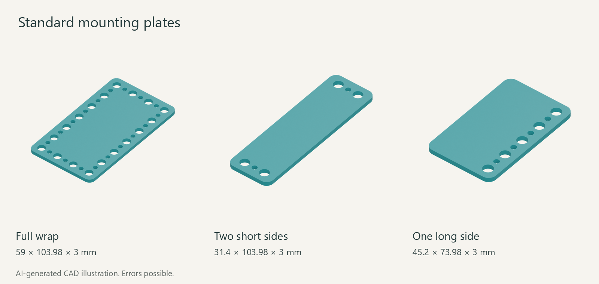
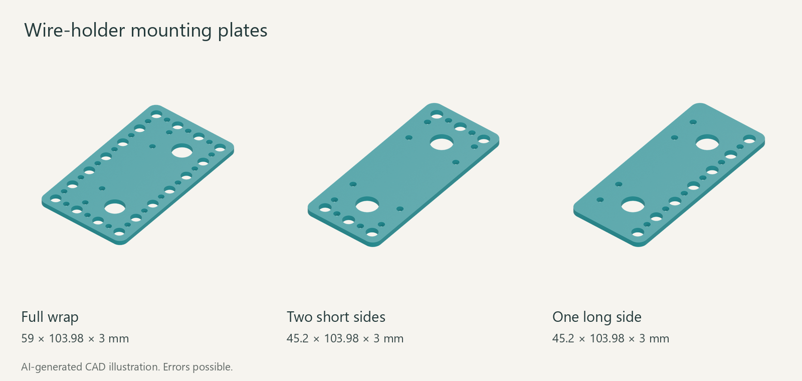

<!-- oomp-documentation:start -->
# Electronic Breakout Microcontroller Esp32 S2 Wroom Devkitc 1 44 Pin 25 4 Mm Width 62 74 Mm Height 44 Pins Espressif Esp32 S2 Devkitc 1

## Summary

OOMP catalogue record for Electronic Breakout Microcontroller Esp32 S2 Wroom Devkitc 1 44 Pin 25 4 Mm Width 62 74 Mm Height 44 Pins Espressif Esp32 S2 Devkitc 1. Use the metadata to identify this variant and the part folder to inspect its available assets.

## Details

**OOMP folder ID:** `electronic_breakout_microcontroller_esp32_s2_wroom_devkitc_1_44_pin_25_4_mm_width_62_74_mm_height_44_pins_espressif_esp32_s2_devkitc_1`

[Catalogue](../../README.md) · [Part metadata](working.yaml)

| Field | Value |
| --- | --- |
| id | electronic_breakout_microcontroller_esp32_s2_wroom_devkitc_1_44_pin_25_4_mm_width_62_74_mm_height_44_pins_espressif_esp32_s2_devkitc_1 |
| md5_6 | 109998 |
| md5_6_alpha | nbfc |
| oomp_key | oomp_electronic_breakout_microcontroller_esp32_s2_wroom_devkitc_1_44_pin_25_4_mm_width_62_74_mm_height_44_pins_espressif_esp32_s2_devkitc_1 |
| taxonomy_1 | electronic |
| taxonomy_2 | breakout |
| taxonomy_3 | microcontroller |
| taxonomy_4 | esp32_s2_wroom |
| taxonomy_5 | devkitc_1_44_pin |
| taxonomy_6 | 25_4_mm_width_62_74_mm_height_44_pins |
| taxonomy_14 | espressif |
| taxonomy_15 | esp32_s2_devkitc_1 |

<details>
<summary>Full part metadata</summary>

```yaml
assembly:
  header_pitch_mm: 2.54
  headers: with_headers
bip_39_2_word_array:
- awesome
- smoke
bip_39_2_word_no_space: awesomesmoke
bip_39_2_word_space: awesome smoke
bip_39_2_word_underscore: awesome_smoke
bip_39_3_word_array:
- awesome
- smoke
- aim
bip_39_3_word_no_space: awesomesmokeaim
bip_39_3_word_space: awesome smoke aim
bip_39_3_word_underscore: awesome_smoke_aim
bip_39_full_array:
- awesome
- smoke
- aim
- ecology
- town
- lab
- vibrant
- globe
- wide
- target
- hurt
- daughter
bip_39_full_no_space: awesomesmokeaimecologytownlabvibrantglobewidetargethurtdaughter
bip_39_full_space: awesome smoke aim ecology town lab vibrant globe wide target hurt
  daughter
bip_39_full_underscore: awesome_smoke_aim_ecology_town_lab_vibrant_globe_wide_target_hurt_daughter
breakout_description: 25_4_mm_width_62_74_mm_height_44_pins
breakout_pcb_height: 62.74
breakout_pcb_width: 25.4
chip:
  family: esp32_s2
  identity_scope: catalogue_chip_or_module_label
  oomp_id: null
  part_number: esp32_s2_wroom
  silicon_revision: null
chip_resources:
  clock_max_mhz: 240
  cpu_core_count: 1
  general_purpose_spi_controllers: 2
  hardware_i2c_controllers: 2
  hardware_uart_controllers: 2
  pio_state_machines: 0
  pwm_channels: 8
  scope: silicon resources; board routing and firmware may reduce availability
  source_id: chip_datasheet
connectors:
  J1:
    contact_count: 22
    pitch_mm: 2.54
    row_spacing_mm: 22.86
    source_id: board_guide
  J3:
    contact_count: 22
    pitch_mm: 2.54
    row_spacing_mm: 22.86
    source_id: board_guide
coordinate_system:
  origin: centre_of_pcb_outline
  units: mm
  view: top_with_usb_at_positive_y
  x_positive: right
  y_positive: towards_usb
data_gaps:
- Assembled component keepouts and USB insertion/cable envelopes have not been captured.
- Chip package/module pad numbers are not fully transcribed; null chip_pin_number
  values must not be replaced with carrier-header numbers.
default_interfaces:
  i2c:
    api: Wire
    basis: framework_defaults
    framework: arduino-esp32
    notes:
    - Defaults apply when selecting this generic Arduino target; they do not establish
      a carrier-specific hardware convention.
    peripheral: null
    pin_keys:
      scl:
      - J1_15
      sda:
      - J1_12
    protocol: i2c
    scl_gpio: 9
    sda_gpio: 8
    signal_status:
      scl: mapped
      sda: mapped
    source_ids:
    - interface_variant
    - interface_board_selection
    - interface_runtime_i2c
    status: documented
    variant: esp32s2
    variant_scope: generic_target_selection
  spi:
    api: SPI
    basis: framework_defaults
    framework: arduino-esp32
    miso_gpio: 37
    mosi_gpio: 35
    notes:
    - Defaults apply when selecting this generic Arduino target; they do not establish
      a carrier-specific hardware convention.
    - ss is the framework chip-select alias/default, not an automatically asserted
      CS. Select and drive CS as required by the peripheral and library.
    peripheral: null
    pin_keys:
      miso:
      - J3_11
      mosi:
      - J3_13
      sck:
      - J3_12
      ss:
      - J3_16
    protocol: spi
    sck_gpio: 36
    signal_status:
      miso: mapped
      mosi: mapped
      sck: mapped
      ss: mapped
    source_ids:
    - interface_variant
    - interface_board_selection
    - interface_runtime_spi
    ss_gpio: 34
    status: documented
    variant: esp32s2
    variant_scope: generic_target_selection
  uart:
    api: null
    basis: framework_pin_aliases
    framework: arduino-esp32
    notes:
    - Defaults apply when selecting this generic Arduino target; they do not establish
      a carrier-specific hardware convention.
    - UART GPIOs are distinct from USB CDC/USB Serial. The meaning of Serial depends
      on the core and USB build settings.
    - TX/RX are board variant aliases. Pass the GPIOs explicitly to the selected HardwareSerial
      instance; no-argument pin selection can use SoC UART defaults instead.
    peripheral: null
    pin_keys:
      rx:
      - J3_3
      tx:
      - J3_2
    protocol: uart
    rx_gpio: 44
    signal_status:
      rx: mapped
      tx: mapped
    source_ids:
    - interface_variant
    - interface_board_selection
    - interface_runtime_uart
    status: documented
    tx_gpio: 43
    variant: esp32s2
    variant_scope: generic_target_selection
dimensions_mm:
  assembled_height: null
  height: 62.74
  module_antenna_overhang_positive_y: null
  pcb_thickness: null
  scope: carrier_pcb_excludes_module_antenna_and_usb_overhang
  source_id: mechanical
  status: manufacturer_drawing
  width: 25.4
directory: parts/electronic_breakout_microcontroller_esp32_s2_wroom_devkitc_1_44_pin_25_4_mm_width_62_74_mm_height_44_pins_espressif_esp32_s2_devkitc_1
electrical:
  gpio_5v_tolerant: false
  logic_voltage_v: 3.3
  source_id: chip_datasheet
  usb_connector: dual_micro_usb_b
form_factor: devkitc_1_44_pin
gpio_summary:
  analog_candidates:
  - 1
  - 2
  - 3
  - 4
  - 5
  - 6
  - 7
  - 8
  - 9
  - 10
  - 11
  - 12
  - 13
  - 14
  - 15
  - 16
  - 17
  - 18
  - 19
  - 20
  automatic_firmware_enable: false
  exposed:
  - 0
  - 1
  - 2
  - 3
  - 4
  - 5
  - 6
  - 7
  - 8
  - 9
  - 10
  - 11
  - 12
  - 13
  - 14
  - 15
  - 16
  - 17
  - 18
  - 19
  - 20
  - 21
  - 33
  - 34
  - 35
  - 36
  - 37
  - 38
  - 39
  - 40
  - 41
  - 42
  - 43
  - 44
  - 45
  - 46
  general_io_candidates:
  - 0
  - 1
  - 2
  - 3
  - 4
  - 5
  - 6
  - 7
  - 8
  - 9
  - 10
  - 11
  - 12
  - 13
  - 14
  - 15
  - 16
  - 17
  - 18
  - 19
  - 20
  - 21
  - 33
  - 34
  - 35
  - 36
  - 37
  - 38
  - 39
  - 40
  - 41
  - 42
  - 43
  - 44
  - 45
  - 46
id: electronic_breakout_microcontroller_esp32_s2_wroom_devkitc_1_44_pin_25_4_mm_width_62_74_mm_height_44_pins_espressif_esp32_s2_devkitc_1
id_no_class: electronic_breakout_microcontroller_esp32_s2_wroom_devkitc_1_44_pin_25_4_mm_width_62_74_mm_height_44_pins_espressif_esp32_s2_devkitc_1
id_no_size: electronic_breakout_microcontroller_esp32_s2_wroom_devkitc_1_44_pin_25_4_mm_width_62_74_mm_height_44_pins_espressif_esp32_s2_devkitc_1
id_no_type: electronic_breakout_microcontroller_esp32_s2_wroom_devkitc_1_44_pin_25_4_mm_width_62_74_mm_height_44_pins_espressif_esp32_s2_devkitc_1
interface_defaults_version: 1
item_kind: breakout
lab_support:
  automatic_firmware_enable: false
  gpio_matrix_routing: true
  requires_reviewed_board_profile: true
  status: catalogue_reference_only
link_github: https://github.com/oomlout/oomlout_oomp_version_1_messy/tree/main/parts/electronic_breakout_microcontroller_esp32_s2_wroom_devkitc_1_44_pin_25_4_mm_width_62_74_mm_height_44_pins_espressif_esp32_s2_devkitc_1
link_main: https://github.com/oomlout/oomlout_oomp_version_1_messy/tree/main/parts/electronic_breakout_microcontroller_esp32_s2_wroom_devkitc_1_44_pin_25_4_mm_width_62_74_mm_height_44_pins_espressif_esp32_s2_devkitc_1
link_redirect: https://github.com/oomlout/oomlout_oomp_version_1_messy/tree/main/parts/electronic_breakout_microcontroller_esp32_s2_wroom_devkitc_1_44_pin_25_4_mm_width_62_74_mm_height_44_pins_espressif_esp32_s2_devkitc_1
manufacturer: espressif
md5: 10999815230e64f83cdb1afabbbdbf1b
md5_10: '1099981523'
md5_10_upper: '1099981523'
md5_5: '10999'
md5_5_upper: '10999'
md5_6: '109998'
md5_6_alpha: nbfc
md5_6_alpha_upper: NBFC
md5_6_upper: '109998'
memory:
  external_flash_bytes: null
  psram_bytes: null
mounting_coordinate_system:
  origin: pcb_bounding_box_centre
  units: mm
  view: top
  x_positive: right
  y_positive: up
mounting_geometry_ready: false
mounting_hole_candidates: []
mounting_hole_details: []
mounting_hole_radius_name: m2
mounting_hole_radius_names: []
mounting_hole_status: no_holes
mounting_holes: []
mounting_lift: 3
mounting_research:
  board_revision: ESP32-S2-DevKitC-1 carrier PCB Rev 1.0 (Espressif drawing
  board_size:
  - 25.4
  - 62.74
  coordinate_system:
    origin: pcb_bounding_box_centre
    units: mm
    view: top
    x_positive: right
    y_positive: up
  derivation: Reviewed the complete manufacturer mechanical layout, page 1, including
    the full PCB boundary, both pin-header rows, both USB connectors and all component/pad
    features. The outline is dimensioned 25.40 mm × 62.74 mm. No intentional board
    mounting holes are drawn. The visible plated header positions are interface pads;
    USB connector tabs/anchors belong to J2/J4 and are not board mounts. No other
    candidate mounting drill is shown. Dimensions are already in mm; no unit conversion
    is applied. For a top-left drawing origin with X right and Y down, centred canonical
    coordinates are x = X - 25.40/2 and y = 62.74/2 - Y. Thus the drawing's USB connectors
    at the bottom map to negative y in the canonical positive-up frame. The pattern
    is empty, so no per-hole coordinates or diameter derivations apply.
  fit_status: generic_holder_not_physical_fit_tested
  identity_evidence: The official ESP32-S2-DevKitC-1 guide identifies the carrier
    and says this is its first board revision; it links the ESP32-S2-DevKitC-1 dimensions
    and PCB layout. The archived drawing DXF_ESP32-S2-DevKitC-1_V1_20210511.pdf independently
    labels ESP32-S2-DevKitC-1, Rev 1.0, and drawing
  mounting_holes: []
  record_sha256: a42e30b5cf0d7acc7aba3f7b61022c98a85dc335351441085030445d5495a69b
  research_file: source_file/electronic_breakout_microcontroller_esp32_s2_wroom_devkitc_1_44_pin_25_4_mm_width_62_74_mm_height_44_pins_espressif_esp32_s2_devkitc_1/mounting.yaml
  reviewed_by: gpt-6-luna
  sources:
  - bytes: 255072
    id: mechanical
    kind: manufacturer_drawing
    local_file: reference/DXF_ESP32-S2-DevKitC-1_V1_20210511.pdf
    locator: Complete page 1 Rev 1.0 ESP32-S2-DevKitC-1 mechanical layout; title block
      dated 2021-05-08; PCB outline dimensions 25.40 mm × 62.74 mm; review complete
      top layout for drilled mounting holes
    registered_at: '2026-11-06T17:50:15+00:00'
    sha256: 0ebbd06bee38d9c9c97c830a867d71ff7227b3aec3faa11231b4e1a8ec4cf7e7
    url: https://dl.espressif.com/dl/schematics/DXF_ESP32-S2-DevKitC-1_V1_20210511.pdf
  - bytes: 38565
    id: product
    kind: manufacturer_product
    local_file: mounting_evidence/esp32-s2-devkitc-1-user-guide.html
    locator: Official ESP32-S2-DevKitC-1 guide identifies the product and lists supported
      module variants; identity scope cross-checked against Rev 1.0 mechanical drawing
    registered_at: '2026-11-06T17:50:16+00:00'
    sha256: c51e46197ca278ec3d17662aead6f2e137f5959802cbf228de620ec569c0cd81
    url: https://docs.espressif.com/projects/esp-dev-kits/en/latest/esp32s2/esp32-s2-devkitc-1/user_guide.html
  status: no_holes
name: Electronic Breakout Microcontroller Esp32 S2 Wroom Devkitc 1 44 Pin 25 4 Mm
  Width 62 74 Mm Height 44 Pins Espressif Esp32 S2 Devkitc 1
name_no_class: Electronic Breakout Microcontroller Esp32 S2 Wroom Devkitc 1 44 Pin
  25 4 Mm Width 62 74 Mm Height 44 Pins Espressif Esp32 S2 Devkitc 1
name_no_size: Electronic Breakout Microcontroller Esp32 S2 Wroom Devkitc 1 44 Pin
  25 4 Mm Width 62 74 Mm Height 44 Pins Espressif Esp32 S2 Devkitc 1
name_no_type: Electronic Breakout Microcontroller Esp32 S2 Wroom Devkitc 1 44 Pin
  25 4 Mm Width 62 74 Mm Height 44 Pins Espressif Esp32 S2 Devkitc 1
name_proper: Electronic Breakout Microcontroller Esp32 S2 Wroom Devkitc 1 44 Pin 25
  4 Mm Width 62 74 Mm Height 44 Pins Espressif Esp32 S2 Devkitc 1
name_readable: Espressif ESP32-S2 DevKitC-1 (module variant unresolved)
name_space: electronic breakout microcontroller esp32 s2 wroom devkitc 1 44 pin 25
  4 mm width 62 74 mm height 44 pins espressif esp32 s2 devkitc 1
name_upper: ELECTRONIC BREAKOUT MICROCONTROLLER ESP32 S2 WROOM DEVKITC 1 44 PIN 25
  4 MM WIDTH 62 74 MM HEIGHT 44 PINS ESPRESSIF ESP32 S2 DEVKITC 1
notes:
- Physical header contacts include supply, ground and reserved contacts; contact count
  is not GPIO count.
- Original catalogue said WROOM; manufacturer guide identifies SOLO/SOLO-2 modules.
  Installed memory/module variant must be checked.
onboard_gpio_connections:
- function: addressable_rgb_led
  gpio: 18
  source_id: board_guide
oobb_details: []
oomlout_ai_roboclick_1:
  actions:
  - command: text_jinja_template
    convert_to_pdf: false
    convert_to_png: false
    dict_data:
      assembly:
        header_pitch_mm: 2.54
        headers: with_headers
      breakout_description: 25_4_mm_width_62_74_mm_height_44_pins
      breakout_pcb_height: 62.74
      breakout_pcb_width: 25.4
      chip:
        family: esp32_s2
        identity_scope: catalogue_chip_or_module_label
        oomp_id: null
        part_number: esp32_s2_wroom
        silicon_revision: null
      chip_resources:
        clock_max_mhz: 240
        cpu_core_count: 1
        general_purpose_spi_controllers: 2
        hardware_i2c_controllers: 2
        hardware_uart_controllers: 2
        pio_state_machines: 0
        pwm_channels: 8
        scope: silicon resources; board routing and firmware may reduce availability
        source_id: chip_datasheet
      connectors:
        J1:
          contact_count: 22
          pitch_mm: 2.54
          row_spacing_mm: 22.86
          source_id: board_guide
        J3:
          contact_count: 22
          pitch_mm: 2.54
          row_spacing_mm: 22.86
          source_id: board_guide
      coordinate_system:
        origin: centre_of_pcb_outline
        units: mm
        view: top_with_usb_at_positive_y
        x_positive: right
        y_positive: towards_usb
      data_gaps:
      - Assembled component keepouts and USB insertion/cable envelopes have not been
        captured.
      - Chip package/module pad numbers are not fully transcribed; null chip_pin_number
        values must not be replaced with carrier-header numbers.
      default_interfaces:
        i2c:
          api: Wire
          basis: framework_defaults
          framework: arduino-esp32
          notes:
          - Defaults apply when selecting this generic Arduino target; they do not
            establish a carrier-specific hardware convention.
          peripheral: null
          pin_keys:
            scl:
            - J1_15
            sda:
            - J1_12
          protocol: i2c
          scl_gpio: 9
          sda_gpio: 8
          signal_status:
            scl: mapped
            sda: mapped
          source_ids:
          - interface_variant
          - interface_board_selection
          - interface_runtime_i2c
          status: documented
          variant: esp32s2
          variant_scope: generic_target_selection
        spi:
          api: SPI
          basis: framework_defaults
          framework: arduino-esp32
          miso_gpio: 37
          mosi_gpio: 35
          notes:
          - Defaults apply when selecting this generic Arduino target; they do not
            establish a carrier-specific hardware convention.
          - ss is the framework chip-select alias/default, not an automatically asserted
            CS. Select and drive CS as required by the peripheral and library.
          peripheral: null
          pin_keys:
            miso:
            - J3_11
            mosi:
            - J3_13
            sck:
            - J3_12
            ss:
            - J3_16
          protocol: spi
          sck_gpio: 36
          signal_status:
            miso: mapped
            mosi: mapped
            sck: mapped
            ss: mapped
          source_ids:
          - interface_variant
          - interface_board_selection
          - interface_runtime_spi
          ss_gpio: 34
          status: documented
          variant: esp32s2
          variant_scope: generic_target_selection
        uart:
          api: null
          basis: framework_pin_aliases
          framework: arduino-esp32
          notes:
          - Defaults apply when selecting this generic Arduino target; they do not
            establish a carrier-specific hardware convention.
          - UART GPIOs are distinct from USB CDC/USB Serial. The meaning of Serial
            depends on the core and USB build settings.
          - TX/RX are board variant aliases. Pass the GPIOs explicitly to the selected
            HardwareSerial instance; no-argument pin selection can use SoC UART defaults
            instead.
          peripheral: null
          pin_keys:
            rx:
            - J3_3
            tx:
            - J3_2
          protocol: uart
          rx_gpio: 44
          signal_status:
            rx: mapped
            tx: mapped
          source_ids:
          - interface_variant
          - interface_board_selection
          - interface_runtime_uart
          status: documented
          tx_gpio: 43
          variant: esp32s2
          variant_scope: generic_target_selection
      dimensions_mm:
        assembled_height: null
        height: 62.74
        module_antenna_overhang_positive_y: null
        pcb_thickness: null
        scope: carrier_pcb_excludes_module_antenna_and_usb_overhang
        source_id: mechanical
        status: manufacturer_drawing
        width: 25.4
      directory: parts\electronic_breakout_microcontroller_esp32_s2_wroom_devkitc_1_44_pin_25_4_mm_width_62_74_mm_height_44_pins_espressif_esp32_s2_devkitc_1
      electrical:
        gpio_5v_tolerant: false
        logic_voltage_v: 3.3
        source_id: chip_datasheet
        usb_connector: dual_micro_usb_b
      form_factor: devkitc_1_44_pin
      gpio_summary:
        analog_candidates:
        - 1
        - 2
        - 3
        - 4
        - 5
        - 6
        - 7
        - 8
        - 9
        - 10
        - 11
        - 12
        - 13
        - 14
        - 15
        - 16
        - 17
        - 18
        - 19
        - 20
        automatic_firmware_enable: false
        exposed:
        - 0
        - 1
        - 2
        - 3
        - 4
        - 5
        - 6
        - 7
        - 8
        - 9
        - 10
        - 11
        - 12
        - 13
        - 14
        - 15
        - 16
        - 17
        - 18
        - 19
        - 20
        - 21
        - 33
        - 34
        - 35
        - 36
        - 37
        - 38
        - 39
        - 40
        - 41
        - 42
        - 43
        - 44
        - 45
        - 46
        general_io_candidates:
        - 0
        - 1
        - 2
        - 3
        - 4
        - 5
        - 6
        - 7
        - 8
        - 9
        - 10
        - 11
        - 12
        - 13
        - 14
        - 15
        - 16
        - 17
        - 18
        - 19
        - 20
        - 21
        - 33
        - 34
        - 35
        - 36
        - 37
        - 38
        - 39
        - 40
        - 41
        - 42
        - 43
        - 44
        - 45
        - 46
      interface_defaults_version: 1
      item_kind: breakout
      lab_support:
        automatic_firmware_enable: false
        gpio_matrix_routing: true
        requires_reviewed_board_profile: true
        status: catalogue_reference_only
      manufacturer: espressif
      memory:
        external_flash_bytes: null
        psram_bytes: null
      mounting_coordinate_system:
        origin: pcb_bounding_box_centre
        units: mm
        view: top
        x_positive: right
        y_positive: up
      mounting_geometry_ready: false
      mounting_hole_candidates: []
      mounting_hole_details: []
      mounting_hole_radius_name: m2
      mounting_hole_radius_names: []
      mounting_hole_status: no_holes
      mounting_holes: []
      mounting_lift: 3
      mounting_research:
        board_revision: ESP32-S2-DevKitC-1 carrier PCB Rev 1.0 (Espressif drawing
        board_size:
        - 25.4
        - 62.74
        coordinate_system:
          origin: pcb_bounding_box_centre
          units: mm
          view: top
          x_positive: right
          y_positive: up
        derivation: Reviewed the complete manufacturer mechanical layout, page 1,
          including the full PCB boundary, both pin-header rows, both USB connectors
          and all component/pad features. The outline is dimensioned 25.40 mm × 62.74
          mm. No intentional board mounting holes are drawn. The visible plated header
          positions are interface pads; USB connector tabs/anchors belong to J2/J4
          and are not board mounts. No other candidate mounting drill is shown. Dimensions
          are already in mm; no unit conversion is applied. For a top-left drawing
          origin with X right and Y down, centred canonical coordinates are x = X
          - 25.40/2 and y = 62.74/2 - Y. Thus the drawing's USB connectors at the
          bottom map to negative y in the canonical positive-up frame. The pattern
          is empty, so no per-hole coordinates or diameter derivations apply.
        fit_status: generic_holder_not_physical_fit_tested
        identity_evidence: The official ESP32-S2-DevKitC-1 guide identifies the carrier
          and says this is its first board revision; it links the ESP32-S2-DevKitC-1
          dimensions and PCB layout. The archived drawing DXF_ESP32-S2-DevKitC-1_V1_20210511.pdf
          independently labels ESP32-S2-DevKitC-1, Rev 1.0, and drawing
        mounting_holes: []
        record_sha256: a42e30b5cf0d7acc7aba3f7b61022c98a85dc335351441085030445d5495a69b
        research_file: source_file/electronic_breakout_microcontroller_esp32_s2_wroom_devkitc_1_44_pin_25_4_mm_width_62_74_mm_height_44_pins_espressif_esp32_s2_devkitc_1/mounting.yaml
        reviewed_by: gpt-6-luna
        sources:
        - bytes: 255072
          id: mechanical
          kind: manufacturer_drawing
          local_file: reference/DXF_ESP32-S2-DevKitC-1_V1_20210511.pdf
          locator: Complete page 1 Rev 1.0 ESP32-S2-DevKitC-1 mechanical layout; title
            block dated 2021-05-08; PCB outline dimensions 25.40 mm × 62.74 mm; review
            complete top layout for drilled mounting holes
          registered_at: '2026-11-06T17:50:15+00:00'
          sha256: 0ebbd06bee38d9c9c97c830a867d71ff7227b3aec3faa11231b4e1a8ec4cf7e7
          url: https://dl.espressif.com/dl/schematics/DXF_ESP32-S2-DevKitC-1_V1_20210511.pdf
        - bytes: 38565
          id: product
          kind: manufacturer_product
          local_file: mounting_evidence/esp32-s2-devkitc-1-user-guide.html
          locator: Official ESP32-S2-DevKitC-1 guide identifies the product and lists
            supported module variants; identity scope cross-checked against Rev 1.0
            mechanical drawing
          registered_at: '2026-11-06T17:50:16+00:00'
          sha256: c51e46197ca278ec3d17662aead6f2e137f5959802cbf228de620ec569c0cd81
          url: https://docs.espressif.com/projects/esp-dev-kits/en/latest/esp32s2/esp32-s2-devkitc-1/user_guide.html
        status: no_holes
      name: electronic_breakout_microcontroller_esp32_s2_wroom_devkitc_1_44_pin_25_4_mm_width_62_74_mm_height_44_pins_espressif_esp32_s2_devkitc_1
      name_proper: Electronic Breakout Microcontroller Esp32 S2 Wroom Devkitc 1 44
        Pin 25 4 Mm Width 62 74 Mm Height 44 Pins Espressif Esp32 S2 Devkitc 1
      name_readable: Espressif ESP32-S2 DevKitC-1 (module variant unresolved)
      name_space: electronic breakout microcontroller esp32 s2 wroom devkitc 1 44
        pin 25 4 mm width 62 74 mm height 44 pins espressif esp32 s2 devkitc 1
      name_upper: ELECTRONIC BREAKOUT MICROCONTROLLER ESP32 S2 WROOM DEVKITC 1 44
        PIN 25 4 MM WIDTH 62 74 MM HEIGHT 44 PINS ESPRESSIF ESP32 S2 DEVKITC 1
      notes:
      - Physical header contacts include supply, ground and reserved contacts; contact
        count is not GPIO count.
      - Original catalogue said WROOM; manufacturer guide identifies SOLO/SOLO-2 modules.
        Installed memory/module variant must be checked.
      onboard_gpio_connections:
      - function: addressable_rgb_led
        gpio: 18
        source_id: board_guide
      oobb_details: []
      part_number: esp32_s2_devkitc_1
      pinout_scope: Expansion connectors and explicitly listed test pads; USB socket
        contacts excluded.
      pinout_status: documented_contact_inventory
      pins:
        J1_1:
          adc_channel: null
          adc_unit: null
          aliases: []
          available_for_general_io: false
          capabilities: []
          chip_pin_number: null
          connector: J1
          default_interface_roles: []
          direction: not_applicable
          functions:
          - 3.3 V power supply
          - 3V3
          gpio: null
          manufacturer_pin_type: P
          name: 3V3
          number: '1'
          position_source_id: mechanical
          restrictions: []
          signal_types: []
          source_id: board_guide
          surface: unspecified
          type: power
          x_mm: 11.43
          y_mm: -30.1
        J1_10:
          adc_channel: 6
          adc_unit: 2
          aliases: []
          available_for_general_io: true
          capabilities:
          - gpio
          - digital_input
          - digital_output
          - pwm
          - analog_output
          - analog_input
          capability_source_id: chip_datasheet
          chip_pin_number: null
          connector: J1
          default_interface_roles: []
          direction: bidirectional
          functions:
          - RTC_GPIO17
          - GPIO17
          - U1TXD
          - ADC2_CH6
          - DAC_1
          - DAC1
          gpio: 17
          input_only: false
          lab_analog_eligible: true
          logic_voltage_v: 3.3
          manufacturer_pin_type: I/O/T
          name: '17'
          number: '10'
          position_source_id: mechanical
          restrictions: []
          routable_peripherals:
          - uart
          - spi
          - i2c
          - i2s
          - rmt
          - pwm
          signal_types:
          - digital
          - analog
          source_id: board_guide
          surface: unspecified
          type: gpio
          x_mm: 11.43
          y_mm: -7.24
        J1_11:
          adc_channel: 7
          adc_unit: 2
          aliases: []
          available_for_general_io: true
          capabilities:
          - gpio
          - digital_input
          - digital_output
          - pwm
          - analog_output
          - analog_input
          capability_source_id: chip_datasheet
          chip_pin_number: null
          connector: J1
          default_interface_roles: []
          direction: bidirectional
          functions:
          - RTC_GPIO18
          - GPIO18
          - U1RXD
          - ADC2_CH7
          - DAC_2
          - CLK_OUT3
          - RGB LED
          - DAC2
          gpio: 18
          input_only: false
          lab_analog_eligible: true
          logic_voltage_v: 3.3
          manufacturer_pin_type: I/O/T
          name: '18'
          number: '11'
          position_source_id: mechanical
          restrictions:
          - 'Shared onboard net: addressable_rgb_led'
          routable_peripherals:
          - uart
          - spi
          - i2c
          - i2s
          - rmt
          - pwm
          signal_types:
          - digital
          - analog
          source_id: board_guide
          surface: unspecified
          type: gpio
          x_mm: 11.43
          y_mm: -4.7
        J1_12:
          adc_channel: 7
          adc_unit: 1
          aliases: []
          available_for_general_io: true
          capabilities:
          - gpio
          - digital_input
          - digital_output
          - pwm
          - analog_input
          capability_source_id: chip_datasheet
          chip_pin_number: null
          connector: J1
          default_interface_roles:
          - interface: i2c
            signal: sda
          direction: bidirectional
          functions:
          - RTC_GPIO8
          - GPIO8
          - TOUCH8
          - ADC1_CH7
          gpio: 8
          input_only: false
          lab_analog_eligible: true
          logic_voltage_v: 3.3
          manufacturer_pin_type: I/O/T
          name: '8'
          number: '12'
          position_source_id: mechanical
          restrictions: []
          routable_peripherals:
          - uart
          - spi
          - i2c
          - i2s
          - rmt
          - pwm
          signal_types:
          - digital
          - analog
          source_id: board_guide
          surface: unspecified
          type: gpio
          x_mm: 11.43
          y_mm: -2.16
        J1_13:
          adc_channel: 2
          adc_unit: 1
          aliases: []
          available_for_general_io: true
          capabilities:
          - gpio
          - digital_input
          - digital_output
          - pwm
          - analog_input
          capability_source_id: chip_datasheet
          chip_pin_number: null
          connector: J1
          default_interface_roles: []
          direction: bidirectional
          functions:
          - RTC_GPIO3
          - GPIO3
          - TOUCH3
          - ADC1_CH2
          gpio: 3
          input_only: false
          lab_analog_eligible: true
          logic_voltage_v: 3.3
          manufacturer_pin_type: I/O/T
          name: '3'
          number: '13'
          position_source_id: mechanical
          restrictions: []
          routable_peripherals:
          - uart
          - spi
          - i2c
          - i2s
          - rmt
          - pwm
          signal_types:
          - digital
          - analog
          source_id: board_guide
          surface: unspecified
          type: gpio
          x_mm: 11.43
          y_mm: 0.38
        J1_14:
          adc_channel: null
          adc_unit: null
          aliases: []
          available_for_general_io: true
          capabilities:
          - gpio
          - digital_input
          capability_source_id: chip_datasheet
          chip_pin_number: null
          connector: J1
          default_interface_roles: []
          direction: input
          functions:
          - GPIO46
          gpio: 46
          input_only: true
          lab_analog_eligible: false
          logic_voltage_v: 3.3
          manufacturer_pin_type: I
          name: '46'
          number: '14'
          position_source_id: mechanical
          restrictions:
          - Boot strapping pin; external levels affect startup.
          routable_peripherals:
          - gpio_matrix_inputs_only
          signal_types:
          - digital
          source_id: board_guide
          surface: unspecified
          type: gpio
          x_mm: 11.43
          y_mm: 2.92
        J1_15:
          adc_channel: 8
          adc_unit: 1
          aliases: []
          available_for_general_io: true
          capabilities:
          - gpio
          - digital_input
          - digital_output
          - pwm
          - analog_input
          capability_source_id: chip_datasheet
          chip_pin_number: null
          connector: J1
          default_interface_roles:
          - interface: i2c
            signal: scl
          direction: bidirectional
          functions:
          - RTC_GPIO9
          - GPIO9
          - TOUCH9
          - ADC1_CH8
          - FSPIHD
          gpio: 9
          input_only: false
          lab_analog_eligible: true
          logic_voltage_v: 3.3
          manufacturer_pin_type: I/O/T
          name: '9'
          number: '15'
          position_source_id: mechanical
          restrictions: []
          routable_peripherals:
          - uart
          - spi
          - i2c
          - i2s
          - rmt
          - pwm
          signal_types:
          - digital
          - analog
          source_id: board_guide
          surface: unspecified
          type: gpio
          x_mm: 11.43
          y_mm: 5.46
        J1_16:
          adc_channel: 9
          adc_unit: 1
          aliases: []
          available_for_general_io: true
          capabilities:
          - gpio
          - digital_input
          - digital_output
          - pwm
          - analog_input
          capability_source_id: chip_datasheet
          chip_pin_number: null
          connector: J1
          default_interface_roles: []
          direction: bidirectional
          functions:
          - RTC_GPIO10
          - GPIO10
          - TOUCH10
          - ADC1_CH9
          - FSPICS0
          - FSPIIO4
          gpio: 10
          input_only: false
          lab_analog_eligible: true
          logic_voltage_v: 3.3
          manufacturer_pin_type: I/O/T
          name: '10'
          number: '16'
          position_source_id: mechanical
          restrictions: []
          routable_peripherals:
          - uart
          - spi
          - i2c
          - i2s
          - rmt
          - pwm
          signal_types:
          - digital
          - analog
          source_id: board_guide
          surface: unspecified
          type: gpio
          x_mm: 11.43
          y_mm: 8.0
        J1_17:
          adc_channel: 0
          adc_unit: 2
          aliases: []
          available_for_general_io: true
          capabilities:
          - gpio
          - digital_input
          - digital_output
          - pwm
          - analog_input
          capability_source_id: chip_datasheet
          chip_pin_number: null
          connector: J1
          default_interface_roles: []
          direction: bidirectional
          functions:
          - RTC_GPIO11
          - GPIO11
          - TOUCH11
          - ADC2_CH0
          - FSPID
          - FSPIIO5
          gpio: 11
          input_only: false
          lab_analog_eligible: true
          logic_voltage_v: 3.3
          manufacturer_pin_type: I/O/T
          name: '11'
          number: '17'
          position_source_id: mechanical
          restrictions: []
          routable_peripherals:
          - uart
          - spi
          - i2c
          - i2s
          - rmt
          - pwm
          signal_types:
          - digital
          - analog
          source_id: board_guide
          surface: unspecified
          type: gpio
          x_mm: 11.43
          y_mm: 10.54
        J1_18:
          adc_channel: 1
          adc_unit: 2
          aliases: []
          available_for_general_io: true
          capabilities:
          - gpio
          - digital_input
          - digital_output
          - pwm
          - analog_input
          capability_source_id: chip_datasheet
          chip_pin_number: null
          connector: J1
          default_interface_roles: []
          direction: bidirectional
          functions:
          - RTC_GPIO12
          - GPIO12
          - TOUCH12
          - ADC2_CH1
          - FSPICLK
          - FSPIIO6
          gpio: 12
          input_only: false
          lab_analog_eligible: true
          logic_voltage_v: 3.3
          manufacturer_pin_type: I/O/T
          name: '12'
          number: '18'
          position_source_id: mechanical
          restrictions: []
          routable_peripherals:
          - uart
          - spi
          - i2c
          - i2s
          - rmt
          - pwm
          signal_types:
          - digital
          - analog
          source_id: board_guide
          surface: unspecified
          type: gpio
          x_mm: 11.43
          y_mm: 13.08
        J1_19:
          adc_channel: 2
          adc_unit: 2
          aliases: []
          available_for_general_io: true
          capabilities:
          - gpio
          - digital_input
          - digital_output
          - pwm
          - analog_input
          capability_source_id: chip_datasheet
          chip_pin_number: null
          connector: J1
          default_interface_roles: []
          direction: bidirectional
          functions:
          - RTC_GPIO13
          - GPIO13
          - TOUCH13
          - ADC2_CH2
          - FSPIQ
          - FSPIIO7
          gpio: 13
          input_only: false
          lab_analog_eligible: true
          logic_voltage_v: 3.3
          manufacturer_pin_type: I/O/T
          name: '13'
          number: '19'
          position_source_id: mechanical
          restrictions: []
          routable_peripherals:
          - uart
          - spi
          - i2c
          - i2s
          - rmt
          - pwm
          signal_types:
          - digital
          - analog
          source_id: board_guide
          surface: unspecified
          type: gpio
          x_mm: 11.43
          y_mm: 15.62
        J1_2:
          adc_channel: null
          adc_unit: null
          aliases: []
          available_for_general_io: false
          capabilities: []
          chip_pin_number: null
          connector: J1
          default_interface_roles: []
          direction: not_applicable
          functions:
          - 3.3 V power supply
          - 3V3
          gpio: null
          manufacturer_pin_type: P
          name: 3V3
          number: '2'
          position_source_id: mechanical
          restrictions: []
          signal_types: []
          source_id: board_guide
          surface: unspecified
          type: power
          x_mm: 11.43
          y_mm: -27.56
        J1_20:
          adc_channel: 3
          adc_unit: 2
          aliases: []
          available_for_general_io: true
          capabilities:
          - gpio
          - digital_input
          - digital_output
          - pwm
          - analog_input
          capability_source_id: chip_datasheet
          chip_pin_number: null
          connector: J1
          default_interface_roles: []
          direction: bidirectional
          functions:
          - RTC_GPIO14
          - GPIO14
          - TOUCH14
          - ADC2_CH3
          - FSPIWP
          - FSPIDQS
          gpio: 14
          input_only: false
          lab_analog_eligible: true
          logic_voltage_v: 3.3
          manufacturer_pin_type: I/O/T
          name: '14'
          number: '20'
          position_source_id: mechanical
          restrictions: []
          routable_peripherals:
          - uart
          - spi
          - i2c
          - i2s
          - rmt
          - pwm
          signal_types:
          - digital
          - analog
          source_id: board_guide
          surface: unspecified
          type: gpio
          x_mm: 11.43
          y_mm: 18.16
        J1_21:
          adc_channel: null
          adc_unit: null
          aliases: []
          available_for_general_io: false
          capabilities: []
          chip_pin_number: null
          connector: J1
          default_interface_roles: []
          direction: not_applicable
          functions:
          - 5 V power supply
          - 5V
          gpio: null
          manufacturer_pin_type: P
          name: 5V
          number: '21'
          position_source_id: mechanical
          restrictions: []
          signal_types: []
          source_id: board_guide
          surface: unspecified
          type: power
          x_mm: 11.43
          y_mm: 20.7
        J1_22:
          adc_channel: null
          adc_unit: null
          aliases: []
          available_for_general_io: false
          capabilities: []
          chip_pin_number: null
          connector: J1
          default_interface_roles: []
          direction: not_applicable
          functions:
          - Ground
          - G
          gpio: null
          manufacturer_pin_type: G
          name: G
          number: '22'
          position_source_id: mechanical
          restrictions: []
          signal_types: []
          source_id: board_guide
          surface: unspecified
          type: ground
          x_mm: 11.43
          y_mm: 23.24
        J1_3:
          adc_channel: null
          adc_unit: null
          aliases: []
          available_for_general_io: false
          capabilities: []
          chip_pin_number: null
          connector: J1
          default_interface_roles: []
          direction: not_applicable
          functions:
          - CHIP_PU
          - RST
          gpio: null
          manufacturer_pin_type: I
          name: RST
          number: '3'
          position_source_id: mechanical
          restrictions: []
          signal_types: []
          source_id: board_guide
          surface: unspecified
          type: control
          x_mm: 11.43
          y_mm: -25.02
        J1_4:
          adc_channel: 3
          adc_unit: 1
          aliases: []
          available_for_general_io: true
          capabilities:
          - gpio
          - digital_input
          - digital_output
          - pwm
          - analog_input
          capability_source_id: chip_datasheet
          chip_pin_number: null
          connector: J1
          default_interface_roles: []
          direction: bidirectional
          functions:
          - RTC_GPIO4
          - GPIO4
          - TOUCH4
          - ADC1_CH3
          gpio: 4
          input_only: false
          lab_analog_eligible: true
          logic_voltage_v: 3.3
          manufacturer_pin_type: I/O/T
          name: '4'
          number: '4'
          position_source_id: mechanical
          restrictions: []
          routable_peripherals:
          - uart
          - spi
          - i2c
          - i2s
          - rmt
          - pwm
          signal_types:
          - digital
          - analog
          source_id: board_guide
          surface: unspecified
          type: gpio
          x_mm: 11.43
          y_mm: -22.48
        J1_5:
          adc_channel: 4
          adc_unit: 1
          aliases: []
          available_for_general_io: true
          capabilities:
          - gpio
          - digital_input
          - digital_output
          - pwm
          - analog_input
          capability_source_id: chip_datasheet
          chip_pin_number: null
          connector: J1
          default_interface_roles: []
          direction: bidirectional
          functions:
          - RTC_GPIO5
          - GPIO5
          - TOUCH5
          - ADC1_CH4
          gpio: 5
          input_only: false
          lab_analog_eligible: true
          logic_voltage_v: 3.3
          manufacturer_pin_type: I/O/T
          name: '5'
          number: '5'
          position_source_id: mechanical
          restrictions: []
          routable_peripherals:
          - uart
          - spi
          - i2c
          - i2s
          - rmt
          - pwm
          signal_types:
          - digital
          - analog
          source_id: board_guide
          surface: unspecified
          type: gpio
          x_mm: 11.43
          y_mm: -19.94
        J1_6:
          adc_channel: 5
          adc_unit: 1
          aliases: []
          available_for_general_io: true
          capabilities:
          - gpio
          - digital_input
          - digital_output
          - pwm
          - analog_input
          capability_source_id: chip_datasheet
          chip_pin_number: null
          connector: J1
          default_interface_roles: []
          direction: bidirectional
          functions:
          - RTC_GPIO6
          - GPIO6
          - TOUCH6
          - ADC1_CH5
          gpio: 6
          input_only: false
          lab_analog_eligible: true
          logic_voltage_v: 3.3
          manufacturer_pin_type: I/O/T
          name: '6'
          number: '6'
          position_source_id: mechanical
          restrictions: []
          routable_peripherals:
          - uart
          - spi
          - i2c
          - i2s
          - rmt
          - pwm
          signal_types:
          - digital
          - analog
          source_id: board_guide
          surface: unspecified
          type: gpio
          x_mm: 11.43
          y_mm: -17.4
        J1_7:
          adc_channel: 6
          adc_unit: 1
          aliases: []
          available_for_general_io: true
          capabilities:
          - gpio
          - digital_input
          - digital_output
          - pwm
          - analog_input
          capability_source_id: chip_datasheet
          chip_pin_number: null
          connector: J1
          default_interface_roles: []
          direction: bidirectional
          functions:
          - RTC_GPIO7
          - GPIO7
          - TOUCH7
          - ADC1_CH6
          gpio: 7
          input_only: false
          lab_analog_eligible: true
          logic_voltage_v: 3.3
          manufacturer_pin_type: I/O/T
          name: '7'
          number: '7'
          position_source_id: mechanical
          restrictions: []
          routable_peripherals:
          - uart
          - spi
          - i2c
          - i2s
          - rmt
          - pwm
          signal_types:
          - digital
          - analog
          source_id: board_guide
          surface: unspecified
          type: gpio
          x_mm: 11.43
          y_mm: -14.86
        J1_8:
          adc_channel: 4
          adc_unit: 2
          aliases: []
          available_for_general_io: true
          capabilities:
          - gpio
          - digital_input
          - digital_output
          - pwm
          - analog_input
          capability_source_id: chip_datasheet
          chip_pin_number: null
          connector: J1
          default_interface_roles: []
          direction: bidirectional
          functions:
          - RTC_GPIO15
          - GPIO15
          - U0RTS
          - ADC2_CH4
          - XTAL_32K_P
          gpio: 15
          input_only: false
          lab_analog_eligible: true
          logic_voltage_v: 3.3
          manufacturer_pin_type: I/O/T
          name: '15'
          number: '8'
          position_source_id: mechanical
          restrictions: []
          routable_peripherals:
          - uart
          - spi
          - i2c
          - i2s
          - rmt
          - pwm
          signal_types:
          - digital
          - analog
          source_id: board_guide
          surface: unspecified
          type: gpio
          x_mm: 11.43
          y_mm: -12.32
        J1_9:
          adc_channel: 5
          adc_unit: 2
          aliases: []
          available_for_general_io: true
          capabilities:
          - gpio
          - digital_input
          - digital_output
          - pwm
          - analog_input
          capability_source_id: chip_datasheet
          chip_pin_number: null
          connector: J1
          default_interface_roles: []
          direction: bidirectional
          functions:
          - RTC_GPIO16
          - GPIO16
          - U0CTS
          - ADC2_CH5
          - XTAL_32K_N
          gpio: 16
          input_only: false
          lab_analog_eligible: true
          logic_voltage_v: 3.3
          manufacturer_pin_type: I/O/T
          name: '16'
          number: '9'
          position_source_id: mechanical
          restrictions: []
          routable_peripherals:
          - uart
          - spi
          - i2c
          - i2s
          - rmt
          - pwm
          signal_types:
          - digital
          - analog
          source_id: board_guide
          surface: unspecified
          type: gpio
          x_mm: 11.43
          y_mm: -9.78
        J3_1:
          adc_channel: null
          adc_unit: null
          aliases: []
          available_for_general_io: false
          capabilities: []
          chip_pin_number: null
          connector: J3
          default_interface_roles: []
          direction: not_applicable
          functions:
          - Ground
          - G
          gpio: null
          manufacturer_pin_type: G
          name: G
          number: '1'
          position_source_id: mechanical
          restrictions: []
          signal_types: []
          source_id: board_guide
          surface: unspecified
          type: ground
          x_mm: -11.43
          y_mm: -30.1
        J3_10:
          adc_channel: null
          adc_unit: null
          aliases: []
          available_for_general_io: true
          capabilities:
          - gpio
          - digital_input
          - digital_output
          - pwm
          capability_source_id: chip_datasheet
          chip_pin_number: null
          connector: J3
          default_interface_roles: []
          direction: bidirectional
          functions:
          - GPIO38
          - FSPIWP
          gpio: 38
          input_only: false
          lab_analog_eligible: false
          logic_voltage_v: 3.3
          manufacturer_pin_type: I/O/T
          name: '38'
          number: '10'
          position_source_id: mechanical
          restrictions: []
          routable_peripherals:
          - uart
          - spi
          - i2c
          - i2s
          - rmt
          - pwm
          signal_types:
          - digital
          source_id: board_guide
          surface: unspecified
          type: gpio
          x_mm: -11.43
          y_mm: -7.24
        J3_11:
          adc_channel: null
          adc_unit: null
          aliases: []
          available_for_general_io: true
          capabilities:
          - gpio
          - digital_input
          - digital_output
          - pwm
          capability_source_id: chip_datasheet
          chip_pin_number: null
          connector: J3
          default_interface_roles:
          - interface: spi
            signal: miso
          direction: bidirectional
          functions:
          - SPIDQS
          - GPIO37
          - FSPIQ
          gpio: 37
          input_only: false
          lab_analog_eligible: false
          logic_voltage_v: 3.3
          manufacturer_pin_type: I/O/T
          name: '37'
          number: '11'
          position_source_id: mechanical
          restrictions: []
          routable_peripherals:
          - uart
          - spi
          - i2c
          - i2s
          - rmt
          - pwm
          signal_types:
          - digital
          source_id: board_guide
          surface: unspecified
          type: gpio
          x_mm: -11.43
          y_mm: -4.7
        J3_12:
          adc_channel: null
          adc_unit: null
          aliases: []
          available_for_general_io: true
          capabilities:
          - gpio
          - digital_input
          - digital_output
          - pwm
          capability_source_id: chip_datasheet
          chip_pin_number: null
          connector: J3
          default_interface_roles:
          - interface: spi
            signal: sck
          direction: bidirectional
          functions:
          - SPIIO7
          - GPIO36
          - FSPICLK
          gpio: 36
          input_only: false
          lab_analog_eligible: false
          logic_voltage_v: 3.3
          manufacturer_pin_type: I/O/T
          name: '36'
          number: '12'
          position_source_id: mechanical
          restrictions: []
          routable_peripherals:
          - uart
          - spi
          - i2c
          - i2s
          - rmt
          - pwm
          signal_types:
          - digital
          source_id: board_guide
          surface: unspecified
          type: gpio
          x_mm: -11.43
          y_mm: -2.16
        J3_13:
          adc_channel: null
          adc_unit: null
          aliases: []
          available_for_general_io: true
          capabilities:
          - gpio
          - digital_input
          - digital_output
          - pwm
          capability_source_id: chip_datasheet
          chip_pin_number: null
          connector: J3
          default_interface_roles:
          - interface: spi
            signal: mosi
          direction: bidirectional
          functions:
          - SPIIO6
          - GPIO35
          - FSPID
          gpio: 35
          input_only: false
          lab_analog_eligible: false
          logic_voltage_v: 3.3
          manufacturer_pin_type: I/O/T
          name: '35'
          number: '13'
          position_source_id: mechanical
          restrictions: []
          routable_peripherals:
          - uart
          - spi
          - i2c
          - i2s
          - rmt
          - pwm
          signal_types:
          - digital
          source_id: board_guide
          surface: unspecified
          type: gpio
          x_mm: -11.43
          y_mm: 0.38
        J3_14:
          adc_channel: null
          adc_unit: null
          aliases: []
          available_for_general_io: true
          capabilities:
          - gpio
          - digital_input
          - digital_output
          - pwm
          capability_source_id: chip_datasheet
          chip_pin_number: null
          connector: J3
          default_interface_roles: []
          direction: bidirectional
          functions:
          - RTC_GPIO0
          - GPIO0
          gpio: 0
          input_only: false
          lab_analog_eligible: false
          logic_voltage_v: 3.3
          manufacturer_pin_type: I/O/T
          name: '0'
          number: '14'
          position_source_id: mechanical
          restrictions:
          - Boot strapping pin; external levels affect startup.
          routable_peripherals:
          - uart
          - spi
          - i2c
          - i2s
          - rmt
          - pwm
          signal_types:
          - digital
          source_id: board_guide
          surface: unspecified
          type: gpio
          x_mm: -11.43
          y_mm: 2.92
        J3_15:
          adc_channel: null
          adc_unit: null
          aliases: []
          available_for_general_io: true
          capabilities:
          - gpio
          - digital_input
          - digital_output
          - pwm
          capability_source_id: chip_datasheet
          chip_pin_number: null
          connector: J3
          default_interface_roles: []
          direction: bidirectional
          functions:
          - GPIO45
          gpio: 45
          input_only: false
          lab_analog_eligible: false
          logic_voltage_v: 3.3
          manufacturer_pin_type: I/O/T
          name: '45'
          number: '15'
          position_source_id: mechanical
          restrictions:
          - Boot strapping pin; external levels affect startup.
          routable_peripherals:
          - uart
          - spi
          - i2c
          - i2s
          - rmt
          - pwm
          signal_types:
          - digital
          source_id: board_guide
          surface: unspecified
          type: gpio
          x_mm: -11.43
          y_mm: 5.46
        J3_16:
          adc_channel: null
          adc_unit: null
          aliases: []
          available_for_general_io: true
          capabilities:
          - gpio
          - digital_input
          - digital_output
          - pwm
          capability_source_id: chip_datasheet
          chip_pin_number: null
          connector: J3
          default_interface_roles:
          - interface: spi
            signal: ss
          direction: bidirectional
          functions:
          - SPIIO5
          - GPIO34
          - FSPICS0
          gpio: 34
          input_only: false
          lab_analog_eligible: false
          logic_voltage_v: 3.3
          manufacturer_pin_type: I/O/T
          name: '34'
          number: '16'
          position_source_id: mechanical
          restrictions: []
          routable_peripherals:
          - uart
          - spi
          - i2c
          - i2s
          - rmt
          - pwm
          signal_types:
          - digital
          source_id: board_guide
          surface: unspecified
          type: gpio
          x_mm: -11.43
          y_mm: 8.0
        J3_17:
          adc_channel: null
          adc_unit: null
          aliases: []
          available_for_general_io: true
          capabilities:
          - gpio
          - digital_input
          - digital_output
          - pwm
          capability_source_id: chip_datasheet
          chip_pin_number: null
          connector: J3
          default_interface_roles: []
          direction: bidirectional
          functions:
          - SPIIO4
          - GPIO33
          - FSPIHD
          gpio: 33
          input_only: false
          lab_analog_eligible: false
          logic_voltage_v: 3.3
          manufacturer_pin_type: I/O/T
          name: '33'
          number: '17'
          position_source_id: mechanical
          restrictions: []
          routable_peripherals:
          - uart
          - spi
          - i2c
          - i2s
          - rmt
          - pwm
          signal_types:
          - digital
          source_id: board_guide
          surface: unspecified
          type: gpio
          x_mm: -11.43
          y_mm: 10.54
        J3_18:
          adc_channel: null
          adc_unit: null
          aliases: []
          available_for_general_io: true
          capabilities:
          - gpio
          - digital_input
          - digital_output
          - pwm
          capability_source_id: chip_datasheet
          chip_pin_number: null
          connector: J3
          default_interface_roles: []
          direction: bidirectional
          functions:
          - RTC_GPIO21
          - GPIO21
          gpio: 21
          input_only: false
          lab_analog_eligible: false
          logic_voltage_v: 3.3
          manufacturer_pin_type: I/O/T
          name: '21'
          number: '18'
          position_source_id: mechanical
          restrictions: []
          routable_peripherals:
          - uart
          - spi
          - i2c
          - i2s
          - rmt
          - pwm
          signal_types:
          - digital
          source_id: board_guide
          surface: unspecified
          type: gpio
          x_mm: -11.43
          y_mm: 13.08
        J3_19:
          adc_channel: 9
          adc_unit: 2
          aliases: []
          available_for_general_io: true
          capabilities:
          - gpio
          - digital_input
          - digital_output
          - pwm
          - analog_input
          capability_source_id: chip_datasheet
          chip_pin_number: null
          connector: J3
          default_interface_roles: []
          direction: bidirectional
          functions:
          - RTC_GPIO20
          - GPIO20
          - U1CTS
          - ADC2_CH9
          - CLK_OUT1
          - USB_D+
          gpio: 20
          input_only: false
          lab_analog_eligible: true
          logic_voltage_v: 3.3
          manufacturer_pin_type: I/O/T
          name: '20'
          number: '19'
          position_source_id: mechanical
          restrictions:
          - 'USB D-/D+ function: GPIO use can disconnect native USB; check board routing.'
          routable_peripherals:
          - uart
          - spi
          - i2c
          - i2s
          - rmt
          - pwm
          signal_types:
          - digital
          - analog
          source_id: board_guide
          surface: unspecified
          type: gpio
          x_mm: -11.43
          y_mm: 15.62
        J3_2:
          adc_channel: null
          adc_unit: null
          aliases: []
          available_for_general_io: true
          capabilities:
          - gpio
          - digital_input
          - digital_output
          - pwm
          capability_source_id: chip_datasheet
          chip_pin_number: null
          connector: J3
          default_interface_roles:
          - interface: uart
            signal: tx
          direction: bidirectional
          functions:
          - U0TXD
          - GPIO43
          - CLK_OUT1
          gpio: 43
          input_only: false
          lab_analog_eligible: false
          logic_voltage_v: 3.3
          manufacturer_pin_type: I/O/T
          name: TX
          number: '2'
          position_source_id: mechanical
          restrictions: []
          routable_peripherals:
          - uart
          - spi
          - i2c
          - i2s
          - rmt
          - pwm
          signal_types:
          - digital
          source_id: board_guide
          surface: unspecified
          type: gpio
          x_mm: -11.43
          y_mm: -27.56
        J3_20:
          adc_channel: 8
          adc_unit: 2
          aliases: []
          available_for_general_io: true
          capabilities:
          - gpio
          - digital_input
          - digital_output
          - pwm
          - analog_input
          capability_source_id: chip_datasheet
          chip_pin_number: null
          connector: J3
          default_interface_roles: []
          direction: bidirectional
          functions:
          - RTC_GPIO19
          - GPIO19
          - U1RTS
          - ADC2_CH8
          - CLK_OUT2
          - USB_D-
          gpio: 19
          input_only: false
          lab_analog_eligible: true
          logic_voltage_v: 3.3
          manufacturer_pin_type: I/O/T
          name: '19'
          number: '20'
          position_source_id: mechanical
          restrictions:
          - 'USB D-/D+ function: GPIO use can disconnect native USB; check board routing.'
          routable_peripherals:
          - uart
          - spi
          - i2c
          - i2s
          - rmt
          - pwm
          signal_types:
          - digital
          - analog
          source_id: board_guide
          surface: unspecified
          type: gpio
          x_mm: -11.43
          y_mm: 18.16
        J3_21:
          adc_channel: null
          adc_unit: null
          aliases: []
          available_for_general_io: false
          capabilities: []
          chip_pin_number: null
          connector: J3
          default_interface_roles: []
          direction: not_applicable
          functions:
          - Ground
          - G
          gpio: null
          manufacturer_pin_type: G
          name: G
          number: '21'
          position_source_id: mechanical
          restrictions: []
          signal_types: []
          source_id: board_guide
          surface: unspecified
          type: ground
          x_mm: -11.43
          y_mm: 20.7
        J3_22:
          adc_channel: null
          adc_unit: null
          aliases: []
          available_for_general_io: false
          capabilities: []
          chip_pin_number: null
          connector: J3
          default_interface_roles: []
          direction: not_applicable
          functions:
          - Ground
          - G
          gpio: null
          manufacturer_pin_type: G
          name: G
          number: '22'
          position_source_id: mechanical
          restrictions: []
          signal_types: []
          source_id: board_guide
          surface: unspecified
          type: ground
          x_mm: -11.43
          y_mm: 23.24
        J3_3:
          adc_channel: null
          adc_unit: null
          aliases: []
          available_for_general_io: true
          capabilities:
          - gpio
          - digital_input
          - digital_output
          - pwm
          capability_source_id: chip_datasheet
          chip_pin_number: null
          connector: J3
          default_interface_roles:
          - interface: uart
            signal: rx
          direction: bidirectional
          functions:
          - U0RXD
          - GPIO44
          - CLK_OUT2
          gpio: 44
          input_only: false
          lab_analog_eligible: false
          logic_voltage_v: 3.3
          manufacturer_pin_type: I/O/T
          name: RX
          number: '3'
          position_source_id: mechanical
          restrictions: []
          routable_peripherals:
          - uart
          - spi
          - i2c
          - i2s
          - rmt
          - pwm
          signal_types:
          - digital
          source_id: board_guide
          surface: unspecified
          type: gpio
          x_mm: -11.43
          y_mm: -25.02
        J3_4:
          adc_channel: 0
          adc_unit: 1
          aliases: []
          available_for_general_io: true
          capabilities:
          - gpio
          - digital_input
          - digital_output
          - pwm
          - analog_input
          capability_source_id: chip_datasheet
          chip_pin_number: null
          connector: J3
          default_interface_roles: []
          direction: bidirectional
          functions:
          - RTC_GPIO1
          - GPIO1
          - TOUCH1
          - ADC1_CH0
          gpio: 1
          input_only: false
          lab_analog_eligible: true
          logic_voltage_v: 3.3
          manufacturer_pin_type: I/O/T
          name: '1'
          number: '4'
          position_source_id: mechanical
          restrictions: []
          routable_peripherals:
          - uart
          - spi
          - i2c
          - i2s
          - rmt
          - pwm
          signal_types:
          - digital
          - analog
          source_id: board_guide
          surface: unspecified
          type: gpio
          x_mm: -11.43
          y_mm: -22.48
        J3_5:
          adc_channel: 1
          adc_unit: 1
          aliases: []
          available_for_general_io: true
          capabilities:
          - gpio
          - digital_input
          - digital_output
          - pwm
          - analog_input
          capability_source_id: chip_datasheet
          chip_pin_number: null
          connector: J3
          default_interface_roles: []
          direction: bidirectional
          functions:
          - RTC_GPIO2
          - GPIO2
          - TOUCH2
          - ADC1_CH1
          gpio: 2
          input_only: false
          lab_analog_eligible: true
          logic_voltage_v: 3.3
          manufacturer_pin_type: I/O/T
          name: '2'
          number: '5'
          position_source_id: mechanical
          restrictions: []
          routable_peripherals:
          - uart
          - spi
          - i2c
          - i2s
          - rmt
          - pwm
          signal_types:
          - digital
          - analog
          source_id: board_guide
          surface: unspecified
          type: gpio
          x_mm: -11.43
          y_mm: -19.94
        J3_6:
          adc_channel: null
          adc_unit: null
          aliases: []
          available_for_general_io: true
          capabilities:
          - gpio
          - digital_input
          - digital_output
          - pwm
          capability_source_id: chip_datasheet
          chip_pin_number: null
          connector: J3
          default_interface_roles: []
          direction: bidirectional
          functions:
          - MTMS
          - GPIO42
          gpio: 42
          input_only: false
          lab_analog_eligible: false
          logic_voltage_v: 3.3
          manufacturer_pin_type: I/O/T
          name: '42'
          number: '6'
          position_source_id: mechanical
          restrictions: []
          routable_peripherals:
          - uart
          - spi
          - i2c
          - i2s
          - rmt
          - pwm
          signal_types:
          - digital
          source_id: board_guide
          surface: unspecified
          type: gpio
          x_mm: -11.43
          y_mm: -17.4
        J3_7:
          adc_channel: null
          adc_unit: null
          aliases: []
          available_for_general_io: true
          capabilities:
          - gpio
          - digital_input
          - digital_output
          - pwm
          capability_source_id: chip_datasheet
          chip_pin_number: null
          connector: J3
          default_interface_roles: []
          direction: bidirectional
          functions:
          - MTDI
          - GPIO41
          - CLK_OUT1
          gpio: 41
          input_only: false
          lab_analog_eligible: false
          logic_voltage_v: 3.3
          manufacturer_pin_type: I/O/T
          name: '41'
          number: '7'
          position_source_id: mechanical
          restrictions: []
          routable_peripherals:
          - uart
          - spi
          - i2c
          - i2s
          - rmt
          - pwm
          signal_types:
          - digital
          source_id: board_guide
          surface: unspecified
          type: gpio
          x_mm: -11.43
          y_mm: -14.86
        J3_8:
          adc_channel: null
          adc_unit: null
          aliases: []
          available_for_general_io: true
          capabilities:
          - gpio
          - digital_input
          - digital_output
          - pwm
          capability_source_id: chip_datasheet
          chip_pin_number: null
          connector: J3
          default_interface_roles: []
          direction: bidirectional
          functions:
          - MTDO
          - GPIO40
          - CLK_OUT2
          gpio: 40
          input_only: false
          lab_analog_eligible: false
          logic_voltage_v: 3.3
          manufacturer_pin_type: I/O/T
          name: '40'
          number: '8'
          position_source_id: mechanical
          restrictions: []
          routable_peripherals:
          - uart
          - spi
          - i2c
          - i2s
          - rmt
          - pwm
          signal_types:
          - digital
          source_id: board_guide
          surface: unspecified
          type: gpio
          x_mm: -11.43
          y_mm: -12.32
        J3_9:
          adc_channel: null
          adc_unit: null
          aliases: []
          available_for_general_io: true
          capabilities:
          - gpio
          - digital_input
          - digital_output
          - pwm
          capability_source_id: chip_datasheet
          chip_pin_number: null
          connector: J3
          default_interface_roles: []
          direction: bidirectional
          functions:
          - MTCK
          - GPIO39
          - CLK_OUT3
          gpio: 39
          input_only: false
          lab_analog_eligible: false
          logic_voltage_v: 3.3
          manufacturer_pin_type: I/O/T
          name: '39'
          number: '9'
          position_source_id: mechanical
          restrictions: []
          routable_peripherals:
          - uart
          - spi
          - i2c
          - i2s
          - rmt
          - pwm
          signal_types:
          - digital
          source_id: board_guide
          surface: unspecified
          type: gpio
          x_mm: -11.43
          y_mm: -9.78
      schema_version: 1
      sources:
      - accessed: '2026-10-22'
        id: original_catalogue
        local_file: null
        scope: Nominal dimensions and identity; not manufacturer verification
        title: Original populate entries in this repository
        url: null
      - accessed: '2026-10-22'
        id: chip_datasheet
        scope: GPIO capabilities, electrical limits and strapping; not carrier geometry
        title: chip_datasheet
        url: https://www.espressif.com/sites/default/files/documentation/esp32-s2_datasheet_en.pdf
      - accessed: '2026-10-22'
        id: board_guide
        scope: Board identity, connector pinout and documented functions
        title: esp32-s2-devkitc-1 manufacturer guide
        url: https://docs.espressif.com/projects/esp-dev-kits/en/latest/esp32s2/esp32-s2-devkitc-1/user_guide.html
      - accessed: '2026-10-22'
        id: mechanical
        local_file: reference/DXF_ESP32-S2-DevKitC-1_V1_20210511.pdf
        scope: Manufacturer mechanical for the stated revision
        sha256: 0ebbd06bee38d9c9c97c830a867d71ff7227b3aec3faa11231b4e1a8ec4cf7e7
        title: ESP32-S2-DevKitC-1 Dimensions
        url: https://dl.espressif.com/dl/schematics/DXF_ESP32-S2-DevKitC-1_V1_20210511.pdf
      - accessed: '2026-10-22'
        id: schematic
        local_file: reference/SCH_ESP32-S2-DEVKITC-1_V1_20220817.pdf
        scope: Manufacturer schematic for the stated revision
        sha256: eea5e87c8420d1bc8ca2eb4f9b6842125978e7ea3344d2495d9505ad322c769c
        title: ESP32-S2-DevKitC-1 Schematic
        url: https://dl.espressif.com/dl/schematics/esp-idf/SCH_ESP32-S2-DEVKITC-1_V1_20220817.pdf
      - id: interface_variant
        local_file: reference/interface_defaults/esp32_esp32s2.h
        retrieved_date: '2026-10-23'
        revision: 6b41cf6f6f272538ee91746f26c5068e2ca692e4
        scope: Arduino variant pin assignments; not a physical header drawing
        sha256: ea9d85a0e971de37a6305071a845958263c597000882a3535dc323dd0b8910a0
        url: https://raw.githubusercontent.com/espressif/arduino-esp32/6b41cf6f6f272538ee91746f26c5068e2ca692e4/variants/esp32s2/pins_arduino.h
      - content_scope: excerpt_of_board_names_and_variant_selections
        id: interface_board_selection
        local_file: reference/interface_defaults/esp32_boards.txt
        retrieved_date: '2026-10-23'
        revision: 6b41cf6f6f272538ee91746f26c5068e2ca692e4
        scope: Framework board names and variant selection; generic selections remain
          explicitly scoped
        sha256: 36ae84eb8a79ab51056fc777bbe6bf01a40c6050bb1640edf82e029eb7fa1a65
        source_document_sha256: 11b90d1f4795ec365418635749b685a2f3d8320d0e163d886aa2099e81277b07
        url: https://raw.githubusercontent.com/espressif/arduino-esp32/6b41cf6f6f272538ee91746f26c5068e2ca692e4/boards.txt
      - id: interface_runtime_uart
        local_file: reference/interface_defaults/esp32_HardwareSerial.cpp
        retrieved_date: '2026-10-23'
        revision: 6b41cf6f6f272538ee91746f26c5068e2ca692e4
        scope: Framework API construction/default behavior; USB Serial is separate
          from UART pin aliases
        sha256: a555861fb4f28a2a4c1d903a8152d714902fee2510c9eaf3ad5311dbcd779035
        url: https://raw.githubusercontent.com/espressif/arduino-esp32/6b41cf6f6f272538ee91746f26c5068e2ca692e4/cores/esp32/HardwareSerial.cpp
      - id: interface_runtime_i2c
        local_file: reference/interface_defaults/esp32_Wire.cpp
        retrieved_date: '2026-10-23'
        revision: 6b41cf6f6f272538ee91746f26c5068e2ca692e4
        scope: Framework API construction/default behavior; USB Serial is separate
          from UART pin aliases
        sha256: 0454e5becf7acaa6f7cb466397682d762461f678cbb88644f31f313e653b71bc
        url: https://raw.githubusercontent.com/espressif/arduino-esp32/6b41cf6f6f272538ee91746f26c5068e2ca692e4/libraries/Wire/src/Wire.cpp
      - id: interface_runtime_spi
        local_file: reference/interface_defaults/esp32_SPI.cpp
        retrieved_date: '2026-10-23'
        revision: 6b41cf6f6f272538ee91746f26c5068e2ca692e4
        scope: Framework API construction/default behavior; USB Serial is separate
          from UART pin aliases
        sha256: 4caea80d21fa230a528322d9eb900880a0acd9c91cb355bc5cec514ea02ecaed
        url: https://raw.githubusercontent.com/espressif/arduino-esp32/6b41cf6f6f272538ee91746f26c5068e2ca692e4/libraries/SPI/src/SPI.cpp
      - bytes: 255072
        id: mounting_mechanical
        kind: manufacturer_drawing
        local_file: reference/DXF_ESP32-S2-DevKitC-1_V1_20210511.pdf
        locator: Complete page 1 Rev 1.0 ESP32-S2-DevKitC-1 mechanical layout; title
          block dated 2021-05-08; PCB outline dimensions 25.40 mm × 62.74 mm; review
          complete top layout for drilled mounting holes
        registered_at: '2026-11-06T17:50:15+00:00'
        sha256: 0ebbd06bee38d9c9c97c830a867d71ff7227b3aec3faa11231b4e1a8ec4cf7e7
        url: https://dl.espressif.com/dl/schematics/DXF_ESP32-S2-DevKitC-1_V1_20210511.pdf
      - bytes: 38565
        id: mounting_product
        kind: manufacturer_product
        local_file: mounting_evidence/esp32-s2-devkitc-1-user-guide.html
        locator: Official ESP32-S2-DevKitC-1 guide identifies the product and lists
          supported module variants; identity scope cross-checked against Rev 1.0
          mechanical drawing
        registered_at: '2026-11-06T17:50:16+00:00'
        sha256: c51e46197ca278ec3d17662aead6f2e137f5959802cbf228de620ec569c0cd81
        url: https://docs.espressif.com/projects/esp-dev-kits/en/latest/esp32s2/esp32-s2-devkitc-1/user_guide.html
      svg_details:
        height: 62.74
        stylesheet: microcontroller
        svg_name: microcontroller
        width: 25.4
      taxonomy_1: electronic
      taxonomy_10: ''
      taxonomy_11: ''
      taxonomy_12: ''
      taxonomy_13: ''
      taxonomy_14: espressif
      taxonomy_15: esp32_s2_devkitc_1
      taxonomy_2: breakout
      taxonomy_3: microcontroller
      taxonomy_4: esp32_s2_wroom
      taxonomy_5: devkitc_1_44_pin
      taxonomy_6: 25_4_mm_width_62_74_mm_height_44_pins
      taxonomy_7: ''
      taxonomy_8: ''
      taxonomy_9: ''
      type_1: microcontroller
      type_2: esp32_s2_wroom
      type_3: devkitc_1_44_pin
      url_chat: ''
    dict_data_files: {}
    dict_data_files_exists: {}
    file_output: label_oomp.svg
    file_template: C:\gh\oomp_electronic_breakout_version_5\source_file\template_jinja\template_jinja_label_oomlout_76_2_mm_50_8_mm\working.svg.j2
    search_and_replace: []
  file_test: label_oomp.pdf
  retries_until_complete: 0
oomp_key: oomp_electronic_breakout_microcontroller_esp32_s2_wroom_devkitc_1_44_pin_25_4_mm_width_62_74_mm_height_44_pins_espressif_esp32_s2_devkitc_1
part_number: esp32_s2_devkitc_1
pinout_scope: Expansion connectors and explicitly listed test pads; USB socket contacts
  excluded.
pinout_status: documented_contact_inventory
pins:
  J1_1:
    adc_channel: null
    adc_unit: null
    aliases: []
    available_for_general_io: false
    capabilities: []
    chip_pin_number: null
    connector: J1
    default_interface_roles: []
    direction: not_applicable
    functions:
    - 3.3 V power supply
    - 3V3
    gpio: null
    manufacturer_pin_type: P
    name: 3V3
    number: '1'
    position_source_id: mechanical
    restrictions: []
    signal_types: []
    source_id: board_guide
    surface: unspecified
    type: power
    x_mm: 11.43
    y_mm: -30.1
  J1_10:
    adc_channel: 6
    adc_unit: 2
    aliases: []
    available_for_general_io: true
    capabilities:
    - gpio
    - digital_input
    - digital_output
    - pwm
    - analog_output
    - analog_input
    capability_source_id: chip_datasheet
    chip_pin_number: null
    connector: J1
    default_interface_roles: []
    direction: bidirectional
    functions:
    - RTC_GPIO17
    - GPIO17
    - U1TXD
    - ADC2_CH6
    - DAC_1
    - DAC1
    gpio: 17
    input_only: false
    lab_analog_eligible: true
    logic_voltage_v: 3.3
    manufacturer_pin_type: I/O/T
    name: '17'
    number: '10'
    position_source_id: mechanical
    restrictions: []
    routable_peripherals:
    - uart
    - spi
    - i2c
    - i2s
    - rmt
    - pwm
    signal_types:
    - digital
    - analog
    source_id: board_guide
    surface: unspecified
    type: gpio
    x_mm: 11.43
    y_mm: -7.24
  J1_11:
    adc_channel: 7
    adc_unit: 2
    aliases: []
    available_for_general_io: true
    capabilities:
    - gpio
    - digital_input
    - digital_output
    - pwm
    - analog_output
    - analog_input
    capability_source_id: chip_datasheet
    chip_pin_number: null
    connector: J1
    default_interface_roles: []
    direction: bidirectional
    functions:
    - RTC_GPIO18
    - GPIO18
    - U1RXD
    - ADC2_CH7
    - DAC_2
    - CLK_OUT3
    - RGB LED
    - DAC2
    gpio: 18
    input_only: false
    lab_analog_eligible: true
    logic_voltage_v: 3.3
    manufacturer_pin_type: I/O/T
    name: '18'
    number: '11'
    position_source_id: mechanical
    restrictions:
    - 'Shared onboard net: addressable_rgb_led'
    routable_peripherals:
    - uart
    - spi
    - i2c
    - i2s
    - rmt
    - pwm
    signal_types:
    - digital
    - analog
    source_id: board_guide
    surface: unspecified
    type: gpio
    x_mm: 11.43
    y_mm: -4.7
  J1_12:
    adc_channel: 7
    adc_unit: 1
    aliases: []
    available_for_general_io: true
    capabilities:
    - gpio
    - digital_input
    - digital_output
    - pwm
    - analog_input
    capability_source_id: chip_datasheet
    chip_pin_number: null
    connector: J1
    default_interface_roles:
    - interface: i2c
      signal: sda
    direction: bidirectional
    functions:
    - RTC_GPIO8
    - GPIO8
    - TOUCH8
    - ADC1_CH7
    gpio: 8
    input_only: false
    lab_analog_eligible: true
    logic_voltage_v: 3.3
    manufacturer_pin_type: I/O/T
    name: '8'
    number: '12'
    position_source_id: mechanical
    restrictions: []
    routable_peripherals:
    - uart
    - spi
    - i2c
    - i2s
    - rmt
    - pwm
    signal_types:
    - digital
    - analog
    source_id: board_guide
    surface: unspecified
    type: gpio
    x_mm: 11.43
    y_mm: -2.16
  J1_13:
    adc_channel: 2
    adc_unit: 1
    aliases: []
    available_for_general_io: true
    capabilities:
    - gpio
    - digital_input
    - digital_output
    - pwm
    - analog_input
    capability_source_id: chip_datasheet
    chip_pin_number: null
    connector: J1
    default_interface_roles: []
    direction: bidirectional
    functions:
    - RTC_GPIO3
    - GPIO3
    - TOUCH3
    - ADC1_CH2
    gpio: 3
    input_only: false
    lab_analog_eligible: true
    logic_voltage_v: 3.3
    manufacturer_pin_type: I/O/T
    name: '3'
    number: '13'
    position_source_id: mechanical
    restrictions: []
    routable_peripherals:
    - uart
    - spi
    - i2c
    - i2s
    - rmt
    - pwm
    signal_types:
    - digital
    - analog
    source_id: board_guide
    surface: unspecified
    type: gpio
    x_mm: 11.43
    y_mm: 0.38
  J1_14:
    adc_channel: null
    adc_unit: null
    aliases: []
    available_for_general_io: true
    capabilities:
    - gpio
    - digital_input
    capability_source_id: chip_datasheet
    chip_pin_number: null
    connector: J1
    default_interface_roles: []
    direction: input
    functions:
    - GPIO46
    gpio: 46
    input_only: true
    lab_analog_eligible: false
    logic_voltage_v: 3.3
    manufacturer_pin_type: I
    name: '46'
    number: '14'
    position_source_id: mechanical
    restrictions:
    - Boot strapping pin; external levels affect startup.
    routable_peripherals:
    - gpio_matrix_inputs_only
    signal_types:
    - digital
    source_id: board_guide
    surface: unspecified
    type: gpio
    x_mm: 11.43
    y_mm: 2.92
  J1_15:
    adc_channel: 8
    adc_unit: 1
    aliases: []
    available_for_general_io: true
    capabilities:
    - gpio
    - digital_input
    - digital_output
    - pwm
    - analog_input
    capability_source_id: chip_datasheet
    chip_pin_number: null
    connector: J1
    default_interface_roles:
    - interface: i2c
      signal: scl
    direction: bidirectional
    functions:
    - RTC_GPIO9
    - GPIO9
    - TOUCH9
    - ADC1_CH8
    - FSPIHD
    gpio: 9
    input_only: false
    lab_analog_eligible: true
    logic_voltage_v: 3.3
    manufacturer_pin_type: I/O/T
    name: '9'
    number: '15'
    position_source_id: mechanical
    restrictions: []
    routable_peripherals:
    - uart
    - spi
    - i2c
    - i2s
    - rmt
    - pwm
    signal_types:
    - digital
    - analog
    source_id: board_guide
    surface: unspecified
    type: gpio
    x_mm: 11.43
    y_mm: 5.46
  J1_16:
    adc_channel: 9
    adc_unit: 1
    aliases: []
    available_for_general_io: true
    capabilities:
    - gpio
    - digital_input
    - digital_output
    - pwm
    - analog_input
    capability_source_id: chip_datasheet
    chip_pin_number: null
    connector: J1
    default_interface_roles: []
    direction: bidirectional
    functions:
    - RTC_GPIO10
    - GPIO10
    - TOUCH10
    - ADC1_CH9
    - FSPICS0
    - FSPIIO4
    gpio: 10
    input_only: false
    lab_analog_eligible: true
    logic_voltage_v: 3.3
    manufacturer_pin_type: I/O/T
    name: '10'
    number: '16'
    position_source_id: mechanical
    restrictions: []
    routable_peripherals:
    - uart
    - spi
    - i2c
    - i2s
    - rmt
    - pwm
    signal_types:
    - digital
    - analog
    source_id: board_guide
    surface: unspecified
    type: gpio
    x_mm: 11.43
    y_mm: 8.0
  J1_17:
    adc_channel: 0
    adc_unit: 2
    aliases: []
    available_for_general_io: true
    capabilities:
    - gpio
    - digital_input
    - digital_output
    - pwm
    - analog_input
    capability_source_id: chip_datasheet
    chip_pin_number: null
    connector: J1
    default_interface_roles: []
    direction: bidirectional
    functions:
    - RTC_GPIO11
    - GPIO11
    - TOUCH11
    - ADC2_CH0
    - FSPID
    - FSPIIO5
    gpio: 11
    input_only: false
    lab_analog_eligible: true
    logic_voltage_v: 3.3
    manufacturer_pin_type: I/O/T
    name: '11'
    number: '17'
    position_source_id: mechanical
    restrictions: []
    routable_peripherals:
    - uart
    - spi
    - i2c
    - i2s
    - rmt
    - pwm
    signal_types:
    - digital
    - analog
    source_id: board_guide
    surface: unspecified
    type: gpio
    x_mm: 11.43
    y_mm: 10.54
  J1_18:
    adc_channel: 1
    adc_unit: 2
    aliases: []
    available_for_general_io: true
    capabilities:
    - gpio
    - digital_input
    - digital_output
    - pwm
    - analog_input
    capability_source_id: chip_datasheet
    chip_pin_number: null
    connector: J1
    default_interface_roles: []
    direction: bidirectional
    functions:
    - RTC_GPIO12
    - GPIO12
    - TOUCH12
    - ADC2_CH1
    - FSPICLK
    - FSPIIO6
    gpio: 12
    input_only: false
    lab_analog_eligible: true
    logic_voltage_v: 3.3
    manufacturer_pin_type: I/O/T
    name: '12'
    number: '18'
    position_source_id: mechanical
    restrictions: []
    routable_peripherals:
    - uart
    - spi
    - i2c
    - i2s
    - rmt
    - pwm
    signal_types:
    - digital
    - analog
    source_id: board_guide
    surface: unspecified
    type: gpio
    x_mm: 11.43
    y_mm: 13.08
  J1_19:
    adc_channel: 2
    adc_unit: 2
    aliases: []
    available_for_general_io: true
    capabilities:
    - gpio
    - digital_input
    - digital_output
    - pwm
    - analog_input
    capability_source_id: chip_datasheet
    chip_pin_number: null
    connector: J1
    default_interface_roles: []
    direction: bidirectional
    functions:
    - RTC_GPIO13
    - GPIO13
    - TOUCH13
    - ADC2_CH2
    - FSPIQ
    - FSPIIO7
    gpio: 13
    input_only: false
    lab_analog_eligible: true
    logic_voltage_v: 3.3
    manufacturer_pin_type: I/O/T
    name: '13'
    number: '19'
    position_source_id: mechanical
    restrictions: []
    routable_peripherals:
    - uart
    - spi
    - i2c
    - i2s
    - rmt
    - pwm
    signal_types:
    - digital
    - analog
    source_id: board_guide
    surface: unspecified
    type: gpio
    x_mm: 11.43
    y_mm: 15.62
  J1_2:
    adc_channel: null
    adc_unit: null
    aliases: []
    available_for_general_io: false
    capabilities: []
    chip_pin_number: null
    connector: J1
    default_interface_roles: []
    direction: not_applicable
    functions:
    - 3.3 V power supply
    - 3V3
    gpio: null
    manufacturer_pin_type: P
    name: 3V3
    number: '2'
    position_source_id: mechanical
    restrictions: []
    signal_types: []
    source_id: board_guide
    surface: unspecified
    type: power
    x_mm: 11.43
    y_mm: -27.56
  J1_20:
    adc_channel: 3
    adc_unit: 2
    aliases: []
    available_for_general_io: true
    capabilities:
    - gpio
    - digital_input
    - digital_output
    - pwm
    - analog_input
    capability_source_id: chip_datasheet
    chip_pin_number: null
    connector: J1
    default_interface_roles: []
    direction: bidirectional
    functions:
    - RTC_GPIO14
    - GPIO14
    - TOUCH14
    - ADC2_CH3
    - FSPIWP
    - FSPIDQS
    gpio: 14
    input_only: false
    lab_analog_eligible: true
    logic_voltage_v: 3.3
    manufacturer_pin_type: I/O/T
    name: '14'
    number: '20'
    position_source_id: mechanical
    restrictions: []
    routable_peripherals:
    - uart
    - spi
    - i2c
    - i2s
    - rmt
    - pwm
    signal_types:
    - digital
    - analog
    source_id: board_guide
    surface: unspecified
    type: gpio
    x_mm: 11.43
    y_mm: 18.16
  J1_21:
    adc_channel: null
    adc_unit: null
    aliases: []
    available_for_general_io: false
    capabilities: []
    chip_pin_number: null
    connector: J1
    default_interface_roles: []
    direction: not_applicable
    functions:
    - 5 V power supply
    - 5V
    gpio: null
    manufacturer_pin_type: P
    name: 5V
    number: '21'
    position_source_id: mechanical
    restrictions: []
    signal_types: []
    source_id: board_guide
    surface: unspecified
    type: power
    x_mm: 11.43
    y_mm: 20.7
  J1_22:
    adc_channel: null
    adc_unit: null
    aliases: []
    available_for_general_io: false
    capabilities: []
    chip_pin_number: null
    connector: J1
    default_interface_roles: []
    direction: not_applicable
    functions:
    - Ground
    - G
    gpio: null
    manufacturer_pin_type: G
    name: G
    number: '22'
    position_source_id: mechanical
    restrictions: []
    signal_types: []
    source_id: board_guide
    surface: unspecified
    type: ground
    x_mm: 11.43
    y_mm: 23.24
  J1_3:
    adc_channel: null
    adc_unit: null
    aliases: []
    available_for_general_io: false
    capabilities: []
    chip_pin_number: null
    connector: J1
    default_interface_roles: []
    direction: not_applicable
    functions:
    - CHIP_PU
    - RST
    gpio: null
    manufacturer_pin_type: I
    name: RST
    number: '3'
    position_source_id: mechanical
    restrictions: []
    signal_types: []
    source_id: board_guide
    surface: unspecified
    type: control
    x_mm: 11.43
    y_mm: -25.02
  J1_4:
    adc_channel: 3
    adc_unit: 1
    aliases: []
    available_for_general_io: true
    capabilities:
    - gpio
    - digital_input
    - digital_output
    - pwm
    - analog_input
    capability_source_id: chip_datasheet
    chip_pin_number: null
    connector: J1
    default_interface_roles: []
    direction: bidirectional
    functions:
    - RTC_GPIO4
    - GPIO4
    - TOUCH4
    - ADC1_CH3
    gpio: 4
    input_only: false
    lab_analog_eligible: true
    logic_voltage_v: 3.3
    manufacturer_pin_type: I/O/T
    name: '4'
    number: '4'
    position_source_id: mechanical
    restrictions: []
    routable_peripherals:
    - uart
    - spi
    - i2c
    - i2s
    - rmt
    - pwm
    signal_types:
    - digital
    - analog
    source_id: board_guide
    surface: unspecified
    type: gpio
    x_mm: 11.43
    y_mm: -22.48
  J1_5:
    adc_channel: 4
    adc_unit: 1
    aliases: []
    available_for_general_io: true
    capabilities:
    - gpio
    - digital_input
    - digital_output
    - pwm
    - analog_input
    capability_source_id: chip_datasheet
    chip_pin_number: null
    connector: J1
    default_interface_roles: []
    direction: bidirectional
    functions:
    - RTC_GPIO5
    - GPIO5
    - TOUCH5
    - ADC1_CH4
    gpio: 5
    input_only: false
    lab_analog_eligible: true
    logic_voltage_v: 3.3
    manufacturer_pin_type: I/O/T
    name: '5'
    number: '5'
    position_source_id: mechanical
    restrictions: []
    routable_peripherals:
    - uart
    - spi
    - i2c
    - i2s
    - rmt
    - pwm
    signal_types:
    - digital
    - analog
    source_id: board_guide
    surface: unspecified
    type: gpio
    x_mm: 11.43
    y_mm: -19.94
  J1_6:
    adc_channel: 5
    adc_unit: 1
    aliases: []
    available_for_general_io: true
    capabilities:
    - gpio
    - digital_input
    - digital_output
    - pwm
    - analog_input
    capability_source_id: chip_datasheet
    chip_pin_number: null
    connector: J1
    default_interface_roles: []
    direction: bidirectional
    functions:
    - RTC_GPIO6
    - GPIO6
    - TOUCH6
    - ADC1_CH5
    gpio: 6
    input_only: false
    lab_analog_eligible: true
    logic_voltage_v: 3.3
    manufacturer_pin_type: I/O/T
    name: '6'
    number: '6'
    position_source_id: mechanical
    restrictions: []
    routable_peripherals:
    - uart
    - spi
    - i2c
    - i2s
    - rmt
    - pwm
    signal_types:
    - digital
    - analog
    source_id: board_guide
    surface: unspecified
    type: gpio
    x_mm: 11.43
    y_mm: -17.4
  J1_7:
    adc_channel: 6
    adc_unit: 1
    aliases: []
    available_for_general_io: true
    capabilities:
    - gpio
    - digital_input
    - digital_output
    - pwm
    - analog_input
    capability_source_id: chip_datasheet
    chip_pin_number: null
    connector: J1
    default_interface_roles: []
    direction: bidirectional
    functions:
    - RTC_GPIO7
    - GPIO7
    - TOUCH7
    - ADC1_CH6
    gpio: 7
    input_only: false
    lab_analog_eligible: true
    logic_voltage_v: 3.3
    manufacturer_pin_type: I/O/T
    name: '7'
    number: '7'
    position_source_id: mechanical
    restrictions: []
    routable_peripherals:
    - uart
    - spi
    - i2c
    - i2s
    - rmt
    - pwm
    signal_types:
    - digital
    - analog
    source_id: board_guide
    surface: unspecified
    type: gpio
    x_mm: 11.43
    y_mm: -14.86
  J1_8:
    adc_channel: 4
    adc_unit: 2
    aliases: []
    available_for_general_io: true
    capabilities:
    - gpio
    - digital_input
    - digital_output
    - pwm
    - analog_input
    capability_source_id: chip_datasheet
    chip_pin_number: null
    connector: J1
    default_interface_roles: []
    direction: bidirectional
    functions:
    - RTC_GPIO15
    - GPIO15
    - U0RTS
    - ADC2_CH4
    - XTAL_32K_P
    gpio: 15
    input_only: false
    lab_analog_eligible: true
    logic_voltage_v: 3.3
    manufacturer_pin_type: I/O/T
    name: '15'
    number: '8'
    position_source_id: mechanical
    restrictions: []
    routable_peripherals:
    - uart
    - spi
    - i2c
    - i2s
    - rmt
    - pwm
    signal_types:
    - digital
    - analog
    source_id: board_guide
    surface: unspecified
    type: gpio
    x_mm: 11.43
    y_mm: -12.32
  J1_9:
    adc_channel: 5
    adc_unit: 2
    aliases: []
    available_for_general_io: true
    capabilities:
    - gpio
    - digital_input
    - digital_output
    - pwm
    - analog_input
    capability_source_id: chip_datasheet
    chip_pin_number: null
    connector: J1
    default_interface_roles: []
    direction: bidirectional
    functions:
    - RTC_GPIO16
    - GPIO16
    - U0CTS
    - ADC2_CH5
    - XTAL_32K_N
    gpio: 16
    input_only: false
    lab_analog_eligible: true
    logic_voltage_v: 3.3
    manufacturer_pin_type: I/O/T
    name: '16'
    number: '9'
    position_source_id: mechanical
    restrictions: []
    routable_peripherals:
    - uart
    - spi
    - i2c
    - i2s
    - rmt
    - pwm
    signal_types:
    - digital
    - analog
    source_id: board_guide
    surface: unspecified
    type: gpio
    x_mm: 11.43
    y_mm: -9.78
  J3_1:
    adc_channel: null
    adc_unit: null
    aliases: []
    available_for_general_io: false
    capabilities: []
    chip_pin_number: null
    connector: J3
    default_interface_roles: []
    direction: not_applicable
    functions:
    - Ground
    - G
    gpio: null
    manufacturer_pin_type: G
    name: G
    number: '1'
    position_source_id: mechanical
    restrictions: []
    signal_types: []
    source_id: board_guide
    surface: unspecified
    type: ground
    x_mm: -11.43
    y_mm: -30.1
  J3_10:
    adc_channel: null
    adc_unit: null
    aliases: []
    available_for_general_io: true
    capabilities:
    - gpio
    - digital_input
    - digital_output
    - pwm
    capability_source_id: chip_datasheet
    chip_pin_number: null
    connector: J3
    default_interface_roles: []
    direction: bidirectional
    functions:
    - GPIO38
    - FSPIWP
    gpio: 38
    input_only: false
    lab_analog_eligible: false
    logic_voltage_v: 3.3
    manufacturer_pin_type: I/O/T
    name: '38'
    number: '10'
    position_source_id: mechanical
    restrictions: []
    routable_peripherals:
    - uart
    - spi
    - i2c
    - i2s
    - rmt
    - pwm
    signal_types:
    - digital
    source_id: board_guide
    surface: unspecified
    type: gpio
    x_mm: -11.43
    y_mm: -7.24
  J3_11:
    adc_channel: null
    adc_unit: null
    aliases: []
    available_for_general_io: true
    capabilities:
    - gpio
    - digital_input
    - digital_output
    - pwm
    capability_source_id: chip_datasheet
    chip_pin_number: null
    connector: J3
    default_interface_roles:
    - interface: spi
      signal: miso
    direction: bidirectional
    functions:
    - SPIDQS
    - GPIO37
    - FSPIQ
    gpio: 37
    input_only: false
    lab_analog_eligible: false
    logic_voltage_v: 3.3
    manufacturer_pin_type: I/O/T
    name: '37'
    number: '11'
    position_source_id: mechanical
    restrictions: []
    routable_peripherals:
    - uart
    - spi
    - i2c
    - i2s
    - rmt
    - pwm
    signal_types:
    - digital
    source_id: board_guide
    surface: unspecified
    type: gpio
    x_mm: -11.43
    y_mm: -4.7
  J3_12:
    adc_channel: null
    adc_unit: null
    aliases: []
    available_for_general_io: true
    capabilities:
    - gpio
    - digital_input
    - digital_output
    - pwm
    capability_source_id: chip_datasheet
    chip_pin_number: null
    connector: J3
    default_interface_roles:
    - interface: spi
      signal: sck
    direction: bidirectional
    functions:
    - SPIIO7
    - GPIO36
    - FSPICLK
    gpio: 36
    input_only: false
    lab_analog_eligible: false
    logic_voltage_v: 3.3
    manufacturer_pin_type: I/O/T
    name: '36'
    number: '12'
    position_source_id: mechanical
    restrictions: []
    routable_peripherals:
    - uart
    - spi
    - i2c
    - i2s
    - rmt
    - pwm
    signal_types:
    - digital
    source_id: board_guide
    surface: unspecified
    type: gpio
    x_mm: -11.43
    y_mm: -2.16
  J3_13:
    adc_channel: null
    adc_unit: null
    aliases: []
    available_for_general_io: true
    capabilities:
    - gpio
    - digital_input
    - digital_output
    - pwm
    capability_source_id: chip_datasheet
    chip_pin_number: null
    connector: J3
    default_interface_roles:
    - interface: spi
      signal: mosi
    direction: bidirectional
    functions:
    - SPIIO6
    - GPIO35
    - FSPID
    gpio: 35
    input_only: false
    lab_analog_eligible: false
    logic_voltage_v: 3.3
    manufacturer_pin_type: I/O/T
    name: '35'
    number: '13'
    position_source_id: mechanical
    restrictions: []
    routable_peripherals:
    - uart
    - spi
    - i2c
    - i2s
    - rmt
    - pwm
    signal_types:
    - digital
    source_id: board_guide
    surface: unspecified
    type: gpio
    x_mm: -11.43
    y_mm: 0.38
  J3_14:
    adc_channel: null
    adc_unit: null
    aliases: []
    available_for_general_io: true
    capabilities:
    - gpio
    - digital_input
    - digital_output
    - pwm
    capability_source_id: chip_datasheet
    chip_pin_number: null
    connector: J3
    default_interface_roles: []
    direction: bidirectional
    functions:
    - RTC_GPIO0
    - GPIO0
    gpio: 0
    input_only: false
    lab_analog_eligible: false
    logic_voltage_v: 3.3
    manufacturer_pin_type: I/O/T
    name: '0'
    number: '14'
    position_source_id: mechanical
    restrictions:
    - Boot strapping pin; external levels affect startup.
    routable_peripherals:
    - uart
    - spi
    - i2c
    - i2s
    - rmt
    - pwm
    signal_types:
    - digital
    source_id: board_guide
    surface: unspecified
    type: gpio
    x_mm: -11.43
    y_mm: 2.92
  J3_15:
    adc_channel: null
    adc_unit: null
    aliases: []
    available_for_general_io: true
    capabilities:
    - gpio
    - digital_input
    - digital_output
    - pwm
    capability_source_id: chip_datasheet
    chip_pin_number: null
    connector: J3
    default_interface_roles: []
    direction: bidirectional
    functions:
    - GPIO45
    gpio: 45
    input_only: false
    lab_analog_eligible: false
    logic_voltage_v: 3.3
    manufacturer_pin_type: I/O/T
    name: '45'
    number: '15'
    position_source_id: mechanical
    restrictions:
    - Boot strapping pin; external levels affect startup.
    routable_peripherals:
    - uart
    - spi
    - i2c
    - i2s
    - rmt
    - pwm
    signal_types:
    - digital
    source_id: board_guide
    surface: unspecified
    type: gpio
    x_mm: -11.43
    y_mm: 5.46
  J3_16:
    adc_channel: null
    adc_unit: null
    aliases: []
    available_for_general_io: true
    capabilities:
    - gpio
    - digital_input
    - digital_output
    - pwm
    capability_source_id: chip_datasheet
    chip_pin_number: null
    connector: J3
    default_interface_roles:
    - interface: spi
      signal: ss
    direction: bidirectional
    functions:
    - SPIIO5
    - GPIO34
    - FSPICS0
    gpio: 34
    input_only: false
    lab_analog_eligible: false
    logic_voltage_v: 3.3
    manufacturer_pin_type: I/O/T
    name: '34'
    number: '16'
    position_source_id: mechanical
    restrictions: []
    routable_peripherals:
    - uart
    - spi
    - i2c
    - i2s
    - rmt
    - pwm
    signal_types:
    - digital
    source_id: board_guide
    surface: unspecified
    type: gpio
    x_mm: -11.43
    y_mm: 8.0
  J3_17:
    adc_channel: null
    adc_unit: null
    aliases: []
    available_for_general_io: true
    capabilities:
    - gpio
    - digital_input
    - digital_output
    - pwm
    capability_source_id: chip_datasheet
    chip_pin_number: null
    connector: J3
    default_interface_roles: []
    direction: bidirectional
    functions:
    - SPIIO4
    - GPIO33
    - FSPIHD
    gpio: 33
    input_only: false
    lab_analog_eligible: false
    logic_voltage_v: 3.3
    manufacturer_pin_type: I/O/T
    name: '33'
    number: '17'
    position_source_id: mechanical
    restrictions: []
    routable_peripherals:
    - uart
    - spi
    - i2c
    - i2s
    - rmt
    - pwm
    signal_types:
    - digital
    source_id: board_guide
    surface: unspecified
    type: gpio
    x_mm: -11.43
    y_mm: 10.54
  J3_18:
    adc_channel: null
    adc_unit: null
    aliases: []
    available_for_general_io: true
    capabilities:
    - gpio
    - digital_input
    - digital_output
    - pwm
    capability_source_id: chip_datasheet
    chip_pin_number: null
    connector: J3
    default_interface_roles: []
    direction: bidirectional
    functions:
    - RTC_GPIO21
    - GPIO21
    gpio: 21
    input_only: false
    lab_analog_eligible: false
    logic_voltage_v: 3.3
    manufacturer_pin_type: I/O/T
    name: '21'
    number: '18'
    position_source_id: mechanical
    restrictions: []
    routable_peripherals:
    - uart
    - spi
    - i2c
    - i2s
    - rmt
    - pwm
    signal_types:
    - digital
    source_id: board_guide
    surface: unspecified
    type: gpio
    x_mm: -11.43
    y_mm: 13.08
  J3_19:
    adc_channel: 9
    adc_unit: 2
    aliases: []
    available_for_general_io: true
    capabilities:
    - gpio
    - digital_input
    - digital_output
    - pwm
    - analog_input
    capability_source_id: chip_datasheet
    chip_pin_number: null
    connector: J3
    default_interface_roles: []
    direction: bidirectional
    functions:
    - RTC_GPIO20
    - GPIO20
    - U1CTS
    - ADC2_CH9
    - CLK_OUT1
    - USB_D+
    gpio: 20
    input_only: false
    lab_analog_eligible: true
    logic_voltage_v: 3.3
    manufacturer_pin_type: I/O/T
    name: '20'
    number: '19'
    position_source_id: mechanical
    restrictions:
    - 'USB D-/D+ function: GPIO use can disconnect native USB; check board routing.'
    routable_peripherals:
    - uart
    - spi
    - i2c
    - i2s
    - rmt
    - pwm
    signal_types:
    - digital
    - analog
    source_id: board_guide
    surface: unspecified
    type: gpio
    x_mm: -11.43
    y_mm: 15.62
  J3_2:
    adc_channel: null
    adc_unit: null
    aliases: []
    available_for_general_io: true
    capabilities:
    - gpio
    - digital_input
    - digital_output
    - pwm
    capability_source_id: chip_datasheet
    chip_pin_number: null
    connector: J3
    default_interface_roles:
    - interface: uart
      signal: tx
    direction: bidirectional
    functions:
    - U0TXD
    - GPIO43
    - CLK_OUT1
    gpio: 43
    input_only: false
    lab_analog_eligible: false
    logic_voltage_v: 3.3
    manufacturer_pin_type: I/O/T
    name: TX
    number: '2'
    position_source_id: mechanical
    restrictions: []
    routable_peripherals:
    - uart
    - spi
    - i2c
    - i2s
    - rmt
    - pwm
    signal_types:
    - digital
    source_id: board_guide
    surface: unspecified
    type: gpio
    x_mm: -11.43
    y_mm: -27.56
  J3_20:
    adc_channel: 8
    adc_unit: 2
    aliases: []
    available_for_general_io: true
    capabilities:
    - gpio
    - digital_input
    - digital_output
    - pwm
    - analog_input
    capability_source_id: chip_datasheet
    chip_pin_number: null
    connector: J3
    default_interface_roles: []
    direction: bidirectional
    functions:
    - RTC_GPIO19
    - GPIO19
    - U1RTS
    - ADC2_CH8
    - CLK_OUT2
    - USB_D-
    gpio: 19
    input_only: false
    lab_analog_eligible: true
    logic_voltage_v: 3.3
    manufacturer_pin_type: I/O/T
    name: '19'
    number: '20'
    position_source_id: mechanical
    restrictions:
    - 'USB D-/D+ function: GPIO use can disconnect native USB; check board routing.'
    routable_peripherals:
    - uart
    - spi
    - i2c
    - i2s
    - rmt
    - pwm
    signal_types:
    - digital
    - analog
    source_id: board_guide
    surface: unspecified
    type: gpio
    x_mm: -11.43
    y_mm: 18.16
  J3_21:
    adc_channel: null
    adc_unit: null
    aliases: []
    available_for_general_io: false
    capabilities: []
    chip_pin_number: null
    connector: J3
    default_interface_roles: []
    direction: not_applicable
    functions:
    - Ground
    - G
    gpio: null
    manufacturer_pin_type: G
    name: G
    number: '21'
    position_source_id: mechanical
    restrictions: []
    signal_types: []
    source_id: board_guide
    surface: unspecified
    type: ground
    x_mm: -11.43
    y_mm: 20.7
  J3_22:
    adc_channel: null
    adc_unit: null
    aliases: []
    available_for_general_io: false
    capabilities: []
    chip_pin_number: null
    connector: J3
    default_interface_roles: []
    direction: not_applicable
    functions:
    - Ground
    - G
    gpio: null
    manufacturer_pin_type: G
    name: G
    number: '22'
    position_source_id: mechanical
    restrictions: []
    signal_types: []
    source_id: board_guide
    surface: unspecified
    type: ground
    x_mm: -11.43
    y_mm: 23.24
  J3_3:
    adc_channel: null
    adc_unit: null
    aliases: []
    available_for_general_io: true
    capabilities:
    - gpio
    - digital_input
    - digital_output
    - pwm
    capability_source_id: chip_datasheet
    chip_pin_number: null
    connector: J3
    default_interface_roles:
    - interface: uart
      signal: rx
    direction: bidirectional
    functions:
    - U0RXD
    - GPIO44
    - CLK_OUT2
    gpio: 44
    input_only: false
    lab_analog_eligible: false
    logic_voltage_v: 3.3
    manufacturer_pin_type: I/O/T
    name: RX
    number: '3'
    position_source_id: mechanical
    restrictions: []
    routable_peripherals:
    - uart
    - spi
    - i2c
    - i2s
    - rmt
    - pwm
    signal_types:
    - digital
    source_id: board_guide
    surface: unspecified
    type: gpio
    x_mm: -11.43
    y_mm: -25.02
  J3_4:
    adc_channel: 0
    adc_unit: 1
    aliases: []
    available_for_general_io: true
    capabilities:
    - gpio
    - digital_input
    - digital_output
    - pwm
    - analog_input
    capability_source_id: chip_datasheet
    chip_pin_number: null
    connector: J3
    default_interface_roles: []
    direction: bidirectional
    functions:
    - RTC_GPIO1
    - GPIO1
    - TOUCH1
    - ADC1_CH0
    gpio: 1
    input_only: false
    lab_analog_eligible: true
    logic_voltage_v: 3.3
    manufacturer_pin_type: I/O/T
    name: '1'
    number: '4'
    position_source_id: mechanical
    restrictions: []
    routable_peripherals:
    - uart
    - spi
    - i2c
    - i2s
    - rmt
    - pwm
    signal_types:
    - digital
    - analog
    source_id: board_guide
    surface: unspecified
    type: gpio
    x_mm: -11.43
    y_mm: -22.48
  J3_5:
    adc_channel: 1
    adc_unit: 1
    aliases: []
    available_for_general_io: true
    capabilities:
    - gpio
    - digital_input
    - digital_output
    - pwm
    - analog_input
    capability_source_id: chip_datasheet
    chip_pin_number: null
    connector: J3
    default_interface_roles: []
    direction: bidirectional
    functions:
    - RTC_GPIO2
    - GPIO2
    - TOUCH2
    - ADC1_CH1
    gpio: 2
    input_only: false
    lab_analog_eligible: true
    logic_voltage_v: 3.3
    manufacturer_pin_type: I/O/T
    name: '2'
    number: '5'
    position_source_id: mechanical
    restrictions: []
    routable_peripherals:
    - uart
    - spi
    - i2c
    - i2s
    - rmt
    - pwm
    signal_types:
    - digital
    - analog
    source_id: board_guide
    surface: unspecified
    type: gpio
    x_mm: -11.43
    y_mm: -19.94
  J3_6:
    adc_channel: null
    adc_unit: null
    aliases: []
    available_for_general_io: true
    capabilities:
    - gpio
    - digital_input
    - digital_output
    - pwm
    capability_source_id: chip_datasheet
    chip_pin_number: null
    connector: J3
    default_interface_roles: []
    direction: bidirectional
    functions:
    - MTMS
    - GPIO42
    gpio: 42
    input_only: false
    lab_analog_eligible: false
    logic_voltage_v: 3.3
    manufacturer_pin_type: I/O/T
    name: '42'
    number: '6'
    position_source_id: mechanical
    restrictions: []
    routable_peripherals:
    - uart
    - spi
    - i2c
    - i2s
    - rmt
    - pwm
    signal_types:
    - digital
    source_id: board_guide
    surface: unspecified
    type: gpio
    x_mm: -11.43
    y_mm: -17.4
  J3_7:
    adc_channel: null
    adc_unit: null
    aliases: []
    available_for_general_io: true
    capabilities:
    - gpio
    - digital_input
    - digital_output
    - pwm
    capability_source_id: chip_datasheet
    chip_pin_number: null
    connector: J3
    default_interface_roles: []
    direction: bidirectional
    functions:
    - MTDI
    - GPIO41
    - CLK_OUT1
    gpio: 41
    input_only: false
    lab_analog_eligible: false
    logic_voltage_v: 3.3
    manufacturer_pin_type: I/O/T
    name: '41'
    number: '7'
    position_source_id: mechanical
    restrictions: []
    routable_peripherals:
    - uart
    - spi
    - i2c
    - i2s
    - rmt
    - pwm
    signal_types:
    - digital
    source_id: board_guide
    surface: unspecified
    type: gpio
    x_mm: -11.43
    y_mm: -14.86
  J3_8:
    adc_channel: null
    adc_unit: null
    aliases: []
    available_for_general_io: true
    capabilities:
    - gpio
    - digital_input
    - digital_output
    - pwm
    capability_source_id: chip_datasheet
    chip_pin_number: null
    connector: J3
    default_interface_roles: []
    direction: bidirectional
    functions:
    - MTDO
    - GPIO40
    - CLK_OUT2
    gpio: 40
    input_only: false
    lab_analog_eligible: false
    logic_voltage_v: 3.3
    manufacturer_pin_type: I/O/T
    name: '40'
    number: '8'
    position_source_id: mechanical
    restrictions: []
    routable_peripherals:
    - uart
    - spi
    - i2c
    - i2s
    - rmt
    - pwm
    signal_types:
    - digital
    source_id: board_guide
    surface: unspecified
    type: gpio
    x_mm: -11.43
    y_mm: -12.32
  J3_9:
    adc_channel: null
    adc_unit: null
    aliases: []
    available_for_general_io: true
    capabilities:
    - gpio
    - digital_input
    - digital_output
    - pwm
    capability_source_id: chip_datasheet
    chip_pin_number: null
    connector: J3
    default_interface_roles: []
    direction: bidirectional
    functions:
    - MTCK
    - GPIO39
    - CLK_OUT3
    gpio: 39
    input_only: false
    lab_analog_eligible: false
    logic_voltage_v: 3.3
    manufacturer_pin_type: I/O/T
    name: '39'
    number: '9'
    position_source_id: mechanical
    restrictions: []
    routable_peripherals:
    - uart
    - spi
    - i2c
    - i2s
    - rmt
    - pwm
    signal_types:
    - digital
    source_id: board_guide
    surface: unspecified
    type: gpio
    x_mm: -11.43
    y_mm: -9.78
schema_version: 1
sources:
- accessed: '2026-10-22'
  id: original_catalogue
  local_file: null
  scope: Nominal dimensions and identity; not manufacturer verification
  title: Original populate entries in this repository
  url: null
- accessed: '2026-10-22'
  id: chip_datasheet
  scope: GPIO capabilities, electrical limits and strapping; not carrier geometry
  title: chip_datasheet
  url: https://www.espressif.com/sites/default/files/documentation/esp32-s2_datasheet_en.pdf
- accessed: '2026-10-22'
  id: board_guide
  scope: Board identity, connector pinout and documented functions
  title: esp32-s2-devkitc-1 manufacturer guide
  url: https://docs.espressif.com/projects/esp-dev-kits/en/latest/esp32s2/esp32-s2-devkitc-1/user_guide.html
- accessed: '2026-10-22'
  id: mechanical
  local_file: reference/DXF_ESP32-S2-DevKitC-1_V1_20210511.pdf
  scope: Manufacturer mechanical for the stated revision
  sha256: 0ebbd06bee38d9c9c97c830a867d71ff7227b3aec3faa11231b4e1a8ec4cf7e7
  title: ESP32-S2-DevKitC-1 Dimensions
  url: https://dl.espressif.com/dl/schematics/DXF_ESP32-S2-DevKitC-1_V1_20210511.pdf
- accessed: '2026-10-22'
  id: schematic
  local_file: reference/SCH_ESP32-S2-DEVKITC-1_V1_20220817.pdf
  scope: Manufacturer schematic for the stated revision
  sha256: eea5e87c8420d1bc8ca2eb4f9b6842125978e7ea3344d2495d9505ad322c769c
  title: ESP32-S2-DevKitC-1 Schematic
  url: https://dl.espressif.com/dl/schematics/esp-idf/SCH_ESP32-S2-DEVKITC-1_V1_20220817.pdf
- id: interface_variant
  local_file: reference/interface_defaults/esp32_esp32s2.h
  retrieved_date: '2026-10-23'
  revision: 6b41cf6f6f272538ee91746f26c5068e2ca692e4
  scope: Arduino variant pin assignments; not a physical header drawing
  sha256: ea9d85a0e971de37a6305071a845958263c597000882a3535dc323dd0b8910a0
  url: https://raw.githubusercontent.com/espressif/arduino-esp32/6b41cf6f6f272538ee91746f26c5068e2ca692e4/variants/esp32s2/pins_arduino.h
- content_scope: excerpt_of_board_names_and_variant_selections
  id: interface_board_selection
  local_file: reference/interface_defaults/esp32_boards.txt
  retrieved_date: '2026-10-23'
  revision: 6b41cf6f6f272538ee91746f26c5068e2ca692e4
  scope: Framework board names and variant selection; generic selections remain explicitly
    scoped
  sha256: 36ae84eb8a79ab51056fc777bbe6bf01a40c6050bb1640edf82e029eb7fa1a65
  source_document_sha256: 11b90d1f4795ec365418635749b685a2f3d8320d0e163d886aa2099e81277b07
  url: https://raw.githubusercontent.com/espressif/arduino-esp32/6b41cf6f6f272538ee91746f26c5068e2ca692e4/boards.txt
- id: interface_runtime_uart
  local_file: reference/interface_defaults/esp32_HardwareSerial.cpp
  retrieved_date: '2026-10-23'
  revision: 6b41cf6f6f272538ee91746f26c5068e2ca692e4
  scope: Framework API construction/default behavior; USB Serial is separate from
    UART pin aliases
  sha256: a555861fb4f28a2a4c1d903a8152d714902fee2510c9eaf3ad5311dbcd779035
  url: https://raw.githubusercontent.com/espressif/arduino-esp32/6b41cf6f6f272538ee91746f26c5068e2ca692e4/cores/esp32/HardwareSerial.cpp
- id: interface_runtime_i2c
  local_file: reference/interface_defaults/esp32_Wire.cpp
  retrieved_date: '2026-10-23'
  revision: 6b41cf6f6f272538ee91746f26c5068e2ca692e4
  scope: Framework API construction/default behavior; USB Serial is separate from
    UART pin aliases
  sha256: 0454e5becf7acaa6f7cb466397682d762461f678cbb88644f31f313e653b71bc
  url: https://raw.githubusercontent.com/espressif/arduino-esp32/6b41cf6f6f272538ee91746f26c5068e2ca692e4/libraries/Wire/src/Wire.cpp
- id: interface_runtime_spi
  local_file: reference/interface_defaults/esp32_SPI.cpp
  retrieved_date: '2026-10-23'
  revision: 6b41cf6f6f272538ee91746f26c5068e2ca692e4
  scope: Framework API construction/default behavior; USB Serial is separate from
    UART pin aliases
  sha256: 4caea80d21fa230a528322d9eb900880a0acd9c91cb355bc5cec514ea02ecaed
  url: https://raw.githubusercontent.com/espressif/arduino-esp32/6b41cf6f6f272538ee91746f26c5068e2ca692e4/libraries/SPI/src/SPI.cpp
- bytes: 255072
  id: mounting_mechanical
  kind: manufacturer_drawing
  local_file: reference/DXF_ESP32-S2-DevKitC-1_V1_20210511.pdf
  locator: Complete page 1 Rev 1.0 ESP32-S2-DevKitC-1 mechanical layout; title block
    dated 2021-05-08; PCB outline dimensions 25.40 mm × 62.74 mm; review complete
    top layout for drilled mounting holes
  registered_at: '2026-11-06T17:50:15+00:00'
  sha256: 0ebbd06bee38d9c9c97c830a867d71ff7227b3aec3faa11231b4e1a8ec4cf7e7
  url: https://dl.espressif.com/dl/schematics/DXF_ESP32-S2-DevKitC-1_V1_20210511.pdf
- bytes: 38565
  id: mounting_product
  kind: manufacturer_product
  local_file: mounting_evidence/esp32-s2-devkitc-1-user-guide.html
  locator: Official ESP32-S2-DevKitC-1 guide identifies the product and lists supported
    module variants; identity scope cross-checked against Rev 1.0 mechanical drawing
  registered_at: '2026-11-06T17:50:16+00:00'
  sha256: c51e46197ca278ec3d17662aead6f2e137f5959802cbf228de620ec569c0cd81
  url: https://docs.espressif.com/projects/esp-dev-kits/en/latest/esp32s2/esp32-s2-devkitc-1/user_guide.html
svg_details:
  height: 62.74
  stylesheet: microcontroller
  svg_name: microcontroller
  width: 25.4
taxonomy_1: electronic
taxonomy_10: ''
taxonomy_11: ''
taxonomy_12: ''
taxonomy_13: ''
taxonomy_14: espressif
taxonomy_14_capital: Espressif
taxonomy_14_first_letter: e
taxonomy_14_first_letter_upper: E
taxonomy_14_length_1: e
taxonomy_14_length_2: es
taxonomy_14_length_3: esp
taxonomy_14_length_4: espr
taxonomy_14_length_5: espre
taxonomy_14_upper: ESPRESSIF
taxonomy_14_upper_length_1: E
taxonomy_14_upper_length_2: ES
taxonomy_14_upper_length_3: ESP
taxonomy_14_upper_length_4: ESPR
taxonomy_14_upper_length_5: ESPRE
taxonomy_15: esp32_s2_devkitc_1
taxonomy_15_capital: Esp32 S2 Devkitc 1
taxonomy_15_first_letter: e
taxonomy_15_first_letter_upper: E
taxonomy_15_length_1: e
taxonomy_15_length_2: es
taxonomy_15_length_3: esp
taxonomy_15_length_4: esp3
taxonomy_15_length_5: esp32
taxonomy_15_upper: ESP32_S2_DEVKITC_1
taxonomy_15_upper_length_1: E
taxonomy_15_upper_length_2: ES
taxonomy_15_upper_length_3: ESP
taxonomy_15_upper_length_4: ESP3
taxonomy_15_upper_length_5: ESP32
taxonomy_1_capital: Electronic
taxonomy_1_first_letter: e
taxonomy_1_first_letter_upper: E
taxonomy_1_length_1: e
taxonomy_1_length_2: el
taxonomy_1_length_3: ele
taxonomy_1_length_4: elec
taxonomy_1_length_5: elect
taxonomy_1_upper: ELECTRONIC
taxonomy_1_upper_length_1: E
taxonomy_1_upper_length_2: EL
taxonomy_1_upper_length_3: ELE
taxonomy_1_upper_length_4: ELEC
taxonomy_1_upper_length_5: ELECT
taxonomy_2: breakout
taxonomy_2_capital: Breakout
taxonomy_2_first_letter: b
taxonomy_2_first_letter_upper: B
taxonomy_2_length_1: b
taxonomy_2_length_2: br
taxonomy_2_length_3: bre
taxonomy_2_length_4: brea
taxonomy_2_length_5: break
taxonomy_2_upper: BREAKOUT
taxonomy_2_upper_length_1: B
taxonomy_2_upper_length_2: BR
taxonomy_2_upper_length_3: BRE
taxonomy_2_upper_length_4: BREA
taxonomy_2_upper_length_5: BREAK
taxonomy_3: microcontroller
taxonomy_3_capital: Microcontroller
taxonomy_3_first_letter: m
taxonomy_3_first_letter_upper: M
taxonomy_3_length_1: m
taxonomy_3_length_2: mi
taxonomy_3_length_3: mic
taxonomy_3_length_4: micr
taxonomy_3_length_5: micro
taxonomy_3_upper: MICROCONTROLLER
taxonomy_3_upper_length_1: M
taxonomy_3_upper_length_2: MI
taxonomy_3_upper_length_3: MIC
taxonomy_3_upper_length_4: MICR
taxonomy_3_upper_length_5: MICRO
taxonomy_4: esp32_s2_wroom
taxonomy_4_capital: Esp32 S2 Wroom
taxonomy_4_first_letter: e
taxonomy_4_first_letter_upper: E
taxonomy_4_length_1: e
taxonomy_4_length_2: es
taxonomy_4_length_3: esp
taxonomy_4_length_4: esp3
taxonomy_4_length_5: esp32
taxonomy_4_upper: ESP32_S2_WROOM
taxonomy_4_upper_length_1: E
taxonomy_4_upper_length_2: ES
taxonomy_4_upper_length_3: ESP
taxonomy_4_upper_length_4: ESP3
taxonomy_4_upper_length_5: ESP32
taxonomy_5: devkitc_1_44_pin
taxonomy_5_capital: Devkitc 1.44 Pin
taxonomy_5_first_letter: d
taxonomy_5_first_letter_upper: D
taxonomy_5_length_1: d
taxonomy_5_length_2: de
taxonomy_5_length_3: dev
taxonomy_5_length_4: devk
taxonomy_5_length_5: devki
taxonomy_5_upper: DEVKITC_1_44_PIN
taxonomy_5_upper_length_1: D
taxonomy_5_upper_length_2: DE
taxonomy_5_upper_length_3: DEV
taxonomy_5_upper_length_4: DEVK
taxonomy_5_upper_length_5: DEVKI
taxonomy_6: 25_4_mm_width_62_74_mm_height_44_pins
taxonomy_6_capital: 25.4 mm Width 62.74 mm Height 44 Pins
taxonomy_6_first_letter: '2'
taxonomy_6_first_letter_upper: '2'
taxonomy_6_length_1: '2'
taxonomy_6_length_2: '25'
taxonomy_6_length_3: '25_'
taxonomy_6_length_4: '25_4'
taxonomy_6_length_5: '25_4_'
taxonomy_6_upper: 25_4_MM_WIDTH_62_74_MM_HEIGHT_44_PINS
taxonomy_6_upper_length_1: '2'
taxonomy_6_upper_length_2: '25'
taxonomy_6_upper_length_3: '25_'
taxonomy_6_upper_length_4: '25_4'
taxonomy_6_upper_length_5: '25_4_'
taxonomy_7: ''
taxonomy_8: ''
taxonomy_9: ''
type_1: microcontroller
type_2: esp32_s2_wroom
type_3: devkitc_1_44_pin
url_chat: ''
```

</details>

## Parts

[Open the canonical part folder](./) for the files available for this variant. Alternative model formats describe the same record; they are not extra components.

## Assembly

No assembly procedure is inferred from this catalogue record. Use any retained technical notes and the original manufacturer documentation for installation details.
<!-- oomp-documentation:end -->

<details>
<summary>Existing technical notes</summary>

<!-- oobb-presentation:start -->
# Espressif ESP32 s2 wroom devkitc 1 44 pin

AI-generated images and instructions. Errors possible.



Mounting plates for the listed board. Board not shown.

M6: Ø6.5 mm holes, Ø13 mm head/nut clearance, 15 mm pitch.

## Parts

One board and one plate. Choose a plate variant.

| Part | Type | Specification | Qty | MD5 alpha |
| --- | --- | --- | ---: | --- |
| [Standard — Full wrap](3dpr.stl) | Printed | 59 × 103.98 × 3 mm | 1 | — |
| [Standard — Two short sides](3dpr_short_sides.stl) | Printed | 31.4 × 103.98 × 3 mm | 1 | — |
| [Standard — One long side](3dpr_long_side.stl) | Printed | 45.2 × 73.98 × 3 mm | 1 | — |
| [Wire-holder — Full wrap](working_oobb.stl) | Printed | 59 × 103.98 × 3 mm | 1 | — |
| [Wire-holder — Two short sides](working_oobb_short_sides.stl) | Printed | 45.2 × 103.98 × 3 mm | 1 | — |
| [Wire-holder — One long side](working_oobb_long_side.stl) | Printed | 45.2 × 103.98 × 3 mm | 1 | — |
| [Espressif ESP32 s2 wroom devkitc 1 44 pin](working.yaml) | Hardware | 25.4 × 62.74 mm | 1 | [nbfc](working.yaml) |

## Wire-holder plates



## Installation

Select a plate and download its STL. Board fixing hardware is not specified in this record.

## Files

[Catalogue record](working.yaml) · [Render sources](presentation/manifest.json)
<!-- oobb-presentation:end -->

</details>
