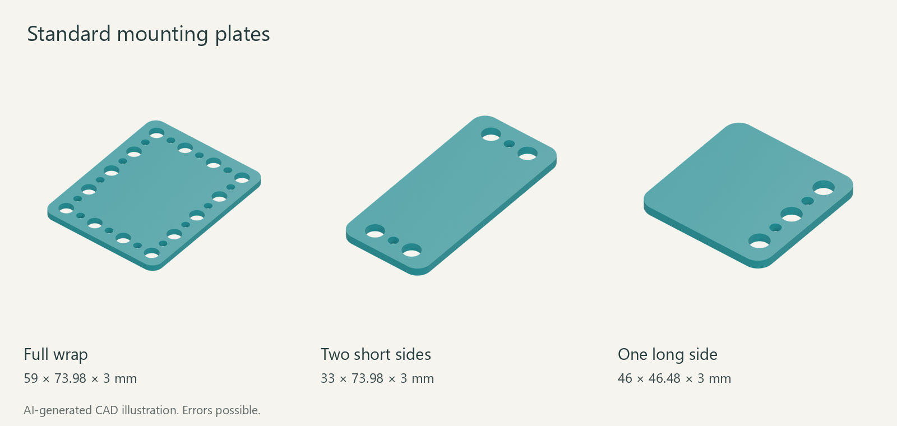
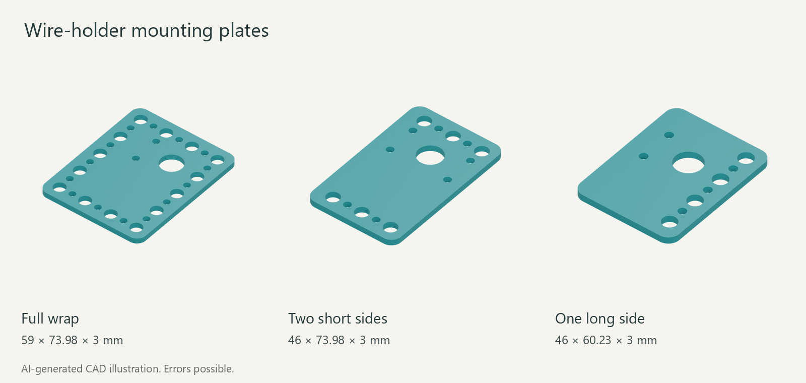

<!-- oobb-presentation:start -->
# Ai Thinker ESP32 s ESP32 cam 16 pin

AI-generated images and instructions. Errors possible.

Mounting plates for the listed board. Board not shown.

M6: Ø6.5 mm holes, Ø13 mm head/nut clearance, 15 mm pitch.

## Parts

One board and one plate. Choose a plate variant.

| Part | Type | Specification | Qty | MD5 alpha |
| --- | --- | --- | ---: | --- |
| [Standard — Full wrap](3dpr.stl) | Printed | 59 × 73.98 × 3 mm | 1 | — |
| [Standard — Two short sides](3dpr_short_sides.stl) | Printed | 33 × 73.98 × 3 mm | 1 | — |
| [Standard — One long side](3dpr_long_side.stl) | Printed | 46 × 46.48 × 3 mm | 1 | — |
| [Wire-holder — Full wrap](working_oobb.stl) | Printed | 59 × 73.98 × 3 mm | 1 | — |
| [Wire-holder — Two short sides](working_oobb_short_sides.stl) | Printed | 46 × 73.98 × 3 mm | 1 | — |
| [Wire-holder — One long side](working_oobb_long_side.stl) | Printed | 46 × 60.23 × 3 mm | 1 | — |
| [Ai Thinker ESP32 s ESP32 cam 16 pin](working.yaml) | Hardware | 27 × 40.5 mm | 1 | [jeid](working.yaml) |

## Wire-holder plates

## Installation

Select a plate and download its STL. Board fixing hardware is not specified in this record.

## Files

[Catalogue record](working.yaml) · [Render sources](presentation/manifest.json)
<!-- oobb-presentation:end -->
