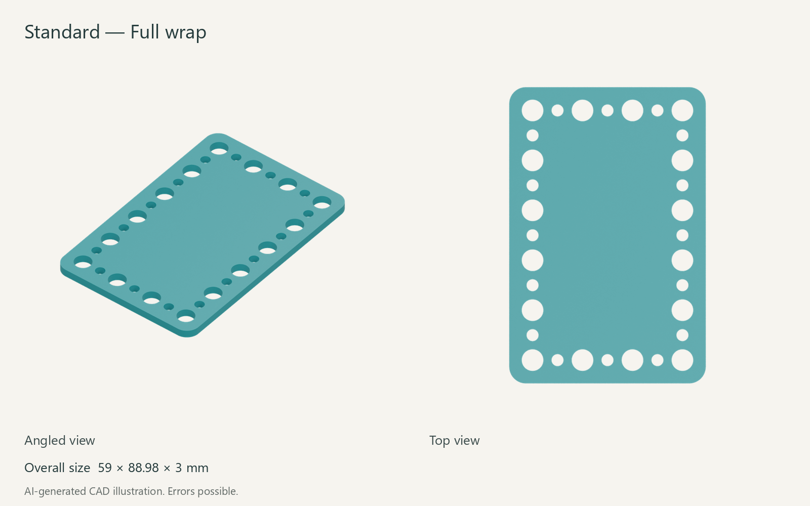
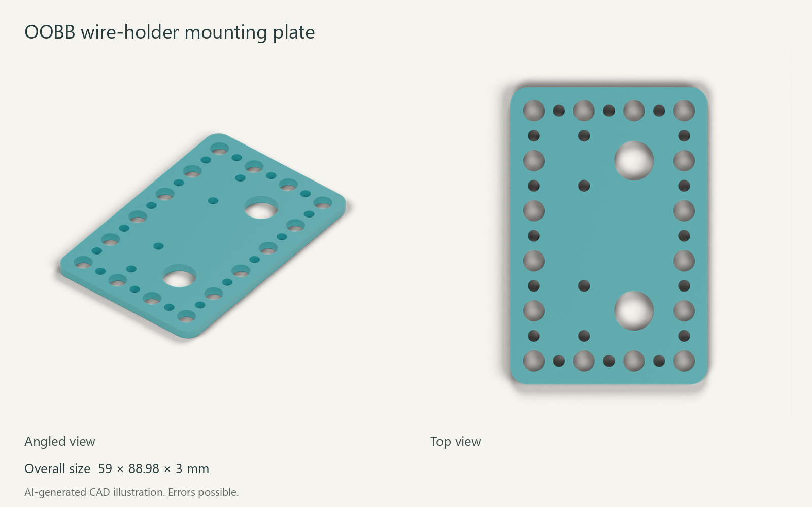

<!-- oobb-presentation:start -->
# Raspberry Pi Pico

AI-generated images and instructions. Errors possible.

Mounting plates for the listed board. Board not shown.

## Parts

One board and one plate. Choose a plate variant.

| Part | Type | Specification | Qty | MD5 alpha |
| --- | --- | --- | ---: | --- |
| [Default plate](3dpr.stl) | Printed | 59 × 88.98 × 3 mm | 1 | — |
| [OOBB wire-holder plate](working_oobb.stl) | Printed | 59 × 88.98 × 3 mm | 1 | — |
| [Raspberry Pi Pico](working.yaml) | Hardware | 21 × 51 mm; without headers | 1 | [1owcj](working.yaml) |

## OOBB variant

## Installation

Select a plate and download its STL. Board fixing hardware is not specified in this record.

## Files

[Catalogue record](working.yaml) · [Render sources](presentation/manifest.json) · [Raspberry Pi documentation](https://www.raspberrypi.com/products/raspberry-pi-pico/)
<!-- oobb-presentation:end -->
