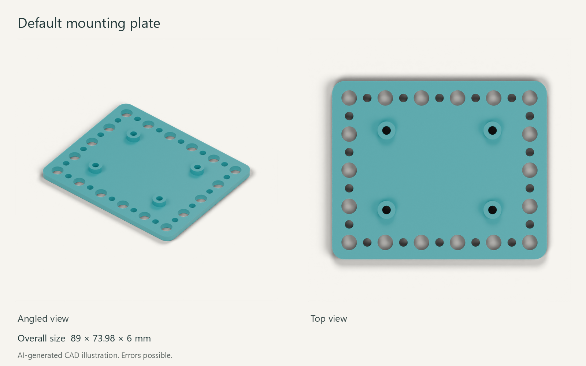

<!-- oobb-presentation:start -->
# Aliexpress relay

AI-generated images and instructions. Errors possible.

Mounting plates for the listed board. Board not shown.

## Parts

One board and one plate. Choose a plate variant.

| Part | Type | Specification | Qty | MD5 alpha |
| --- | --- | --- | ---: | --- |
| [Default plate](3dpr.stl) | Printed | 89 × 73.98 × 6 mm | 1 | — |
| [OOBB wire-holder plate](working_oobb.stl) | Printed | 89 × 73.98 × 9 mm | 1 | — |
| [Aliexpress relay](working.yaml) | Hardware | 49 × 38 mm | 1 | [7zii9](working.yaml) |

## OOBB variant

## Installation

Select a plate and download its STL. Board fixing hardware is not specified in this record.

## Files

[Catalogue record](working.yaml) · [Render sources](presentation/manifest.json)
<!-- oobb-presentation:end -->
