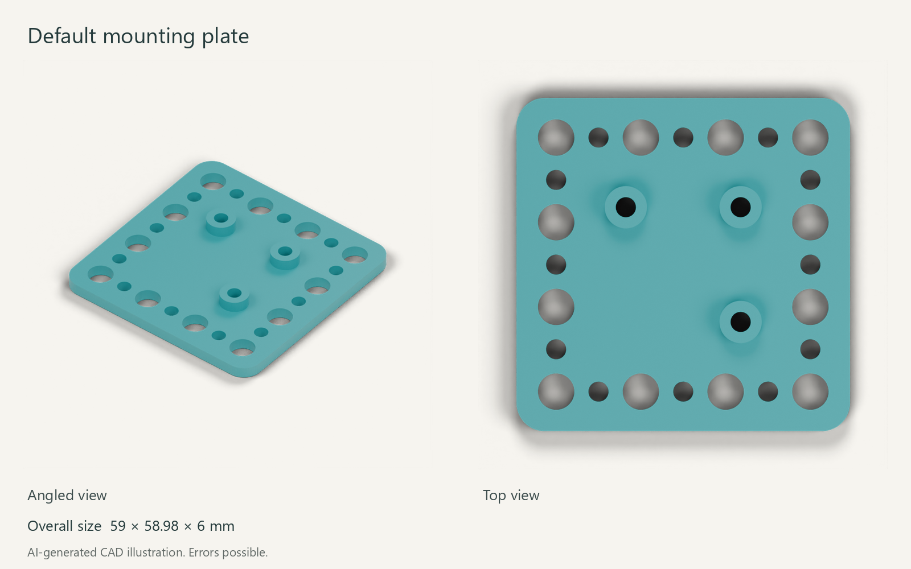
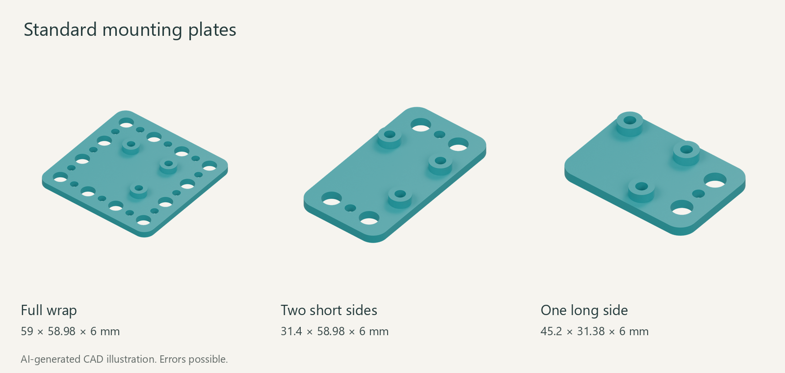
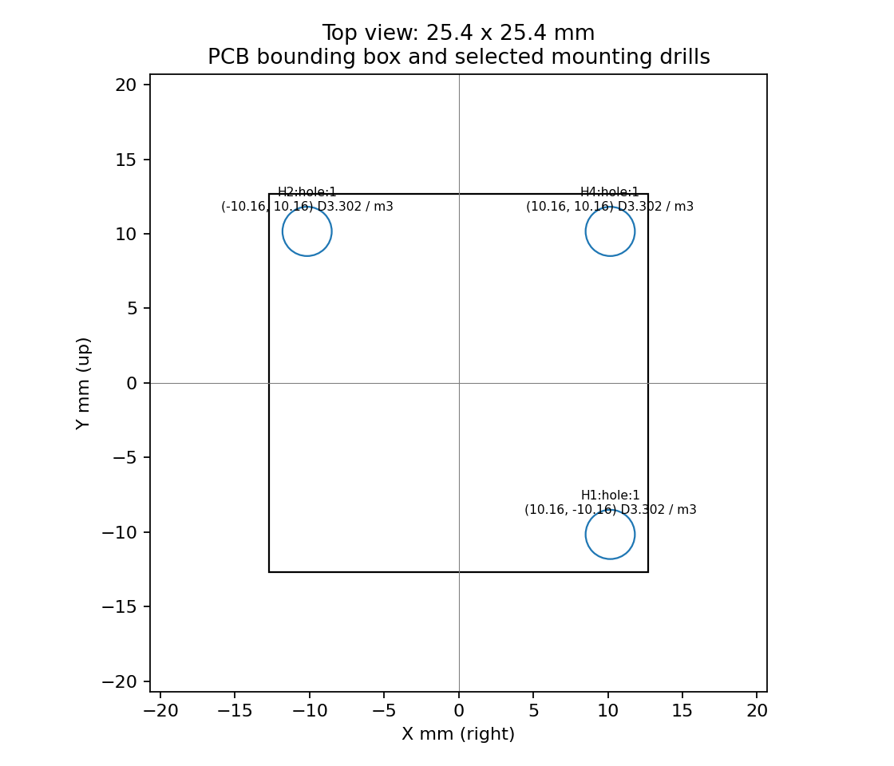

<!-- oomp-documentation:start -->
# Electronic Breakout Sensor Environmental Temperature Humidity Pressure Bme280 Qwiic Sparkfun Sen 15440

## Summary

OOMP catalogue record for Electronic Breakout Sensor Environmental Temperature Humidity Pressure Bme280 Qwiic Sparkfun Sen 15440. Use the metadata to identify this variant and the part folder to inspect its available assets.



Catalogue illustration; consult the source dimensions and datasheet for specification.

## Details

**OOMP folder ID:** `electronic_breakout_sensor_environmental_temperature_humidity_pressure_bme280_qwiic_sparkfun_sen_15440`

[Catalogue](../../README.md) · [Part metadata](working.yaml)

| Field | Value |
| --- | --- |
| id | electronic_breakout_sensor_environmental_temperature_humidity_pressure_bme280_qwiic_sparkfun_sen_15440 |
| md5_6 | 28a0ee |
| md5_6_alpha | 1l2i6 |
| oomp_key | oomp_electronic_breakout_sensor_environmental_temperature_humidity_pressure_bme280_qwiic_sparkfun_sen_15440 |
| taxonomy_1 | electronic |
| taxonomy_2 | breakout |
| taxonomy_3 | sensor |
| taxonomy_4 | environmental |
| taxonomy_5 | temperature_humidity_pressure |
| taxonomy_6 | bme280 |
| taxonomy_7 | qwiic |
| taxonomy_14 | sparkfun |
| taxonomy_15 | sen_15440 |

<details>
<summary>Full part metadata</summary>

```yaml
bip_39_2_word_array:
- chunk
- alter
bip_39_2_word_no_space: chunkalter
bip_39_2_word_space: chunk alter
bip_39_2_word_underscore: chunk_alter
bip_39_3_word_array:
- chunk
- alter
- main
bip_39_3_word_no_space: chunkaltermain
bip_39_3_word_space: chunk alter main
bip_39_3_word_underscore: chunk_alter_main
bip_39_full_array:
- chunk
- alter
- main
- bracket
- frost
- fun
- bean
- because
- loop
- naive
- swap
- spin
bip_39_full_no_space: chunkaltermainbracketfrostfunbeanbecauseloopnaiveswapspin
bip_39_full_space: chunk alter main bracket frost fun bean because loop naive swap
  spin
bip_39_full_underscore: chunk_alter_main_bracket_frost_fun_bean_because_loop_naive_swap_spin
board_variant: qwiic
breakout_description: qwiic
breakout_pcb_height: 25.4
breakout_pcb_width: 25.4
catalogue: i2c_breakouts
catalogue_status: product_page_reference
data_gaps:
- Physical connector/pad map and coordinates not imported.
- Located mounting holes and complete assembly/connector clearances not imported.
- Pull-up values/rails and full electrical limits require schematic review.
- Carrier PCB outline dimensions not verified.
definition_authority: working_oomp_populate_i2c.py
description: A useful combined weather and environmental sensor. The board supports
  I2C and SPI.
dimensions_mm:
  height: null
  scope: pcb_outline_not_established
  source_id: null
  status: unverified
  width: null
directory: parts/electronic_breakout_sensor_environmental_temperature_humidity_pressure_bme280_qwiic_sparkfun_sen_15440
geometry_ready: false
i2c:
  address_evidence_status: partial_product_page_evidence
  address_selection: board_configuration
  clock_stretching: unverified
  default_address_7bit: 119
  documented_addresses_7bit:
  - 118
  - 119
  maximum_clock_hz: null
  source_id: product
id: electronic_breakout_sensor_environmental_temperature_humidity_pressure_bme280_qwiic_sparkfun_sen_15440
id_no_class: electronic_breakout_sensor_environmental_temperature_humidity_pressure_bme280_qwiic_sparkfun_sen_15440
id_no_size: electronic_breakout_sensor_environmental_temperature_humidity_pressure_bme280_qwiic_sparkfun_sen_15440
id_no_type: electronic_breakout_sensor_environmental_temperature_humidity_pressure_bme280_qwiic_sparkfun_sen_15440
interface_scope: documented_board_interfaces_only
interfaces:
- i2c
- spi
item_kind: breakout
link_github: https://github.com/oomlout/oomlout_oomp_version_1_messy/tree/main/parts/electronic_breakout_sensor_environmental_temperature_humidity_pressure_bme280_qwiic_sparkfun_sen_15440
link_main: https://github.com/oomlout/oomlout_oomp_version_1_messy/tree/main/parts/electronic_breakout_sensor_environmental_temperature_humidity_pressure_bme280_qwiic_sparkfun_sen_15440
link_redirect: https://github.com/oomlout/oomlout_oomp_version_1_messy/tree/main/parts/electronic_breakout_sensor_environmental_temperature_humidity_pressure_bme280_qwiic_sparkfun_sen_15440
manufacturer: sparkfun
manufacturer_part_number: SEN-15440
md5: 28a0ee190d65d6bc04e09e83f2576d68
md5_10: 28a0ee190d
md5_10_upper: 28A0EE190D
md5_5: 28a0e
md5_5_upper: 28A0E
md5_6: 28a0ee
md5_6_alpha: 1l2i6
md5_6_alpha_upper: 1L2I6
md5_6_upper: 28A0EE
mounting_coordinate_system:
  origin: pcb_bounding_box_centre
  units: mm
  view: top
  x_positive: right
  y_positive: up
mounting_geometry_ready: true
mounting_hole_details:
- diameter_mm: 3.302
  id: H4:hole:1
  package: STAND-OFF
  plated: false
  source_id: mounting_cad
  x_mm: 10.16
  y_mm: 10.16
- diameter_mm: 3.302
  id: H2:hole:1
  package: STAND-OFF
  plated: false
  source_id: mounting_cad
  x_mm: -10.16
  y_mm: 10.16
- diameter_mm: 3.302
  id: H1:hole:1
  package: STAND-OFF
  plated: false
  source_id: mounting_cad
  x_mm: 10.16
  y_mm: -10.16
mounting_hole_radius_name: m3
mounting_hole_radius_names:
- m3
- m3
- m3
mounting_hole_status: verified
mounting_holes:
- - 10.16
  - 10.16
- - -10.16
  - 10.16
- - 10.16
  - -10.16
mounting_lift: 3
mounting_research:
  board_revision: SparkFun Atmospheric Sensor Breakout - BME280 (Qwiic), SEN-15440
    carrier, matched to manufacturer EAGLE board file at commit 69d2067e2999ea92fe713dfb745f2955c7e2953a;
    physical production revisions not independently inspected.
  board_size:
  - 25.4
  - 25.4
  coordinate_system:
    origin: pcb_bounding_box_centre
    units: mm
    view: top
    x_positive: right
    y_positive: up
  derivation: 'Layer 20 wires define a plain rectangular carrier outline spanning
    native x=0..25.4 mm and y=0..25.4 mm, yielding board_size=[25.4,25.4]. Centre
    is (12.7,12.7) mm. Hole candidates in the full drill inspection: H4, H2, H1 are
    unplated 3.302 mm holes in STAND-OFF packages, giving centred locations (10.16,10.16),
    (-10.16,10.16), (10.16,-10.16) mm. The other six drilled candidates are J3:pad:1..4
    and J4:pad:1..2, 1.016 mm plated through-hole connector contacts at y=-11.43 mm;
    they are explicitly excluded because their package/element references place them
    in the 0.1-inch header footprints, not board mounting features. Full drill count
    is nine and all candidates were inspected.'
  fit_status: generic_holder_not_physical_fit_tested
  identity_evidence: SparkFun product page names the Atmospheric Sensor Breakout -
    BME280 (Qwiic), SKU SEN-15440. SparkFun repository README names SEN-15440 and
    lists Hardware EAGLE files; commit 69d2067e2999ea92fe713dfb745f2955c7e2953a is
    confirmed by GitHub API and contains Hardware/Qwiic_Atmospheric_Sensor.brd. Archived
    local XML bytes match that pinned raw URL exactly (393744 bytes, SHA-256 4b34fb80307cfd8d4008901a69409346b4d8c301a6afd522ce289ca682187e7c).
  mounting_holes:
  - diameter_mm: 3.302
    id: H4:hole:1
    package: STAND-OFF
    plated: false
    source_id: cad
    x_mm: 10.16
    y_mm: 10.16
  - diameter_mm: 3.302
    id: H2:hole:1
    package: STAND-OFF
    plated: false
    source_id: cad
    x_mm: -10.16
    y_mm: 10.16
  - diameter_mm: 3.302
    id: H1:hole:1
    package: STAND-OFF
    plated: false
    source_id: cad
    x_mm: 10.16
    y_mm: -10.16
  record_sha256: 56a0cc9e868014081342a6b57c2e550f057dd9fb013bb32c1e8f04bbffefe8ba
  research_file: source_file/electronic_breakout_sensor_environmental_temperature_humidity_pressure_bme280_qwiic_sparkfun_sen_15440/mounting.yaml
  reviewed_by: gpt-6-luna
  sources:
  - bytes: 574671
    id: product
    kind: manufacturer_product
    local_file: website.html
    locator: Product name and SKU SEN-15440; identity only, no board outline dimensions.
    sha256: 7369feea75452a4e7c89db69be84c8fe2c631910414f0ca32a4a122a32609eff
    url: https://www.sparkfun.com/sparkfun-atmospheric-sensor-breakout-bme280-qwiic.html
  - bytes: 260508
    id: repo
    kind: manufacturer_repository
    local_file: reference/hardware_repository.html
    locator: README identifies SEN-15440 Qwiic product and lists Hardware Eagle files;
      commit verified by API.
    sha256: 83fe134809a381c8f5fce2991f47a6fe114db94694b398e294c90b94332991c5
    url: https://github.com/sparkfun/Qwiic_Atmospheric_Sensor_Breakout_BME280
  - bytes: 393744
    id: cad
    kind: manufacturer_cad
    local_file: reference/qwiic_bme280.brd
    locator: Pinned commit and matching local file hash; XML layer 20 outline and
      all nine drill candidates inspected.
    sha256: 4b34fb80307cfd8d4008901a69409346b4d8c301a6afd522ce289ca682187e7c
    url: https://raw.githubusercontent.com/sparkfun/Qwiic_Atmospheric_Sensor_Breakout_BME280/69d2067e2999ea92fe713dfb745f2955c7e2953a/Hardware/Qwiic_Atmospheric_Sensor.brd
  status: verified
name: Electronic Breakout Sensor Environmental Temperature Humidity Pressure Bme280
  Qwiic Sparkfun Sen 15440
name_no_class: Electronic Breakout Sensor Environmental Temperature Humidity Pressure
  Bme280 Qwiic Sparkfun Sen 15440
name_no_size: Electronic Breakout Sensor Environmental Temperature Humidity Pressure
  Bme280 Qwiic Sparkfun Sen 15440
name_no_type: Electronic Breakout Sensor Environmental Temperature Humidity Pressure
  Bme280 Qwiic Sparkfun Sen 15440
name_proper: Electronic Breakout Sensor Environmental Temperature Humidity Pressure
  Bme280 Qwiic Sparkfun Sen 15440
name_readable: SparkFun BME280 Atmospheric Sensor, Qwiic
name_space: electronic breakout sensor environmental temperature humidity pressure
  bme280 qwiic sparkfun sen 15440
name_upper: ELECTRONIC BREAKOUT SENSOR ENVIRONMENTAL TEMPERATURE HUMIDITY PRESSURE
  BME280 QWIIC SPARKFUN SEN 15440
notes: []
oobb_details:
- breakout_pcb_height: 25.4
  breakout_pcb_width: 25.4
  mounting_hole_details:
  - diameter_mm: 3.302
    id: H4:hole:1
    package: STAND-OFF
    plated: false
    source_id: mounting_cad
    x_mm: 10.16
    y_mm: 10.16
  - diameter_mm: 3.302
    id: H2:hole:1
    package: STAND-OFF
    plated: false
    source_id: mounting_cad
    x_mm: -10.16
    y_mm: 10.16
  - diameter_mm: 3.302
    id: H1:hole:1
    package: STAND-OFF
    plated: false
    source_id: mounting_cad
    x_mm: 10.16
    y_mm: -10.16
  mounting_hole_radius_name: m3
  mounting_hole_radius_names:
  - m3
  - m3
  - m3
  mounting_holes:
  - - 10.16
    - 10.16
  - - -10.16
    - 10.16
  - - 10.16
    - -10.16
  mounting_layout: full_wrap
  mounting_lift: 3
  oobb_name: mounting_plate_default
- breakout_pcb_height: 25.4
  breakout_pcb_width: 25.4
  mounting_hole_details:
  - diameter_mm: 3.302
    id: H4:hole:1
    package: STAND-OFF
    plated: false
    source_id: mounting_cad
    x_mm: 10.16
    y_mm: 10.16
  - diameter_mm: 3.302
    id: H2:hole:1
    package: STAND-OFF
    plated: false
    source_id: mounting_cad
    x_mm: -10.16
    y_mm: 10.16
  - diameter_mm: 3.302
    id: H1:hole:1
    package: STAND-OFF
    plated: false
    source_id: mounting_cad
    x_mm: 10.16
    y_mm: -10.16
  mounting_hole_radius_name: m3
  mounting_hole_radius_names:
  - m3
  - m3
  - m3
  mounting_holes:
  - - 10.16
    - 10.16
  - - -10.16
    - 10.16
  - - 10.16
    - -10.16
  mounting_layout: short_sides
  mounting_lift: 3
  oobb_name: mounting_plate_default
  scad_output: 3dpr_short_sides
- breakout_pcb_height: 25.4
  breakout_pcb_width: 25.4
  mounting_hole_details:
  - diameter_mm: 3.302
    id: H4:hole:1
    package: STAND-OFF
    plated: false
    source_id: mounting_cad
    x_mm: 10.16
    y_mm: 10.16
  - diameter_mm: 3.302
    id: H2:hole:1
    package: STAND-OFF
    plated: false
    source_id: mounting_cad
    x_mm: -10.16
    y_mm: 10.16
  - diameter_mm: 3.302
    id: H1:hole:1
    package: STAND-OFF
    plated: false
    source_id: mounting_cad
    x_mm: 10.16
    y_mm: -10.16
  mounting_hole_radius_name: m3
  mounting_hole_radius_names:
  - m3
  - m3
  - m3
  mounting_holes:
  - - 10.16
    - 10.16
  - - -10.16
    - 10.16
  - - 10.16
    - -10.16
  mounting_layout: long_side
  mounting_lift: 3
  oobb_name: mounting_plate_default
  scad_output: 3dpr_long_side
oomlout_ai_roboclick_1:
  actions:
  - command: text_jinja_template
    convert_to_pdf: false
    convert_to_png: false
    dict_data:
      board_variant: qwiic
      breakout_description: qwiic
      breakout_pcb_height: 25.4
      breakout_pcb_width: 25.4
      catalogue: i2c_breakouts
      catalogue_status: product_page_reference
      data_gaps:
      - Physical connector/pad map and coordinates not imported.
      - Located mounting holes and complete assembly/connector clearances not imported.
      - Pull-up values/rails and full electrical limits require schematic review.
      - Carrier PCB outline dimensions not verified.
      definition_authority: working_oomp_populate_i2c.py
      description: A useful combined weather and environmental sensor. The board supports
        I2C and SPI.
      dimensions_mm:
        height: null
        scope: pcb_outline_not_established
        source_id: null
        status: unverified
        width: null
      directory: parts\electronic_breakout_sensor_environmental_temperature_humidity_pressure_bme280_qwiic_sparkfun_sen_15440
      geometry_ready: false
      i2c:
        address_evidence_status: partial_product_page_evidence
        address_selection: board_configuration
        clock_stretching: unverified
        default_address_7bit: 119
        documented_addresses_7bit:
        - 118
        - 119
        maximum_clock_hz: null
        source_id: product
      interface_scope: documented_board_interfaces_only
      interfaces:
      - i2c
      - spi
      item_kind: breakout
      manufacturer: sparkfun
      manufacturer_part_number: SEN-15440
      mounting_coordinate_system:
        origin: pcb_bounding_box_centre
        units: mm
        view: top
        x_positive: right
        y_positive: up
      mounting_geometry_ready: true
      mounting_hole_details:
      - diameter_mm: 3.302
        id: H4:hole:1
        package: STAND-OFF
        plated: false
        source_id: mounting_cad
        x_mm: 10.16
        y_mm: 10.16
      - diameter_mm: 3.302
        id: H2:hole:1
        package: STAND-OFF
        plated: false
        source_id: mounting_cad
        x_mm: -10.16
        y_mm: 10.16
      - diameter_mm: 3.302
        id: H1:hole:1
        package: STAND-OFF
        plated: false
        source_id: mounting_cad
        x_mm: 10.16
        y_mm: -10.16
      mounting_hole_radius_name: m3
      mounting_hole_radius_names:
      - m3
      - m3
      - m3
      mounting_hole_status: verified
      mounting_holes:
      - - 10.16
        - 10.16
      - - -10.16
        - 10.16
      - - 10.16
        - -10.16
      mounting_lift: 3
      mounting_research:
        board_revision: SparkFun Atmospheric Sensor Breakout - BME280 (Qwiic), SEN-15440
          carrier, matched to manufacturer EAGLE board file at commit 69d2067e2999ea92fe713dfb745f2955c7e2953a;
          physical production revisions not independently inspected.
        board_size:
        - 25.4
        - 25.4
        coordinate_system:
          origin: pcb_bounding_box_centre
          units: mm
          view: top
          x_positive: right
          y_positive: up
        derivation: 'Layer 20 wires define a plain rectangular carrier outline spanning
          native x=0..25.4 mm and y=0..25.4 mm, yielding board_size=[25.4,25.4]. Centre
          is (12.7,12.7) mm. Hole candidates in the full drill inspection: H4, H2,
          H1 are unplated 3.302 mm holes in STAND-OFF packages, giving centred locations
          (10.16,10.16), (-10.16,10.16), (10.16,-10.16) mm. The other six drilled
          candidates are J3:pad:1..4 and J4:pad:1..2, 1.016 mm plated through-hole
          connector contacts at y=-11.43 mm; they are explicitly excluded because
          their package/element references place them in the 0.1-inch header footprints,
          not board mounting features. Full drill count is nine and all candidates
          were inspected.'
        fit_status: generic_holder_not_physical_fit_tested
        identity_evidence: SparkFun product page names the Atmospheric Sensor Breakout
          - BME280 (Qwiic), SKU SEN-15440. SparkFun repository README names SEN-15440
          and lists Hardware EAGLE files; commit 69d2067e2999ea92fe713dfb745f2955c7e2953a
          is confirmed by GitHub API and contains Hardware/Qwiic_Atmospheric_Sensor.brd.
          Archived local XML bytes match that pinned raw URL exactly (393744 bytes,
          SHA-256 4b34fb80307cfd8d4008901a69409346b4d8c301a6afd522ce289ca682187e7c).
        mounting_holes:
        - diameter_mm: 3.302
          id: H4:hole:1
          package: STAND-OFF
          plated: false
          source_id: cad
          x_mm: 10.16
          y_mm: 10.16
        - diameter_mm: 3.302
          id: H2:hole:1
          package: STAND-OFF
          plated: false
          source_id: cad
          x_mm: -10.16
          y_mm: 10.16
        - diameter_mm: 3.302
          id: H1:hole:1
          package: STAND-OFF
          plated: false
          source_id: cad
          x_mm: 10.16
          y_mm: -10.16
        record_sha256: 56a0cc9e868014081342a6b57c2e550f057dd9fb013bb32c1e8f04bbffefe8ba
        research_file: source_file/electronic_breakout_sensor_environmental_temperature_humidity_pressure_bme280_qwiic_sparkfun_sen_15440/mounting.yaml
        reviewed_by: gpt-6-luna
        sources:
        - bytes: 574671
          id: product
          kind: manufacturer_product
          local_file: website.html
          locator: Product name and SKU SEN-15440; identity only, no board outline
            dimensions.
          sha256: 7369feea75452a4e7c89db69be84c8fe2c631910414f0ca32a4a122a32609eff
          url: https://www.sparkfun.com/sparkfun-atmospheric-sensor-breakout-bme280-qwiic.html
        - bytes: 260508
          id: repo
          kind: manufacturer_repository
          local_file: reference/hardware_repository.html
          locator: README identifies SEN-15440 Qwiic product and lists Hardware Eagle
            files; commit verified by API.
          sha256: 83fe134809a381c8f5fce2991f47a6fe114db94694b398e294c90b94332991c5
          url: https://github.com/sparkfun/Qwiic_Atmospheric_Sensor_Breakout_BME280
        - bytes: 393744
          id: cad
          kind: manufacturer_cad
          local_file: reference/qwiic_bme280.brd
          locator: Pinned commit and matching local file hash; XML layer 20 outline
            and all nine drill candidates inspected.
          sha256: 4b34fb80307cfd8d4008901a69409346b4d8c301a6afd522ce289ca682187e7c
          url: https://raw.githubusercontent.com/sparkfun/Qwiic_Atmospheric_Sensor_Breakout_BME280/69d2067e2999ea92fe713dfb745f2955c7e2953a/Hardware/Qwiic_Atmospheric_Sensor.brd
        status: verified
      name: electronic_breakout_sensor_environmental_temperature_humidity_pressure_bme280_qwiic_sparkfun_sen_15440
      name_proper: Electronic Breakout Sensor Environmental Temperature Humidity Pressure
        Bme280 Qwiic Sparkfun Sen 15440
      name_readable: SparkFun BME280 Atmospheric Sensor, Qwiic
      name_space: electronic breakout sensor environmental temperature humidity pressure
        bme280 qwiic sparkfun sen 15440
      name_upper: ELECTRONIC BREAKOUT SENSOR ENVIRONMENTAL TEMPERATURE HUMIDITY PRESSURE
        BME280 QWIIC SPARKFUN SEN 15440
      notes: []
      oobb_details:
      - breakout_pcb_height: 25.4
        breakout_pcb_width: 25.4
        mounting_hole_details:
        - diameter_mm: 3.302
          id: H4:hole:1
          package: STAND-OFF
          plated: false
          source_id: mounting_cad
          x_mm: 10.16
          y_mm: 10.16
        - diameter_mm: 3.302
          id: H2:hole:1
          package: STAND-OFF
          plated: false
          source_id: mounting_cad
          x_mm: -10.16
          y_mm: 10.16
        - diameter_mm: 3.302
          id: H1:hole:1
          package: STAND-OFF
          plated: false
          source_id: mounting_cad
          x_mm: 10.16
          y_mm: -10.16
        mounting_hole_radius_name: m3
        mounting_hole_radius_names:
        - m3
        - m3
        - m3
        mounting_holes:
        - - 10.16
          - 10.16
        - - -10.16
          - 10.16
        - - 10.16
          - -10.16
        mounting_layout: full_wrap
        mounting_lift: 3
        oobb_name: mounting_plate_default
      - breakout_pcb_height: 25.4
        breakout_pcb_width: 25.4
        mounting_hole_details:
        - diameter_mm: 3.302
          id: H4:hole:1
          package: STAND-OFF
          plated: false
          source_id: mounting_cad
          x_mm: 10.16
          y_mm: 10.16
        - diameter_mm: 3.302
          id: H2:hole:1
          package: STAND-OFF
          plated: false
          source_id: mounting_cad
          x_mm: -10.16
          y_mm: 10.16
        - diameter_mm: 3.302
          id: H1:hole:1
          package: STAND-OFF
          plated: false
          source_id: mounting_cad
          x_mm: 10.16
          y_mm: -10.16
        mounting_hole_radius_name: m3
        mounting_hole_radius_names:
        - m3
        - m3
        - m3
        mounting_holes:
        - - 10.16
          - 10.16
        - - -10.16
          - 10.16
        - - 10.16
          - -10.16
        mounting_layout: short_sides
        mounting_lift: 3
        oobb_name: mounting_plate_default
        scad_output: 3dpr_short_sides
      - breakout_pcb_height: 25.4
        breakout_pcb_width: 25.4
        mounting_hole_details:
        - diameter_mm: 3.302
          id: H4:hole:1
          package: STAND-OFF
          plated: false
          source_id: mounting_cad
          x_mm: 10.16
          y_mm: 10.16
        - diameter_mm: 3.302
          id: H2:hole:1
          package: STAND-OFF
          plated: false
          source_id: mounting_cad
          x_mm: -10.16
          y_mm: 10.16
        - diameter_mm: 3.302
          id: H1:hole:1
          package: STAND-OFF
          plated: false
          source_id: mounting_cad
          x_mm: 10.16
          y_mm: -10.16
        mounting_hole_radius_name: m3
        mounting_hole_radius_names:
        - m3
        - m3
        - m3
        mounting_holes:
        - - 10.16
          - 10.16
        - - -10.16
          - 10.16
        - - 10.16
          - -10.16
        mounting_layout: long_side
        mounting_lift: 3
        oobb_name: mounting_plate_default
        scad_output: 3dpr_long_side
      part_number: sen_15440
      part_number_sparkfun: SEN-15440
      pinout_status: unverified
      pins: {}
      research_date: '2026-10-23'
      schema_version: 1
      sources:
      - id: product
        kind: manufacturer_product_page
        retrieved: '2026-10-23'
        scope: identity, stated interfaces/features and recorded nominal dimensions
        url: https://www.sparkfun.com/sparkfun-atmospheric-sensor-breakout-bme280-qwiic.html
      - bytes: 574671
        id: mounting_product
        kind: manufacturer_product
        local_file: website.html
        locator: Product name and SKU SEN-15440; identity only, no board outline dimensions.
        sha256: 7369feea75452a4e7c89db69be84c8fe2c631910414f0ca32a4a122a32609eff
        url: https://www.sparkfun.com/sparkfun-atmospheric-sensor-breakout-bme280-qwiic.html
      - bytes: 260508
        id: mounting_repo
        kind: manufacturer_repository
        local_file: reference/hardware_repository.html
        locator: README identifies SEN-15440 Qwiic product and lists Hardware Eagle
          files; commit verified by API.
        sha256: 83fe134809a381c8f5fce2991f47a6fe114db94694b398e294c90b94332991c5
        url: https://github.com/sparkfun/Qwiic_Atmospheric_Sensor_Breakout_BME280
      - bytes: 393744
        id: mounting_cad
        kind: manufacturer_cad
        local_file: reference/qwiic_bme280.brd
        locator: Pinned commit and matching local file hash; XML layer 20 outline
          and all nine drill candidates inspected.
        sha256: 4b34fb80307cfd8d4008901a69409346b4d8c301a6afd522ce289ca682187e7c
        url: https://raw.githubusercontent.com/sparkfun/Qwiic_Atmospheric_Sensor_Breakout_BME280/69d2067e2999ea92fe713dfb745f2955c7e2953a/Hardware/Qwiic_Atmospheric_Sensor.brd
      svg_details:
      - export_pdf: true
        stylesheet: coordinate
        svg_name: coordinate_diagram
        svg_output: working_coordinate_diagram
      taxonomy_1: electronic
      taxonomy_10: ''
      taxonomy_11: ''
      taxonomy_12: ''
      taxonomy_13: ''
      taxonomy_14: sparkfun
      taxonomy_15: sen_15440
      taxonomy_2: breakout
      taxonomy_3: sensor
      taxonomy_4: environmental
      taxonomy_5: temperature_humidity_pressure
      taxonomy_6: bme280
      taxonomy_7: qwiic
      taxonomy_8: ''
      taxonomy_9: ''
      taxonomy_schema: breakout_function_v1
      type_1: sensor
      type_2: environmental
      type_3: temperature_humidity_pressure
      type_4: bme280
      url_chat: ''
      webpage: https://www.sparkfun.com/sparkfun-atmospheric-sensor-breakout-bme280-qwiic.html
      webpage_sparkfun: https://www.sparkfun.com/sparkfun-atmospheric-sensor-breakout-bme280-qwiic.html
    dict_data_files: {}
    dict_data_files_exists: {}
    file_output: label_oomp.svg
    file_template: C:\gh\oomp_electronic_breakout_version_5\source_file\template_jinja\template_jinja_label_oomlout_76_2_mm_50_8_mm\working.svg.j2
    search_and_replace: []
  file_test: label_oomp.pdf
  retries_until_complete: 0
oomp_key: oomp_electronic_breakout_sensor_environmental_temperature_humidity_pressure_bme280_qwiic_sparkfun_sen_15440
part_number: sen_15440
part_number_sparkfun: SEN-15440
pinout_status: unverified
pins: {}
research_date: '2026-10-23'
schema_version: 1
sources:
- id: product
  kind: manufacturer_product_page
  retrieved: '2026-10-23'
  scope: identity, stated interfaces/features and recorded nominal dimensions
  url: https://www.sparkfun.com/sparkfun-atmospheric-sensor-breakout-bme280-qwiic.html
- bytes: 574671
  id: mounting_product
  kind: manufacturer_product
  local_file: website.html
  locator: Product name and SKU SEN-15440; identity only, no board outline dimensions.
  sha256: 7369feea75452a4e7c89db69be84c8fe2c631910414f0ca32a4a122a32609eff
  url: https://www.sparkfun.com/sparkfun-atmospheric-sensor-breakout-bme280-qwiic.html
- bytes: 260508
  id: mounting_repo
  kind: manufacturer_repository
  local_file: reference/hardware_repository.html
  locator: README identifies SEN-15440 Qwiic product and lists Hardware Eagle files;
    commit verified by API.
  sha256: 83fe134809a381c8f5fce2991f47a6fe114db94694b398e294c90b94332991c5
  url: https://github.com/sparkfun/Qwiic_Atmospheric_Sensor_Breakout_BME280
- bytes: 393744
  id: mounting_cad
  kind: manufacturer_cad
  local_file: reference/qwiic_bme280.brd
  locator: Pinned commit and matching local file hash; XML layer 20 outline and all
    nine drill candidates inspected.
  sha256: 4b34fb80307cfd8d4008901a69409346b4d8c301a6afd522ce289ca682187e7c
  url: https://raw.githubusercontent.com/sparkfun/Qwiic_Atmospheric_Sensor_Breakout_BME280/69d2067e2999ea92fe713dfb745f2955c7e2953a/Hardware/Qwiic_Atmospheric_Sensor.brd
svg_details:
- export_pdf: true
  stylesheet: coordinate
  svg_name: coordinate_diagram
  svg_output: working_coordinate_diagram
taxonomy_1: electronic
taxonomy_10: ''
taxonomy_11: ''
taxonomy_12: ''
taxonomy_13: ''
taxonomy_14: sparkfun
taxonomy_14_capital: Sparkfun
taxonomy_14_first_letter: s
taxonomy_14_first_letter_upper: S
taxonomy_14_length_1: s
taxonomy_14_length_2: sp
taxonomy_14_length_3: spa
taxonomy_14_length_4: spar
taxonomy_14_length_5: spark
taxonomy_14_upper: SPARKFUN
taxonomy_14_upper_length_1: S
taxonomy_14_upper_length_2: SP
taxonomy_14_upper_length_3: SPA
taxonomy_14_upper_length_4: SPAR
taxonomy_14_upper_length_5: SPARK
taxonomy_15: sen_15440
taxonomy_15_capital: Sen 15440
taxonomy_15_first_letter: s
taxonomy_15_first_letter_upper: S
taxonomy_15_length_1: s
taxonomy_15_length_2: se
taxonomy_15_length_3: sen
taxonomy_15_length_4: sen_
taxonomy_15_length_5: sen_1
taxonomy_15_upper: SEN_15440
taxonomy_15_upper_length_1: S
taxonomy_15_upper_length_2: SE
taxonomy_15_upper_length_3: SEN
taxonomy_15_upper_length_4: SEN_
taxonomy_15_upper_length_5: SEN_1
taxonomy_1_capital: Electronic
taxonomy_1_first_letter: e
taxonomy_1_first_letter_upper: E
taxonomy_1_length_1: e
taxonomy_1_length_2: el
taxonomy_1_length_3: ele
taxonomy_1_length_4: elec
taxonomy_1_length_5: elect
taxonomy_1_upper: ELECTRONIC
taxonomy_1_upper_length_1: E
taxonomy_1_upper_length_2: EL
taxonomy_1_upper_length_3: ELE
taxonomy_1_upper_length_4: ELEC
taxonomy_1_upper_length_5: ELECT
taxonomy_2: breakout
taxonomy_2_capital: Breakout
taxonomy_2_first_letter: b
taxonomy_2_first_letter_upper: B
taxonomy_2_length_1: b
taxonomy_2_length_2: br
taxonomy_2_length_3: bre
taxonomy_2_length_4: brea
taxonomy_2_length_5: break
taxonomy_2_upper: BREAKOUT
taxonomy_2_upper_length_1: B
taxonomy_2_upper_length_2: BR
taxonomy_2_upper_length_3: BRE
taxonomy_2_upper_length_4: BREA
taxonomy_2_upper_length_5: BREAK
taxonomy_3: sensor
taxonomy_3_capital: Sensor
taxonomy_3_first_letter: s
taxonomy_3_first_letter_upper: S
taxonomy_3_length_1: s
taxonomy_3_length_2: se
taxonomy_3_length_3: sen
taxonomy_3_length_4: sens
taxonomy_3_length_5: senso
taxonomy_3_upper: SENSOR
taxonomy_3_upper_length_1: S
taxonomy_3_upper_length_2: SE
taxonomy_3_upper_length_3: SEN
taxonomy_3_upper_length_4: SENS
taxonomy_3_upper_length_5: SENSO
taxonomy_4: environmental
taxonomy_4_capital: Environmental
taxonomy_4_first_letter: e
taxonomy_4_first_letter_upper: E
taxonomy_4_length_1: e
taxonomy_4_length_2: en
taxonomy_4_length_3: env
taxonomy_4_length_4: envi
taxonomy_4_length_5: envir
taxonomy_4_upper: ENVIRONMENTAL
taxonomy_4_upper_length_1: E
taxonomy_4_upper_length_2: EN
taxonomy_4_upper_length_3: ENV
taxonomy_4_upper_length_4: ENVI
taxonomy_4_upper_length_5: ENVIR
taxonomy_5: temperature_humidity_pressure
taxonomy_5_capital: Temperature Humidity Pressure
taxonomy_5_first_letter: t
taxonomy_5_first_letter_upper: T
taxonomy_5_length_1: t
taxonomy_5_length_2: te
taxonomy_5_length_3: tem
taxonomy_5_length_4: temp
taxonomy_5_length_5: tempe
taxonomy_5_upper: TEMPERATURE_HUMIDITY_PRESSURE
taxonomy_5_upper_length_1: T
taxonomy_5_upper_length_2: TE
taxonomy_5_upper_length_3: TEM
taxonomy_5_upper_length_4: TEMP
taxonomy_5_upper_length_5: TEMPE
taxonomy_6: bme280
taxonomy_6_capital: Bme280
taxonomy_6_first_letter: b
taxonomy_6_first_letter_upper: B
taxonomy_6_length_1: b
taxonomy_6_length_2: bm
taxonomy_6_length_3: bme
taxonomy_6_length_4: bme2
taxonomy_6_length_5: bme28
taxonomy_6_upper: BME280
taxonomy_6_upper_length_1: B
taxonomy_6_upper_length_2: BM
taxonomy_6_upper_length_3: BME
taxonomy_6_upper_length_4: BME2
taxonomy_6_upper_length_5: BME28
taxonomy_7: qwiic
taxonomy_7_capital: Qwiic
taxonomy_7_first_letter: q
taxonomy_7_first_letter_upper: Q
taxonomy_7_length_1: q
taxonomy_7_length_2: qw
taxonomy_7_length_3: qwi
taxonomy_7_length_4: qwii
taxonomy_7_length_5: qwiic
taxonomy_7_upper: QWIIC
taxonomy_7_upper_length_1: Q
taxonomy_7_upper_length_2: QW
taxonomy_7_upper_length_3: QWI
taxonomy_7_upper_length_4: QWII
taxonomy_7_upper_length_5: QWIIC
taxonomy_8: ''
taxonomy_9: ''
taxonomy_schema: breakout_function_v1
type_1: sensor
type_2: environmental
type_3: temperature_humidity_pressure
type_4: bme280
url_chat: ''
webpage: https://www.sparkfun.com/sparkfun-atmospheric-sensor-breakout-bme280-qwiic.html
webpage_sparkfun: https://www.sparkfun.com/sparkfun-atmospheric-sensor-breakout-bme280-qwiic.html
```

</details>

## Parts

[Open the canonical part folder](./) for the files available for this variant. Alternative model formats describe the same record; they are not extra components.

## Assembly

No assembly procedure is inferred from this catalogue record. Use any retained technical notes and the original manufacturer documentation for installation details.
<!-- oomp-documentation:end -->

<details>
<summary>Existing technical notes</summary>

<!-- oobb-presentation:start -->
# SparkFun Qwiic BME280

AI-generated images and instructions. Errors possible.



Mounting plates for the listed board. Board not shown.

M6: Ø6.5 mm holes, Ø13 mm head/nut clearance, 15 mm pitch.

## Parts

One board and one plate. Choose a plate variant.

| Part | Type | Specification | Qty | MD5 alpha |
| --- | --- | --- | ---: | --- |
| [Standard — Full wrap](3dpr.stl) | Printed | 59 × 58.98 × 6 mm | 1 | — |
| [Standard — Two short sides](3dpr_short_sides.stl) | Printed | 31.4 × 58.98 × 6 mm | 1 | — |
| [Standard — One long side](3dpr_long_side.stl) | Printed | 45.2 × 31.38 × 6 mm | 1 | — |
| [SparkFun Qwiic BME280](working.yaml) | Hardware | 25.4 × 25.4 mm; bme280 | 1 | [1l2i6](working.yaml) |

## Installation

1. Download and print the default mounting plate STL.
2. The plate uses 3 board fixing locations, sized for M3 screws. The PCB drill diameters are listed below.
3. Check screw length, screw-head clearance and underside component clearance against the physical board before fastening; physical fit has not been tested.

## Files

[Catalogue record](working.yaml) · [Render sources](presentation/manifest.json) · [Mounting evidence](../../source_file/electronic_breakout_sensor_environmental_temperature_humidity_pressure_bme280_qwiic_sparkfun_sen_15440/mounting.yaml) · [SCAD](3dpr.scad) · [Hole coordinates](mounting.csv)
<!-- oobb-presentation:end -->

<!-- mounting-review:start -->
## Mounting pattern

25.4 × 25.4 mm PCB bounding box. Coordinates are millimetres, top view, with the origin at the PCB centre, +X right and +Y up.



| Mount | X mm | Y mm | PCB drill mm | Holder screw |
| --- | ---: | ---: | ---: | --- |
| `H4:hole:1` | 10.16 | 10.16 | 3.302 | M3 |
| `H2:hole:1` | -10.16 | 10.16 | 3.302 | M3 |
| `H1:hole:1` | 10.16 | -10.16 | 3.302 | M3 |

The generic holder has a 3 mm plate and 3 mm board lift. Screw sizes are the holder's design choice, not a manufacturer hardware recommendation.

[Vector drawing](mounting.svg) · [Coordinate CSV](mounting.csv) · [Evidence and revision](../../source_file/electronic_breakout_sensor_environmental_temperature_humidity_pressure_bme280_qwiic_sparkfun_sen_15440/mounting.yaml) · [Build checks](../../source_file/electronic_breakout_sensor_environmental_temperature_humidity_pressure_bme280_qwiic_sparkfun_sen_15440/mounting_build.json)
<!-- mounting-review:end -->

</details>
