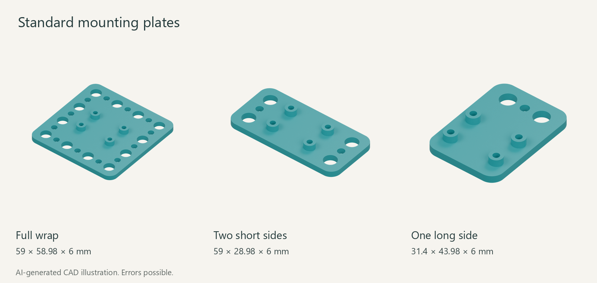
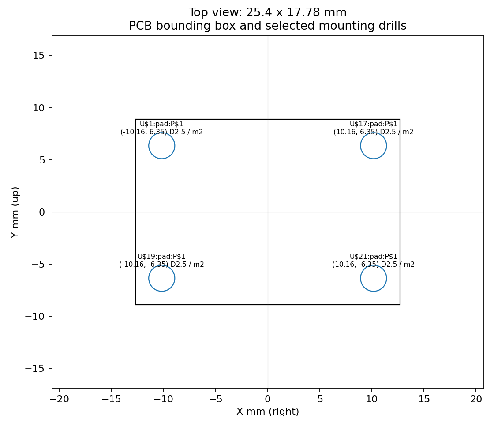

<!-- oobb-presentation:start -->
# Adafruit ADXL345 STEMMA QT

AI-generated images and instructions. Errors possible.

Mounting plates for the listed board. Board not shown.

M6: Ø6.5 mm holes, Ø13 mm head/nut clearance, 15 mm pitch.

## Parts

One board and one plate. Choose a plate variant.

| Part | Type | Specification | Qty | MD5 alpha |
| --- | --- | --- | ---: | --- |
| [Standard — Full wrap](3dpr.stl) | Printed | 59 × 58.98 × 6 mm | 1 | — |
| [Standard — Two short sides](3dpr_short_sides.stl) | Printed | 59 × 28.98 × 6 mm | 1 | — |
| [Standard — One long side](3dpr_long_side.stl) | Printed | 31.4 × 43.98 × 6 mm | 1 | — |
| [Adafruit ADXL345 STEMMA QT](working.yaml) | Hardware | 25.4 × 17.78 mm; adxl345 | 1 | [1ut2v](working.yaml) |

## Installation

1. Download and print the default mounting plate STL.
2. The plate uses 4 board fixing locations, sized for M2 screws. The PCB drill diameters are listed below.
3. Check screw length, screw-head clearance and underside component clearance against the physical board before fastening; physical fit has not been tested.

## Files

[Catalogue record](working.yaml) · [Render sources](presentation/manifest.json) · [Mounting evidence](../../source_file/electronic_breakout_sensor_motion_accelerometer_adxl345_stemma_qt_adafruit_1231/mounting.yaml) · [SCAD](3dpr.scad) · [Hole coordinates](mounting.csv)
<!-- oobb-presentation:end -->

<!-- mounting-review:start -->
## Mounting pattern

25.4 × 17.78 mm PCB bounding box. Coordinates are millimetres, top view, with the origin at the PCB centre, +X right and +Y up.

| Mount | X mm | Y mm | PCB drill mm | Holder screw |
| --- | ---: | ---: | ---: | --- |
| `U$1:pad:P$1` | -10.16 | 6.35 | 2.5 | M2 |
| `U$17:pad:P$1` | 10.16 | 6.35 | 2.5 | M2 |
| `U$19:pad:P$1` | -10.16 | -6.35 | 2.5 | M2 |
| `U$21:pad:P$1` | 10.16 | -6.35 | 2.5 | M2 |

The generic holder has a 3 mm plate and 3 mm board lift. Screw sizes are the holder's design choice, not a manufacturer hardware recommendation.

[Vector drawing](mounting.svg) · [Coordinate CSV](mounting.csv) · [Evidence and revision](../../source_file/electronic_breakout_sensor_motion_accelerometer_adxl345_stemma_qt_adafruit_1231/mounting.yaml) · [Build checks](../../source_file/electronic_breakout_sensor_motion_accelerometer_adxl345_stemma_qt_adafruit_1231/mounting_build.json)
<!-- mounting-review:end -->
