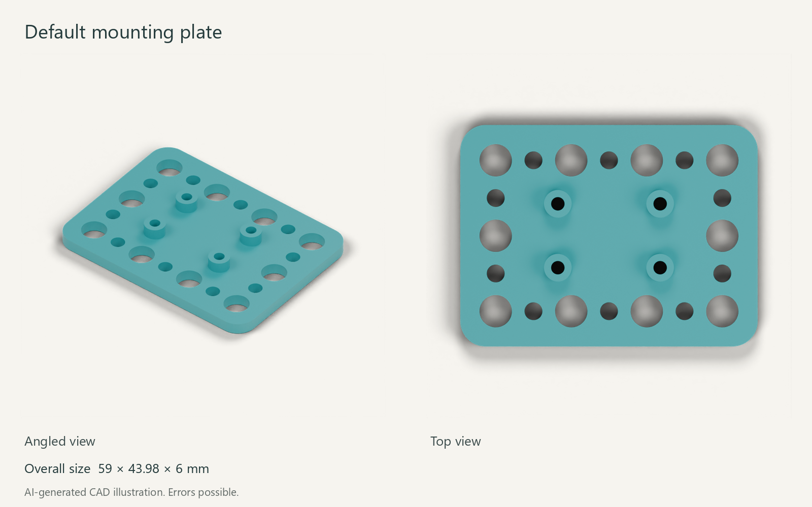
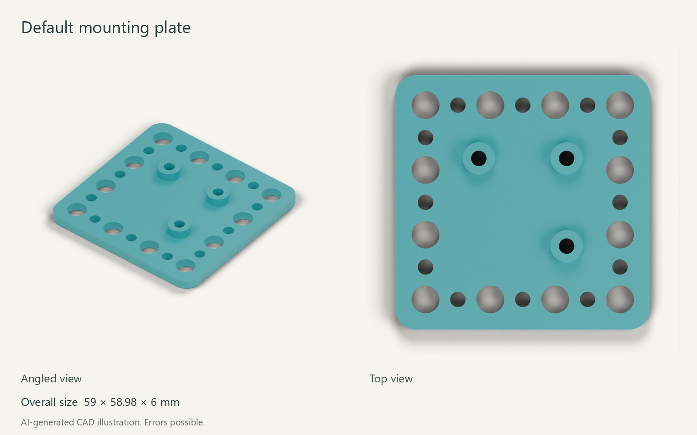

# Review the two mounting pilots

Both boards have completed source validation, populate generation, SCAD/STL export and presentation rendering. Both STLs are single watertight solids. Physical fit remains untested.

## Adafruit ADXL345 STEMMA QT

25.4 × 17.78 mm PCB; 4 mounting holes.

[Open the part page](../../parts/electronic_breakout_sensor_motion_accelerometer_adxl345_stemma_qt_adafruit_1231) · [Download STL](../../parts/electronic_breakout_sensor_motion_accelerometer_adxl345_stemma_qt_adafruit_1231/3dpr.stl) · [Mounting drawing](../../parts/electronic_breakout_sensor_motion_accelerometer_adxl345_stemma_qt_adafruit_1231/mounting.png)

## SparkFun Qwiic BME280

25.4 × 25.4 mm PCB; 3 mounting holes.

[Open the part page](../../parts/electronic_breakout_sensor_environmental_temperature_humidity_pressure_bme280_qwiic_sparkfun_sen_15440) · [Download STL](../../parts/electronic_breakout_sensor_environmental_temperature_humidity_pressure_bme280_qwiic_sparkfun_sen_15440/3dpr.stl) · [Mounting drawing](../../parts/electronic_breakout_sensor_environmental_temperature_humidity_pressure_bme280_qwiic_sparkfun_sen_15440/mounting.png)

## Check before accepting

Confirm the selected carrier revision, mounting pattern and screw choice on each part page. The views show the generated holder without a board or fasteners. A successful mesh check does not establish connector or underside clearance.

[Luna research pilot report](PILOT_REPORT.md) · [Full build manifest](full_build.json) · [Rebuild instructions](../../MOUNTING_RESEARCH.md)
